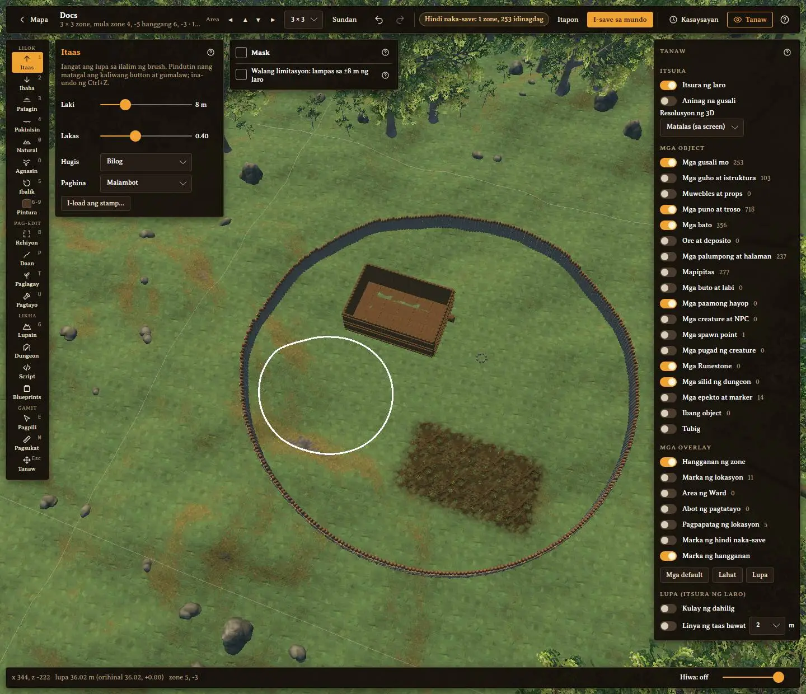
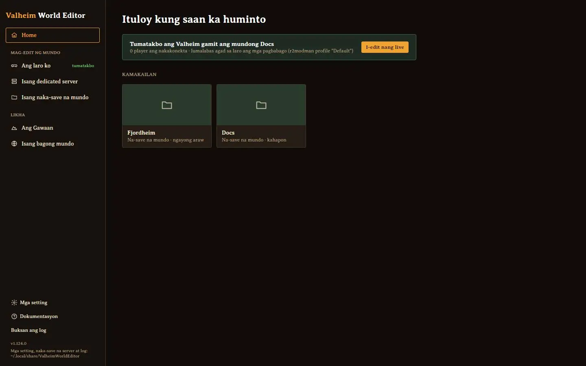
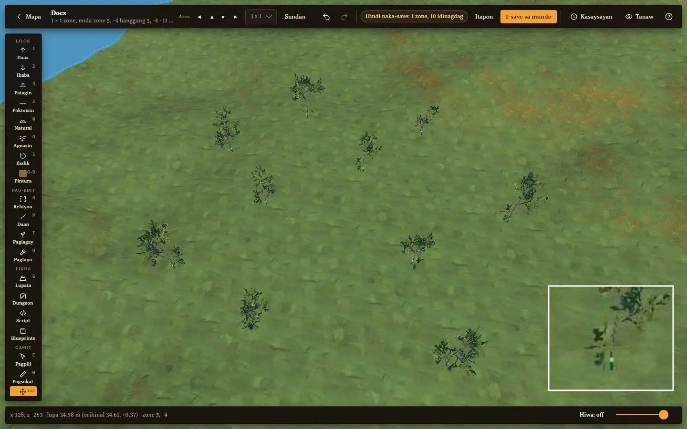
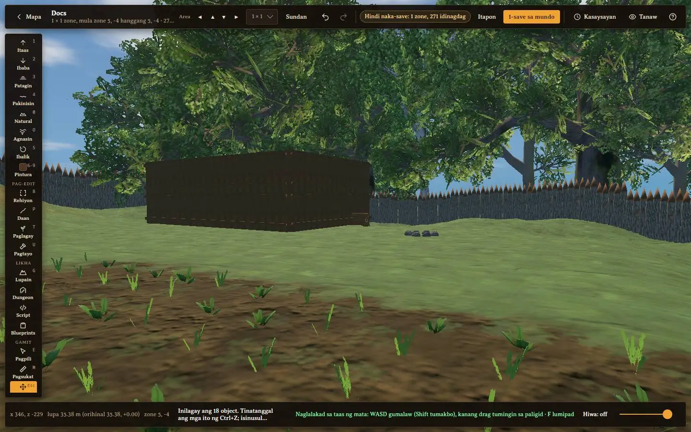
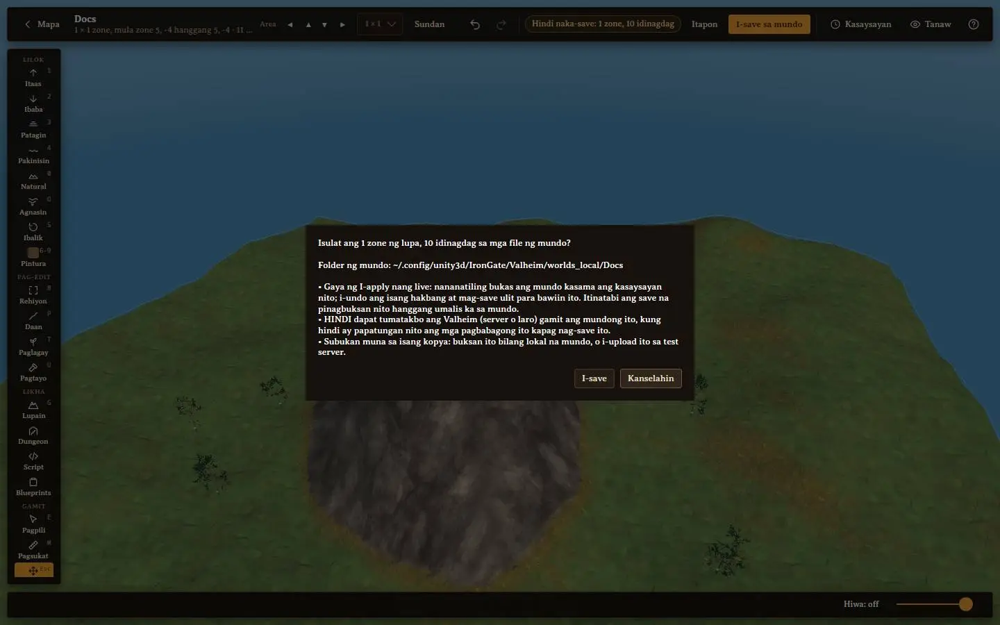
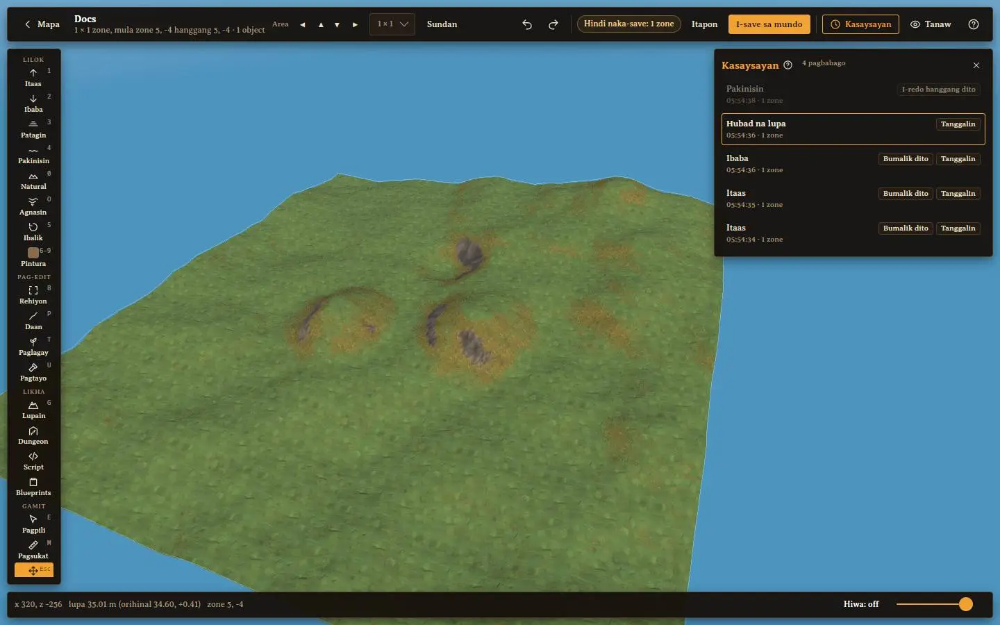
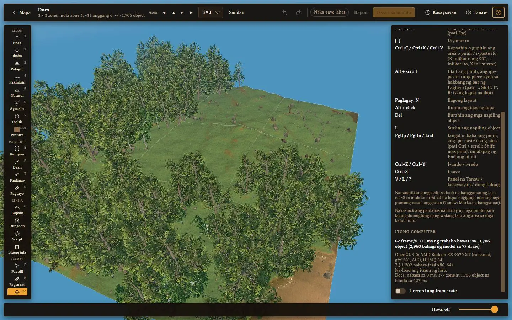
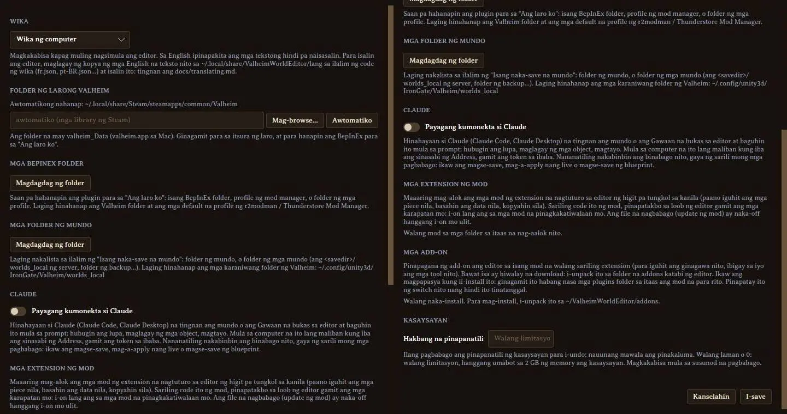

<!-- source: 1d85c1a0 -->
# Ang window ng editor

Alamin ang mga bahagi ng editor: ang panimulang pahina, ang 3D window kasama ang top bar, tool rail at mga panel nito,
ang camera, ang pag-save, ang Kasaysayan at ang panel na Tanaw.

**Saan:** unang bumubukas ang panimulang pahina; bumubukas ang isang mundo sa [mapa](map.md) nito, saka **I-edit sa
3D** · **Key:** `?` o `F3` para sa help card, `F1` para sa help na ito sa tool na ginagamit · **Gumagana sa:** mga
naka-save na mundo, live, ang Gawaan

*Isang maliit na base sa 3 × 3 na area, napili ang brush na Itaas (ang singsing nito sa damo). Kaliwa: ang tool rail at
ang panel ng tool. Itaas: ang top bar. Kanan: ang panel na Tanaw. Ibaba: ang status bar, binabasa ang lupa sa ilalim ng
pointer.*

## Gamitin ito

1. Sa panimulang pahina, pumili kung paano mag-e-edit: **Ang laro ko**, **Isang dedicated server** o **Isang naka-save
   na mundo** (o **Ang Gawaan** para magtayo nang walang mundo).
2. I-click ang mundo mo. Bumubukas ito sa [mapa](map.md) nito.
3. Sa mapa, i-click ang lugar na ie-edit, piliin ang laki ng area, saka **I-edit sa 3D**.
4. Pumili ng tool sa rail, i-set ito sa panel nito, at gamitin ito sa tanaw.
5. Tingnan ang naghihintay sa linya ng nakabinbin sa top bar, saka **I-save sa mundo** (o **I-apply nang live**).
6. Para bawiin ang isang pagbabago, pindutin ang `Ctrl+Z`, o buksan ang **Kasaysayan** (`L`).

Naghihintay bilang [nakabinbin](concepts/saving-and-history.md#mga-nakabinbing-pagbabago) ang bawat pagbabago hanggang i-save o
i-apply mo ito.

## Ang panimulang pahina

*Home: ang card ng tumatakbong laro na may **I-edit nang live**, saka ang mga mundo at blueprint na huling binuksan.*

May **Home** ang side menu, saka dalawang seksiyon, **Mag-edit ng mundo** at **Likha**. Bumabalik ka rito mula sa mapa
ng isang mundo (**Mga mundo**) o mula sa Gawaan (**Simula**).

| Entry | Ano ang ipinapakita |
|---|---|
| **Home** | Kung saan ka huminto. Kapag tumatakbo ang Valheim kasama ang plugin na WorldEditorBridge, may card na nagsasabing "Tumatakbo ang Valheim gamit ang mundong …" at kung ilang player ang nakakonekta, na may **I-edit nang live**. Sa ilalim ng **Kamakailan**: ang mga naka-save na mundo at blueprint na huli mong binuksan o in-save (ang mga blueprint kasama ang mga larawan nila), pinakabago muna, at ang mga naka-save na server na kumokonekta sa isang click (naka-save ang password, o may key file). |
| **Ang laro ko** | Ang sarili mong laro, live: kung ano ang kulang (BepInEx, ang plugin, isang unang pagbukas), o ang mundong gamit nito at **I-edit nang live**. Lumalabas ang *tumatakbo* sa tabi nito habang tumatakbo ang laro; sinusuri ito ng editor bawat ilang segundo. Tingnan ang [live mode](live-mode.md). |
| **Isang dedicated server** | Ang mga naka-save na server (**Kumonekta**, **i-edit**, **kalimutan**) at ang form para kumonekta sa iba. Tingnan ang [live mode](live-mode.md). |
| **Isang naka-save na mundo** | Ang mga mundo sa computer na ito, na binubuksan habang sarado ang laro. Sinusundan ng listahan ang mga folder ng mundo na idinagdag o tinanggal bawat ilang segundo; tumitingin agad ang **I-refresh**. I-hover ang isang mundo para makita ang folder nito. Binubuksan ng **Ibang folder ng mundo** ang anumang folder na may mga file na `_main.<n>.chunks`. Tingnan ang [Magbukas ng mundong wala sa listahan](guides/open-a-world.md). |
| **Ang Gawaan** | **Buksan ang Gawaan**, kung naka-install ang Homestead, at ang bawat blueprint, pinakabago muna: i-click ang isa para buksan ito. Tingnan ang [Gawaan](workshop.md). |
| **Isang bagong mundo** | **Gumawa ng bagong mundo**: ang mundo ng isang seed bago pa ito umiral, at paghahanap ng isang babagay sa iyo. Tingnan ang [bagong mundo](new-world.md). |

Sa ibaba ng menu: **Mga setting** (tingnan ang [Mga setting](#mga-setting)), **Dokumentasyon** (ang help na ito, sa
sariling window), **Buksan ang log**, ang bersiyon, at ang folder na naglalaman ng mga setting at log ng editor.

## Ang window

May limang bahagi ang 3D window:

- **Top bar**: ang pangalan at area ng mundo, ang mga kontrol ng area, undo at redo, ang nakabinbin, **Itapon**,
  **I-save sa mundo** o **I-apply nang live**, saka **Kasaysayan**, **Tanaw** at **?**. Tingnan ang
  [Ang top bar](#ang-top-bar).
- **Tool rail** (kaliwang gilid): bawat tool, may key nito sa sulok. Tingnan ang [Ang tool rail](#ang-tool-rail).
- **Panel ng tool** (katabi ng rail): ang pangalan ng napiling tool, isang linya kung paano ito gamitin, at ang mga
  setting nito. Nagpapakita ang [Mask](masks.md) ng sariling card sa tabi nito para sa mga tool na gumagana kasama nito
  (ang mga brush, Daan, Rehiyon, Lupain at Paglagay). Nasa parehong card ang **Walang limitasyon**, ang isa pang
  pinagsasaluhang switch ng mga tool sa lupa (tingnan ang [Walang limitasyon](terrain.md#walang-limitasyon)).
- **Panel sa kanan**: **Tanaw** (`V`), **Kasaysayan** (`L`), ang help card na **Mga kontrol** (`?` o `F3`) o ang
  [Inspector](select.md) (`I`). Iisang puwesto ang pinagsasaluhan nila, kaya isa lang ang lumalabas sa bawat
  pagkakataon; isinasara ito ng parehong key o button.
- **Status bar** (ibaba): kung nasaan ang mouse, ang huling mensahe, ang pinili, Lakad o Lipad, ang slider na **Hiwa**
  (tingnan ang [Hiwa](#hiwa)) at, sa window na mga 1500 px ang lapad o higit pa, paalala tungkol sa mouse ("Kanang drag:
  iikot · Scroll: zoom · Gitnang drag: igalaw · ? tulong"); sa mas makitid na window, napupunta ang puwesto nito sa
  mensahe.

Ganito ang basa ng mouse: `x 1250, z -380   ground 32.40 m (original 30.10, +2.30)   zone 20, -6`: ang posisyon sa
metro, ang taas ng lupa ngayon, ang taas nito bago ang anumang pagbabago at ang diperensiya, at ang zone. Sa hangganan
ng laro, idinadagdag nito ang ", nasa hangganang ±8 m". Ganito ang basa ng pinili: "Napili: 15 object (Beech ×12,
Rock ×3)", kasama ang apat na pinakakaraniwang uri.

Ipinapaliwanag ng bawat slider, switch at button ang sarili nito kapag in-hover mo ito. Tinatandaan ng editor ang mga
pinili mo sa pagitan ng mga pagbukas: ang ipinapakita ng Tanaw, ang mga opsiyon ng itsura, ang hugis at paghina ng
brush, ang aksiyon ng Rehiyon, ang uri ng Lupain, ang preset ng Pormula nito at ang sarili mong pormula, ang mga opsiyon
ng Pagpili, kung aling mga kategorya ng Paglagay ang bukas, ang mga setting ng bar ng Pagtayo at ang laki ng dock ng
Pagtayo, ang panel sa kanan na iniwan mong bukas, **Sundan**, **Auto**, ang puwesto ng mapa at ang clipboard. Hindi
kasama ang **Walang limitasyon**: naka-off ito tuwing nagbubukas ang editor.

## Ang top bar

| Kontrol | Ano ang ginagawa |
|---|---|
| **Mapa** | Balik sa mapa ng mundo. Nananatiling nakabinbin ang hindi na-save o na-apply. Sa Gawaan, ito ang **Simula**. |
| Pangalan at area | Ang pangalan ng mundo; sa ilalim nito ang laki ng area, ang una at huling zone nito at kung ilang object ang hawak nito. |
| **Area** ◀ ▲ ▼ ▶, listahan ng laki, **Sundan** | Ilipat ang area, baguhin ang laki nito, hayaan itong lumaki habang tumitingin ka sa paligid. Tingnan ang [Ang area](#ang-area). |
| Undo, redo (ang mga kurbadong arrow) | I-undo ang huling pagbabago (`Ctrl+Z`); i-redo ito (`Ctrl+Y` o `Ctrl+Shift+Z`). Pinapangalanan ng hover text nila ang hakbang, hal. "I-undo ang Itaas (Ctrl+Z)". Maaaring magtanong muna ang isang hakbang mula sa naunang session. |
| **LIVE** (live) | Ipinapakitang nakakonekta ka sa tumatakbong laro sa pamamagitan ng plugin na WorldEditorBridge. |
| Listahan ng player, **Pumunta** (live) | Sa tabi ng **LIVE**, habang may nakakonektang player: pumili ng nakakonektang player, saka **Pumunta**. Humaharap ang camera sa player kapag nasa area siya; kung hindi, lumilipat ang area sa kaniya. Lumalabas ang mga player sa tanaw bilang mga asul na poste na may pangalan nila. |
| **I-reload** (live) | Nilo-load muli ang mundo mula sa laro, matapos magtanong kapag may mga pagbabagong hindi pa na-apply (nawawala ang mga ito, kasama ang mga hakbang nila). Nananatili sa Kasaysayan ang mga hakbang na hawak ng laro. Nananatili ka kung nasaan ka. |
| **Auto** (live) | Ina-apply ang bawat pagbabago sa laro sa sandaling matapos ito: bawat stroke pagbitaw mo, bawat tool, undo at redo. Kapag in-on ito, ipinapadala agad ang naghihintay. Tinatandaan. |
| Linya ng nakabinbin | "Hindi naka-save: 3 na zone, 1 binura, 12 idinagdag, 1 ire-reset" (offline) o "Hindi na-apply: …" (live), kulay amber; "Naka-save lahat" o "Na-apply lahat" na kulay abo kapag walang naghihintay. Kung ano ang binibilang nito: tingnan ang [Mga nakabinbing pagbabago](concepts/saving-and-history.md#mga-nakabinbing-pagbabago). |
| **Itapon** | Itinatapon ang hindi pa na-save o na-apply, matapos magtanong. Tingnan ang [Itapon](#itapon). |
| **I-save sa mundo** (offline) | Isinusulat ang mga pagbabago sa mga file ng mundo (`Ctrl+S`). Tingnan ang [I-save sa mundo](#i-save-sa-mundo). |
| **I-apply nang live** (live) | Ipinapadala ang mga pagbabago sa tumatakbong laro (`Ctrl+S`): nakikita agad ito ng lahat ng naroon. Tingnan ang [I-apply nang live](#i-apply-nang-live). |
| **Kasaysayan** | Bawat pagbabago ng session (`L`). Tingnan ang [Kasaysayan](#kasaysayan). |
| **Tanaw** | Kung ano ang ipinapakita at paano (`V`). Tingnan ang [Panel na Tanaw](#panel-na-tanaw). |
| **?** | Ang help card na **Mga kontrol** (`?` o `F3`). Tingnan ang [Ang help card](#ang-help-card). May sariling maliit na **?** ang bawat panel sa itaas: ang Help window sa pahina ng tool na iyon (ganoon din ang ginagawa ng `F1` para sa tool na ginagamit). |

Sa makitid na window, nagtatapos sa "…" ang linya ng pangalan at area (i-hover ito para mabasa nang buo), at kapag
kulang pa rin iyon, mga icon na lang ang ipinapakita ng **Mapa**, **I-reload**, **Kasaysayan** at **Tanaw**.

Sa tanaw, may **berdeng tuldok** ang bawat bagong object na hindi pa na-save o na-apply, maliban habang napili ito
(ang balangkas nito ang nagmamarka rito noon). Itinatago ng **Tanaw → Marka ng hindi naka-save** ang mga tuldok;
nananatili ang mga object.

*Mga batang punong katatanim lang: may maliit na berdeng tuldok ang bawat isa sa paanan nito hanggang ma-save ito (isa
ang pinalaki sa sulok), at binibilang sila ng linya ng nakabinbin: "Hindi naka-save: 1 zone, 10 idinagdag".*

## Ang tool rail

| Seksiyon | Button sa rail (key) | Ano ang binubuksan |
|---|---|---|
| **LILOK** | **Itaas** (`1`), **Ibaba** (`2`), **Patagin** (`3`), **Pakinisin** (`4`), **Natural** (`0`), **Agnasin** (`O`), **Ibalik** (`5`), **Pintura** (`6` hanggang `9`) | Ang mga brush sa lupa. Iisang brush ang **Pintura** para sa apat na pintura, pinipili sa panel nito o gamit ang key: Hubad na lupa (`6`), Bungkalin (`7`), Sementado (`8`), Alisin pintura (`9`). Tingnan ang [Lilok at pintura](terrain.md). |
| **PAG-EDIT** | **Rehiyon** (`B`), **Daan** (`P`), **Paglagay** (`T`), **Pagtayo** (`U`) | [Rehiyon](area.md) (mga aksiyon sa kahon o polygon, kopya at paste), [Daan](path.md) (mga kalsada, rampa, ilog), [Paglagay](place.md) (mga puno, bato, pananim, spawn point), [Pagtayo](build.md) (ang mga piece na itinatayo ng player, kasama ang dock ng Pagtayo at ang bar ng Pagtayo). |
| **LIKHA** | **Lupain** (`G`), **Dungeon**, **Script**, **Blueprints** | [Lupain](landform.md) (isang buong anyong-lupa sa isang click: hugis ng pormula, bundok o larawan), [Mga dungeon](dungeons.md), [Script](scripting.md), at ang aklatan ng blueprint para mag-paste ng isa (tingnan ang [Gawaan](workshop.md)). Ang Lupain lang ang may key. |
| **GAMIT** | **Pagpili** (`E`), **Pagsukat** (`M`), **Tanaw** (`Esc` o `H`) | [Pagpili](select.md), [Pagsukat](measure.md), at Tanaw: tumingin sa paligid; iginagalaw ng kaliwang drag ang tanaw, pumipili ng object ang click, at lumilipat sa Pagpili na napili ito ang double-click sa isa. |
| **MODS** | Isang button bawat tool na dala ng [extension](modding.md) ng isang mod: ang pangalan nito, ang larawan nito o unang titik; pinapangalanan ang mod kapag in-hover | Ang tool ng mod: ang card ng mga setting nito sa tabi ng rail, ang help nito sa tooltip. Pumapasok sa Kasaysayan ang mga pagbabago nito at ina-undo, nire-redo at sine-save gaya ng sa editor. Ipinapakita lang kapag may tool ang isang tumatakbong extension. |

Nag-i-scroll ang rail kapag masyadong maikli ang window para dito (at nagtatapos ito sa itaas ng dock ng Pagtayo habang
bukas ito). Sa Gawaan, **Pagtayo** (`U` o `T`), **Pagpili** at **Tanaw** lang ang natitira.

## Camera

| Aksiyon | Paano |
|---|---|
| Iikot ang tanaw | Kanang drag. |
| Zoom | Mouse wheel, mula 3 m hanggang 3 km mula sa puntong tinitingnan mo. |
| Igalaw ang tanaw | Gitnang drag, `Space` + kaliwang drag o `Shift` + kanang drag (sa anumang tool), o kaliwang drag gamit ang tool na **Tanaw**. |
| Gumalaw sa paligid | `W` `A` `S` `D` o ang mga arrow key. Habang mas malayo ang zoom, mas mabilis. Nananatili sa lupa (o sa tubig) ang puntong tinitingnan mo. |
| Tingnan ito bilang player | `F`: Lakad, saka Lipad, saka balik sa karaniwang tanaw. |

### Lakad at Lipad

*Mode na Lakad (`F`): ang base gaya ng nakikita ng player na nakatayo sa tabi ng bukid, ang mata ay 1.8 m sa itaas ng
lupa.*

Umiikot ang `F` sa tatlong tanaw:

1. **Lakad**: 1.8 m sa itaas ng lupa ang mata mo (o sa itaas ng tubig kung saan mas malalim ito). Nagsisimula ka kung
   saan nakatingin ang karaniwang tanaw. Gumagalaw ang `W` `A` `S` `D` papunta sa tinitingnan mo nang 6 m/s; tumatakbo
   ang `Shift` nang 12 m/s. Tumitingin sa paligid ang kanang drag. Sumusunod ka sa lupa habang tumataas at bumababa
   ito, kasama ang na-edit na lupa.
2. **Lipad**: `F` ulit. Pataas ang `Space`, pababa ang `C`, nang 15 m/s (`Shift`: 45 m/s). Dinadala ka rin ng `C`
   tagos sa lupa, papasok sa hinuhukay ng isang mod sa ilalim nito (mga tunnel at cellar ng Tunnelheim); ibinabalik ka
   ng `Space` pataas.
3. **Ang karaniwang tanaw**: `F` sa ikatlong beses. Umiikot ang tanaw sa isang punto sa lupa na 20 m sa harap ng
   kinaroroonan mo.

Sinasabi ng status bar kung aling mode ang naka-on at ang mga key nito. Habang naglalakad o lumilipad, hindi nag-zoom
ang wheel at hindi iginagalaw ng mga drag ang tanaw; gumagana pa rin ang bawat tool. Sa isang dungeon (5000 m pataas,
kung saan iniingatan ng laro ang mga silid ng dungeon), hindi sumusunod sa lupa ang camera.

## Ang area

Isang **area** ang ipinapakita ng 3D window: isang bloke ng mga zone (64 × 64 m ang isang zone) sa paligid ng lugar na
binuksan mo mula sa mapa. Naka-lock ang panlabas na linya ng mga punto ng lupa nito, kaya para magtrabaho malapit sa
gilid, ilipat ang area o palakihin ito. Kung bakit ganito gumagana ang editor: tingnan ang
[Mga area at zone](concepts/areas-and-zones.md).

| Kontrol | Ano ang ginagawa |
|---|---|
| **◀ ▲ ▼ ▶** (pagkatapos ng "Area") | Inililipat ang area nang isang zone (64 m) pakanluran, pahilaga, patimog o pasilangan. Nananatili ang camera kung nasaan ito sa mundo, at sumasama ang mga nakabinbing pagbabago at ang Kasaysayan. |
| Listahan ng laki | Binubuksan muli ang area sa paligid ng parehong gitnang zone sa **3 × 3**, **5 × 5**, **7 × 7**, **9 × 9**, **13 × 13** o **17 × 17** na zone. Nananatili ang tanaw, ang mga pagbabago at ang Kasaysayan. Ipinapakita ng area na pinalaki ng Sundan (gaya ng 4 × 3) ang sarili nitong laki. Mabagal buksan at iguhit ang malalaking area (hanggang 1088 m ang lapad). |
| **Sundan** | Kapag umabot ang puntong tinitingnan mo sa loob ng 12 m mula sa gilid ng area, nadadagdagan ang area ng isang hanay ng mga zone sa panig na iyon, at pinapanatili ang mga zone na mayroon ito, hanggang 17 zone sa bawat direksiyon. I-click para i-on o i-off ito; tinatandaan. Tingnan ang [Sundan](concepts/areas-and-zones.md#sundan). |

Naghihintay ang mga arrow, ang Sundan at ang listahan ng laki habang may mawawala, at sinasabi ng status bar kung
bakit: may napiling mga object (inaalis sila ng `Alt+A` sa Pagpili), may nagaganap na stroke ng brush, may nakaguhit na
daan (i-apply o alisin ito), o ipinapadala pa ang mga pagbabago sa laro. Hindi sila naghihintay para sa kahon o polygon
ng Rehiyon, sa linya, grid o zone ng Paglagay, o sa isang sukat: nawawala ang mga iyon kapag lumipat, lumaki o nagbago
ng laki ang area. Wala sa Gawaan ang mga kontrol ng area.

## I-save, i-apply at itapon

### I-save sa mundo

Nagtatanong muna ang **I-save sa mundo** (`Ctrl+S`), sa **Pag-save sa mundo**, at ipinapakita ang isusulat at ang folder
ng mundo. Isara ang Valheim (ang laro o ang server) bago ka mag-save: sinusulatan ng tumatakbong laro ang mga pagbabago
mo sa susunod na pag-save nito.

*Walang isinusulat hangga't hindi mo kini-click ang **I-save**: binibilang ng tanong ang papasok, pinapangalanan ang
**Folder ng mundo** at pinapaalalahanan kang isara muna ang Valheim.*

Sinasabi ng resulta kung ano ang na-save ("Na-save ang lupa ng 4 zone, 2 binurang object, 12 bagong object sa save
#37.") at inililista ang hindi na-save, kasama ang dahilan:

- isang zone, o bagong object sa isang zone, na **not generated yet** (hindi pa nabubuo): wala pang player na nakapunta
  roon, kaya walang data ang mundo roon. Puntahan muna ito sa laro.
- bagong lupa sa mundong **no terrain object to copy yet** (wala pang terrain object na makokopya): wala pang naghukay
  o nagpatag ng lupa sa laro.
  I-edit muna ang lupa nang isang beses kahit saan sa laro.

Pagkatapos mag-save, nananatili ang area at ang Kasaysayan gaya ng dati. Para bawiin ang isang na-save na pagbabago,
i-undo ito (o **Tanggalin** ito sa Kasaysayan) at mag-save ulit: inaalis ito ng pag-save sa mundo. Kapag wala nang
natitira sa na-save mo, sinasabi ng mensahe na gaya ulit ng noong binuksan mo ito ang mundo. Kung paano isinusulat at
sinusuri ang isang save: tingnan ang [Pag-save ng mundo](concepts/saving-and-history.md#pag-save-ng-mundo).

**Kapag nag-save ang laro mula noon.** Kung na-save ng laro ang mundo matapos itong basahin ng editor, walang
sine-save: matatapon ng pag-save ang mga ginawa sa laro. Iniaalok ng tanong na **Na-save ng laro ang mundong ito** ang
**Dalhin ang mga pagbabago ko**: binabasa ng editor ang save ng laro at ginagawa ulit doon ang bawat hindi naka-save na
pagbabago mo. Kung saan binago ng laro ang parehong zone o object, nagtatanong ito nang isang beses bawat uri,
**Panatilihin ang akin** o **Panatilihin ang sa laro**. Walang isinusulat hanggang mag-save ka ulit. Iniiwan ng
**Hindi ngayon** ang lahat gaya ng dati. Tingnan ang [Pag-save ng mundo](concepts/saving-and-history.md#pag-save-ng-mundo).

### I-apply nang live

Sa live mode, **I-apply nang live** ang parehong button. Ipinapadala nito ang lupa, ang mga pagbabago sa object at ang
mga pag-reset ng zone sa tumatakbong laro, at minamarkahang **na-apply** sa Kasaysayan ang mga ipinadalang hakbang.
Maaari pa rin silang i-undo: ipinapadala ng susunod na pag-apply ang undo. Kapag binago ng mga player ang lupa ng isang
zone na binago mo rin, nagtatanong muna ito (**I-apply** o **Hindi ngayon**). Tingnan ang
[Pag-apply nang live](concepts/saving-and-history.md#pag-apply-nang-live) at ang [live mode](live-mode.md).

### Itapon

Ina-undo ng **Itapon** ang lahat ng hindi pa na-save o na-apply, matapos magtanong ("Ia-undo ang huling N hakbang sa
Kasaysayan"). Ina-undo nito ang mga hindi naka-save na hakbang sa dulo ng Kasaysayan, pinakabago muna, nire-redo ang
mga na-save o na-apply na hakbang na in-undo mo mula noon, at inaalis ang natitira sa listahan ng redo. Nananatili ang
mga na-save at na-apply na pagbabago, pati ang natitirang Kasaysayan, ang camera at ang tool.

Maaaring walang hakbang sa Kasaysayan ng area na ito ang ilang nakabinbing pagbabago (ginawa sa ibang area, o bago
binasa muli ang mundo). Kung gayon, nagtatanong ulit ang Itapon: binabasa ng **Basahin muli** ang mundo mula sa mga file
nito (o mula sa laro, live) at inaalis ang bawat nakabinbing pagbabago ng buong mundo. Pinapanatili ng Kasaysayan ang
hawak ng mundo: ang kasaysayang itinabi sa huling pag-save, o, live, ang bawat hakbang na hawak ng laro.

### Pag-alis at pagsasara

Pinapanatili ng **Mapa**, ng mga arrow at ng listahan ng laki ang lahat ng nakabinbin. Nawawala ang nakabinbin kapag
umalis ka sa mundo papunta sa panimulang pahina (**Mga mundo** sa mapa) at kapag isinara mo ang window, kaya
nagtatanong muna ang dalawa: **Umalis pa rin** / **Manatili**, at **Isara pa rin** / **Magpatuloy sa pag-edit**.

## Kasaysayan

*Na-undo ang huling pagbabago gamit ang **Bumalik dito**: kulay abo ito at iniaalok ang **I-redo hanggang dito**.*

Inililista ng **Kasaysayan** (`L`) ang bawat pagbabago ng session, pinakabago muna. Ipinapakita ng bawat row ang
pangalan ng hakbang (ang tool o aksiyon, hal. "Itaas", "Pag-paste ×3", "Tinanggal: Itaas"), ang oras (kasama ang araw
para sa mas luma) at ang ginalaw nito, hal. "3 na zone · 12 bago · 2 inalis · 1 pag-reset ng zone". Nakabalangkas ang
kasalukuyang hakbang, ang susunod na ia-undo ng `Ctrl+Z`. Binibilang ng heading ang mga hakbang na maaari mong i-undo.
Ipinapakita ng panel ang 200 pinakabagong row; nagdadagdag ng 200 pa ang **Ipakita ang mas luma (N)** sa ibaba.

| Kontrol | Ano ang ginagawa |
|---|---|
| **Bumalik dito** | Ina-undo ang bawat pagbabagong ginawa pagkatapos nito. Nananatili sa listahan ang mga sumunod na pagbabago, kulay abo. |
| **I-redo hanggang dito** | Sa pagbabagong kulay abo: nire-redo ang bawat pagbabago hanggang dito, kasama ito. |
| **Tanggalin** | Tinatanggal lang ang pagbabagong ito at pinapanatili ang lahat ng ginawa pagkatapos nito. Bagong hakbang ang pagtanggal ("Tinanggal: …"), kaya ibinabalik ng `Ctrl+Z` ang pagbabago. May guhit sa gitna ang tinanggal na pagbabago. |
| **Bawiin ang mga pagbabago ni Claude** | Lumalabas kapag may ginawang pagbabago si Claude sa kasaysayan ng area na ito. Tinatanggal ang bawat isa sa mga ito, gaya ng ginagawa ng **Tanggalin**, at pinapanatili ang sa iyo, pati ang mga ginawa pagkatapos ng mga iyon. Nananatili ang mga pagbabago ni Claude na ginawa sa ibang area, at sinasabi ng status bar kung ilan: buksan ang mga area na iyon para bawiin sila roon. |

Mga tag sa isang row: **na-apply** (ipinadala sa laro, o na-save), **Claude** (ginawa sa pamamagitan ng
[koneksiyon kay Claude](claude.md)), **naunang session** (itinabi mula sa naunang pagbukas ng editor). Inaalis ng bagong
pagbabagong ginawa pagkatapos ng isang undo ang mga hakbang na kulay abo. Kung kailan isinusulat sa disk ang
Kasaysayan, gaano kalayo ito umaabot pabalik, at ano ang nangyayari sa mga hakbang na ginawa sa ibang area: tingnan ang
[Kasaysayan](concepts/saving-and-history.md#kasaysayan).

## Panel na Tanaw

Pinipili ng **Tanaw** (`V`) kung ano ang iginuguhit at paano. Ipinapakita ng bawat switch kung ilan ang nasa area. Ang
ipinapakita lang ang mapipili, kaya ang pagtatago ng isang uri ay nag-iingat din dito mula sa click.

| Seksiyon | Kontrol | Ano ang ginagawa |
|---|---|---|
| ITSURA | **Itsura ng laro** | Iginuguhit ang mundo gamit ang sariling texture, model, tubig at langit ng laro. Naka-off: payak na kulay at kahon, mas mabilis. |
| | **Aninag na gusali** | Iginuguhit nang kalahating aninag ang mga gusali ng player, para makita ang nasa loob o likod nila. Nananatiling solido ang mga puno at bato. |
| | **Resolusyon ng 3D** | **Matalas (sa screen)**, **Balanse** (isang pixel bawat punto ng screen: mas kaunti sa naka-scale na screen na mataas ang resolusyon) o **Mabilis** (mas kaunti pa). Mas maraming frame bawat segundo ang naibibigay ng mas kaunting pixel sa mabagal na computer; sinasabi ng status bar ang laki. |
| MGA OBJECT | **Mga gusali mo**, **Mga guho at istruktura**, **Muwebles at props**, **Mga puno at troso**, **Mga bato**, **Ore at deposito**, **Mga palumpong at halaman**, **Mapipitas**, **Mga buto at labi**, **Mga paamong hayop**, **Mga creature at NPC**, **Mga spawn point**, **Mga pugad ng creature**, **Mga Runestone**, **Mga silid ng dungeon**, **Mga epekto at marker**, **Ibang object** | Ipakita o itago ang bawat uri. **Mga gusali mo**, **Mga puno at troso**, **Mga bato**, **Mga paamong hayop**, **Mga Runestone** at **Mga silid ng dungeon** lang ang naka-on sa simula, para hindi masira ng editor ang mga bagay na hindi pa natutuklasan. |
| | **Tubig** | Ang ibabaw ng dagat at lawa. |
| MGA OVERLAY | **Hangganan ng zone** | Ang mga linya ng zone na 64 m (naka-on sa simula). |
| | **Marka ng lokasyon** | Isang poste sa bawat lokasyon (mga nayon, ang trader, mga pasukan ng dungeon…). |
| | **Area ng Ward** | Mga singsing kung saan nagpoprotekta ang bawat Ward (32 m). |
| | **Abot ng pagtatayo** | Mga singsing kung saan ka pinapayagang magtayo ng bawat Workbench, Forge o iba pang crafting station (10–40 m, depende sa uri). |
| | **Pagpapatag ng lokasyon** | Kung saan pinapatag ng mga lokasyon ang lupa: isang singsing para sa patag na bahagi, isang mas malabo kung saan ito humahalo. |
| | **Marka ng hindi naka-save** | Ang berdeng tuldok sa ibabaw ng bawat bagong object na hindi pa na-save o na-apply. |
| | **Marka ng hangganan** | Pula sa lupang umabot sa hangganang ±8 m ng laro (sa Itsura ng laro). Tingnan ang [Marka ng hangganan](concepts/ground-limits.md#marka-ng-hangganan). |
| | **Mga default** / **Lahat** / **Lupa** | Ang karaniwang mga switch / naka-on lahat / ang lupa lang. Itinatakda nila ang mga object, ang tubig at ang mga overlay, hindi ang itsura. |
| LUPA (itsura ng laro) | **Kulay ng dahilig**, **Linya ng taas bawat** 1 / 2 / 5 / 10 **m** | Mga overlay sa lupa, tingnan ang [Pagsukat](measure.md). |

Dalawang bagay tungkol sa tanaw ang wala sa panel na ito, dahil kailangan sila kung saan wala ang panel: nasa status
bar ang slider na **Hiwa** (tingnan ang [Hiwa](#hiwa)), at nasa top bar, sa tabi ng **LIVE**, ang pagpunta sa
nakakonektang player.

Ano ang hawak ng mga uri:

- Ipinapakita rin ng **Mga guho at istruktura** ang mga bahagi ng mga lokasyon ng laro na hindi object ng save (ang mga
  bato sa pasukan ng crypt, ang kampo ng trader, ang altar ng isang boss). Ginagawa ulit sila ng laro tuwing nilo-load
  ang zone, kaya hindi sila mapipili o mababago.
- Binibilang na gusali mo ang isang guhong pinagtayuan mo: nasa ilalim ng **Mga gusali mo** ang mga piece nito na
  dumidikit sa iyo, at ang mga dumidikit sa mga iyon.
- Ang **Mga paamong hayop** ay ang mga creature na pinaamo ng mga player; nasa ilalim ng **Mga creature at NPC** ang
  mga ligaw.
- Ang **Mga spawn point** ay ang mga di-nakikitang spawn point ng laro, ipinapakita na may marker at pangalan ng
  creature. Ang **Mga pugad ng creature** ay mga pugad ng greydwarf, tambak ng buto at mga katulad nito.
- Mataas sa itaas ng mga pasukan nila ang **Mga silid ng dungeon** (5000 m pataas). I-edit sila gamit ang tool na
  [Dungeon](dungeons.md).
- Iginuguhit kasama ng stand ang hawak ng mga item stand at armour stand, sa Itsura ng laro, at ipinapakita o itinatago
  kasama ng uri nito. Lumalabas ang mga shield at cape sa una nilang estilo, ang armour stand sa nakapahingang tindig
  nito. Hindi mapipili ang mga item: piliin ang stand.
- Ang paglagay o pag-paste ng uring naka-off ay nag-o-on dito, para manatiling nakikita ang inilagay mo (sinasabi iyon
  ng mensahe).

Ang **Itinayo ni**, ang player na isinusulat bilang nagtayo ng mga piece na itinatayo, ipine-paste o pinapalitan mo, ay
nasa [bar ng Pagtayo](build.md#ang-bar-ng-pagtayo), kasama ng Pagtayo, Pagpili at Paste.

Kapag may hawak na mga lokasyon ang isang area (o may ilan sa loob ng 40 m), may tala sa ibaba ng tanaw, sa tabi ng
panel ng tool, na nagsasabi kung ilan, at na kasama na sa lupa ang pagpapatag na ginagawa ng laro sa paligid nila.
Isara ito gamit ang × nito. Tingnan ang
[Pinapatag ng mga lokasyon ang lupa](concepts/ground-limits.md#pinapatag-ng-mga-lokasyon-ang-lupa).

## Hiwa

Itinatago ng slider na **Hiwa** sa status bar ang lahat ng nasa itaas ng isang taas, at tumatagos ang cursor sa
nakatago: silipin ang loob ng gusali mula sa itaas, piliin ang nasa loob nito, o magtayo roon. Iisang kontrol ito para
sa bawat 3D na tanaw; ang pinagbibilangan lang ng mga metro nito ang nagbabago.

| Saan | Binibilang ang mga metro mula sa | Saklaw |
|---|---|---|
| Isang mundo | Ang lupa (o ang dagat) sa gitna ng tanaw; kapag naglalakad o lumilipad, ang lupa sa ilalim ng camera. Sumusunod ang hiwa sa tanaw habang gumagalaw ito. | 0 hanggang 39 m |
| Ang [Gawaan](workshop.md#hiwa) | Ang plot. | 0 hanggang 39 m |
| Isang dungeon, gamit ang tool na [Dungeon](dungeons.md) o **Itayo rito** | Halos sa sahig ng pasukan ng dungeon. | 0 hanggang 29 m |

Gumagalaw nang 1 m bawat hakbang ang slider. Humihiwa sa lupa, sa plot o sa sahig ang kaliwang dulo nito; naka-off ang
kanang dulo nito. Sa tabi nito, nakasulat sa bar ang "Hiwa sa N m" o "Hiwa: off". Naka-off ito tuwing nagbubukas ang
editor.

- **Mga object lang.** Itinatago ng hiwa ang nakatayo sa itaas ng taas (mga gusali, puno, bato, silid ng dungeon).
  Iginuguhit nang buo ang lupa at ang tubig.
- **Sa isang mundo, gumagalaw ang hiwa kasama ng tanaw.** Sa dahilig, iikot ang tanaw sa paligid ng gusali sa halip na
  igalaw ito: binibilang ang taas mula sa lupa sa gitna ng tanaw.
- **May kaniya-kaniyang hiwa ang mundo at ang dungeon.** Kinukuha ng pagpili sa tool na Dungeon ang hiwa ng dungeon
  (naka-off sa simula; humihiwa sa 4 m ang **Pumunta sa dungeon**), at ibinabalik ng pag-alis dito ang sa mundo. Walang
  hiwa ang Gawaan sa simula.
- **Ibang paraan para makita ang loob**: **Tanaw → Aninag na gusali**, at ang **Itago** at **Pumili nang tagos** ng
  tool na [Pagpili](select.md).

## Ang help card

*Ang card na **Mga kontrol** (`F3`), naka-scroll hanggang dulo: ang mga huling key, saka **Itong computer** kasama ang
frame rate, ang graphics card at **I-record ang frame rate**.*

Binubuksan ng **?**, `?` o `F3` ang card na **Mga kontrol**: ang pangunahing aksiyon ng mouse at mga key, may paalala
tungkol sa hangganang ±8 m at sa naka-lock na gilid. Nasa [Mga shortcut](help/shortcuts.md) ang bawat key.

Sa ibaba nila, sinasabi ng **Itong computer** kung ano ang gumuguhit ng 3D na tanaw (ang graphics card at ang bersiyon
ng OpenGL nito) at kung paano nag-load ang area at, habang gumagalaw ang tanaw, ang frame rate kasama ang sariling
trabaho ng editor bawat frame at kung ilang object, bahagi ng model at draw ang naroon. Iginuguhit nang buong bilis ang
tanaw habang may nangyayari lang; kung hindi, ilang beses lang bawat segundo.

Isinusulat ng **I-record ang frame rate** (naka-off tuwing binubuksan ang editor) ang frame rate sa `perf-native.log` sa
data folder ng editor, isang linya bawat 0.2 s habang ginagamit ang tanaw: kung gumagalaw (**moving**) ang camera o
nakatigil (**still**) habang may ibang nangyayari, ang frame bawat segundo, ang trabaho ng editor bawat frame at ang
pinakamahabang puwang sa pagitan ng dalawang frame. Ibinibigay ng linya ng header (`#`) ang petsa, ang bersiyon, ang
laki ng tanaw, ang graphics card at ang naka-load. Hindi isinusulat ang mga sandaling walang ginagawa.

## Ang top bar ng Gawaan

Sa [Gawaan](workshop.md), blangkong plot ang ipinapakita ng window sa halip na mundo, at nagbabago ang top bar:

| Kontrol | Ano ang ginagawa |
|---|---|
| **Simula** | Balik sa panimulang pahina, matapos magtanong kapag hindi naka-save bilang blueprint ang gusali. |
| Pangalan at gastos | Ang pangalan ng gusali, at sa ilalim nito ang "Gastos: …" (i-hover ito para sa bawat materyales at sa mga crafting station na kailangan nito), o "Isang blangkong plot: ang gusali lang ang itinatabi sa blueprint". |
| **Suri ng suporta** | Naka-on sa simula: kinukulayan ang bawat piece ng gusali ng kulay na ibinibigay ng laro sa suporta nito sa build mode, at pula ang mga piece na babagsak sa laro. Naka-off: malayang magtayo. Tingnan ang [Ang suri ng suporta](concepts/objects.md#ang-suri-ng-suporta). |
| Nakabinbin | "N piece", kung ilan ang babagsak, at "hindi naka-save bilang blueprint" o "naka-save"; "Wala pang piece" sa walang lamang plot. |
| **I-save ang blueprint** | Sine-save ang mga piece ng gusali sa plot bilang blueprint ng Homestead (`Ctrl+S`). Wala nang iba pang itinatabi. |
| **Mga materyales** | Binubuksan o isinasara ang panel na Mga materyales sa kanan: ang gastos ng gusali sa laro. Tingnan ang [Mga materyales](workshop.md#mga-materyales). |
| **Kasaysayan**, **?** | Gaya sa isang mundo. |

Nasa status bar ang slider na **Hiwa**, gaya sa isang mundo: sa Gawaan, binibilang ang mga metro nito mula sa plot
(tingnan ang [Hiwa](#hiwa)).

Walang mga kontrol ng area, walang **Itapon** at walang panel na **Tanaw** ang Gawaan: iginuguhit nang solido ang mga
gusali, at naka-off ang mga hangganan ng zone at ang mga berdeng tuldok.

## Mga setting

Itinatakda ng **Mga setting**, sa ibaba ng menu ng panimulang pahina, kung saan hahanapin ng editor ang mga bagay sa
computer na ito. Kusang nahahanap ng editor ang mga karaniwang lugar: ang Valheim sa bawat library ng Steam (pati
Flatpak Steam at mga dagdag na library), ang BepInEx sa Valheim folder at sa mga default na profile ng r2modman at
Thunderstore Mod Manager, at ang mga mundo sa sariling mga folder ng mundo ng Valheim (pati sa Proton).

*Nag-i-scroll ang Mga setting: ang itaas nito sa kaliwa, ang dulo nito sa kanan, pababa hanggang **Kasaysayan** at
**I-save**. Sa Windows lang lumalabas ang **Pagguhit**.*

| Setting | Ano ang ginagawa |
|---|---|
| **Wika** | Ang wika ng editor; sa simula, ang sa computer kapag mayroon nito ang editor, kung hindi ay English. Ginagamit sa susunod na pagbukas ng editor. Tingnan ang [Pagsasalin](translating.md). |
| **Folder ng larong Valheim** | Ang folder na may `valheim_Data` (`valheim.app` sa Mac), para sa kopyang wala sa Steam o pangalawang install. Bumabalik sa paghahanap sa mga library ng Steam ang **Awtomatiko**. |
| **Mga BepInEx folder** | Iba pang lugar kung saan hahanapin ang plugin para sa **Ang laro ko**: isang `BepInEx` folder, profile ng mod manager, o folder ng mga profile. |
| **Mga folder ng mundo** | Isang mundo, o folder ng mga mundo (kopya ng `<savedir>/worlds_local` ng server, isang backup folder…), laging nakalista sa ilalim ng **Isang naka-save na mundo**. |
| **Claude** | **Payagang kumonekta si Claude**, ang port at token nito, **Maaaring magpatakbo si Claude ng script**, at ang mga linyang ibibigay sa Claude Code o Claude Desktop. Tingnan ang [Claude](claude.md). |
| **Mga extension ng mod** | Isang switch bawat extension na iniaalok ng isang mod sa mga folder sa itaas. I-on lang ang sa mga mod na pinagkakatiwalaan mo. Tingnan ang [Para sa mga gumagawa ng mod](modding.md). |
| **Mga add-on** | Ang mga add-on na in-unpack sa folder na `addons` sa tabi ng editor, kung ginagamit ang bawat isa, at isang switch para i-off ang isa nang hindi ito tinatanggal. Ginagamit ang isang add-on habang nasa mga plugin folder sa itaas ang mod nito. |
| **Kasaysayan** | **Hakbang na pinapanatili**: kung ilang pagbabago ang pinapanatili ng Kasaysayan para i-undo. Walang laman o 0: walang limitasyon, hanggang umabot sa 2 GB ng memory ang Kasaysayan; nauunang mawala ang pinakaluma. |
| **Pagguhit** (Windows) | **Gumuhit gamit ang OpenGL ng graphics driver**. Naka-off bilang default: gumuguhit ang editor sa pamamagitan ng Direct3D, gaya ng mga laro. Ginagamit sa susunod na pagbukas ng editor. |

## Mga shortcut

| Key | Aksiyon |
|---|---|
| `Ctrl+Z` / `Ctrl+Y` o `Ctrl+Shift+Z` | I-undo / i-redo |
| `Ctrl+S` | I-save sa mundo, I-apply nang live, o I-save ang blueprint |
| `V` / `L` / `?` o `F3` | Panel na Tanaw / Kasaysayan / help card |
| `F1` | Ang Help window sa tool na ginagamit |
| `F` | Lakad, Lipad, balik sa karaniwang tanaw |
| `W` `A` `S` `D` | Gumalaw sa paligid |
| `Esc` | Kanselahin ang ginagawa ng tool, kung hindi ay ang tool na Tanaw |

Bawat key at aksiyon ng mouse, tool kada tool: [Mga shortcut](help/shortcuts.md). Sa Mac, gumagana ang `Cmd` saanman
nakasulat ang `Ctrl`.

## Mga tip at limitasyon

- Gumagalaw ang lupa nang hanggang 8 m pataas o pababa mula sa orihinal nitong taas, ang sariling hangganan ng laro;
  nagiging pula ang mga punto roon. Tingnan ang
  [Ang 8 m na hangganan ng laro](concepts/ground-limits.md#ang-8-m-na-hangganan-ng-laro).
- Naka-lock ang panlabas na linya ng mga punto ng area, kaya laging dumudugtong ang area sa mga katabi nito. Para
  mag-edit doon, ilipat ang area o palakihin ito. Tingnan ang
  [Ang naka-lock na gilid](concepts/areas-and-zones.md#ang-naka-lock-na-gilid).
- Walang data sa mga file ng mundo ang mga zone na hindi pa napupuntahan ng player: hindi mase-save ang mga edit doon.
  Puntahan muna sila sa laro.
- Idinadagdag sa aklatan ng blueprint mo ang `.blueprint` o `.vbuild` file na ibinagsak sa 3D na tanaw; sa Gawaan,
  idinadagdag din ito sa plot kung saan mo ito ibinagsak.
- May nagkamali? Nag-a-undo ang `Ctrl+Z`, binabawi ng **Kasaysayan** ang isang pagbabago, itinatapon ng **Itapon** ang
  lahat ng hindi naka-save. Tingnan ang
  [Mag-undo ng hakbang, bawiin ang isang pagbabago, o itapon ang lahat](guides/undo-changes.md).
- Para mag-ulat ng problema, ilakip ang log: **Buksan ang log** sa ibaba ng menu ng panimulang pahina. Nagsisimula itong
  muli sa bawat pagbukas, kaya ilakip ito bago mo buksan ulit ang editor.

## Kaugnay

- [Ang una mong edit](start/first-edit.md)
- [Mag-undo ng hakbang, bawiin ang isang pagbabago, o itapon ang lahat](guides/undo-changes.md)
- [Pag-save at kasaysayan](concepts/saving-and-history.md)
- [Mga area at zone](concepts/areas-and-zones.md)
- [Mga shortcut](help/shortcuts.md)
