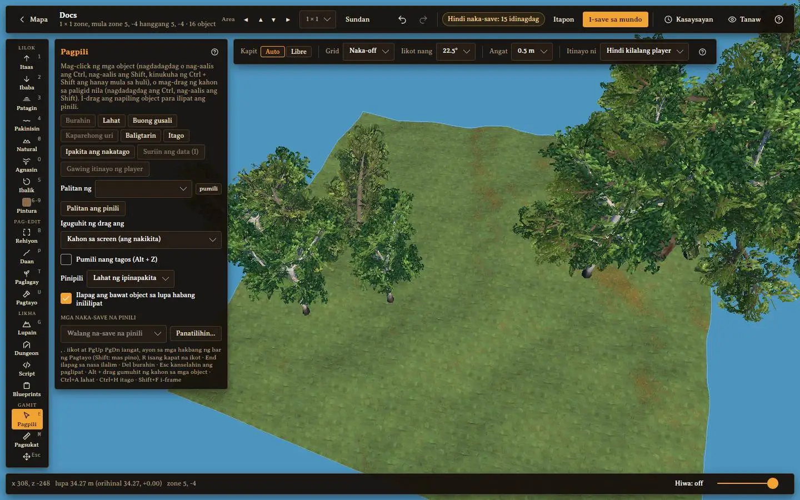

<!-- source: 133e1e92 -->
# Linisin ang mga puno at bato, patagin ang puwesto ng gusali

Alisin ang mga puno, bato at palumpong sa isang lugar at patagin ito para maging puwestong mapagtatayuan.

**Kailangan mo:** isang mundong bukas sa 3D, nakasara ang laro o nasa [live mode](edit-your-game-live.md).

1. Pindutin ang `B` ([Rehiyon](../area.md)). Sa itaas ng panel nito, piliin ang **Polygon**.
2. Mag-click ng mga sulok sa paligid ng puwesto, ilang metrong mas malapad kaysa sa gusali, at i-double-click para
   isara ito.
3. Piliin ang **Mga object**.
4. Tingnan ang mga chip ng uri: naka-on sa simula ang **Mga puno at troso**, **Mga bato**, **Mga palumpong at halaman**
   at **Mapipitas**. Iwanang naka-off ang **Mga gusali mo**.
5. Pindutin ang **Piliin ang mga object (Enter)**. Bubukas ang tool na Pagpili na napili na ang mga ito.
6. Pindutin ang `Del`. Wala na ang mga ito.
7. Pindutin ang `B` para bumalik sa tool na Rehiyon: naroon pa ang polygon. Piliin ang **Lupa**, saka ang **Patagin**
   sa **Aksiyon**.
8. Pindutin ang **avg** para sa karaniwang taas sa loob, o mag-type ng **Taas**. Para tumugma sa pintong naitayo mo na,
   ituro ang lupa sa paanan nito at basahin ang taas sa status bar.
9. Itakda ang **Lambot** (3 m sa simula) para humalo ang puwesto sa dahilig. Sinasabi ng linya sa ilalim ng
   mga setting kung gaano karaming lupa ang huhukayin at tatambakan, at kung ano ang lampas sa 8 m na abot ng laro.
10. Pindutin ang **Patagin (Enter)**.
11. Opsiyonal: sa **Aksiyon**, piliin ang **Pintura**, saka ang **Hubad na lupa** o **Sementado**, at pindutin ang
    **Pintahan (Enter)**.
12. I-click ang **I-save sa mundo** (o **I-apply nang live**).

*Pagkatapos ng **Piliin ang mga object (Enter)** at `Del`: wala na ang mga puno sa loob ng polygon, nakatayo pa ang mga
nasa labas.*

## Tingnan kung gumana

- Pindutin ang `M` ([Pagsukat](../measure.md)) at sukatin ang puwesto mula dulo hanggang dulo: dapat magtugma ang
  **Pinakamababa / pinakamataas**.
- O i-on ang **Kulay ng dahilig** sa panel na Tanaw: berde ang puwesto.

## I-undo ito

- Isang hakbang ang bawat aksiyon: binabawi ng `Ctrl+Z` ang huli. Pagkatapos mag-save, i-undo ito at mag-save ulit
  (tingnan ang [Mag-undo ng hakbang, bawiin ang isang pagbabago, o itapon ang lahat](undo-changes.md)).
- Para mapatubo muli ang mga puno sa ibang pagkakataon, piliin ang lugar, piliin ang **Pagbawi** at gamitin ang
  **Muling patubuin ang kalikasan** (tingnan ang [Rehiyon](../area.md#muling-patubuin-ang-kalikasan)).

## Kaugnay

- [Rehiyon, kopyahin at i-paste](../area.md)
- [Mask](../masks.md): patagin lang ang ibaba ng dahilig
- [Gumawa ng kalsada o rampa paakyat ng burol](make-a-road.md)
