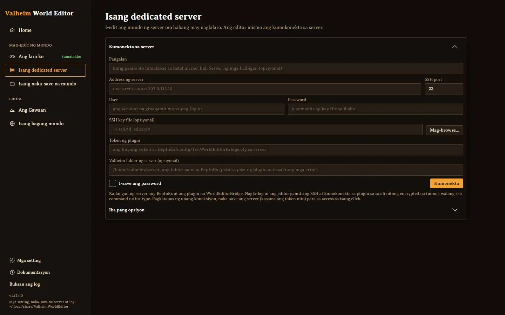

<!-- source: 52199907 -->
# I-edit ang dedicated server habang may naglalaro

Ikonekta ang editor sa dedicated server mo at baguhin ang mundo nito habang nananatiling online ang mga player.

**Kailangan mo:** SSH access sa makinang nagpapatakbo ng server (shell login, gamit ang password o key file: hindi
sapat ang SFTP o ang file manager ng web panel lang), at karapatang mag-install ng BepInEx at ng plugin na
WorldEditorBridge doon at i-restart ito. Para sa game server na inuupahan mula sa host (web panel at FTP, walang SSH),
o sa isang pinapatakbo ng game panel gaya ng Pterodactyl sa loob ng container: tingnan ang
[I-edit ang inuupahang server o server sa panel](edit-a-rented-server.md).

*Ang form sa ilalim ng **Isang dedicated server**. Pagkatapos ng unang koneksiyon, naka-save ang server sa itaas nito,
para sa access sa isang click.*

1. Sa server, i-install ang BepInEx ([BepInExPack for Valheim](https://thunderstore.io/c/valheim/p/denikson/BepInExPack_Valheim/),
   ayon sa mga tagubilin nito para sa dedicated server).
2. Kopyahin ang `WorldEditorBridge.dll` (mula sa `WorldEditorBridge-<version>.zip` sa
   [pahina ng mga release](https://github.com/Shuiei/valheim-world-editor/releases/latest)) papunta sa
   `BepInEx/plugins` ng server, o i-install ang WorldEditorBridge sa server profile ng isang mod manager.
3. I-restart ang server kasama ang BepInEx. Sinasabi na ngayon ng `BepInEx/LogOutput.log` nito ang `WorldEditorBridge <version> listening on
   http://127.0.0.1:5182/`.
4. Sa server, buksan ang `BepInEx/config/Tie.WorldEditorBridge.cfg` at kopyahin ang value ng linyang `Token` nito.
   Umiiral lang ang file kapag nagsimula na ang server kasama ang plugin.
5. Sa panimulang pahina ng editor, piliin ang **Isang dedicated server**, saka ang **Kumonekta sa server**.
6. Punan ang **Address ng server**, **User**, at **Password** o **SSH key file (opsiyonal)**. I-paste ang token sa
   **Token ng plugin**.
7. Opsiyonal: punan ang **Valheim folder ng server (opsiyonal)** (ang folder na naglalaman ng `BepInEx`), para
   masabi ng editor kung ano mismo ang mali kapag hindi sumasagot ang plugin. I-check ang **I-save ang password** para
   hindi na ito i-type ulit.
8. Pindutin ang **Kumonekta**. Nagla-log in ang editor gamit ang SSH, nagbubukas ng sarili nitong encrypted na tunnel
   papunta sa plugin at nilo-load ang mundo.
9. Sa mapa, pumili ng lugar, **I-edit sa 3D**, gumawa ng pagbabago at pindutin ang **I-apply nang live**.

## Tingnan kung gumana

- Ipinapakita ng top bar ang **LIVE**; pagkatapos mag-apply, "Na-apply lahat" at "Na-apply sa tumatakbong laro:
  …" sa status bar.
- Nakikita agad ito ng mga player na malapit sa pagbabago.
- Lumalabas na ngayon ang server sa itaas ng form, at sa **Home**, para sa access sa isang click sa susunod.

Kung may mensaheng lumabas sa ilalim ng form sa halip, tingnan ang [Hindi makakonekta ang server](../help/troubleshooting.md#hindi-kumokonekta-ang-server).

## I-undo ito

Pindutin ang `Ctrl+Z` (o **Tanggalin** ang hakbang sa Kasaysayan), saka **I-apply nang live** ulit. Hindi na
maa-undo ang mga reset ng zone kapag na-apply na.

## Ang iba pang field ng form

| Field | Ano ito |
|---|---|
| **Pangalan** | Kung paano lumalabas ang server sa listahan mo (opsiyonal; ang address kung wala). |
| **Address ng server** | Ang pangalan o IP address ng server. Maaari mo ring i-type dito ang `user@address`. |
| **SSH port** | 22 maliban kung binago ang SSH ng server. |
| **SSH key file (opsiyonal)** | Ang private key mo (**Mag-browse…** para piliin ito). Kung walang laman: sinusubukan ang karaniwang mga key sa `~/.ssh` (`id_ed25519`, `id_ecdsa`, `id_rsa`); nilalaktawan ang key na hindi magamit ng editor, at sinusubukan pa rin ang iba at ang password. |
| **Token ng plugin** | Laging ikaw ang nagta-type: hindi ito binabasa ng editor mula sa server, kaya hindi mababago ng SSH login lang ang mundo. |
| **Iba pang opsiyon** → **Passphrase ng key** | Ang passphrase ng key, kung mayroon. Hindi kailanman sine-save. |
| **Iba pang opsiyon** → **Port ng plugin** | Ang port ng plugin sa server, kapag hindi ito 5182 at walang ibinigay na folder. |
| **Iba pang opsiyon** → **Gumawa ako ng sariling tunnel** | **Address ng bridge** at **Token**, saka **Kumonekta**: para sa tunnel na ginawa mo gamit ang `ssh -L` o PuTTY. |

## Mga naka-save na server

Pagkatapos ng unang koneksiyon, nakalista ang server sa itaas ng form, pinakabago muna, kasama ang **Kumonekta**,
**i-edit** at **kalimutan**; natitiklop ang form sa ilalim ng **Kumonekta sa ibang server**. Ipinapakita ng bawat row
ang `user@address`, kung gumagamit ito ng key file, ng naka-save na password o humihingi ng isa, at mga kahon para sa
hindi naka-save.

- Pinupunan ng **i-edit** ang form ng server; baguhin ang kailangan mo, saka ina-update ito ng **Kumonekta**.
- Tinatanggal ito ng **kalimutan**, kasama ang password at token nito.

Itinatabi ang mga server sa `servers.cfg` sa data folder ng editor (ipinapakita ito ng side menu ng panimulang pahina),
isang seksiyon bawat server (`Host`, `SshPort`, `User`, `Password`, `KeyFile`, `Token`, `BridgePort`, `GameFolder`,
`HostKey`), kaya maaari mo rin itong i-edit nang mano-mano. Ang isang server ay isang account sa isang address at port:
ina-update ng muling pagkonekta gamit ang mga iyon ang seksiyon nito.

Pinupunan lang ang `Password` kapag naka-check ang **I-save ang password**, bilang plain text (sa Linux, ikaw lang ang
makakabasa ng file): mas mabuti ang SSH key.

Ang `HostKey` ay ang pagkakakilanlan ng server, na natatandaan sa unang koneksiyon. Kung magbago ito, tatanggi ang
editor na kumonekta, dahil maaaring may nagpapanggap na server mo. Kung ni-reinstall mo ang server, alisan ng laman ang
linyang `HostKey` ng bawat naka-save na server na may address na iyon para tanggapin ang bagong pagkakakilanlan.

## Kaugnay

- [Live mode](../live-mode.md): I-apply nang live, Auto, pagsunod sa laro, mga player
- [I-edit ang inuupahang server o server sa panel](edit-a-rented-server.md): game server ng host, Pterodactyl, Docker
- [Live na pag-edit](../concepts/live-editing.md#paano-ito-kumokonekta): ang SSH tunnel at ang token
- [I-edit ang mundong nilalaro mo](edit-your-game-live.md)
- [Mag-backup ng mundo bago mag-edit](back-up-a-world.md)
