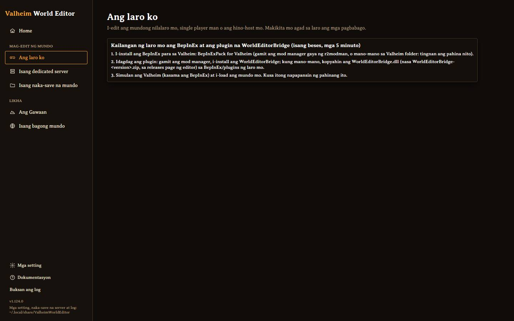
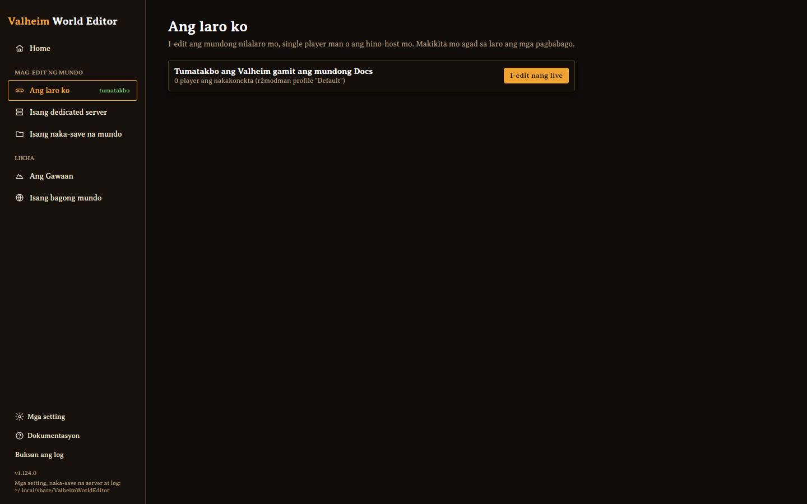

<!-- source: 0fe62110 -->
# I-edit ang mundong nilalaro mo

Baguhin ang mundo ng sarili mong tumatakbong laro (single player, o ang mundong hino-host mo) at makita agad sa laro ang
bawat pagbabago.

**Kailangan mo:** ang Valheim sa computer na ito, ang editor, at mga 5 minuto para i-install nang isang beses ang
BepInEx at ang plugin na WorldEditorBridge.

*Ang sinasabi ng **Ang laro ko** bago ma-install ang BepInEx at ang plugin: ang mga hakbang sa ibaba, sa madaling salita.*

1. I-install ang **BepInEx** sa Valheim mo, nang isang beses: [BepInExPack for Valheim](https://thunderstore.io/c/valheim/p/denikson/BepInExPack_Valheim/),
   gamit ang mod manager (r2modman, Thunderstore Mod Manager) o mano-mano sa folder ng Valheim, gaya ng ipinapaliwanag
   ng pahina nito. Sa Linux na may native na laro, nagsisimula ang BepInEx sa start script ng pack (ipinapakita ng
   pahina nito ang Steam launch option); ginagawa iyon ng mod manager para sa iyo.
2. Idagdag ang plugin. Gamit ang mod manager, i-install ang **WorldEditorBridge** mula sa
   [Thunderstore](https://thunderstore.io/c/valheim/p/Tie/WorldEditorBridge/) o
   [Hexium](https://valheim.hexium.gg/mods/Tie/WorldEditorBridge). Kung mano-mano, kopyahin ang `WorldEditorBridge.dll`
   mula sa `WorldEditorBridge-<version>.zip` (sa [pahina ng mga release](https://github.com/Shuiei/valheim-world-editor/releases/latest) ng editor)
   papunta sa `BepInEx/plugins` ng Valheim mo o ng profile ng mod manager mo. Gamitin ang plugin ng parehong release ng
   editor mo.
3. Simulan ang Valheim gamit ang BepInEx at i-load ang mundo mo (single player, o magsimula ng server mula sa laro para
   i-host ito). Sa unang pagsisimulang ito, isinusulat ng plugin ang mga setting nito at ang lihim na token, na kusang
   binabasa ng editor.
4. Sa editor, buksan ang panimulang pahina. Ipinapakita ng **Home** ang "Tumatakbo ang Valheim gamit ang mundong …" at
   kung ilang player ang nakakonekta; sinasabi ng **Ang laro ko** sa side menu na *tumatakbo*.
5. I-click ang **I-edit nang live**. Bubukas ang mundo sa mapa nito.
6. Mag-click ng lugar na malapit sa iyo at piliin ang **I-edit sa 3D**.
7. Gumawa ng pagbabago, halimbawa magtaas ng maliit na burol gamit ang brush na **Itaas**.
8. Pindutin ang **I-apply nang live** (o `Ctrl+S`).

*Kusang napansin ng panimulang pahina ang tumatakbong laro: binubuksan ng **I-edit nang live** ang mundo nito.*

## Tingnan kung gumana

- Ipinapakita ng top bar ang **LIVE**, at pagkatapos ng pag-apply, ang "Na-apply lahat".
- Sinasabi ng status bar ang "Na-apply sa tumatakbong laro: …".
- Sa laro, naroon agad ang burol. Sine-save ito ng laro gaya ng ibang pagbabago.

Habang hindi pa handa ang laro, sinasabi ng **Ang laro ko** kung ano ang kulang: ang tatlong hakbang, "Naka-install na
ang BepInEx: hakbang 2 at 3 na lang ang natitira", "Simulan nang isang beses ang Valheim gamit ang BepInEx" (hindi pa
kailanman tumakbo ang plugin), o "Simulan ang Valheim at i-load ang mundo mo". Kung hindi ito umuusad, tingnan ang
[Nagpapakita ang Ang laro ko ng mga hakbang na gagawin](../help/troubleshooting.md#nagpapakita-ng-mga-hakbang-ang-ang-laro-ko).

## I-undo ito

Pindutin ang `Ctrl+Z` (o **Tanggalin** ang hakbang sa Kasaysayan), saka **I-apply nang live** ulit: babawiin ng laro
ang pagbabago. Hindi na maa-undo ang pag-reset ng mga zone kapag na-apply na. Para ma-apply ang bawat pagbabago habang
ginagawa mo ito, i-on ang **Auto**.

## Kaugnay

- [Live mode](../live-mode.md): I-apply nang live, Auto, pagsunod sa laro, mga player
- [I-edit ang dedicated server habang may naglalaro](edit-a-server-live.md)
- [Live na pag-edit](../concepts/live-editing.md#paano-ito-kumokonekta): paano naaabot ng editor ang laro
- [Mag-undo ng hakbang, bawiin ang isang pagbabago, o itapon ang lahat](undo-changes.md)
