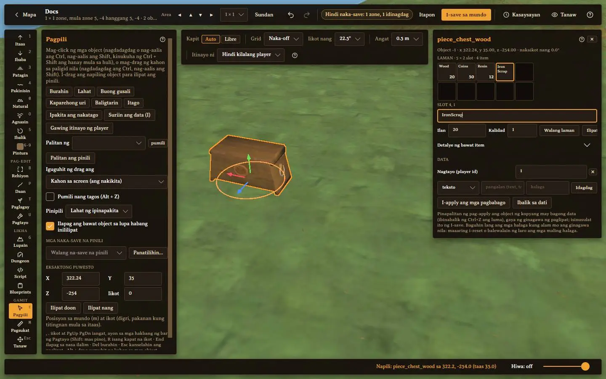

<!-- source: 0fb1e9cf -->
# Baguhin ang laman ng chest o ang nakasulat sa karatula

Maglagay ng mga item sa chest, ilabas ang mga ito, o magsulat ng bagong teksto sa karatula, gamit ang Inspector.

**Kailangan mo:** isang mundong bukas sa editor, na bukas ang area sa paligid ng chest o karatula. Para hanapin muna
ito, tingnan ang [Hanapin ang isang object, item sa chest o karatula](find-things.md).

## Isang chest

1. Pindutin ang `E` para buksan ang [Pagpili](../select.md).
2. I-double-click ang chest: napipili ito nang mag-isa at bumubukas sa Inspector, ipinapakita ang mga slot nito gaya sa
   laro.
3. Mag-click ng bakanteng slot.
4. Sa **Maghanap ng item…**, i-type ang ilang letra ng item (`iron`, `mead`) at piliin ito sa listahan.
5. Itakda ang **Ilan** at, para sa mga tool at armour, ang **Kalidad**.
6. Ulitin para sa ibang slot. Para ilabas ang item, i-click ang slot nito, saka ang **Walang laman**; para ilipat ito,
   ang **Ilipat**, saka ibang slot.
7. I-click ang **I-apply ang mga pagbabago**.
8. I-click ang **I-save sa mundo** (o **I-apply nang live**).

Pinuputol ang Ilan sa pinakamalaking stack na pinapayagan ng laro para sa item na iyon. Nananatiling sa chest ang
binagong laman: hindi pinupuno ng loot ng laro ang chest na hindi pa nabubuksan ng sinuman sa ibabaw nito.

*Na-click ang slot 4, napili ang IronScrap sa **Maghanap ng item…** at itinakda sa 20 ang **Ilan**; laman ng unang
tatlong slot ang Wood, Coins at Resin. Inilalagay ng **I-apply ang mga pagbabago** ang mga ito sa chest.*

## Isang karatula

1. Pindutin ang `E`, saka i-click ang karatula.
2. Pindutin ang `I` (**Suriin ang data (I)**): ang pag-double-click sa karatula ay pipili sa buong gusali.
3. Sa ilalim ng **DATA**, hanapin ang **Teksto (karatula)** at i-type ang bagong teksto.
4. I-click ang **I-apply ang mga pagbabago**, saka ang **I-save sa mundo** (o **I-apply nang live**).

Para sa karatulang wala pang teksto, gamitin ang **Idagdag**: piliin ang **teksto**, i-type ang `text` bilang pangalan,
saka ang mga salita.

## Tingnan kung gumana

Piliin ulit ang chest o karatula at pindutin ang `I`: ipinapakita ng Inspector ang bagong laman o teksto. Pagkatapos
mag-save, buksan ang chest o basahin ang karatula sa laro.

## I-undo ito

- Bago mag-apply: kinakalimutan ng **Ibalik sa dati** ang mga pagbabago sa card.
- Pagkatapos mag-apply: ibinabalik ng `Ctrl+Z` ang lumang chest o karatula.
- Pagkatapos mag-save: tingnan ang [Mag-undo ng hakbang, bawiin ang isang pagbabago, o itapon ang lahat](undo-changes.md).

## Kaugnay

- [Inspector](../select.md#inspector) (sa pahina ng Pagpili)
- [Ano ang object](../concepts/objects.md#ano-ang-object)
- [Hanapin ang isang object, item sa chest o karatula](find-things.md)
