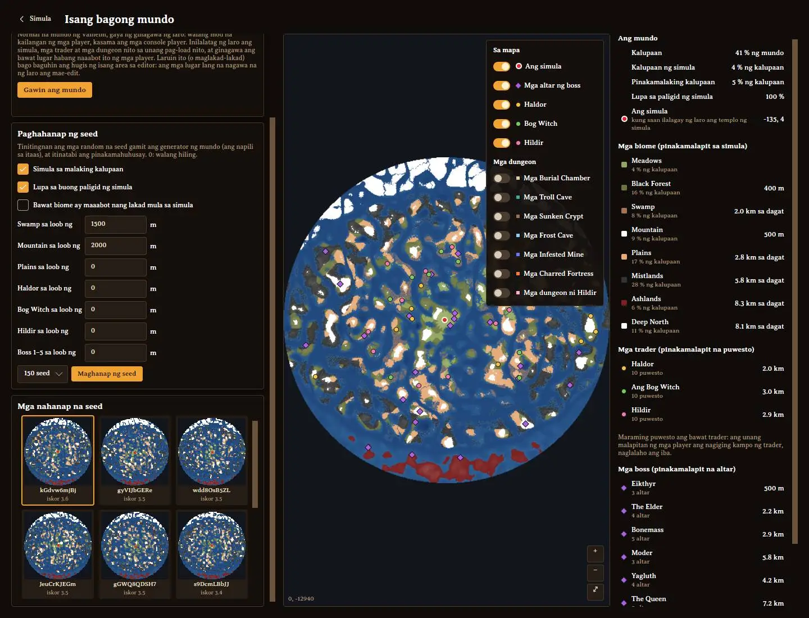

<!-- source: cccbe33c -->
# Maghanap ng seed na may gusto mo malapit sa simula

Hayaang suriin ng editor ang maraming seed at pumili ng isa na ang simula ay may mga biome, trader o boss na gusto mong
malapit, saka gawin ang mundo.

**Kailangan mo:** ang editor at ang Valheim sa computer na ito. Hindi kailangang may bukas na mundo.

1. Sa panimulang pahina, piliin ang **Isang bagong mundo** sa ilalim ng **Likha**, saka **Gumawa ng bagong mundo**.
2. Sa ilalim ng **Paghahanap ng seed**, panatilihing naka-on ang **Simula sa malaking kalupaan** at **Lupa sa buong
   paligid ng simula**, o i-off ang mga ito kung gusto mo ng mga isla.
3. Opsiyonal: i-on ang **Bawat biome ay maaabot nang lakad mula sa simula** para hindi mo agad kailanganin ang bangka.
4. Itakda ang mga layong gusto mo, sa metro: **Swamp sa loob ng**, **Mountain sa loob ng**, **Plains sa loob ng**,
   isang trader (**Haldor sa loob ng**, **Bog Witch sa loob ng**, **Hildir sa loob ng**) o **Boss 1–5 sa loob ng**.
   Iwanang 0 ang isang kahon kung wala kang hiling doon. Pinababagal nang ilang ulit ng mga hiling sa trader at boss
   ang paghahanap.
5. Piliin kung ilang seed ang susuriin: **60 seed**, **150 seed** o **400 seed**.
6. Pindutin ang **Maghanap ng seed**. Ipinapakita ng bar kung gaano na kalayo ito; pinapanatili ng **Ihinto** ang
   pinakamahusay na nahanap hanggang ngayon.
7. Sa ilalim ng **Mga nahanap na seed**, i-hover ang isang seed para sa mga detalye nito, saka i-click ito para makita
   sa malaking mapa.
8. Suriin ito sa malaking mapa: magaspang na tinitingnan ng paghahanap ang bawat seed at maaaring malampasan nito ang
   maliliit na isla o makikitid na kipot. Opsiyonal: i-on ang mga uri ng **Mga dungeon** na mahalaga sa iyo.
9. I-type ang **Pangalan** ng mundo, piliin ang **Naka-save sa**, at pindutin ang **Gawin ang mundo**.
10. Simulan ang Valheim at i-load ang mundo nang isang beses bago mo ito i-edit sa editor: ginagawa ng laro ang bawat
    lugar habang lumalapit dito ang mga player.

*Ang mga hiling sa kaliwa; ang pinakamahusay na mga seed sa ilalim ng **Mga nahanap na seed**, mula sa pinakamahusay,
bawat isa kasama ang score nito.*

## Tingnan kung gumana

- Binubuksan ng editor ang mapa ng bagong mundo na may mensaheng "Nagawa ang … (seed …)".
- Sa Valheim, nasa listahan ng folder na pinili mo ang mundo; dumarating ang bagong character sa lugar ng pulang tuldok.
- Nasa mga lugar na ipinakita ng pahina ang mga trader at boss.

## I-undo ito

Walang ginagawa hangga't hindi pinipindot ang **Gawin ang mundo**. Para alisin ang mundong ginawa mo, burahin ang folder
nito sa world folder kung saan ito na-save (ang pinili sa **Naka-save sa**). Laging maita-type ulit ang seed na gusto
mo: parehong mundo ang ginagawa ng parehong seed.

## Kaugnay

- [Isang bagong mundo](../new-world.md): bawat kontrol, ang mapa, ang mga detalye at kung paano binibigyan ng score ang
  mga seed
- [Magbukas ng mundong wala sa listahan](open-a-world.md)
- [I-edit ang mundong ginawa gamit ang Expand World, Riverheim o Tunnelheim](use-mods-worlds.md)
