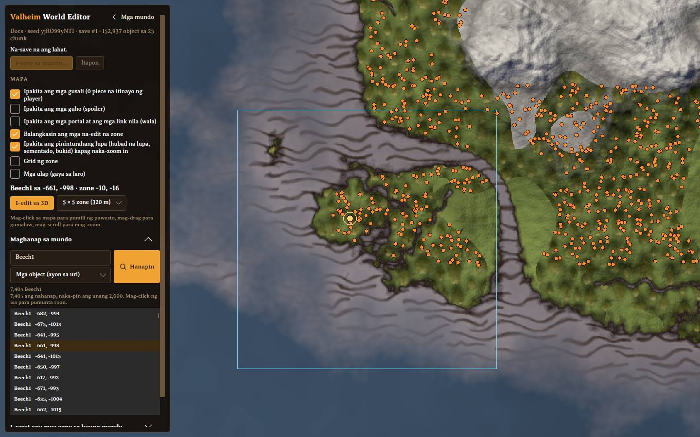

<!-- source: 1ca7ded6 -->
# Hanapin ang isang object, item sa chest o karatula

Maghanap sa buong mundo ng isang object, isang item sa kahit anong chest, o teksto sa karatula o portal, at buksan ito sa 3D.

**Kailangan mo:** isang mundong nakabukas sa [mapa](../map.md) nito.

1. Sa side panel ng mapa, buksan ang **Maghanap sa mundo**.
2. I-type ang bahagi ng hinahanap mo: isang uri (`portal`, `chest`, `Beech`), isang item (`Silver`, `Wood`) o mga salita
   sa karatula. Hindi mahalaga ang malaki o maliit na titik.
3. Piliin kung ano ang hahanapin: **Mga object (ayon sa uri)**, **Mga item sa lalagyan** o
   **Mga teksto (karatula, portal, ward…)**.
4. Pindutin ang **Hanapin** (o `Enter`). Bawat resulta ay naka-pin nang kulay kahel sa mapa, at nakalista kasama ang
   bilang bawat uri.
5. I-click ang isang resulta sa listahan. Igigitna ito ng mapa at pipiliin ang zone nito.
6. Pindutin ang **I-edit sa 3D**. Bubukas ang editor na napili ang object na iyon. Para sa item o teksto, bubukas din
   ang data nito.
7. Opsiyonal: palitan ang laman ng chest o ang teksto ng karatula (tingnan ang
   [Baguhin ang laman ng chest o ang nakasulat sa karatula](fill-a-chest.md)), pagkatapos ay **I-save sa mundo** (o
   **I-apply nang live**).

*Bawat pin ay isang object na nahanap; mas malaki ang napili sa listahan, na may gintong singsing.*

## Tingnan kung gumana

- Sinasabi ng linya sa itaas ng mga resulta kung ilan ang nahanap. Ipinapakita ng listahan ang unang 300; hanggang
  2000 ang naka-pin.
- **Walang nahanap?** Tingnan ang baybay at kung ano ang pinili mong hanapin. Nakikita ng paghahanap ang mundo kung ano
  ito sa editor: hindi nahahanap ang mga object na binura mo pero hindi na-save. Ang sariling mga object ng laro para sa
  pagtatala (`_ZoneCtrl`…) ay nahahanap lang kapag nagsisimula ang teksto mo sa `_`.

## I-undo ito

Walang binabago ang paghahanap. Isang hakbang ang pagbabagong ginawa mo sa object: ibinabalik ito ng `Ctrl+Z`.

## Kaugnay

- [Mapa ng mundo](../map.md#maghanap-sa-mundo)
- [Baguhin ang laman ng chest o ang nakasulat sa karatula](fill-a-chest.md)
- [Pagpili](../select.md)
