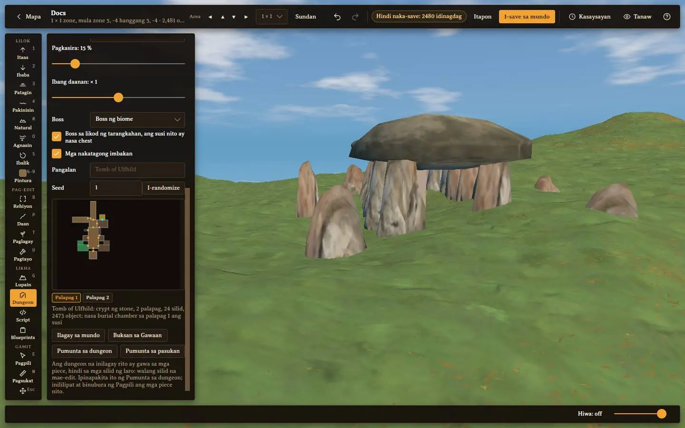

<!-- source: 89221403 -->
# Bumuo ng dungeon at ilagay ito sa mundo

Gumawa ng buong dungeon mula sa ilang pagpili at ilagay ito sa likod ng isang pasukan, gaya ng ginagawa ng laro sa
sarili nitong mga dungeon.

**Kailangan mo:** isang mundong nakabukas sa editor, nakabukas ang area kung saan ilalagay ang pasukan, sa isang zone na
wala pang pasukan ng dungeon (gumawa muna ng backup: tingnan ang [Mag-backup ng mundo](back-up-a-world.md)).

## Mga hakbang

1. I-click ang **Dungeon** sa tool rail (seksiyong LIKHA).
2. Sa ilalim ng **Bumuo ng dungeon**, piliin ang **Biome**: itinatakda nito ang mga halimaw, ang loot at ang pasukan sa
   lupa.
3. Piliin ang **Laki** at **Mga palapag**, at ang boss sa ilalim ng **Boss**.
4. Tingnan ang plano; i-click ang **Palapag 1**, **Palapag 2**... sa ilalim nito para makita ang bawat palapag.
5. Opsiyonal: i-click ang **I-randomize** hanggang magustuhan mo ang plano, o mag-type ng **Pangalan** para sa karatula
   sa bulwagan ng pasukan.
6. Iikot ang view para humarap sa lugar na paglalagyan ng pasukan, nasa gitna ng view ang lugar na iyon.
7. I-click ang **Ilagay sa mundo**. Lumalabas ang pasukan sa lupa, nakaharap sa iyo ang pinto nito.
8. I-click ang **Pumunta sa dungeon** para tumingin sa loob mula sa itaas, tinanggal ang mga bubong.
9. I-click ang **Pumunta sa pasukan** para bumalik pababa.
10. I-click ang **I-save sa mundo** (o **I-apply nang live**).

*Ang pasukan pagkatapos ng **Ilagay sa mundo**: ang punso ng isang burial chamber, nakaharap sa camera ang pinto nito.*

Para baguhin nang mano-mano ang dungeon bago ito ilagay (ilipat ang mga kasangkapan, punuin ang mga chest), i-save (o
i-apply) ang mga pagbabago mo, saka i-click ang **Buksan sa Gawaan** sa halip ng hakbang 7: pumapalit ang Gawaan sa
mundo. Baguhin ang dungeon, i-click ang **I-save ang blueprint**, buksan ulit ang mundo at i-paste ito: tingnan ang
[I-paste ang blueprint sa isang mundo](paste-a-blueprint.md).

## Tingnan kung gumana

Sinasabi ng status bar ang *Binuo ang …: … object, 5000 m sa itaas nito.* Ipinapakita ng **Pumunta sa dungeon** ang mga
silid nito. Pagkatapos mag-save, buksan ang mundo sa laro, maglakad papunta sa pasukan at dumaan sa pinto: darating ka
sa bulwagan ng pasukan.

## I-undo ito

- Bago mag-save: ibinabalik ng `Ctrl+Z` ang buong paglalagay sa isang hakbang.
- Pagkatapos mag-save: tingnan ang [Mag-undo ng hakbang, bawiin ang isang pagbabago, o itapon ang lahat](undo-changes.md), o [Ibalik ang isang area mula sa backup](restore-from-backup.md).

## Mga tip

- *May nakalagay na sa itaas*: bawat zone (64 × 64 m) ay may hawak na isang dungeon. Ilagay ang pasukan sa ibang zone.
- Ang parehong mga pagpili at seed ay laging gumagawa ng parehong dungeon ng mga piece ng gusali: itala ang **Seed**
  para gawin ito ulit. Ang dungeon ng sariling mga silid ng laro ay inaayos ulit mula sa pasukan nito kapag inilagay, kaya
  kailangan din nito ang parehong lugar at direksiyon ng pagharap.
- Ang **Gawa sa: Sariling mga silid ng laro** ay binubuo ito mula sa mga silid ng laro sa halip, para i-edit nang
  silid-silid.

## Kaugnay

- [Dungeon](../dungeons.md)
- [Paano iniingatan ng laro ang mga dungeon](../concepts/dungeons.md#paano-iniingatan-ng-laro-ang-mga-dungeon)
- [Gawaan](../workshop.md)
