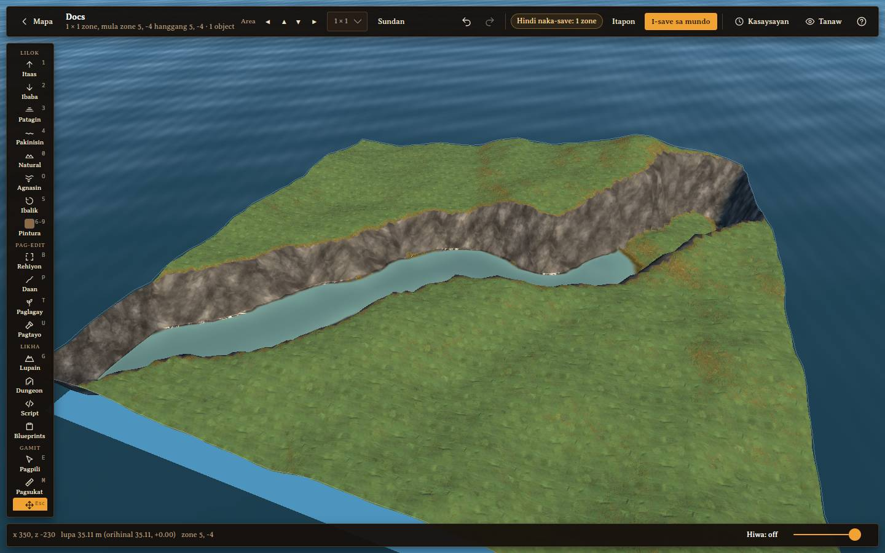

<!-- source: d55dc125 -->
# Humukay ng ilog o lawa

Humukay ng ilog, kanal o lawa na napupuno ng tubig.

**Kailangan mo:** isang mundong nakabukas sa 3D, nakasara ang laro o nasa [live mode](edit-your-game-live.md). Pinakamadali
ang mababang lupa malapit sa dagat.

Walang umaagos na tubig ang Valheim: ang tubig sa mga ilog ay ang dagat, nasa 30 m saanman. May tubig lang ang ilog o
lawa kung saan nasa ibaba ng 30 m ang sahig nito.

1. Ilipat ang cursor sa ibabaw ng ruta at basahin ang taas ng lupa sa status bar. Kung naka-off ang Walang limitasyon,
   8 m pababa lang ang kaya mong hukayin, kaya hindi magkakatubig ang lupang mas mataas sa mga 36 m.
2. Pindutin ang `P` ([Daan](../path.md)) at mag-click ng mga punto sa kahabaan ng ilog, mula sa dagat o sa isang lawa
   sa loob ng kalupaan.
3. Sa panel, piliin ang **Ilog / kanal (tubig)**.
4. Itakda ang **Lapad** (lapad ng tubig), **Lambot** (ang mga pampang) at **Lalim** (gaano kalalim sa ilalim
   ng dagat ang sahig sa gitna nito, 2 m sa simula).
5. Pindutin ang **I-apply (Enter)**. Mapupuno ng tubig ang sahig.
6. Para sa lawa, pindutin ang `B` ([Rehiyon](../area.md)), piliin ang **Polygon**, mag-click paikot sa lawa at
   i-double-click ang huling sulok para isara ang hugis.
7. Sa grupong **Lupa**, piliin ang **Patagin** sa **Aksiyon**, mag-type ng **Taas** na mas mababa sa 30 m (ang 28 m ay
   gagawa ng tubig na 2 m ang lalim), itakda ang **Lambot** sa mga 5 m para sa banayad na pampang, at
   pindutin ang **Patagin (Enter)**.
8. I-click ang **I-save sa mundo** (o **I-apply nang live**).

*Isang ilog na hinukay gamit ang Ilog / kanal (tubig): pinupuno ito ng dagat.*

## Tingnan kung gumana

- Lumalabas ang tubig sa 3D view sa sandaling nasa ibaba ng 30 m ang sahig.
- Kung sinasabi ng status bar na umabot sa hangganan ng laro ang bahagi nito, masyadong mataas ang lupa roon: ibaba muna
  ito malapit sa dagat, sundan ang mas mababang lupa, o i-on ang **Walang limitasyon** (tingnan ang [Itaas o hukayin
  lampas sa 8 m na hangganan ng laro](raise-past-the-limit.md)).

## I-undo ito

Ibinabalik ng `Ctrl+Z` ang huling **I-apply** o **Patagin**. Pagkatapos mag-save, i-undo at i-save ulit (tingnan ang
[Mag-undo ng hakbang, bawiin ang isang pagbabago, o itapon ang lahat](undo-changes.md)).

Para tabunan ang ilog sa ibang pagkakataon, kapag wala na ang mga hakbang na ma-undo, iguhit ulit ang linya (o panatilihin
ito) at i-apply ang **Ibalik** ng Daan: bumabalik ang lupa sa kahabaan nito sa kung paano ito binuo ng mundo. Ganoon din
ang ginagawa ng brush na **Ibalik** (`5`) sa isang lugar.

## Kaugnay

- [Daan](../path.md#ilog-o-kanal)
- [Pagsukat at mga overlay](../measure.md): lalim ng tubig
- [Mga hangganan ng lupa](../concepts/ground-limits.md)
