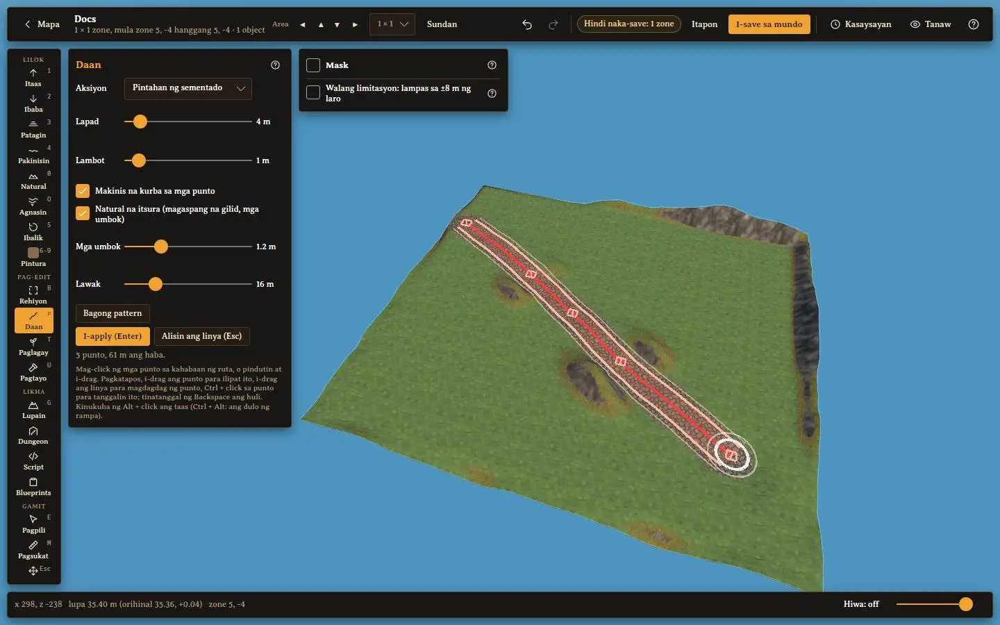

<!-- source: 20a95afa -->
# Gumawa ng kalsada o rampa paakyat ng burol

Gumuhit ng patag na kalsada na may pantay na rampang paakyat ng burol, sementado sa gitna nito.

**Kailangan mo:** isang mundong bukas sa 3D, nakasara ang laro o nasa [live mode](edit-your-game-live.md).

1. Opsiyonal: tingnan muna ang dahilig. Pindutin ang `M` ([Pagsukat](../measure.md)), i-click ang paanan ng burol,
   saka ang tuktok nito: ang **Dahilig** ang ibibigay ng rampang nasa pagitan nila.
2. Pindutin ang `P` ([Daan](../path.md)) at mag-click ng mga punto sa kahabaan ng patag na bahagi ng kalsada.
3. Sa panel, piliin ang **Patagin**. `Alt`+click sa lupa para kunin ang taas nito, o i-type ito sa **Taas**.
4. Itakda ang **Lapad** (mainam na kalsada ang 8 m) at ang **Lambot** (inihahalo ito ng 4 m sa dahilig).
5. Opsiyonal: i-tick ang **Natural na itsura (magaspang na gilid, mga umbok)** para sa lumang daanan.
6. Pindutin ang **I-apply (Enter)**, saka ang **Alisin ang linya (Esc)**.
7. Para sa burol, mag-click ng isang punto sa paanan nito at isa sa tuktok nito, at piliin ang **Rampa (simula →
   dulo)**. Sinusundan ng **Simula** at **Dulo** ang lupa sa ilalim ng dalawang dulo; mag-type ng taas para baguhin
   ang isa.
8. Pindutin ang **I-apply (Enter)**. Nananatili ang linya.
9. Para sementuhin ito, piliin ang **Pintahan ng sementado**, paliitin ang **Lapad** at **Lambot** (4 m at
   1 m), at pindutin ulit ang **I-apply (Enter)** sa parehong linya.
10. I-click ang **I-save sa mundo** (o **I-apply nang live**).

*Isang kalsadang ginawa gamit ang Patagin sa dalawang punso, saka Pintahan ng sementado (Lapad 4 m, Lambot
1 m) sa parehong linya.*

## Tingnan kung gumana

- Sukatin sa kahabaan ng kalsada: pareho ang **Dahilig** sa buong rampa.
- Kung naging pula ang mga punto, umabot ang bahagi ng kalsada sa 8 m na hangganan ng laro: tingnan ang
  [Itaas o hukayin lampas sa 8 m na hangganan ng laro](raise-past-the-limit.md).

## I-undo ito

Iisang hakbang ng undo ang bawat **I-apply**: binabawi ng `Ctrl+Z` ang huli. Ang linya lang ang tinatanggal ng
**Alisin ang linya (Esc)**, hindi ang in-apply mo. Pagkatapos mag-save, mag-undo at mag-save ulit (tingnan ang
[Mag-undo ng hakbang, bawiin ang isang pagbabago, o itapon ang lahat](undo-changes.md)).

Para alisin ang kalsada sa ibang pagkakataon, kapag wala na ang mga hakbang ng undo, gumuhit ng linya sa kahabaan nito
at i-apply ang **Ibalik** na may **Lapad** na sumasaklaw dito: bumabalik ang lupa sa kung paano ito binuo ng mundo,
tinanggal ang pintura.

## Kaugnay

- [Daan](../path.md)
- [Pagsukat at mga overlay](../measure.md)
- [Linisin ang mga puno at bato, patagin ang puwesto ng gusali](clear-an-area.md)
