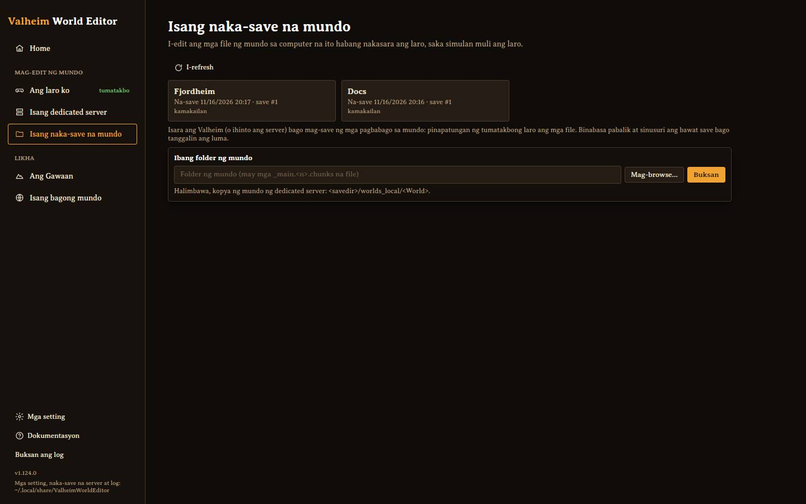

<!-- source: 289a125b -->
# Magbukas ng mundong wala sa listahan

Magbukas ng mundo mula sa kahit anong folder sa computer na ito: kopya ng mundo ng isang server, isang backup, isang
mundo sa ibang drive.

**Kailangan mo:** ang folder ng mundo (ang may lamang mga file na `_main.<n>.chunks`), at walang laro o server na
tumatakbo gamit ito.

1. Isara ang Valheim, o ihinto ang server na gumagamit ng mundo: sinusulatan ng tumatakbong laro ang mga file na
   sine-save ng editor.
2. Para sa mundo ng dedicated server, kopyahin ang folder nito, `<savedir>/worlds_local/<World>`, mula sa server
   papunta sa computer na ito.
3. Sa panimulang pahina, i-click ang **Isang naka-save na mundo**.
4. Sa ilalim ng **Ibang folder ng mundo**, i-click ang **Mag-browse…** at piliin ang folder ng mundo, o i-paste ang path
   nito sa kahon.
5. I-click ang **Buksan**. Bubukas ang mundo sa [mapa](../map.md) nito.
6. Opsiyonal: para laging nasa listahan ang mundo, buksan ang **Mga setting**, i-click ang **Magdagdag ng folder** sa
   ilalim ng **Mga folder ng mundo**, piliin ang folder ng mundo (o isang folder ng mga mundo) gamit ang
   **Mag-browse…**, saka **I-save**.

*Ang mga mundong kusang nahanap ng editor, saka ang **Ibang folder ng mundo** kasama ang **Mag-browse…** at **Buksan**.*

## Tingnan kung gumana

- Ipinapakita ng mapa ang mundo, kasama ang pangalan at seed nito sa itaas ng side panel.
- Sa **Home**, nasa ilalim ng **Kamakailan** ang mundo, kaya sa susunod ay bubukas ito sa isang click.
- Kapag naidagdag ang folder sa **Mga setting**, inililista ng **Isang naka-save na mundo** ang mundo na may *iyo* sa
  ilalim ng pangalan nito.

## I-undo ito

Walang binabago sa mundo ang pagbubukas nito: ang **I-save sa mundo** lang ang nagsusulat. Para alisin ang isang folder
sa listahan, buksan ang **Mga setting**, i-click ang **✕** sa tabi nito sa ilalim ng **Mga folder ng mundo**, saka
**I-save**.

## Mga tip

- Sinasabi ng editor kung ano ang mali sa isang folder: "That folder holds worlds; pick one of them" (may mga mundo
  sa folder na iyon; pinili mo ang `worlds_local`: pumili ng isang mundo sa loob nito), o "No Valheim world in that
  folder" (walang mundo ng Valheim sa folder na iyon).
- Ang mundo sa lumang format na iisang file (`<World>.db` at `.fwl`) ay naka-grey out: i-load ito nang isang beses sa
  Valheim, at gagawin ito ng laro na folder ng mundo na nabubuksan ng editor.
- Ang mundong ginawa gamit ang mod ng world generation (Expand World, Riverheim) ay nangangailangan ng add-on nito:
  tingnan ang [I-edit ang mundong ginawa gamit ang Expand World, Riverheim o Tunnelheim](use-mods-worlds.md).
- Pagkatapos i-edit dito ang mundo ng server, kopyahin pabalik ang folder sa server habang nakahinto ang server.

## Kaugnay

- [Mag-backup ng mundo bago mag-edit](back-up-a-world.md)
- [I-edit ang dedicated server habang may naglalaro](edit-a-server-live.md)
- [Ang window ng editor](../editor-basics.md)
- [Ang mapa ng mundo](../map.md)
