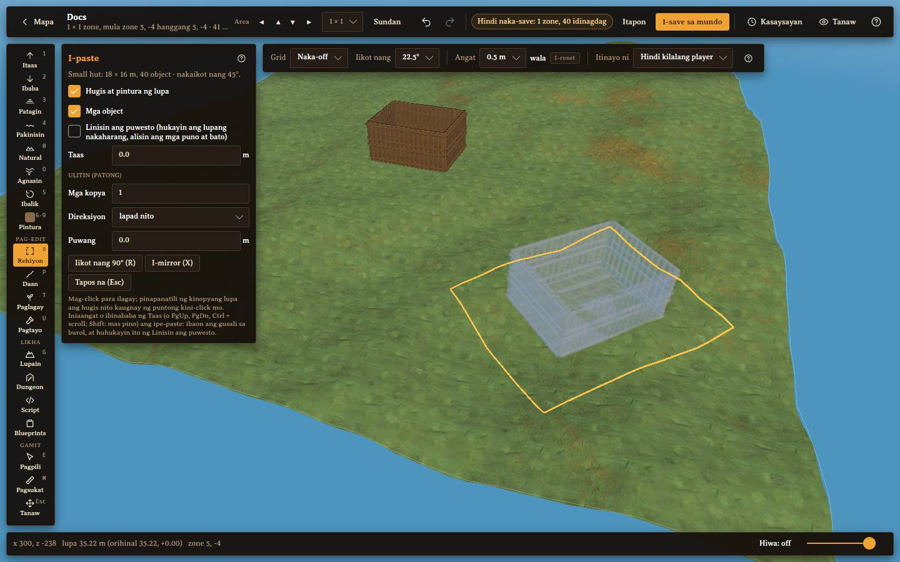

<!-- source: 45f0d395 -->
# I-paste ang blueprint sa isang mundo

Ilagay sa isang mundo ang gusali mula sa aklatan mo ng blueprint (ginawa sa Gawaan, na-save mula sa isang mundo, o
na-import).

**Kailangan mo:** isang mundong bukas sa editor, na bukas ang area kung saan pupunta ang gusali, at isang blueprint sa
aklatan (tingnan ang [Gawaan](../workshop.md)). Mag-backup muna: tingnan ang [Mag-backup ng mundo bago mag-edit](back-up-a-world.md).

## Mga hakbang

1. I-click ang **Blueprints** sa tool rail (seksiyong LIKHA).
2. Opsiyonal: para magpasok ng file na ipinadala sa iyo ng iba, i-click ang **I-import ang file…** at piliin ang
   `.blueprint` o `.vbuild` na file.
3. Mag-type ng salita mula sa pangalan o mga tag nito sa **Maghanap ng blueprint**.
4. I-click ang **I-paste** sa tabi ng blueprint. Magsasara ang panel at susundan ng blueprint ang cursor, naaaninag.
5. Iikot ito gamit ang `R` (isang kapat na ikot) o `,` `.` (ayon sa **Iikot nang** sa bar ng Pagtayo); pindutin ang
   `X` para i-mirror ito.
6. Opsiyonal: para ibaon ito sa dahilig, ibaba ito gamit ang `PgDn` (o `Ctrl` + wheel). Ang **Linisin ang puwesto** sa
   panel na I-paste (naka-on sa simula) ay naghuhukay ng lupang nakaharang at nag-aalis ng mga puno at bato.
7. Mag-click kung saan ito dapat tumayo. Mag-click ulit sa ibang lugar para sa iba pang kopya.
8. Pindutin ang `Esc` para huminto sa pag-paste.
9. I-click ang **I-save sa mundo** (o **I-apply nang live**).

Taglay ng mga na-paste na piece ang taglay ng blueprint: laman ng chest, teksto ng karatula, mga creature. Ang nagtayo
sa kanila ay ang player na pinili sa **Itinayo ni** sa [bar ng Pagtayo](../build.md#ang-bar-ng-pagtayo), na ipinapakita
habang nagpe-paste ka; walang nagtayo ang mga piece ng guho. Iniiwan ang mga piece mula sa mga mod na wala sa mundong
ito, at inililista sila ng mensahe.

*Pagkatapos ng **I-paste**: sinusundan ng kubo ang cursor nang naaaninag, may balangkas ang sakop nito, nakaikot nang
45° (`nakaikot nang 45°` sa panel na **I-paste**), naka-off ang **Linisin ang puwesto**. Sa likod nito, ang kubong
pinagmulan nito.*

Ang blueprint na may markang **Isang dungeon** ay hindi inilalagay sa lupa: napupunta ang pasukan nito kung saan ka
nag-click, at ang gusali ay 5000 m sa itaas nito. Tingnan ang [Dungeon](../dungeons.md).

## Tingnan kung gumana

Matatag na nakatayo ang gusali kung saan ka nag-click, may berdeng tuldok ng hindi naka-save, at sinasabi ng status bar
kung ilang object ang na-paste. Tingnan ang ilalim ng mga gilid nito: walang dapat lumutang. Pagkatapos mag-save,
puntahan ito sa laro.

## I-undo ito

- Bago mag-save: binabawi ng `Ctrl+Z` ang bawat pag-paste.
- Pagkatapos mag-save: tingnan ang [Mag-undo ng hakbang, bawiin ang isang pagbabago, o itapon ang lahat](undo-changes.md).

## Mga tip

- Dapat magkasya ang ipe-paste sa loob ng bukas na area; kung sinasabi nitong *Hindi na-paste*, magbukas ng mas
  malaking area sa paligid ng lugar.
- Nape-paste rin ang mga piece na ang editor mismo ang naglalagay (mga estatwa, props, creature), kahit nilalaktawan
  sila ng hammer ng Homestead.
- Para baguhin muna ang blueprint, i-click ang **Buksan** para buksan ito sa Gawaan.
- Para itago bilang blueprint ang isang bagay mula sa mundo: kopyahin ito (ang tool na Rehiyon, o `Ctrl+C` sa
  Pagpili), saka i-click ang **I-save bilang blueprint…** sa row na **Clipboard** ng panel.

## Kaugnay

- [Gawaan](../workshop.md) · [Rehiyon](../area.md)
- [Ilipat o kopyahin ang isang gusali](move-a-building.md)
- [Mga piece na itinayo ng player](../concepts/objects.md#mga-piece-na-itinayo-ng-player)
