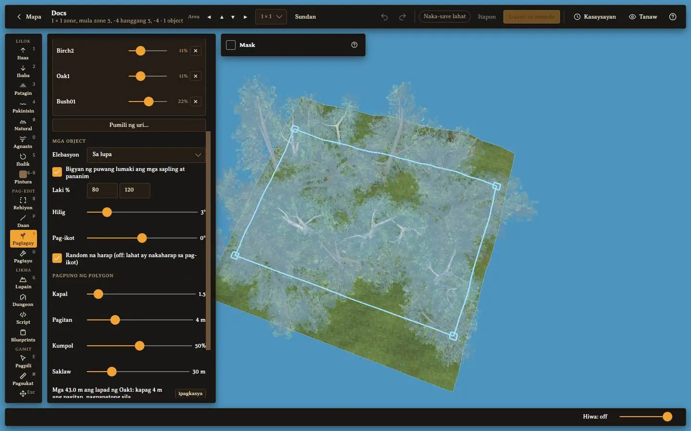

<!-- source: 78139bdb -->
# Magtanim ng gubat, bukid o bakod na halaman

Punuin ang isang bahagi ng lupa ng mga punong nasa natural na kumpol, ng bukid ng mga pananim na nakahanay, o ng bakod
na halaman sa kahabaan ng isang linya.

**Kailangan mo:** isang mundong bukas sa editor (mag-backup muna: tingnan ang
[Mag-backup ng mundo](back-up-a-world.md)).

## Isang gubat

1. Pindutin ang `T` para buksan ang [Paglagay](../place.md).
2. Sa ilalim ng **Pumili ng preset**, piliin ang **Kakahuyan ng Meadows** (o **Gubat ng Black Forest**, **Swamp**).
3. Sa itaas ng panel, piliin ang **Polygon**.
4. Mag-click ng mga punto sa lupa sa paligid ng balangkas ng gubat, o pindutin nang matagal at i-drag para iguhit ito
   nang malaya.
5. Opsiyonal: sa ilalim ng **Pagpuno ng polygon**, itaas ang **Kumpol** sa mga 50% para sa mga kumpol na may
   bakanteng lugar sa pagitan nila, at itakda ang **Saklaw** sa gusto mong laki ng mga kumpol.
6. Pindutin ang `N` (**Bagong layout (N)**) hanggang maging tama ang preview.
7. Pindutin ang `Enter` para itanim ito.
8. I-click ang **I-save sa mundo** (o **I-apply nang live**).

*Isang polygon na mga 58 × 40 m na may **Kumpol** 50% at **Saklaw** 30 m (at **Kapal** 1.5): nagkukumpol
ang mga aninag na puno, may mga bakanteng lugar sa pagitan nila. Nasa ibaba ng panel ang mga row ng **Pagpuno ng
polygon**.*

## Isang bukid

1. Pintahan ang bukid ng **Bungkalin** (tool rail, **Pintura**, o key `7`): sa binungkal na lupa lang tumutubo ang mga
   pananim.
2. Sa Paglagay, i-click ang **Pumili ng uri…**, hanapin ang `carrot`, i-tick ang mga pananim na gusto mo, saka i-click
   ang **Tapos na**.
3. Piliin ang **Grid**, at itakda ang **Pagitan** sa ilalim ng **Grid** (bagay ang 1 m sa carrot).
4. Mag-drag ng kahon sa ibabaw ng binungkal na lupa, saka pindutin ang `Enter`.

Panatilihing naka-on ang **Bigyan ng puwang lumaki ang mga sapling at pananim**, para may puwang ang bawat pananim na
kailangan ng laro para lumaki ito.

## Isang bakod na halaman

1. Sa Paglagay, i-click ang **Pumili ng uri…**, hanapin ang `bush`, at i-tick ang isa o dalawang palumpong.
2. Piliin ang **Linya**, saka **Mga punto**.
3. Mag-click ng mga punto sa kahabaan ng bakod; itakda ang **Bawat** sa mga 1.5 m at ang **Alon** sa 0.25 m.
4. Pindutin ang `Enter`.

## Tingnan kung gumana

Nagiging solido ang aninag na preview kung saan ka nagtanim, may berdeng tuldok na hindi naka-save sa bawat object.
Sinasabi ng status bar kung ilang object ang inilagay. Sa laro, pumunta roon pagkatapos mag-save.

## I-undo ito

- Bago mag-save: binabawi ng `Ctrl+Z` ang huling polygon, grid, linya o stroke ng brush.
- Para magtanggal ng ilan: mode na Brush na naka-tick ang parehong mga uri, `Shift` + drag sa ibabaw nila.
- Pagkatapos mag-save: tingnan ang
  [Mag-undo ng hakbang, bawiin ang isang pagbabago, o itapon ang lahat](undo-changes.md).

## Kaugnay

- [Paglagay](../place.md)
- [Mga patakaran sa pagtubo](../concepts/objects.md#mga-patakaran-sa-pagtubo)
- [Linisin ang mga puno at bato, patagin ang puwesto ng gusali](clear-an-area.md)
