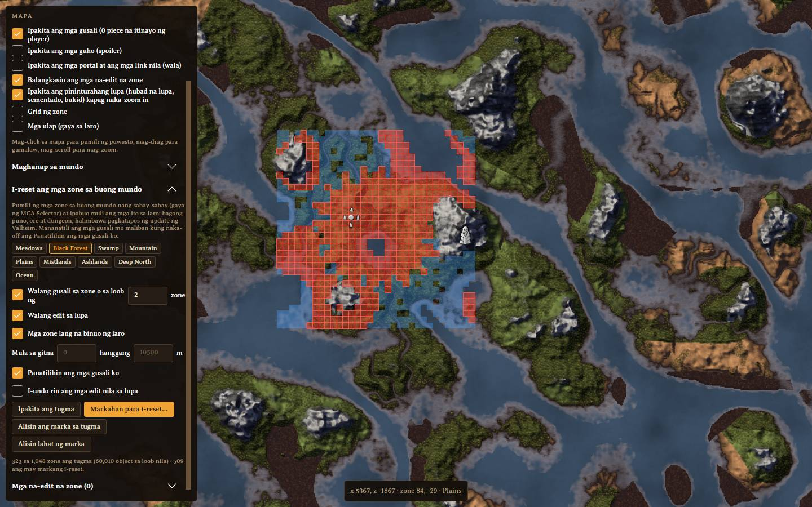

<!-- source: e87fa23c -->
# Buuin ulit ang mga zone

Ipagawa ulit sa laro ang mga napiling zone mula sa seed, na may bagong puno, bato, ore at dungeon, halimbawa para
makuha ang bagong content ng isang update ng Valheim sa mga lugar na walang nagtayo.

**Kailangan mo:** ang mundong nakasara sa laro (o nakahinto ang server), o [live mode](edit-a-server-live.md), at isang
[backup ng mundo](back-up-a-world.md): hindi na maa-undo ang na-save na reset.

1. Sa laro, akayin palayo ang mga paamong hayop mula sa mga lugar na ire-reset mo: nawawala ang lahat ng nasa na-reset
   na zone maliban sa mga lapida at, kapag naka-on ang **Panatilihin ang mga gusali ko**, ang mga piece na itinayo ng
   player. Pagkatapos, isara ang laro (o ihinto ang server), maliban kung nag-e-edit ka nang live.
2. I-backup ang mundo.
3. Buksan ang mundo. Bubukas ang [mapa](../map.md) nito.
4. Sa side panel, buksan ang **I-reset ang mga zone sa buong mundo**.
5. Itakda ang filter: ang mga biome na ire-reset, at panatilihing naka-on ang **Walang gusali sa zone o sa loob ng N
   zone** at **Panatilihin ang mga gusali ko** para hindi magalaw ang mga base at ang lupa sa paligid nila. Gamitin ang
   **Mula sa gitna … hanggang … m** para i-reset lang ang bahagi ng mundo.
6. Pindutin ang **Ipakita ang tugma**. Sa unang pagkakataon, binabasa ng editor ang bawat zone. Nagiging asul ang mga
   tugmang zone, at may linyang nagsasabi kung ilan ang tugma at ilang object ang laman nila.
7. Baguhin ang filter hanggang ang mga asul na zone na ang mga gusto mo.
8. Pindutin ang **Markahan para i-reset…**. Sinasabi ng tanong kung ilang zone, ano ang mawawala at kung pananatilihin
   ang mga gusali mo: basahin ito, saka pumayag. Nagiging pula ang mga zone.
9. I-click ang **I-save sa mundo** (o **I-apply nang live**).

*Tumutugma sa filter ang mga asul na zone; minarkahan para i-reset ang mga pulang zone.*

Para i-reset lang ang mga zone sa ilalim ng isang lugar, gamitin na lang ang tool na [Rehiyon](../area.md#i-reset-ang-mga-zone):
gumuhit ng kahon sa ibabaw nila, piliin ang **Pagbawi**, saka ang **I-reset ang mga zone** sa **Aksiyon**, at pindutin
ang **I-reset ang mga zone… (Enter)**. Mayroon itong parehong switch na **Panatilihin ang mga gusali ko** at **I-undo
rin ang mga edit nila sa lupa** gaya ng sa mapa.

## Tingnan kung gumana

- Bago mag-save, binibilang ng linya sa ilalim ng mga button ang mga zone na minarkahan para i-reset.
- Sa laro, pumunta sa na-reset na zone: binubuo itong muli habang lumalapit ka, na may bagong puno, bato at ang
  lokasyon nito.

## I-undo ito

- **Bago mag-save:** kinakansela ng **Alisin lahat ng marka** (sa mapa o sa tool na Rehiyon) ang bawat minarkahang
  reset, at ng **Alisin ang marka sa tugma** ang sa mga zone lang na tumutugma sa filter (ang minarkahan gamit ang
  **I-reset ang mga zone** ng tool na Rehiyon: `Ctrl+Z` rin).
- **Pagkatapos mag-save:** hindi na ito maa-undo sa editor. Ibalik ang backup ng mundo mula sa hakbang 2 (tingnan ang
  [Mag-backup ng mundo bago mag-edit](back-up-a-world.md#i-undo-ito)).

## Kaugnay

- [Mapa ng mundo](../map.md#i-reset-ang-mga-zone-sa-buong-mundo)
- [Mga zone](../concepts/areas-and-zones.md#mga-zone)
- [Mag-backup ng mundo bago mag-edit](back-up-a-world.md)
