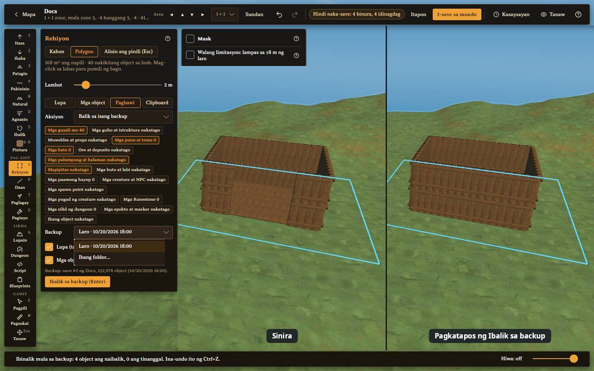

<!-- source: 0a333811 -->
# Ibalik ang isang area mula sa backup

Ibalik ang isang lugar gaya ng dati sa isang backup, matapos ang griefing, masamang raid o edit na pinagsisihan mo,
nang hindi ibinabalik ang iba pang bahagi ng mundo.

**Kailangan mo:** isang backup ng mundo mula bago ang pinsala: ang sariling mga backup ng laro sa tabi ng folder ng
mundo (`<World>_backup_auto-<date>`), o isang backup ng server na kinopya sa computer na ito. Nakasara ang laro, o
[live mode](edit-a-server-live.md).

1. Buksan ang mundo at hanapin ang lugar sa [mapa](../map.md). Pindutin ang **I-edit sa 3D**.
2. Pindutin ang `B` ([Rehiyon](../area.md)), piliin ang **Polygon** at mag-click sa paligid ng napinsalang lugar,
   medyo mas malapad dito.
3. Piliin ang **Pagbawi**, saka ang **Balik sa isang backup** sa **Aksiyon**.
4. Sa **Backup**, pumili ng petsa bago ang pinsala ("Laro · petsa"). Para sa backup ng server o ibang kopya, piliin
   ang **Ibang folder…** at piliin ito (kapag live, ito lang ang paraan). Sinasabi ng linya sa ilalim nito kung aling
   save ito.
5. Piliin ang mga chip ng uring ibabalik. Para sa isang gusali, i-on ang **Mga gusali mo**.
6. Iwanang naka-tick ang **Lupa (taas at pintura)** at **Mga object ng mga uring pinili sa itaas**, o alisin ang tick
   sa ayaw mong ibalik.
7. Pindutin ang **Ibalik sa backup (Enter)**.
8. Tingnan ang resulta. Kung tama, **I-save sa mundo** (o **I-apply nang live**).

*Kaliwa: isang polygon sa paligid ng kubong nawalan ng bahagi ng malapit na pader nito, napili ang **Balik sa isang
backup**, bukas ang listahang **Backup** sa backup ng laro at naka-on ang **Mga gusali mo**. Kanan: pagkatapos ng
**Ibalik sa backup (Enter)**, buo na ulit ang pader; pinapangalanan ng linya sa itaas ng button ang save ng backup,
binibilang ng status bar ang bumalik.*

## Tingnan kung gumana

- Sinasabi ng status bar ang "Ibinalik mula sa backup: ang lupa, N object ang naibalik, M ang tinanggal."
- Ang ibig sabihin ng "Walang maibabalik: ang pinili ay gaya pa rin ng nasa backup" ay may parehong mga object at lupa
  roon ang backup: pumili ng mas lumang backup.
- May laman ulit ang naibalik na chest: i-click ito gamit ang [Pagpili](../select.md) (`E`) at pindutin ang `I` para
  silipin ang loob.

## I-undo ito

Binabawi ng `Ctrl+Z` ang pagbabalik: iisang hakbang ito sa Kasaysayan. Pagkatapos mag-save, i-undo ito at mag-save
ulit. Tinatanggal ang mga object ng mga piniling uri na wala sa backup, kaya magbalik ulit mula sa mas bagong backup
kung may nawala kang itinayo mo pagkatapos.

## Kaugnay

- [Rehiyon: Balik sa isang backup](../area.md#balik-sa-isang-backup)
- [Mag-backup ng mundo bago mag-edit](back-up-a-world.md)
- [Mga backup](../concepts/saving-and-history.md#mga-backup)
