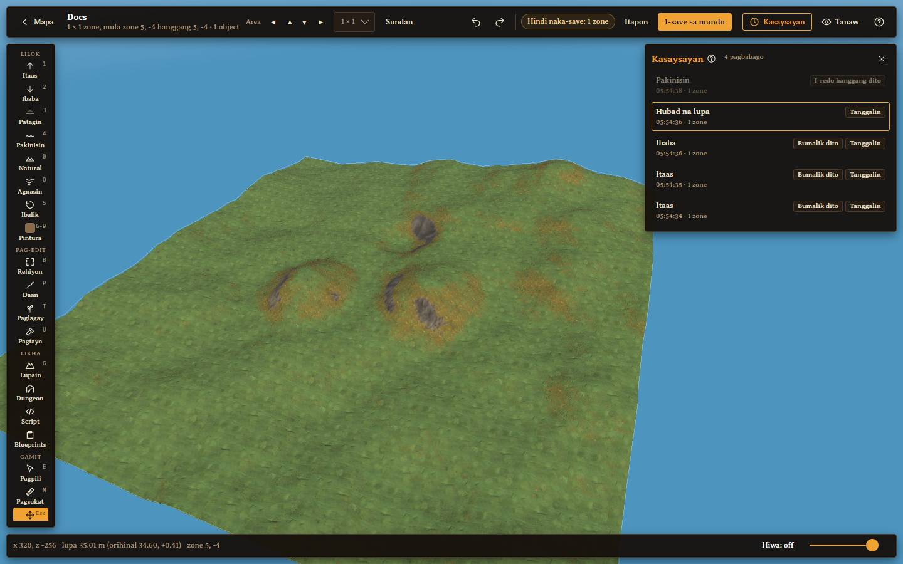

<!-- source: a0f30736 -->
# Mag-undo ng hakbang, bawiin ang isang pagbabago, o itapon ang lahat

Bawiin ang ginawa mo sa editor: ang mga huling hakbang, isang pagbabago mula sa gitna habang pinapanatili ang iba, o
ang lahat ng hindi pa naka-save.

**Kailangan mo:** isang mundong bukas sa 3D (naka-save o live) o ang Gawaan, na may mga pagbabago sa **Kasaysayan**.

1. Para i-undo ang huling pagbabago, pindutin ang `Ctrl+Z` (o ang kurbadong arrow sa top bar). Pindutin ulit para sa
   naunang hakbang. Pinapangalanan ng hover text ng arrow ang hakbang na ia-undo nito.
2. Para i-redo ang kaka-undo mo lang, pindutin ang `Ctrl+Y` o `Ctrl+Shift+Z`.
3. Para bumalik nang ilang hakbang nang sabay, buksan ang **Kasaysayan** (`L`) at i-click ang **Bumalik dito** sa
   huling pagbabagong pananatilihin. Nagiging kulay abo ang mga sumunod; ibinabalik sila ng **I-redo hanggang dito**
   sa isa sa kanila.
4. Para bawiin ang isang pagbabago at panatilihin ang lahat ng ginawa pagkatapos nito, i-click ang **Tanggalin** sa
   pagbabagong iyon sa **Kasaysayan**. Nagkakaroon ito ng guhit sa gitna, at sariling hakbang ang pagtanggal: ibinabalik
   ng `Ctrl+Z` ang pagbabago.
5. Para bawiin ang lahat ng ginawa ni Claude at panatilihin ang sarili mong mga pagbabago, i-click ang **Bawiin ang mga
   pagbabago ni Claude** sa **Kasaysayan** (lumalabas lang kapag may ginawang pagbabago si Claude sa bukas na area).
   Gawin ito sa bawat area na binago ni Claude: sinasabi ng status bar kung ilan sa mga pagbabago ni Claude sa ibang
   area ang nananatili.
6. Para itapon ang lahat ng hindi pa na-save o na-apply, i-click ang **Itapon** sa top bar, saka kumpirmahin.
   Nananatili ang mga na-save at na-apply na pagbabago: bumabalik ang na-save na hakbang na in-undo mo, kaya mag-save
   pagkatapos itong i-undo kung gusto mo itong mawala.
7. Para bawiin ang pagbabagong na-save mo na, i-undo ito (o **Tanggalin** ito), saka **I-save sa mundo** ulit. Kapag
   live, i-undo ito at **I-apply nang live** ulit (o hayaang ipadala ito ng **Auto**).

*Kasaysayan: na-undo ang huling pagbabago gamit ang **Bumalik dito**, kulay abo na may **I-redo hanggang dito**.*

> [!WARNING]
> Inaalis ng bagong pagbabagong ginawa pagkatapos ng isang undo ang mga hakbang na kulay abo: hindi na sila
> mare-redo. Inaalis ng pagsasara ng editor ang bawat pagbabagong hindi mo na-save o na-apply.

## Tingnan kung gumana

- Ipinapakita ng tanaw ang lupa at mga object gaya ng dati, at mas kaunti ang binibilang ng linya ng nakabinbin sa top
  bar (o sinasabi nito ang "Naka-save lahat").
- Sa **Kasaysayan**, ang nakabalangkas na row ay ang hakbang na binalikan mo; kulay abo ang mga na-undo na hakbang, may
  guhit sa gitna ang mga tinanggal.

## I-undo ito

Mababawi ang bawat isa rito hanggang gumawa ka ng bagong pagbabago: nire-redo ng `Ctrl+Y` ang isang undo, ibinabalik ng
**I-redo hanggang dito** ang mga hakbang na kulay abo, at ibinabalik ng `Ctrl+Z` ang tinanggal na pagbabago. Hindi
naa-undo ang **Itapon**: kaya nagtatanong muna ito.

## Mga tip

- Itinatabi ang Kasaysayan pagkatapos ng bawat save o apply: buksan ulit ang mundo, kahit naisara mo na ang editor, at
  bumabalik ang mga hakbang, may tag na **naunang session**. Kung nagbago ang mundo mula noon, nagtatanong ang editor
  bago mag-undo ng isa. Tingnan ang [Kasaysayan](../concepts/saving-and-history.md#kasaysayan).
- Naghihintay ang hakbang na ginawa sa ibang area hanggang magbukas ka ng area na may hawak nito: sinasabi ng panel kung
  ilan.
- Para bumalik nang mas malayo kaysa sa Kasaysayan ng editor, gumamit ng kopya ng mundo: tingnan ang
  [Mag-backup ng mundo bago mag-edit](back-up-a-world.md) o [Ibalik ang isang area mula sa backup](restore-from-backup.md).

## Kaugnay

- [Ibalik ang isang area mula sa backup](restore-from-backup.md)
- [Mag-backup ng mundo bago mag-edit](back-up-a-world.md)
- [Pag-save at kasaysayan](../concepts/saving-and-history.md)
- [Ang window ng editor](../editor-basics.md#kasaysayan)
