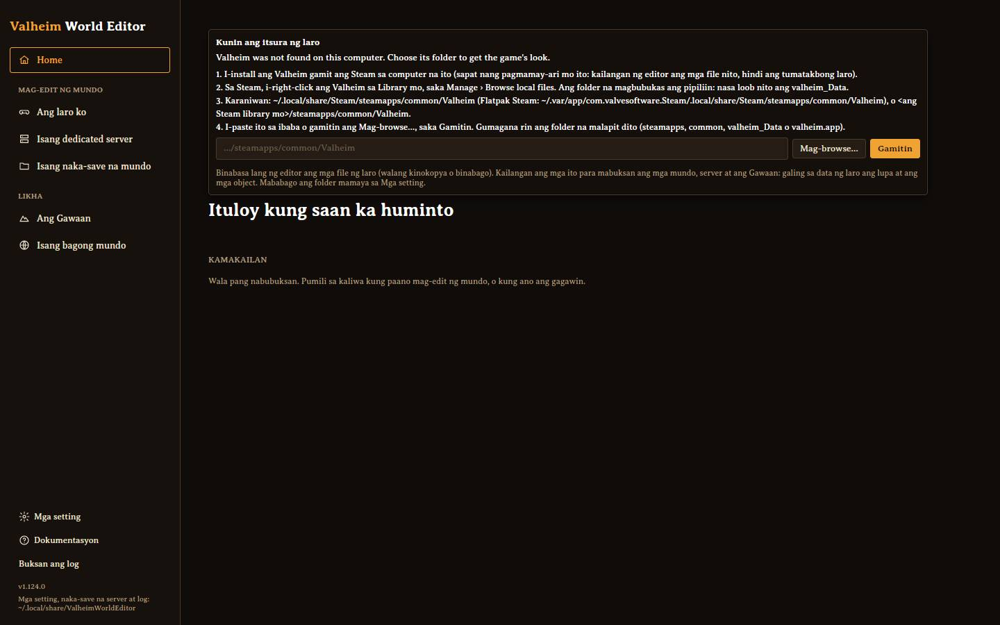
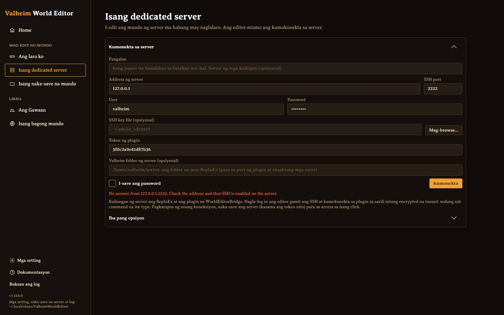
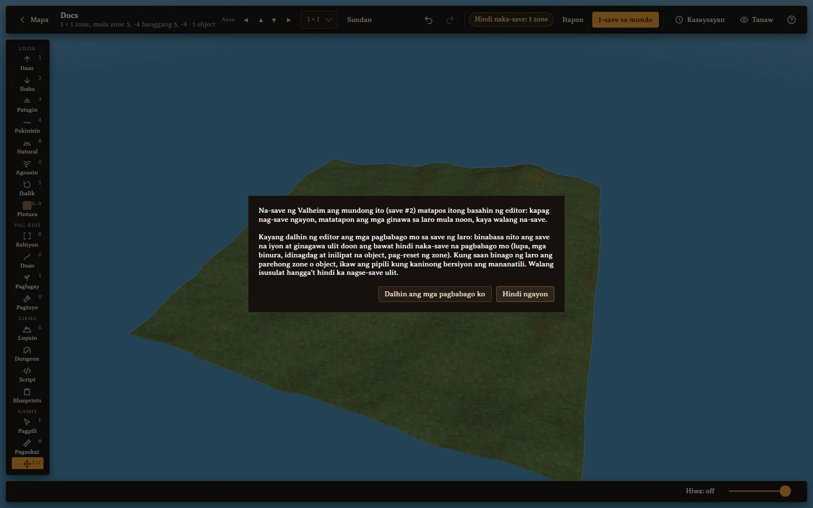

<!-- source: 5b752532 -->
# Pag-troubleshoot

Hanapin sa talahanayan ang nakikita mo, saka sundan ang seksiyon nito: sinasabi ng bawat isa kung bakit ito nangyayari
at ang dapat gawin.

| Ang nakikita mo | Pumunta sa |
|---|---|
| "Hindi nahanap ang Valheim sa computer na ito", o mga kahon sa halip na mga model | [Hindi nahanap ang Valheim](#hindi-nahanap-ang-valheim) |
| Naglilista ng mga hakbang ang **Ang laro ko**, o hindi lumalabas sa **Home** ang tumatakbong laro | [Nagpapakita ng mga hakbang ang Ang laro ko](#nagpapakita-ng-mga-hakbang-ang-ang-laro-ko) |
| Isang mensahe sa ilalim ng form ng server pagkatapos ng **Kumonekta** | [Hindi kumokonekta ang server](#hindi-kumokonekta-ang-server) |
| Kulay abo ang card ng isang mundo, o hindi bumubukas ang isang mundo | [Hindi bumubukas o kulay abo ang isang mundo](#hindi-bumubukas-o-kulay-abo-ang-isang-mundo) |
| Nagtatapos ang pag-save sa "Walang nagbago" o "Hindi na-save" | [Sinasabi ng pag-save na walang nagbago](#sinasabi-ng-pag-save-na-walang-nagbago) |
| "Na-save ng laro ang mundong ito" kapag nag-save ka | [Nag-save ang laro habang nag-e-edit ka](#nag-save-ang-laro-habang-nag-e-edit-ka) |
| Live: hindi nakikita ng mga player ang isang pagbabago, o hindi nakikita ng editor ang sa kanila | [Hindi lumalabas ang isang live na pagbabago](#hindi-lumalabas-ang-isang-live-na-pagbabago) |
| Pagkislap, mga linya o itim na 3D view sa Windows | [Pagkislap o mga linya sa Windows](#pagkislap-o-mga-linya-sa-windows) |
| "Windows protected your PC", o ayaw buksan ng macOS ang app | [Hinaharangan ng Windows o macOS ang app](#hinaharangan-ng-windows-o-macos-ang-app) |
| Sinasabi ni Claude na hindi nito maabot ang editor | [Hindi makakonekta si Claude](#hindi-makakonekta-si-claude) |
| Sinasabi ng script ang "May mga mali", "error" o "walang binago" | [Pumalya ang isang script](#pumalya-ang-isang-script) |
| Iba pa | [Ang log at mga ulat ng bug](#ang-log-at-mga-ulat-ng-bug) |

## Hindi nahanap ang Valheim

Binabasa ng editor ang mga texture, model at lupa ng laro mula sa naka-install mong Valheim; kung wala ito, walang
mundo o Gawaan na bubukas. Ipinapakita noon ng panimulang pahina ang **Kunin ang itsura ng laro** kasama ang "Hindi
nahanap ang Valheim sa computer na ito."

1. I-install ang Valheim gamit ang Steam sa computer na ito. Sapat na ang pagmamay-ari nito: hindi kailangang tumatakbo
   ang laro.
2. Sa Steam, i-right-click ang Valheim sa Library mo, saka **Manage › Browse local files**. Ang folder na bubukas (ang
   may `valheim_Data`, o `valheim.app` sa Mac) ang pipiliin.
3. I-paste ang path nito sa card, o gamitin ang **Mag-browse…**, saka **Gamitin**. Gumagana rin ang isang folder na
   malapit dito (`steamapps`, `common`, `valheim_Data`, `valheim.app`).

Karaniwang mga lugar:

- Windows: `C:\Program Files (x86)\Steam\steamapps\common\Valheim`
- Linux: `~/.local/share/Steam/steamapps/common/Valheim` (Flatpak na Steam:
  `~/.var/app/com.valvesoftware.Steam/.local/share/Steam/steamapps/common/Valheim`)
- macOS: `~/Library/Application Support/Steam/steamapps/common/Valheim`
- Ibang Steam library: `<library>/steamapps/common/Valheim`

Mapapalitan ang folder sa ibang pagkakataon sa **Mga setting** → **Folder ng larong Valheim** (hinahanap ulit ng
**Awtomatiko** ang mga Steam library). Kung sinasabi ng card ang **Hindi mabasa ang itsura ng laro**, pindutin ang
**Subukan ulit** o tingnan ang folder sa Mga setting; kung pumalya ulit, iulat ito kasama ang log
([sa ibaba](#ang-log-at-mga-ulat-ng-bug)).

*"Hindi nahanap ang Valheim sa computer na ito.": piliin ang folder na may `valheim_Data`, saka **Gamitin**.*

## Nagpapakita ng mga hakbang ang Ang laro ko

Sinasabi ng **Ang laro ko** ang kailangan pa ng Valheim mo bago lumabas ang **I-edit nang live**:

| Ang sinasabi nito | Gawin ito |
|---|---|
| "Kailangan ng laro mo ang BepInEx at ang plugin na WorldEditorBridge" | I-install ang dalawa: tingnan ang [I-edit ang mundong nilalaro mo](../guides/edit-your-game-live.md). |
| "Naka-install na ang BepInEx: hakbang 2 at 3 na lang ang natitira." | Idagdag ang plugin sa `BepInEx/plugins`, saka simulan ang Valheim. |
| "Simulan nang isang beses ang Valheim gamit ang BepInEx" | Hindi pa kailanman tumakbo ang plugin. Simulan ang laro sa pamamagitan ng BepInEx (ang **Start modded** ng mod manager, o ang start script ng pack sa Linux), hindi ang simpleng button ng Steam. |
| "Simulan ang Valheim at i-load ang mundo mo" | Mag-load ng mundo sa laro (single player, o mag-host ng isa). Hindi mae-edit ang larong sumali sa server ng iba. |

Sumusuri ang editor kada ilang segundo. Hinahanap nito ang settings file ng plugin sa bawat BepInEx folder na alam nito:
ang Valheim folder mo, ang profile ng mod manager kung saan na-install ang editor mismo, bawat profile ng r2modman at
Thunderstore Mod Manager para sa Valheim (sa Linux, pati ang Flatpak na r2modman), at ang mga folder sa ilalim ng
**Mga setting** → **Mga BepInEx folder**. Kung nasa ibang lugar ang laro o profile mo, idagdag doon ang `BepInEx`
folder nito, ang profile nito o isang folder ng mga profile.

**Wala pa rin habang tumatakbo ang laro?** Nakikinig ang plugin sa port 5182. Kung may ibang program na gumagamit ng
port na iyon (isang tunnel na `ssh -L 5182:…` na binuksan mo nang mano-mano, halimbawa), hindi makakapagsimula ang
plugin, at may linya ang `BepInEx/LogOutput.log` ng laro na
`WorldEditorBridge: caught at … while listening on 127.0.0.1:5182 (the bridge does
not answer)`. Isara ang program na iyon, o palitan ang `Port` sa
[mga setting ng plugin](../live-mode.md#mga-setting-ng-plugin).

Ang "Hindi masuri ang laro mo: …" ay nangangahulugang hindi mabasa ng editor ang isang BepInEx folder: sinasabi ng
natitirang bahagi ng mensahe kung bakit.

## Hindi kumokonekta ang server

Sinasabi ng mensahe sa ilalim ng form kung ano ang nagkamali. Minsan lang inililista ang mga mensaheng magkapareho ang
simula. Lumalabas sa Ingles ang ilan sa kanila; nasa panaklong ang kahulugan.

| Mensahe | Ang dapat gawin |
|---|---|
| "Ilagay ang address ng server." / "Ilagay ang token ng plugin: …" | Punan ang **Address ng server** o **Token ng plugin**. |
| "The server refused the login: check the user name and the password or key." (tinanggihan ng server ang login) | Tingnan ang **User**, at ang **Password** o **SSH key file**. Kailangan ng key na may passphrase ang **Iba pang opsiyon** → **Passphrase ng key**. |
| "No answer from <address>:<port>. Check the address and that SSH is enabled on the server." (walang sagot mula sa address na iyon) | Tingnan ang **Address ng server** at **SSH port** (22 maliban kung binago), at kung tumatanggap ng SSH ang server. |
| "The server's identity changed (it was …, now …)." (nagbago ang pagkakakilanlan ng server) | Kung ni-reinstall mo ang server, alisin ang laman ng linyang `HostKey` na binabanggit ng mensahe sa `servers.cfg`, saka kumonekta ulit. Kung hindi, huwag kumonekta: maaaring may nagpapanggap na server mo. |
| "The server answered but refused the token." (sumagot ang server pero tinanggihan ang token) | Kopyahin ulit nang buo ang linyang `Token` ng `BepInEx/config/Tie.WorldEditorBridge.cfg` sa server. |
| "That token cannot be sent (…)" (hindi maipapadala ang token na iyon) | May line break o ibang ligaw na character ang token: kopyahin ulit ito. |
| "Bukas ang tunnel, pero hindi sumasagot ang plugin sa server: …" | Hindi tumatakbo ang server, o hindi kasama ang BepInEx at ang plugin. Punan ang **Valheim folder ng server (opsiyonal)** sa form at kumonekta ulit para sa eksaktong sagot (sa ibaba). Hindi kailanman ganito sumasagot ang server sa isang container (isang game panel gaya ng Pterodactyl): tingnan ang [Server sa isang container](../guides/edit-a-rented-server.md#server-sa-loob-ng-container). |
| "The plugin answered, but the game it runs in does not host the world" (sumagot ang plugin, pero hindi nagho-host ng mundo ang laro nito) | Nasa larong sumali sa ibang server ang plugin. I-install ito sa server na nagho-host ng mundo. |
| "The server answered with an error (…). Is it the WorldEditorBridge plugin?" (sumagot ang server nang may error) | May ibang sumasagot sa port ng plugin: tingnan ang **Iba pang opsiyon** → **Port ng plugin** at ang `Port` sa mga setting ng plugin. Kapag 400, sa tunnel papunta sa `BindAddress` na hindi `127.0.0.1`: itakda ang `BindAddress = +` (tingnan ang [Server sa isang container](../guides/edit-a-rented-server.md#server-sa-loob-ng-container)). |
| "Could not connect: …" (hindi makakonekta) | Anumang ibang pagpalya; sinasabi ng natitirang bahagi ng mensahe kung ano. |

Kapag napunan ang **Valheim folder ng server**, tumitingin doon ang editor sa SSH at sinasabi nang eksakto kung ano ang
kulang: "The folder … does not exist on the server" (wala ang folder sa server), "BepInEx is not installed in …"
(hindi naka-install ang BepInEx), "The plugin is not in …/BepInEx/plugins" (wala roon ang plugin), "The plugin is
installed but has never run: restart the server with BepInEx" (naka-install ang plugin pero hindi pa tumakbo), o "The
plugin is installed but does not answer: is the server running, and started with BepInEx (not the plain start
script)?" (naka-install ang plugin pero hindi sumasagot). Ang huli, sa server na tumatakbo naman kasama ang BepInEx, ay
karaniwang nangangahulugang tumatakbo ito sa isang container (Pterodactyl, Pelican, Docker): tingnan ang
[Server sa isang container](../guides/edit-a-rented-server.md#server-sa-loob-ng-container).

Hindi maaabot nang live ang game server na inuupahan sa isang host, na may web panel at FTP pero walang SSH login:
i-edit na lang ang mga file ng mundo nito, gaya sa
[Inuupahang game server](../guides/edit-a-rented-server.md#inuupahang-game-server).

Sa **Gumawa ako ng sariling tunnel**, ang "Nothing answers on 127.0.0.1:…" o "No answer from 127.0.0.1:… within … s"
(walang sumasagot) ay nangangahulugang hindi bukas ang tunnel mo, o hindi tumatakbo ang server kasama ang plugin.

*Pinindot ang Kumonekta nang walang sumasagot sa address: "No answer from 127.0.0.1:2222. Check the address and that SSH
is enabled on the server." Tingnan ang **Address ng server** at **SSH port**.*

## Hindi bumubukas o kulay abo ang isang mundo

Sinasabi nang kulay kahel ng card na kulay abo sa ilalim ng **Isang naka-save na mundo** kung bakit. Ang mga karaniwang
dahilan:

- "Old save format: load this world in Valheim once, then it can be edited here." (lumang save format: i-load nang
  isang beses ang mundo sa Valheim). Kino-convert ng laro ang mga lumang mundong iisang file kapag nilo-load nito ang
  mga ito.
- "Ginawa gamit ang mod sa world generation (…) na hindi iginuguhit ng anumang add-on na ginagamit", "… naka-off ang
  add-on", o "… kapag nasa isa sa mga BepInEx plugins folder …": i-install ang add-on, i-on ito sa
  **Mga setting → Mga add-on**, o idagdag ang BepInEx folder ng mod sa Mga setting. Tingnan ang [I-edit ang mundong
  ginawa gamit ang Expand World, Riverheim o Tunnelheim](../guides/use-mods-worlds.md).
- Kailangan din ng mundo ng Riverheim ang Riverheim na alam ang preset nito (i-update ang mas luma), at kailangan ng
  Riverheim 1.3 pataas ang Worldhalla sa parehong BepInEx folder; hindi mabubuksan ang mga mundong ginawa gamit ang
  deprecated na beta ng Riverheim.

Para sa folder na tinype mo sa ilalim ng **Ibang folder ng mundo**: ang "That folder holds worlds; pick one of them
(…)" (may mga mundo ang folder na iyon; pumili ng isa) ay nangangahulugang pumili ka ng `worlds_local` folder sa halip
na isang mundo; ang "No Valheim world in that folder" (walang mundo ng Valheim sa folder na iyon) ay nangangahulugang
wala itong mga file na `_main.<n>.chunks`. Tingnan ang
[Magbukas ng mundong wala sa listahan](../guides/open-a-world.md).

Ibinibigay ng "Hindi mabuksan ang mundo: …" ang dahilan pagkatapos ng tutuldok; nasa log ang mga detalye.

## Sinasabi ng pag-save na walang nagbago

Sinusuri ng editor ang bawat pag-save sa pamamagitan ng muling pagbasa nito: kung may mali, tinatanggal nito ang mga
bagong file at nagtatapos sa "Walang nagbago". Nananatili ang mundo mo gaya ng dati, at nasa editor pa rin ang mga
pagbabago mo.

| Mensahe | Ang dapat gawin |
|---|---|
| "Walang hindi naka-save na pagbabago." | Walang naghihintay na i-save. |
| "Na-save ng Valheim ang mundong ito (save #…) matapos itong basahin ng editor" | Tingnan ang [Nag-save ang laro habang nag-e-edit ka](#nag-save-ang-laro-habang-nag-e-edit-ka). |
| "Pumalya ang pag-save (…). Walang nagbago." / "Hindi nabasa nang tama pabalik ang na-save na mundo (…). Walang nagbago." | Tingnan ang dahilan sa panaklong (punong disk, folder na hindi mo masulatan). Isara ang Valheim kung ginagamit nito ang mundo, saka mag-save ulit. |
| "Save format … ang gamit ng mundong ito; format … hanggang … lang ang sine-save ng editor." | Mas bagong format: i-update ang editor. Mas luma: i-load at i-save ang mundo sa updated na Valheim, saka buksan ulit ito. |
| "Hindi na-save: … zone …: not generated yet (…; visit it in game first)" (hindi pa nabubuo; puntahan muna ito sa laro) | Wala pang player na nakapunta roon, kaya walang data ang mundo na mababago. Maglakad doon sa laro, saka mag-edit ulit. |
| "Hindi na-save: … the world has no terrain object to copy yet (edit the ground once in game first)" (wala pang terrain object ang mundo na makokopya) | Humukay o magpatag ng lupa nang isang beses kahit saan sa laro, i-save ang laro, saka mag-save ulit. |
| "Walang na-save." | Nasa listahang "Hindi na-save" sa itaas ang lahat. |

Ang stroke ng brush na walang ginagawa kasama ang "Walang nagbago: hindi isinasama ng Mask ang lahat ng lupa sa ilalim
ng brush" ay ang [Mask](../masks.md) na gumagana: tingnan ang mga setting nito sa taas, dahilig, biome at pintura.

## Nag-save ang laro habang nag-e-edit ka

Iniingatan ng tumatakbong laro ang mundo sa memory at pinapatungan ang mga file. Kung nag-save ito pagkatapos basahin
ng editor ang mundo, walang sine-save ang **I-save sa mundo** at nagtatanong ito ng **Na-save ng laro ang mundong
ito**:

1. Pindutin ang **Dalhin ang mga pagbabago ko**. Binabasa ng editor ang save ng laro at ginagawa ulit dito ang bawat
   pagbabago mo.
2. Kung binago ng laro ang parehong mga zone o object, nagtatanong ito nang isang beses bawat uri (lupa, binagong
   object, tinanggal na object): **Panatilihin ang akin** o **Panatilihin ang sa laro**.
3. Suriin ang resulta: nakabinbin na ngayon ang mga pagbabago mo sa save ng laro. Wala pang naisusulat.
4. Isara ang Valheim (o ihinto ang server), saka pindutin ulit ang **I-save sa mundo**.

*Tinanggihan ang pag-save dahil nag-save ang laro ng mundo pagkatapos itong basahin ng editor: ginagawa ulit ng
**Dalhin ang mga pagbabago ko** ang mga pagbabago mo sa save ng laro.*

Iniiwan ng **Hindi ngayon** ang lahat gaya ng dati. Maaaring mawala ang ilang hakbang sa Kasaysayan kapag dinala ang mga
pagbabago mo (sinasabi ng mensahe kung ilan).

Para maiwasan ito, isara ang laro bago ka mag-save, o mag-edit nang live. Higit pa sa
[Pag-save ng mundo](../concepts/saving-and-history.md#pag-save-ng-mundo).

## Hindi lumalabas ang isang live na pagbabago

- **Hindi nakikita ng mga player ang na-apply na pagbabago.** Tingnan ang `BepInEx/LogOutput.log` ng server: sinasabi
  ng mga linya pagkatapos ng bawat pag-apply kung ano ang sinira, ginawa at inilipat, at kung may gumawa ulit sa
  sinirang object. Tingnan ang [Ang inila-log ng plugin](../live-mode.md#ang-inilo-log-ng-plugin).
- **"Hindi ma-apply nang live: …" o "Hindi maabot ang laro: …"**. Hindi sumagot ang laro sa loob ng 30 segundo
  (naglo-load ito, o abala). Walang nagawa rito: pindutin ulit ang **I-apply nang live**.
- **"Hindi na-apply: binago ng laro ang lupa kung saan may mga pagbabago ka"**. Sumagot ka ng **Hindi ngayon** sa
  **I-apply sa ibabaw ng mga pagbabago ng laro**: mag-apply ulit at piliin ang **I-apply**, o i-undo ang mga pagbabago
  mo roon.
- **Hindi nakikita ng editor ang binabago ng mga player** at sinasabi nitong "Mas luma ang plugin na WorldEditorBridge
  sa server kaysa sa editor na ito". I-update ang plugin; samantala, binabasa ulit ng **I-reload** ang mundo.

## Pagkislap o mga linya sa Windows

Sa Windows, gumuguhit ang editor sa pamamagitan ng Direct3D, gaya ng mga laro. Kung kumikislap, may mga linya, mali o
mabagal ang pagguhit ng 3D view o ng mapa, subukan ang sariling OpenGL ng graphics driver:

1. Sa panimulang pahina, buksan ang **Mga setting**.
2. Sa ilalim ng **Pagguhit**, i-on ang **Gumuhit gamit ang OpenGL ng graphics driver**, saka **I-save**.
3. Isara ang editor at simulan ulit ito.

I-off ito sa parehong paraan kung mas lumala. Nakakatulong din ang pag-update ng graphics driver. Ipinapakita ng card na
**Mga kontrol** (`F3` sa 3D view) sa ilalim ng **Itong computer** kung aling graphics card at bersiyon ng OpenGL ang
gumuguhit ng view.

## Hinaharangan ng Windows o macOS ang app

**Windows: "Windows protected your PC".** Ipinapakita ito ng SmartScreen sa unang pagkakataon, hanggang makilala nito
ang pirma ng editor. I-click ang **More info** (ipinapakita nito ang publisher), saka **Run anyway**.

**macOS: "cannot be opened".** May pirma ang Mac build, pero hindi gamit ang Apple Developer certificate, kaya hindi
masuri ng macOS kung sino ang gumawa nito.

1. I-double-click nang isang beses ang **ValheimWorldEditor.app** at isara ang mensahe.
2. Sa **System Settings › Privacy & Security**, i-click ang **Open Anyway** sa tabi ng ValheimWorldEditor.
3. O kaya, sa Terminal: `xattr -dr com.apple.quarantine /Applications/ValheimWorldEditor.app`.

<!-- picture: os-blocked.jpg: two halves side by side: left, Windows SmartScreen "Windows protected your PC" after More info, showing the publisher and Run anyway; right, macOS System Settings › Privacy & Security scrolled to the "ValheimWorldEditor was blocked" line with Open Anyway -->

Pagkatapos noon, bumubukas ito sa isang double-click. Eksperimental ang Mac build (Apple silicon, macOS 12 pataas).

## Hindi makakonekta si Claude

| Suriin | Ang dapat gawin |
|---|---|
| Tumatakbo ang editor | Naaabot lang ni Claude ang editor habang tumatakbo ito. Simulan ito. |
| Naka-on ang **Payagang kumonekta si Claude** | Sa **Mga setting → Claude**, i-on ito at pindutin ang **I-save**. Dapat sinasabi ng seksiyon ang "Listening on http://127.0.0.1:5731/mcp" (nakikinig sa address na iyon). |
| "Could not listen on port …" (hindi makapakinig sa port) | May ibang program na gumagamit ng port. Pumili ng ibang **Port**, **I-save**, saka idagdag ulit ang editor kay Claude gamit ang bagong command. |
| Pinindot mo ang **Bagong token** | Hindi na gumagana ang lumang token: patakbuhin ulit ang bagong command ng Claude Code. |
| Claude Desktop | I-restart ito pagkatapos i-edit ang configuration nito. Kung inilipat mo ang folder ng editor, kopyahin ulit ang mga linya mula sa Mga setting: hawak nila ang path ng program. |
| Claude Code | Dapat inililista ng `/mcp` ang **valheim-editor** bilang nakakonekta. Kung hindi, patakbuhin ulit ang command mula sa Mga setting. |

Nakakonekta si Claude pero walang binabago? Habang naka-on ang **Auto** sa isang live na mundo, ang panel na Tanaw lang
ang mababago ni Claude: i-off ang Auto. Kailangan ng mga script ang **Maaaring magpatakbo si Claude ng script**.
Tingnan ang [Claude](../claude.md).

## Pumalya ang isang script

Sinasabi ng output box sa ilalim ng script kung ano ang nangyari, at walang nagbago sa lahat ng kaso:

- "May mga mali ang script": mali sa pag-type o sa C#, nakalista kasama ang linya nito (`line 4: The name 'Groud' does
  not exist in the current context`). Ayusin ang linyang iyon. Ang "Walang statement na mapapatakbo ang script" sa ilalim
  nito ay nangangahulugang walang laman ang kahon o mga comment lang ang hawak nito: magsulat ng kahit isang linya ng
  code, o mag-load ng halimbawa.
- "Huminto ang script dahil sa error": pumalya ito habang tumatakbo, sa linyang ibinigay (pangalan ng object na hindi
  magawa ng editor, preset ng pintura o bundok na hindi nito alam, laki na 0 o mas mababa, paghahati sa zero).
- "Tumakbo ang script at walang binago.": gamitin ang `Print` para tingnan kung nahahanap ng loop mo ang inaasahan mo.
- "Nagbago ang area habang tumatakbo ang script": nag-edit, nag-undo o nag-save ka samantala. Patakbuhin ulit ito at
  maghintay.
- "Inihinto ang script (o tumakbo ito nang 2 minuto)": gawin itong mas magaan, halimbawa `Area.Points(step: 4)`.

Higit pa sa [Script](../scripting.md#kapag-may-nagkamali).

## Ang log at mga ulat ng bug

Napupunta ang lahat ng sinasabi ng editor sa `ValheimWorldEditor.log`, sinisimulan nang bago sa bawat pagtakbo, sa data
folder ng editor:

- Windows: `%LOCALAPPDATA%\ValheimWorldEditor`
- Linux: `~/.local/share/ValheimWorldEditor`
- macOS: `~/Library/Application Support/ValheimWorldEditor`

Binubuksan ito ng **Buksan ang log**, sa ibaba ng side menu ng panimulang pahina; ipinapakita rin doon ang folder.
Bawat error na hinahawakan ng editor ay isang linyang nagsisimula sa `Caught at`, kasama kung saan ito nangyari at kung
ano ang ginagawa ng editor. Hindi isinasama ang personal na data: isinusulat na `~` ang home folder mo, at pinapalitan
ng mga placeholder gaya ng `<path>` ang mga path, address, pangalan ng account, password at token.

Para mag-ulat ng problema, [magbukas ng issue](https://github.com/Shuiei/valheim-world-editor/issues) kasama ang:

1. Ang ginawa mo at ang nakita mo (nakakatulong ang screenshot).
2. Ang log ng editor, mula sa **Buksan ang log**, kaagad pagkatapos ng problema (bago mo simulan ulit ang editor).
3. Live: ang `BepInEx/LogOutput.log` ng laro o server.
4. Para sa mabagal na view: i-on ang **I-record ang frame rate** sa card na **Mga kontrol** (`F3`), gamitin ang view,
   at ilakip ang `perf-native.log` mula sa parehong data folder.

May nakitang problema sa seguridad? Iulat ito nang pribado: tingnan ang [SECURITY.md](../../../SECURITY.md).
