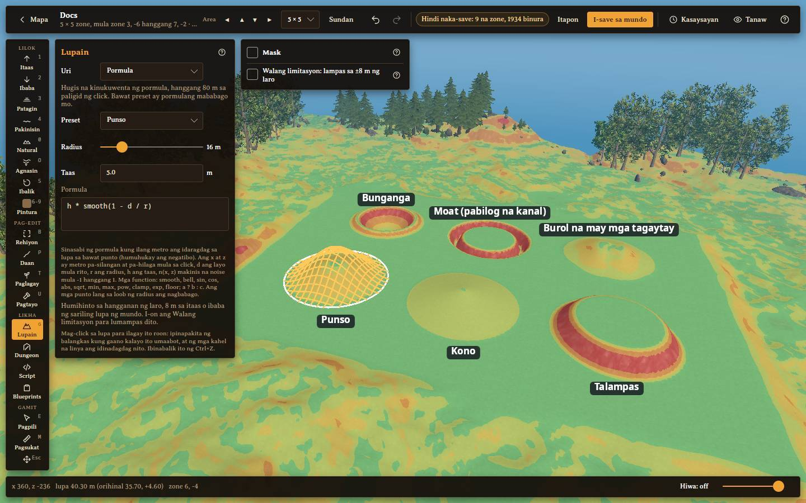
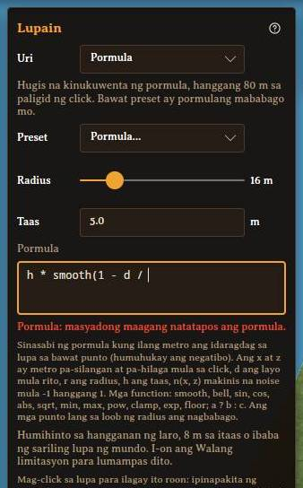
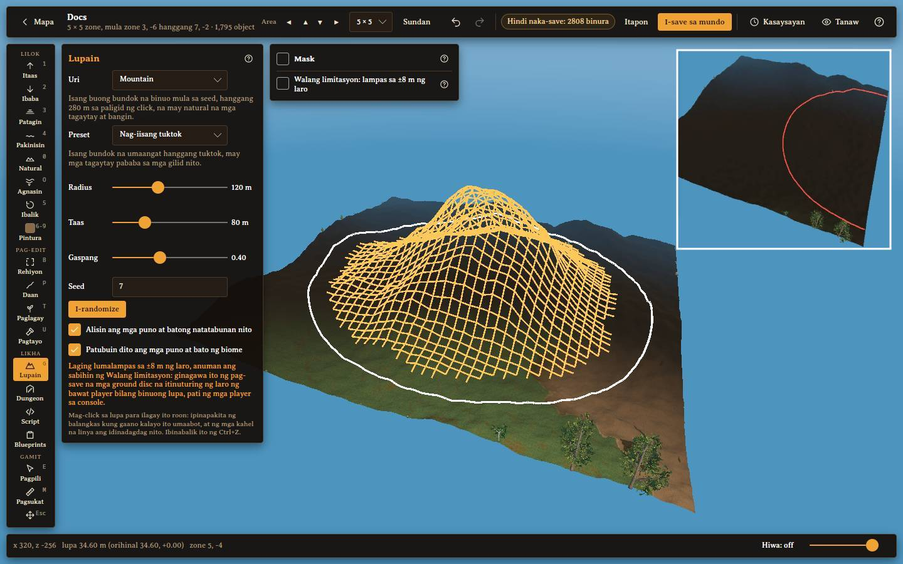
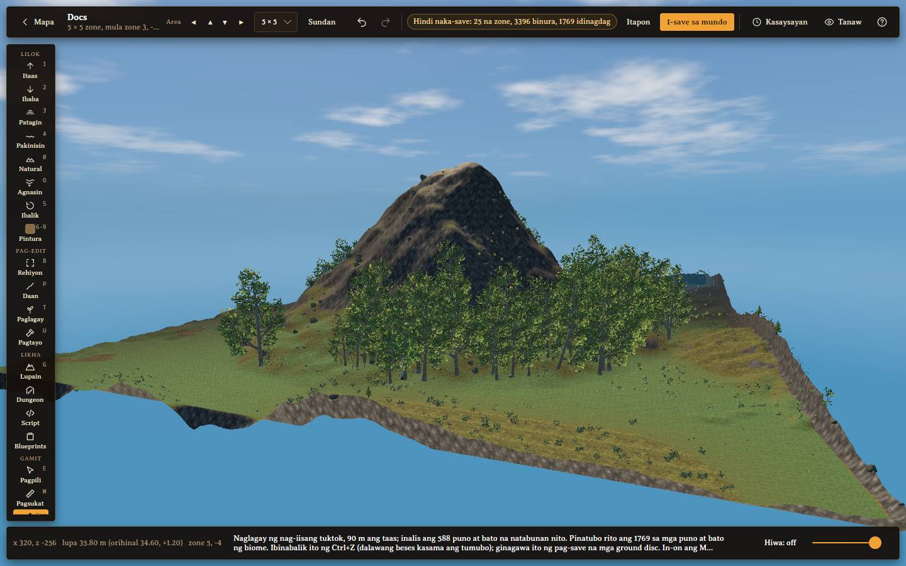
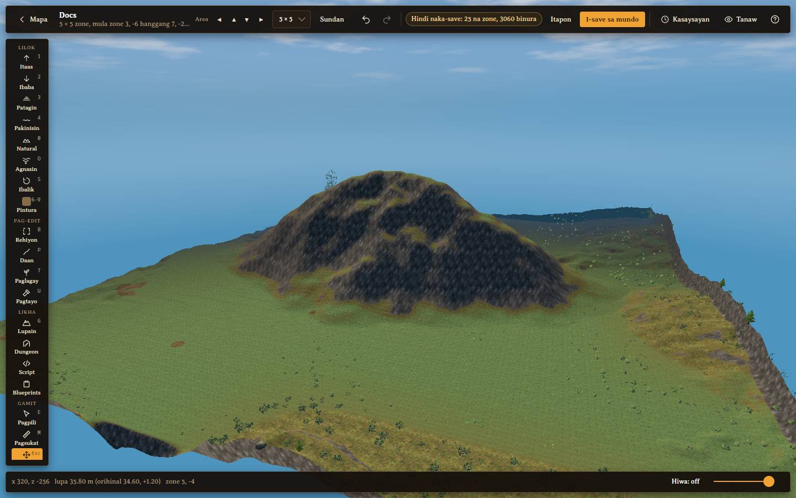
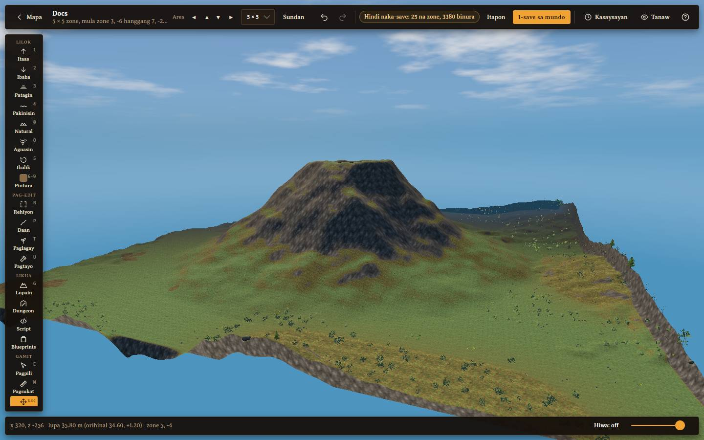
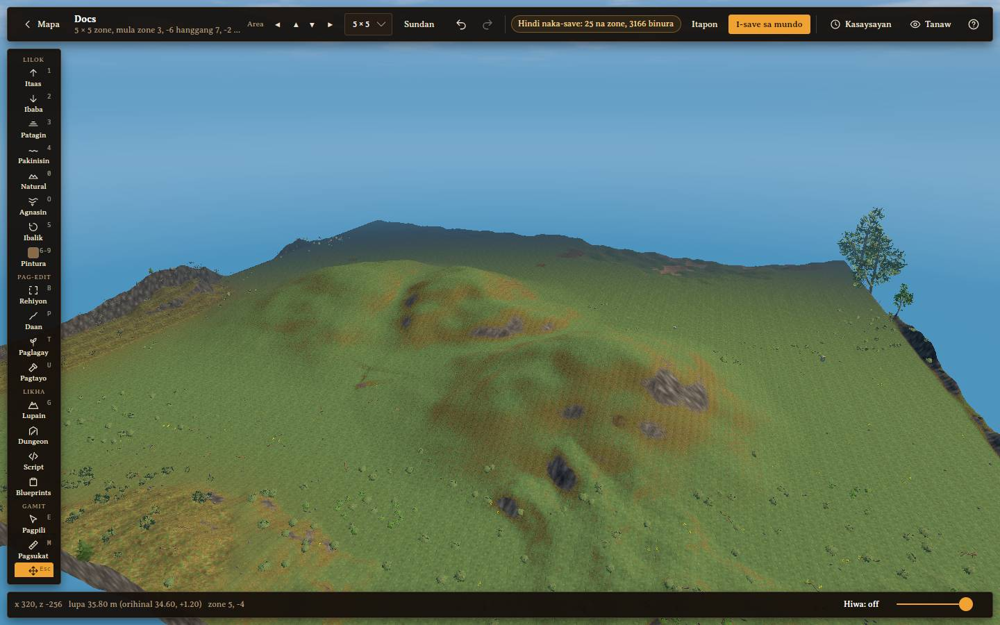
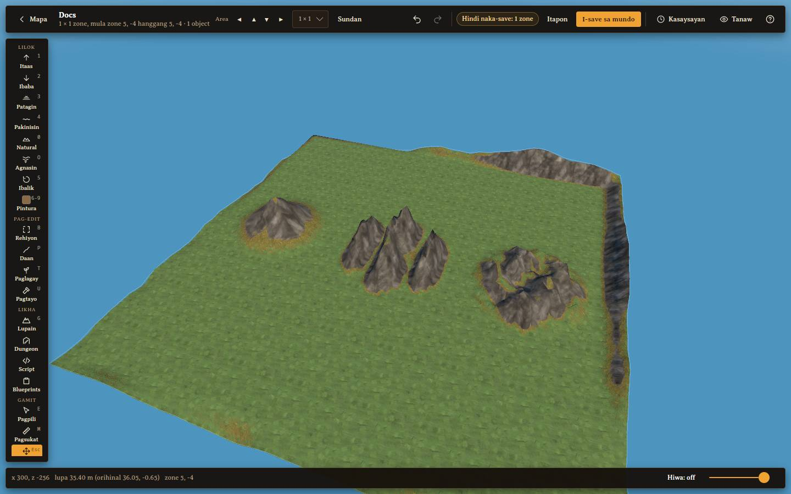
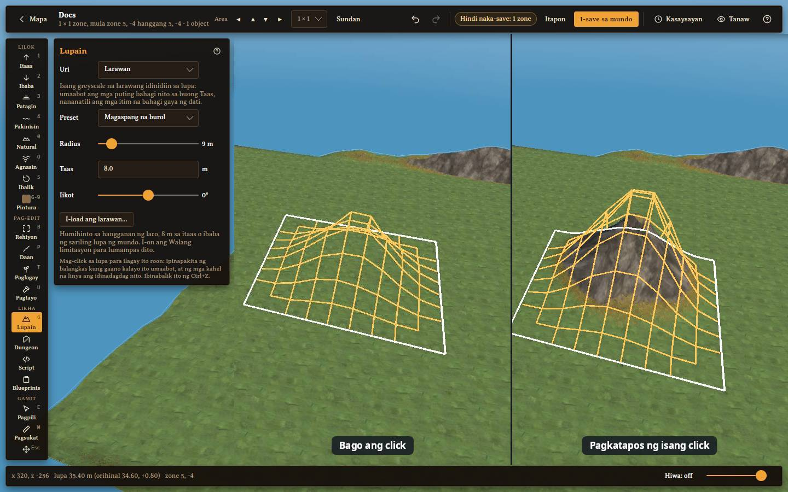

<!-- source: e6ef7a67 -->
# Lupain

Maglagay ng buong anyong-lupa sa lupa sa isang click: punso o bungangang kinukuwenta ng pormula, bundok na lampas na
lampas sa 8 m ng laro, o sarili mong larawang idiniin.

**Saan:** tool rail, seksiyong **LIKHA** · **Key:** `G` · **Gumagana sa:** mga naka-save na mundo, live

*Ang uring **Pormula**. Hanay sa harap mula kaliwa: Punso, Kono, Talampas. Hanay sa likod mula kaliwa: Bunganga, Moat
(pabilog na kanal), Burol na may mga tagaytay, bawat isa sa default na radius na 16 m at taas na 5 m, naka-on ang
**Kulay ng dahilig** sa Tanaw para mabasa ang mga dahilig nila. Ipinapakita ng panel ang Punso at ang pormula nito; sa
punso, ang puting balangkas ay ang radius at ang mga orange na linya ay ang idadagdag ng isa pang click.*

## Gamitin ito

1. Sa tool rail, i-click ang **Lupain** (`G`).
2. Sa panel, pumili ng **Uri**: **Pormula**, **Mountain** o **Larawan** (tingnan ang [Ang tatlong uri](#ang-tatlong-uri)).
3. Pumili ng **Preset**, saka itakda ang **Radius** at **Taas**.
4. Igalaw ang pointer sa ibabaw ng lupa. Ipinapakita ng puting balangkas kung hanggang saan aabot ang anyong-lupa, at
   ipinapakita ng mga orange na linya ang idadagdag nito, kasintaas o kasinlalim ng magiging ito.
5. Mag-click. Agad na naipapasok ang anyong-lupa.
6. Hindi tama? Binabawi ito ng `Ctrl+Z`. Iisang hakbang ng undo ang bawat click ("Lupain: Punso").

## Ang tatlong uri

May sariling mga preset ang bawat uri. Walang preset na may parehong pangalan sa dalawang uri, kaya sinasabi ng
pangalan kung alin ang ginamit mo.

| Uri | Ginagawa | Radius | Ang hangganang ±8 m ng laro |
|---|---|---|---|
| **Pormula** | Isang makinis at eksaktong hugis na kinukuwenta ng pormulang mababasa at mababago mo. | 2 hanggang 80 m | Sinusunod ito, maliban kung naka-on ang **Walang limitasyon**. |
| **Mountain** | Isang buong natural na bundok mula sa seed, may mga tagaytay at bangin, at may mga punong tumubo rito. | 20 hanggang 280 m | Laging lumalampas dito. |
| **Larawan** | Isang greyscale na larawang idiniin: built-in, o anumang file ng larawan. | 2 hanggang 80 m | Sinusunod ito, maliban kung naka-on ang **Walang limitasyon**. |

Sinasabi ng isang linya malapit sa ibaba ng panel kung ano ang lagay ng piniling uri sa hangganan sa ngayon. Nagiging
amber ito kapag lalampas dito ang anyong-lupa. Tingnan ang [Walang limitasyon](terrain.md#walang-limitasyon) para sa switch at
sa ginagawa ng pag-save sa lupang lampas sa hangganan.

## Mga setting na mayroon ang bawat uri

Nasa parehong puwesto ang mga ito, sa parehong pangalan, para sa tatlong uri. Tinatandaan ng bawat uri ang sarili
nitong mga halaga.

| Setting | Ano ang ginagawa |
|---|---|
| **Uri** | Kung saan gawa ang anyong-lupa. Tinatandaan para sa susunod. |
| **Preset** | Ang anyong-lupa: ang sariling listahan ng uri. |
| **Radius** | Hanggang saan ito umaabot mula sa click. |
| **Taas** | Gaano ito kataas (m). Para sa **Pormula** at **Larawan**, binabaligtad ito ng negatibong taas: nagiging hukay ang punso, at pabilog na pader ang moat. |
| **Iikot** | Ang direksiyon nito, kung mayroon: tagaytay o hanay ng **Mountain**, at anumang **Larawan**. |

## Pormula

Isang hugis na kinukuwenta punto kada punto. Bawat preset ay isang pormulang ipinapakita sa kahon; baguhin ito at
lilipat ang listahan sa **Pormula…**, ang sarili mo, na tinatandaan para sa susunod.

| Preset | Hugis |
|---|---|
| **Punso** | Isang makinis na bilog na burol. |
| **Kono** | Tuwid na dahilig hanggang sa isang tulis. |
| **Talampas** | Patag na tuktok na may makinis na dahilig sa paligid. |
| **Bunganga** | Isang hukay na may nakaangat na gilid. |
| **Moat (pabilog na kanal)** | Isang kanal sa tatlong-kapat ng radius. Kapag negatibo ang taas, pabilog na pader. |
| **Mangkok** | Isang bilog na hukay. |
| **Burol na may mga tagaytay** | Isang punsong may mga tagaytay na tumatawid dito. |
| **Pormula…** | Ang sarili mo. |

| Setting | Ano ang ginagawa |
|---|---|
| **Radius** | 2 hanggang 80 m (default 16 m). Ang lupa lang sa loob nito ang nagbabago. |
| **Taas** | Default 5 m. Ito ang `h` sa pormula. |
| **Pormula** | Ilang metro ang idadagdag sa lupa sa bawat punto sa loob ng radius; humuhukay ang negatibong numero. Lumalabas ang mali sa ilalim ng kahon, at walang mailalagay hangga't hindi ito naaayos. |

*Isang hindi tapos na pormula: lumipat ang listahan sa **Pormula…**, at sinasabi ng linya sa ilalim ng kahon kung ano
ang mali ("masyadong maagang natatapos ang pormula").*

### Sumulat ng pormula

Kinukuwenta ang pormula para sa bawat punto ng lupa sa loob ng radius, at idinadagdag ang resulta sa lupa roon.

| Pangalan | Kahulugan |
|---|---|
| `x`, `z` | Metro pasilangan at pahilaga mula sa click. |
| `d`, `r`, `h` | Layo mula sa click, ang radius, ang taas. |
| `n(x, z)` | Makinis na noise mula mga -1 hanggang 1, mula sa pattern ng mga brush (binabago ito ng **Bagong pattern** sa [Natural](terrain.md#natural)). Gamitin ang `n(x / 10, z / 10)` para sa malalapad na umbok. |
| `pi` | 3.14159… |

Mga function: `abs`, `atan2(y, x)`, `bell(t)` (1 sa 0, unti-unting nawawala sa mga ±1), `ceil`, `clamp(v, a, b)`,
`cos`, `exp`, `floor`, `log`, `max(…)` at `min(…)` (kahit ilang halaga), `pow(a, b)`, `round`, `sign`, `sin`,
`smooth(t)` (0 sa ilalim ng 0, 1 sa itaas ng 1, isang makinis na S sa pagitan), `sqrt`, `tan`.

Mga operator: `+ - * / %`, `^` (power), mga paghahambing na `< > <= >= == !=` (1 o 0), `&&`, `||`, `!`, at
`a ? b : c`.

Ipinapakita ng mga preset kung paano ito gumagana:

| Preset | Pormula |
|---|---|
| **Punso** | `h * smooth(1 - d / r)` |
| **Kono** | `h * max(0, 1 - d / r)` |
| **Talampas** | `h * smooth((r - d) / (0.35 * r))` |
| **Mangkok** | `-h * smooth(1 - (d / r) ^ 2)` |
| **Moat (pabilog na kanal)** | `-h * bell((d - 0.75 * r) / (0.12 * r))`: isang kanal sa tatlong-kapat ng radius. |

Dalawa pa para pagsimulan: ang `h * smooth(1 - d / r) * (1 + 0.3 * n(x / 8, z / 8))` ay isang burol na may mga umbok,
at humuhukay ang `abs(x) < 3 ? -h : 0` ng kanal na 6 m ang lapad na tumatawid sa bilog.

## Mountain

Isang buong bundok na ginawa mula sa seed, idinagdag sa lupang naroon, kaya pinapanatili nito ang sariling hilig ng
kalupaan at unti-unting humahalo pabalik dito sa gilid nito. Hindi kailanman perpektong bilog ang balangkas nito, at
nagdadagdag ang **Gaspang** ng mga umbok, tagaytay at bangin ayon sa laki nito.

*Nag-iisang tuktok, 80 m ang taas, radius na 120 m, bago ang click: ipinapakita ito ng mga orange na linya sa pinakamataas
na aabutin nito at ng puting singsing kung hanggang saan ito aabot. Sa inset, kanang itaas: kapag malapit ang pointer
sa gilid ng area, nagiging pula ang singsing at walang preview, dahil hindi ito kakasya.*

| Preset | Taas / radius na pinipili nito | Hugis |
|---|---|---|
| **Nag-iisang tuktok** | 50–110 m / 120–240 m | Isang bundok na tumataas hanggang sa tuktok, may mga tagaytay pababa sa mga gilid nito. |
| **Tagaytay** | 35–80 m / 140–260 m | Isang mahabang taluktok, kalahati ng haba nito ang lapad. |
| **Hanay ng bundok** | 40–90 m / 180–280 m | Tatlo hanggang limang tuktok sa isang linya, pinagdudugtong ng mga siyahan. |
| **Mesa** | 20–50 m / 70–150 m | Patag na tuktok na may matarik at mabatong gilid: may puwang para magtayo roon sa itaas. Sa mga gilid lang napupunta ang gaspang. |
| **Bulkan** | 45–100 m / 130–240 m | Isang kono na may bunganga sa tuktok. |
| **Mga alun-along burol** | 12–30 m / 100–220 m | Tatlo hanggang anim na banayad na burol na magkakasama. |

| Nag-iisang tuktok | Tagaytay |
|---|---|
|  |  |
| **Bulkan** | **Mga alun-along burol** |
|  |  |

*Apat na preset sa gitna ng 5 × 5 na area na nilinis at pinatag muna, para tumampok ang bawat isa. May mga puno ng
biome na tumubo sa nag-iisang tuktok; iniwang hubad ang iba para makita ang hugis nila.*

| Setting | Ano ang ginagawa |
|---|---|
| **Preset** | Ang uri ng bundok. Ang pagpili ng isa ay gumagawa ng bagong bundok nito, gaya ng **I-randomize**. |
| **Radius** | 20 hanggang 280 m. Magaspang ang balangkas nito, hanggang 15% na mas malayo: ipinapakita ito ng singsing. |
| **Taas** | Gaano ito kataas mula sa lupa roon, 5 hanggang 300 m. |
| **Iikot** | **Tagaytay** at **Hanay ng bundok** lang: ang direksiyong tinatahak nito, 0° hanggang 179°. |
| **Gaspang** | 0: makinis na dahilig. 1: malalalim na bangin at tagaytay. |
| **Seed** | Ang numerong pinagmumulan ng mga detalye nito: muling ginagawa ng parehong preset, mga halaga at seed ang parehong bundok. |
| **I-randomize** | Bagong bundok ng preset: bagong laki, gaspang, direksiyon at seed. Kung hindi ito kakasya sa bukas na area, pinapaliit ito nang buo, pati ang taas, para manatiling banayad ang mga dahilig. |
| **Alisin ang mga puno at batong natatabunan nito** | Naka-on sa simula. Inaalis ang mga puno, bato, ore, palumpong at mapipitas kung saan nito itinataas ang lupa nang higit sa 2 m (gagawin din ito ng pag-save). Nananatili ang mga piece ng gusali, pati ang nasa dungeon na mataas sa itaas. |
| **Patubuin dito ang mga puno at bato ng biome** | Naka-on sa simula. Pinapatubo ang sariling mga puno at bato ng biome, ayon sa mga patakaran ng laro, sa mga dahilig na itinaas nito nang higit sa isang metro, malayo sa nakatayo na roon. Pangalawang hakbang ng undo. |

Dapat kumasya nang buo ang bundok sa bukas na area, kasama ang magaspang na gilid: kung saan pula ang singsing, walang
naipapasok ang click.

## Larawan

Isang greyscale na larawang idiniin sa lupa: umaabot sa buong **Taas** ang mga puting bahagi nito, sa bahagi nito ang
mga abong bahagi, at nananatili ang mga itim na bahagi. Sumasaklaw ang larawan sa parisukat na dalawang beses ang lapad
ng **Radius**; ipinapakita ito ng balangkas.

*Ang mga built-in na larawan, 6 m ang taas sa radius na 8 m. Mula kaliwa: Magaspang na burol, Mga buhanginan, Mabatong
lupa.*

*Ang **Magaspang na burol**, **Radius** 9 m at **Taas** 8 m. Kaliwa: ang parisukat na balangkas at orange na preview
nito sa patag na lupa bago ang click. Kanan: ang buong burol, inilagay ng isang click.*

| Preset | Hugis |
|---|---|
| **Magaspang na burol** | Isang maliit na tuktok na may magaspang na gilid. |
| **Mga buhanginan** | Magkakaagapay na tagaytay sa loob ng isang bilog na bahagi. |
| **Mabatong lupa** | Bukol-bukol at baku-bakong lupa. |
| Sarili mo | Bawat larawang in-load mo, sa ilalim ng pangalan ng file nito. |

| Setting | Ano ang ginagawa |
|---|---|
| **Radius** | Kalahati ng gilid ng larawan, 2 hanggang 80 m (default 16 m). |
| **Taas** | Gaano kataas umaangat ang mga puting bahagi (m, default 4). Negatibo: idinidiin sila pababa. |
| **Iikot** | Iniikot ang larawan, -180° hanggang 180°. |
| **I-load ang larawan…** | Gumagamit ng anumang larawan (PNG, JPEG…): heightmap mula sa ibang tool, logo, hugis na iginuhit ng kamay. Ang liwanag nito ang taas; binibilang na itim ang mga transparent na bahagi. Ini-scale ito sa parisukat na 128 × 128 na punto, kaya napipiga ang malapad na larawan at nawawala ang pinong detalye. Itinatabi ito para sa susunod sa ilalim ng pangalan ng file nito. |
| **Kalimutan ang larawan** | Tinatanggal ang napiling in-load na larawan. Ipinapakita lang para sa mga in-load na larawan: nananatili ang mga built-in. |

Ang mga larawan ay ang mga [stamp](terrain.md#mga-stamp) ng mga brush: hugis ng brush din ang ilo-load mo rito, at
iniaalok dito ang in-load doon. Dalawang built-in na stamp, **Mesa (patag na tuktok)** at **Gilid ng bunganga**, ay
hugis ng brush lang: bilang anyong-lupa, ginagawa sila ng uring **Pormula** (**Talampas**, at **Moat** na may
negatibong taas).

## Mga shortcut

| Key o mouse | Ano ang ginagawa |
|---|---|
| `G` | Piliin ang Lupain. |
| Mag-click sa lupa | Ilagay doon ang anyong-lupa. |
| `Ctrl+Z` | Bawiin ang huli (pindutin nang dalawang beses kapag may mga punong tumubo sa bundok). |
| `Esc` | Umalis sa tool (balik sa Tanaw). |

## Mga tip at limitasyon

- **Humihinto ang Pormula at Larawan sa 8 m mula sa nabuong lupa**, at sinasabi iyon ng status bar. Para sa mas
  matataas, i-tick ang **Walang limitasyon: lampas sa ±8 m ng laro** sa card ng **Mask** katabi ng panel (tingnan ang
  [Walang limitasyon](terrain.md#walang-limitasyon)): nananatili itong naka-on para sa bawat tool sa lupa hanggang i-off mo ito.
- **Laging lumalampas ang bundok sa 8 m ng laro**, anuman ang sabihin ng **Walang limitasyon**. Ginagawa itong mga
  ground disc ng pag-save at binubura nito ang Kasaysayan ng area, gaya ng sa
  [Walang limitasyon](terrain.md#walang-limitasyon). Suriin ito bago ka mag-save.
- **Para sa malalaking bundok, magbukas muna ng mas malaking area** (ang listahan ng laki ng area sa top bar): sa
  5 × 5 na area, aabot sa mga 137 m ang radius.
- **Gumagana ang [Mask](masks.md)**: kung saan nito hindi isinasama ang lupa, humihinto ang anyong-lupa sa isang
  baitang, ang bundok sa isang bangin.
- **Ang pormulang nagbibigay ng 0 saanman** ay walang binabago, at sinasabi iyon ng status bar. Iniiwan gaya ng dati
  ang mga puntong walang ibinibigay na numero (paghahati sa zero).
- **Hindi kailanman nagbabago ang pinakalabas na linya ng mga punto ng area** (tingnan ang
  [Ang naka-lock na gilid](concepts/areas-and-zones.md#ang-naka-lock-na-gilid)).
- **Para palambutin ang isang gilid** pagkatapos, daanan ito ng brush na **Pakinisin** o **Natural**.
- **Napapanatili ng banayad na dahilig ang damo at puno; hubad na bato ang lumalabas sa matatarik**, gaya ng pagguhit
  ng laro sa kanila.
- **Para gamitin ang larawan bilang brush** habang nagda-drag ka, piliin na lang ito bilang **Hugis** ng brush
  (tingnan ang [Mga stamp](terrain.md#mga-stamp)). Para itakda ang taas ng isang buong area mula sa larawan, tingnan ang
  [Heightmap](area.md#heightmap).
- **Ang isang [script](scripting.md)** ay makapaglalagay rin ng mga hugis ng pormula at bundok, ayon sa patakaran.

## Kaugnay

- [Itaas o hukayin lampas sa 8 m na hangganan ng laro](guides/raise-past-the-limit.md)
- [Walang limitasyon](concepts/ground-limits.md#walang-limitasyon): kung paano sine-save ang lupa nang lampas sa 8 m
- [Paano ginagawa ang bundok](concepts/ground-limits.md#paano-ginagawa-ang-bundok)
- [Mga patakaran sa pagtubo](concepts/objects.md#mga-patakaran-sa-pagtubo): kung ano ang tumutubo sa bundok
- [Lilok at pintura](terrain.md): mga brush at stamp
