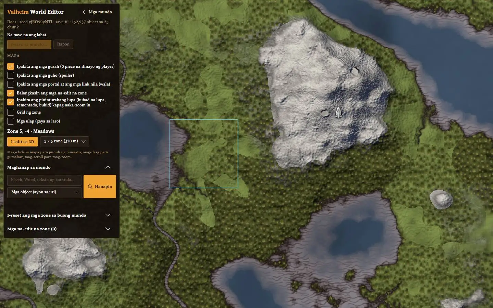
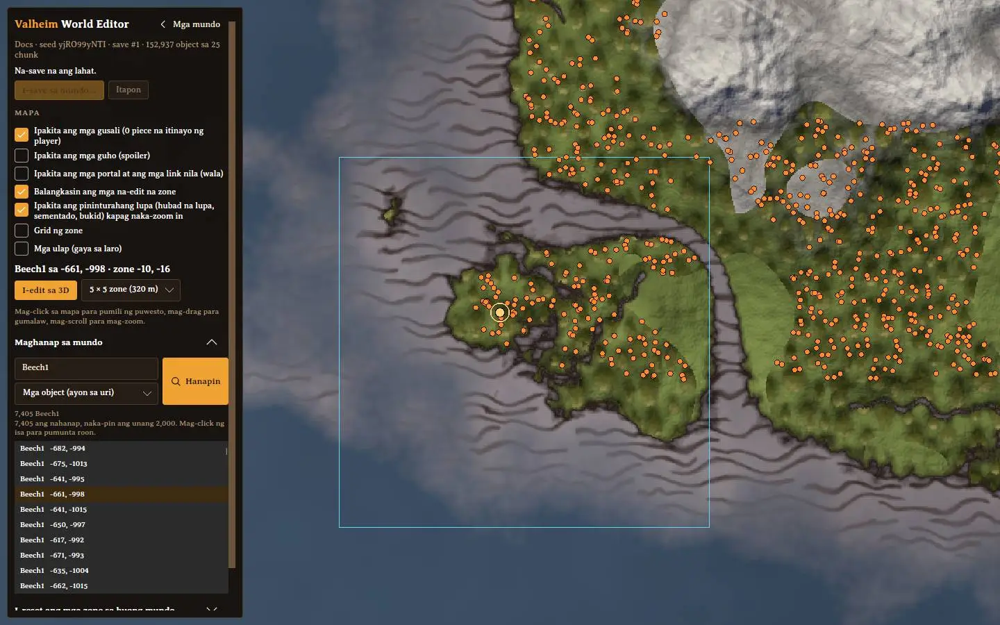
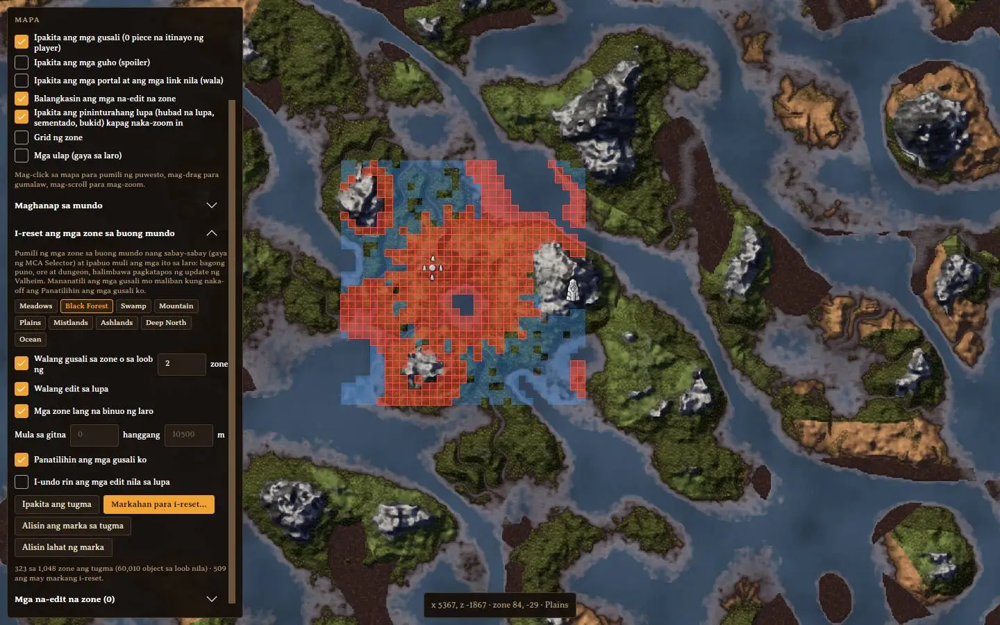
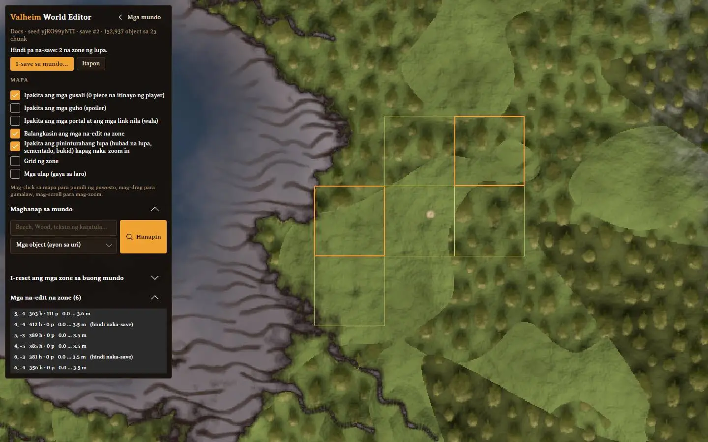

<!-- source: 2b176694 -->
# Mapa ng mundo

Tingnan ang buong mundo, piliin ang lugar na ie-edit sa 3D, hanapin ang bawat object, chest at karatula, i-reset ang
mga zone kahit saan nang sabay-sabay, at i-save ang naghihintay.

**Saan:** bumubukas kasama ng bawat mundo; ibinabalik ka rito ng **Mapa** sa top bar ng editor · **Key:** wala
(binubuksan ng `F1` ang pahinang ito) · **Gumagana sa:**
mga naka-save na mundo, live

> [!WARNING]
> **Isara ang laro o ihinto ang server bago mo i-save ang mundo nang offline.** Isinusulat ng tumatakbong laro ang mga
> file ng mundo kapag nagse-save ito, at nawawala ang mga pagbabago mo, kasama ang mga reset ng zone. Para baguhin ang
> mundo habang tumatakbo ito, gamitin ang [live mode](live-mode.md).

*May napiling zone: ang mapusyaw na asul na parisukat ay ang area na bubuksan ng **I-edit sa 3D**, sa laking napili sa
tabi ng button.*

Iginuguhit ang mapa gaya ng pagguhit ng laro sa sarili nitong mapa, mula sa data ng mundo, kaya mukha itong mapa sa
laro na nakalantad ang lahat. Ipinapakita ng simula at ng mga trader (kapag nagawa na ang zone nila) ang mga icon nila
gaya sa laro.

## Gamitin ito

1. Mag-drag para igalaw ang mapa; i-scroll ang mouse wheel para mag-zoom papunta sa pointer.
2. Mag-click ng isang puwesto. Ipinapakita ng side panel ang zone at biome nito ("Zone 12, -4 · Black Forest"), at
   nakabalangkas sa mapusyaw na asul ang area na bubuksan.
3. Sa side panel, piliin ang laki sa listahan sa tabi ng **I-edit sa 3D**.
4. Pindutin ang **I-edit sa 3D**. Bumubukas ang [3D editor](editor-basics.md) sa paligid ng zone na kini-click mo.

Natatandaan ng mapa kung saan ka huling tumingin, pati sa susunod na pagsisimula mo ng editor. Ipinapakita ng kahon sa
ibaba ang punto sa ilalim ng pointer: ang mga coordinate, zone at biome nito ("x 812, z -260 · zone 13, -4 · Meadows"),
at ang alt biome ng area nito kapag mayroon ("alt biome Dark Meadows", lumalabas ilang segundo pagkabukas ng mapa).

## Mga setting

Ibinibigay ng itaas ng side panel ang pangalan ng mundo, seed, numero ng save at kung ilang object ang laman nito
(live: ang koneksiyon sa halip na numero ng save); pagkatapos mag-save, ipinapakita nito ang bagong numero ng save.
Ibinabalik ka ng **Mga mundo** sa panimulang pahina: kapag may nakabinbing pagbabago, nagtatanong muna ito, at
nawawala ang mga iyon sa **Umalis pa rin**.

| Setting | Ano ang ginagawa nito |
|---|---|
| **I-reload mula sa laro** | Live lang: binabasa ulit ang buong mundo mula sa tumatakbong laro. Inililista ng linya sa itaas ang mga player na online ("Live na mundo · 2 player online: Ragnar, Freya"). |
| **I-save sa mundo…** / **I-apply nang live** | Isinusulat ang bawat nakabinbing pagbabago sa mga file ng mundo (live: ipinapadala ito sa tumatakbong laro). Sinasabi ng linya sa itaas kung ano ang naghihintay, halimbawa "Hindi pa na-save: 3 na zone ng lupa, 12 binura, 40 idinagdag, 25 pag-reset ng zone." |
| **Itapon** | Itinatapon ang bawat pagbabagong hindi pa naka-save o na-apply, pagkatapos magtanong. |
| **Ipakita ang mga gusali (N piece na itinayo ng player)** | Iginuguhit ang bawat piece na itinayo ng player: mga bakas kapag malapit, mga tuldok kapag mas malayo, wala kapag naka-zoom out nang malayo. Iginuguhit kasama ng gusali ang mga guhong pinagtayuan ng mga player. Naka-on sa simula. |
| **Ipakita ang mga guho (spoiler)** | Iginuguhit din ang mga guho ng mundo (mga toreng bato, sirang bahay, guho ng Mistlands at Ashlands), mas malabo. Naka-off sa simula, dahil ipinapakita nito kung nasaan ang mga ito. |
| **Ipakita ang mga portal at ang mga link nila (N: P magkakabit na pares, A walang kapares)** | Iginuguhit ang bawat portal bilang violet na tuldok, na may linya sa pagitan ng dalawang may parehong tag (ang pares na pinagdudugtong ng laro); guwang ang portal na walang kapares. Kapag naka-zoom in (8 m bawat pixel o mas malapit), isinusulat ang bawat tag sa tabi ng portal nito ("walang tag" kung walang laman). Binibilang ng N ang mga portal, ng P ang magkakabit na pares, ng A ang mga portal na walang kapares. Nabibilang ang mga portal na idinagdag o binura sa editor kapag ipinakita ulit ang mapa. Naka-off sa simula, dahil ipinapakita nito kung nasaan ang bawat portal. |
| **Balangkasin ang mga na-edit na zone** | Binabalangkas ang mga zone na binago ang lupa: manipis na dilaw na linya para sa mga pagbabagong nasa mundo na, mas makapal na kahel na linya para sa mga pagbabagong hindi pa naka-save o na-apply. Naka-on sa simula. |
| **Ipakita ang pininturahang lupa (hubad na lupa, sementado, bukid) kapag naka-zoom in** | Kapag malapit, iginuguhit ang mapa sa detalyeng 1 m kasama ang mga nakabinbin mong pagbabago sa lupa; ipinapakita rin nito ang hubad na lupa, sementado at binungkal na lupa. Naka-on sa simula. |
| **Grid ng zone** | Iginuguhit ang mga linya sa pagitan ng mga 64 m na [zone](concepts/areas-and-zones.md#mga-zone), kapag sapat ang zoom. |
| **Mga ulap (gaya sa laro)** | Iginuguhit ang gumagalaw na anino ng ulap ng mapa sa laro. |
| **I-edit sa 3D** | Binubuksan ang 3D editor sa area sa paligid ng napiling zone. |
| Listahan ng laki (sa tabi ng **I-edit sa 3D**) | Kung gaano karaming lupa ang nilo-load ng editor: **3 × 3 zone (192 m)**, **5 × 5 zone (320 m)** (default), **7 × 7**, **9 × 9**, **13 × 13** o **17 × 17 zone (1088 m)**. Gamitin ang 5 × 5 sa karamihan ng gawain, 9 × 9 o higit pa para mag-paste ng bayan o magtaas ng malaking bundok. Mas mabagal ang mas malalaking area. Mababago mo ito mamaya sa itaas na bar. |

Sa live mode, lumalabas ang mga player na online bilang mga asul na tuldok na may pangalan nila, na ina-update bawat
5 segundo. Nananatiling [nakabinbin](concepts/saving-and-history.md#mga-nakabinbing-pagbabago) ang mga pagbabago sa iba't ibang
area: mag-edit ng isang area, bumalik sa mapa, magbukas ng iba, at i-save ang lahat nang sabay.

## Maghanap sa mundo

*Bawat kahel na pin ay isang nahanap na object. Mas malaki ang resultang napili sa listahan, may gintong singsing, at
nakagitna rito ang mapa.*

1. Buksan ang **Maghanap sa mundo**.
2. I-type ang bahagi ng pangalan o teksto, halimbawa `Beech`, `Wood` o mga salita ng karatula. Hindi mahalaga ang
   malaki o maliit na titik.
3. Piliin kung ano ang hahanapin (nasa ibaba).
4. Pindutin ang **Hanapin** (o `Enter`). Naka-pin sa mapa at nakalista ang bawat resulta.
5. Mag-click ng resulta: gumigitna rito ang mapa at pinipili ang zone nito. Bubukas ang **I-edit sa 3D** na napili na
   ang object na iyon.

| Hanapin | Nahahanap |
|---|---|
| **Mga object (ayon sa uri)** | Bawat object na ang uri ay may tekstong iyon: `portal`, `Beech`, `chest`, `guard_stone`… |
| **Mga item sa lalagyan** | Bawat chest, cart, barko o ibang lalagyan na may item na ang pangalan ay may tekstong iyon: `Wood`, `Draugr`, `Silver`… Sinasabi ng bawat resulta kung ilan ("Wood ×50"). |
| **Mga teksto (karatula, portal, ward…)** | Bawat object na may tekstong naglalaman nito: teksto ng karatula, tag ng portal, pangalan ng ward at lapida. Ipinapakita ng bawat resulta ang tekstong tumugma. |

Binibilang ng linya sa itaas ng mga resulta ang nahanap bawat uri (bawat item para sa mga lalagyan) at sa kabuuan.
Ipinapakita ng listahan ang unang 300 resulta; hanggang 2000 ang naka-pin. Para sa mga item at teksto, bumubukas din
ang [data](select.md) ng object, kaya mababago mo agad ang laman ng chest o ang teksto ng karatula. Kapag binago ang
hinahanap, naghahanap ulit agad.

Binabasa ng paghahanap ang mundo kung paano ito sa editor: nahahanap ang mga object na inilagay mo pero hindi na-save,
hindi nahahanap ang mga object na binura mo pero hindi na-save. Ang sariling bookkeeping object ng laro (mga pangalang
nagsisimula sa `_`, gaya ng `_ZoneCtrl`) ay nahahanap lang kapag nagsisimula rin sa `_` ang teksto mo.

## I-reset ang mga zone sa buong mundo

*Minarkahang i-reset ang mga zone ng Meadows (pula), saka pinili ang **Black Forest** at pinindot ang **Ipakita ang
tugma** (asul). Binibilang ng linya sa ilalim ng mga button ang dalawa.*

Pumili ng mga zone kahit saan sa mundo ayon sa kung ano sila, at ipabuo ulit ang mga ito sa laro: bagong puno, bato,
ore at dungeon, halimbawa pagkatapos ng update ng Valheim, sa mga lugar na walang nagtayo. Para i-reset ang mga zone sa
ilalim ng isang pinili, gamitin na lang ang tool na [Rehiyon](area.md#i-reset-ang-mga-zone), na may parehong dalawang switch at
pareho ang pagmamarka; hakbang-hakbang: [Buuin ulit ang mga zone](guides/reset-zones.md).

1. Buksan ang **I-reset ang mga zone sa buong mundo**.
2. Itakda ang filter (nasa ibaba).
3. Pindutin ang **Ipakita ang tugma**. Sa unang pagkakataon, binabasa ng editor ang bawat zone (sandali lang). Nagiging
   asul ang mga tugmang zone at sinasabi ng isang linya ang "N sa M zone ang tugma (K object sa loob nila)". Mula noon,
   sinusundan ng mapa ang filter habang binabago mo ito.
4. Pindutin ang **Markahan para i-reset…** at sumang-ayon. Nagiging pula ang mga tugmang zone.
5. Ginagawa ng **I-save sa mundo** (offline) o **I-apply nang live** ang reset. Hanggang doon, kinakansela ito ng
   **Alisin lahat ng marka**, at kinakansela ito ng **Alisin ang marka sa tugma** para sa mga zone na tugma ngayon sa
   filter.

> [!CAUTION]
> **Hindi na maa-undo ang reset kapag na-save o na-apply na.** Tinatanggal ang bawat object sa zone maliban sa mga
> lapida ng mga player at, kapag naka-on ang **Panatilihin ang mga gusali ko**, ang mga piece na itinayo ng player:
> mga puno, bato, ore, guho, pasukan ng dungeon, mga item sa lupa at mga creature, pati mga paamong hayop. Ilabas muna
> ang mga paamong hayop, at [i-backup ang mundo](guides/back-up-a-world.md).

| Setting | Ano ang ginagawa nito |
|---|---|
| Mga button ng biome (**Meadows** … **Ocean**) | Mga zone lang na ang gitna ay nasa isa sa mga naka-on na biome. Kapag walang naka-on: bawat biome. |
| **Walang gusali sa zone o sa loob ng N zone** | Hindi isinasama ang mga zone na nasa loob ng N zone mula sa mga piece na itinayo ng player, kasama ang pahilis (0 hanggang 50; 2 sa simula). Naka-on sa simula. Kapag naka-off ito, hindi pa rin isinasama ang zone na may mga piece habang naka-on ang **Panatilihin ang mga gusali ko**. |
| **Walang edit sa lupa** | Hindi isinasama ang mga zone na binago ang lupa (sa laro o sa editor). Naka-on sa simula. |
| **Mga zone lang na binuo ng laro** | Mga zone lang na nalapitan na ng isang player. Kapag naka-off: pati mga zone na may laman lang na object o edit sa lupa mula sa editor. Naka-on sa simula. |
| **Mula sa gitna … hanggang … m** | Mga zone lang na nasa layong ito mula sa gitna ng mundo. Kapag walang laman: walang limitasyon (nasa 10,500 m ang gilid ng mundo). Halimbawa, i-reset lang ang mga panlabas na singsing. |
| **Panatilihin ang mga gusali ko** | Naka-on sa simula: hindi kailanman nire-reset mula sa mapa ang mga gusali, at hindi kailanman tumutugma ang zone na may mga piece na itinayo ng player. Kapag naka-off, at naka-off din ang **Walang gusali…**, tumutugma ang mga zone na may gusali gaya ng iba at sumasama ang mga gusali nila; sinasabi ito ng tanong bago magmarka. |
| **I-undo rin ang mga edit nila sa lupa** | Binabawi rin ng reset ang mga pagbabago sa lupa ng mga zone, pabalik sa lupa ng seed. Mahalaga lang kapag naka-off ang **Walang edit sa lupa**. Naka-off sa simula rito (naka-on sa simula ang sa tool na Rehiyon). |
| **Ipakita ang tugma** | Kinukulayan ng asul ang mga tugmang zone at binibilang ang mga ito at ang mga object sa loob nila. |
| **Markahan para i-reset…** | Minamarkahang i-reset ang bawat tugmang zone (pula), pagkatapos magtanong. |
| **Alisin ang marka sa tugma** | Kinakansela ang reset ng mga tugmang zone na may marka; nananatili ang ibang marka. |
| **Alisin lahat ng marka** | Kinakansela ang bawat reset ng zone na may marka, pati ang mga minarkahan gamit ang tool na Rehiyon. |

Sa susunod na lumapit ang isang player sa zone na na-reset, binubuo ulit ito ng laro mula sa seed, kasama ang lokasyon
nito (guho, dungeon, altar). Kapag live, nangyayari iyon agad kung nasaan ang mga player; pagkatapos ng live na reset,
binabasa ulit ng editor ang mundo, at sumasama ang kasaysayan nang wala ang ginawa nito sa mga na-reset na zone.

## Mga na-edit na zone

Inililista ng **Mga na-edit na zone (N)** ang bawat zone na binago ang lupa, pinakamaraming binago muna. Ibinibigay ng
bawat row ang zone, kung ilang punto ng taas (`h`) at punto ng pintura (`p`) ang binago, ang saklaw ng pagbabago ng
taas (`-2.4 … 6.0 m`), at "(hindi naka-save)" kapag may nakabinbing pagbabago ("(hindi na-apply)" sa live na mundo).
Mag-click ng row para mag-zoom in sa zone na iyon at piliin ito, handa para sa **I-edit sa 3D**.

*Apat na zone ang naka-save (manipis na dilaw) at dalawa ang na-edit mula noon (mas makapal na kahel): minamarkahan ng
listahan ang mga nakabinbin ng "(hindi naka-save)".*

## Mga shortcut

| Key o mouse | Ano ang ginagawa nito |
|---|---|
| Drag | Igalaw ang mapa. |
| Mouse wheel | Mag-zoom papunta sa pointer. |
| Click | Piliin ang zone doon. |
| `Enter` sa kahon ng paghahanap | Hanapin. |

## Mga tip at limitasyon

- **Ipinapakita ng mapa ang mundo kung paano ito nabasa.** Kapag live, sinusundan ng 3D editor ang binabago ng mga
  player sa bukas na area, pero nagbabago lang ang natitirang bahagi ng mapa sa **I-reload mula sa laro**.
- **Kapag naka-zoom in nang mas malapit sa mga 6 m bawat pixel**, iginuguhit ulit sa detalyeng 1 m ang bahaging
  nakikita, kasama ang mga nakabinbin mong pagbabago sa lupa.
- **Mga zone lang na nasa loob ng mundo** ang nakalista para i-reset. Bumubuo rin ang dedicated server na walang
  online ng mga zone na malayo sa labas ng mundo: hindi isinasama ang mga iyon.
- **Para bawiin ang isang pagbabago**, kinakansela ng **Alisin lahat ng marka** ang mga minarkahang reset, at
  itinatapon ng **Itapon** ang lahat ng nakabinbin. Para i-undo ang isang pagbabago, buksan ang area nito sa 3D at
  pindutin ang `Ctrl+Z` o gamitin ang Kasaysayan: tingnan ang
  [Mag-undo ng hakbang, bawiin ang isang pagbabago, o itapon ang lahat](guides/undo-changes.md).
- **Walang nahanap ang paghahanap?** Suriin ang baybay at ang piniling hahanapin; kailangan ng bookkeeping object ng
  `_` sa unahan.
- **Mga mundong ginawa gamit ang Expand World**: kapag naka-install at naka-on ang add-on nito, lumalabas nang buo ang
  mas malapad na mundo, mula sa data nito ang mga icon ng lokasyon, at idinadagdag ng readout ang teritoryo at ang mga
  status effect na nakukuha ng player doon ("teritoryo frost · epekto Freezing (gabi)"). Tingnan ang
  [I-edit ang mundong ginawa gamit ang Expand World, Riverheim o Tunnelheim](guides/use-mods-worlds.md).

## Kaugnay

- [Hanapin ang isang object, item sa chest o karatula](guides/find-things.md)
- [Buuin ulit ang mga zone](guides/reset-zones.md)
- [Mag-backup ng mundo bago mag-edit](guides/back-up-a-world.md)
- [Mga area at zone](concepts/areas-and-zones.md)
- [Mga batayan ng editor](editor-basics.md), [Live mode](live-mode.md)
