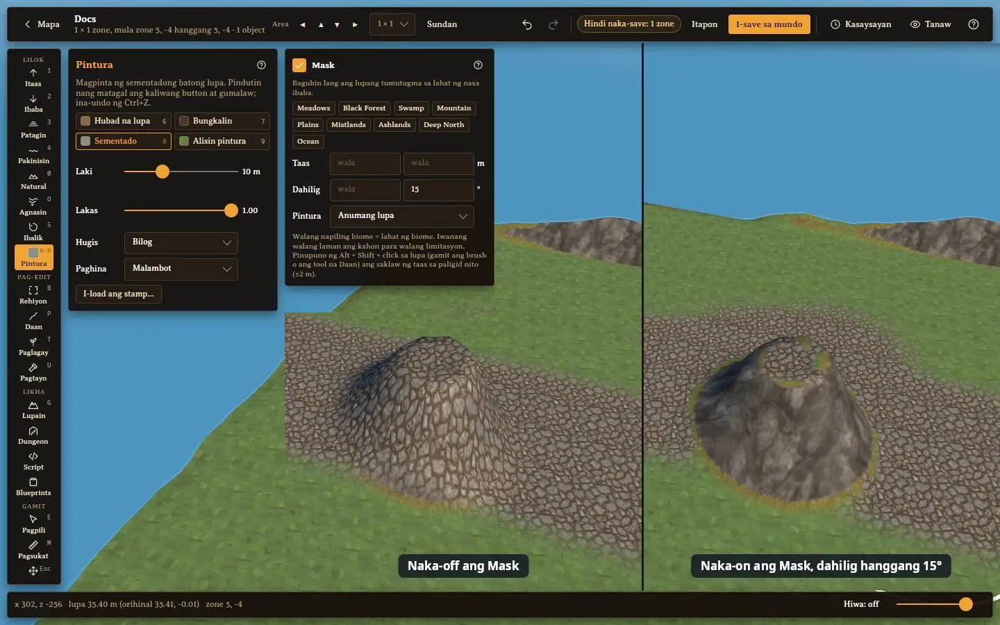
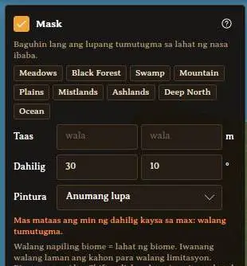

<!-- source: 1cb7e459 -->
# Mask

Gawing ang lupang pinili mo lang ang babaguhin ng isang tool, ayon sa biome, taas, dahilig o pintura: sementuhin lang
ang mga patag na bahagi ng burol, patagin ang sahig ng lambak nang hindi ginagalaw ang mga gilid nito, magtanim lang sa
lupang walang pintura.

**Saan:** ang card na **Mask** sa tabi ng panel ng tool · **Key:** wala (nagtatakda ng saklaw ng taas ang
`Alt`+`Shift`+click) · **Gumagana sa:** mga naka-save na mundo, live

*Ang parehong malapad na stroke ng pinturang Sementado sa isang punso. Kaliwa, naka-off ang Mask: sementado ang lahat.
Kanan, naka-on ang Mask na may dahilig na mas mababa sa 15°: sementado ang patag na lupa, hindi ang matatarik na gilid
ng punso. Nasa tabi ng panel ng tool ang card ng Mask.*

Gumagana ang Mask sa mga brush na panlilok at sa brush na Pintura, sa [Lupain](landform.md), [Daan](path.md), sa mga
aksiyon ng tool na [Rehiyon](area.md), sa pag-paste at sa [Paglagay](place.md). Hindi nito pinipigilan ang
[Pagtayo](build.md): napupunta ang piece kung saan ka nakaturo.

## Gamitin ito

1. Pumili ng tool na gumagamit ng Mask. Lumalabas ang card na **Mask** sa tabi ng panel nito.
2. Sa card, i-tick ang **Mask**. Bumubukas ang mga setting nito sa ilalim nito.
3. Itakda ang mga biome, taas, dahilig at pinturang gusto mo. Iwanang walang laman ang isang setting para hindi
   limitahan ayon dito.
4. Gamitin ang tool gaya ng dati: ang lupa lang na tumutugma sa bawat setting ang binabago nito.
5. Kapag tapos ka na, alisin ang tick sa **Mask**. Nananatili itong naka-on, kasama ang mga setting nito, kapag
   nagpalit ka ng tool.

## Mga setting

| Setting | Ano ang ginagawa |
|---|---|
| **Mask** | Naka-on: ang lupa lang na tumutugma sa lahat ng nasa ibaba ang binabago ng tool. Naka-off: walang hangganan. |
| Mga chip ng biome | **Meadows**, **Black Forest**, **Swamp**, **Mountain**, **Plains**, **Mistlands**, **Ashlands**, **Deep North**, **Ocean**: ang mga biome lang na ito. Kapag walang napili: bawat biome. |
| **Taas** min / max | Ang lupa lang sa pagitan ng mga taas na ito (m; nasa 30 m ang dagat). Iwanang walang laman ang isang kahon ("wala") para walang hangganan sa panig na iyon. |
| **Dahilig** min / max | Ang lupa lang sa pagitan ng mga tarik na ito, 0° hanggang 90°. Ang maximum na 0 ay nagpapadaan lang sa lupang perpektong patag. |
| **Pintura** | **Anumang lupa**, **Walang pintura lang**, **May pintura lang**, **Hubad na lupa lang**, **Binungkal lang** o **Sementado lang**. |

Lumalabas ang orange na babala sa ilalim ng mga setting kapag wala silang pinapadaan: maximum na dahilig na 0°, o
minimum na mas mataas sa maximum.

*Mas mataas ang Dahilig min na 30° kaysa sa max na 10°, kaya nagbababala ang card nang kulay orange: "Mas mataas ang
min ng dahilig kaysa sa max: walang tumutugma."*

### Walang limitasyon, sa parehong card

Sa ilalim ng Mask, hawak ng card ang isa pang setting na pinagsasaluhan ng bawat tool sa lupa:

| Setting | Ano ang ginagawa |
|---|---|
| **Walang limitasyon: lampas sa ±8 m ng laro** | Naka-on: umaabot ang mga tool sa lupa hanggang 400 m mula sa nabuong lupa, hindi lang sa 8 m ng laro. Iisang switch para sa mga brush na panlilok, [Lupain](landform.md) (ang mga pormula at larawan nito), [Daan](path.md) at [Rehiyon](area.md); nananatili itong naka-on hanggang i-off mo ito, at naka-off ito tuwing nagbubukas ang editor. Tingnan ang [Walang limitasyon](terrain.md#walang-limitasyon). |

Hindi ito bahagi ng Mask (gumagana ito naka-on man o naka-off ang Mask), at ipinapakita lang ito ng card kasama ng mga
tool na sakop nito: hindi kasama ng brush na Pintura at ng [Paglagay](place.md), na hindi naglilipat ng lupa. Laging
lumalampas sa hangganan ang bundok ng Lupain, anuman ang sabihin ng switch.

## Mga shortcut

| Key o mouse | Ano ang ginagawa |
|---|---|
| `Alt`+`Shift`+click sa lupa | Gamit ang brush na panlilok o pintura, o ang tool na Daan: ino-on ang Mask at pinupunan ang **Taas** mula 2 m sa ibaba hanggang 2 m sa itaas ng lugar na iyon. Madaling gamitin para magtrabaho sa iisang terasa o iisang baybayin lang. |

## Mga tip at limitasyon

- **Walang malambot na gilid ang Mask.** Tumutugma o hindi ang bawat punto ng lupa (isa bawat metro), kaya ang
  paglilok gamit ito ay maaaring mag-iwan ng baitang kung saan nagtatagpo ang tumutugmang lupa at ang iba pa, lalo na
  sa Itaas, Ibaba at [Lupain](landform.md). Daanan ang baitang ng brush na **Pakinisin** pagkatapos, naka-off ang Mask.
- **Habang may stroke ng brush, tinitingnan ng Mask ang lupa gaya noong pinindot mo ang button.** Patuloy na tumataas
  lampas sa hangganan ng taas ang stroke ng Itaas hanggang bumitaw ka. Tinitingnan ng mga edit na isang click (Lupain,
  Daan, Rehiyon, paste) ang lupa bago mismo sila.
- **Ang biome ay ang biome na binuo ng mundo** roon. Hindi ito binabago ng paghuhugis sa lupa.
- **Pintura:** binibilang na walang pintura ang lupang pinunasan ng **Alisin pintura**. Kailangan ng **Hubad na
  lupa lang**, **Binungkal lang** at **Sementado lang** na kahit kalahati man lang ng kulay ay ang pinturang iyon.
- **Walang nagbago?** Sinasabi ng status bar ang "Walang nagbago: hindi isinasama ng Mask ang lahat ng lupa sa ilalim
  ng brush (tingnan ang mga setting nito sa taas, dahilig, biome at pintura)."
- **Sinusunod din ng paste ang Mask, kahit hindi ipinapakita ang card habang nagpe-paste ka.** Nililimitahan ng
  naiwang naka-on na Mask ang lupang hinuhugis ng paste (pumapasok lahat ng object nito). Alisin ang tick sa **Mask**
  bago ka kumopya at mag-paste kung gusto mo ang buong lupa.
- **Setting ang Mask, hindi pagbabago**: hindi ito ina-undo ng `Ctrl+Z` at hindi sine-save sa mundo. Naka-off ito,
  walang laman ang mga kahon nito, tuwing nagbubukas ang editor.

Mga ideya:

- Para sementuhin ang daan sa mga patag na bahagi lang ng gilid ng burol, itakda ang max ng **Dahilig** at gamitin ang
  **Pintahan ng sementado** ng tool na Daan.
- Para magtanim lang sa lupang walang pintura o sa binungkal na lupa lang, itakda ang **Pintura** at gamitin ang
  [Paglagay](place.md).
- Para patagin ang ilalim ng lambak nang hindi ginagalaw ang mga gilid nito, itakda ang max ng **Taas** nang medyo
  mataas sa sahig ng lambak at gamitin ang **Patagin** o ang tool na [Rehiyon](area.md).

## Kaugnay

- [Linisin ang mga puno at bato, patagin ang puwesto ng gusali](guides/clear-an-area.md)
- [Magtanim ng gubat, bukid o bakod na halaman](guides/plant-a-forest.md)
- [Lilok at pintura](terrain.md), [Daan](path.md), [Rehiyon](area.md)
- [Paano hinuhusgahan ng mask ang lupa](concepts/ground-limits.md#paano-hinuhusgahan-ng-mask-ang-lupa)
