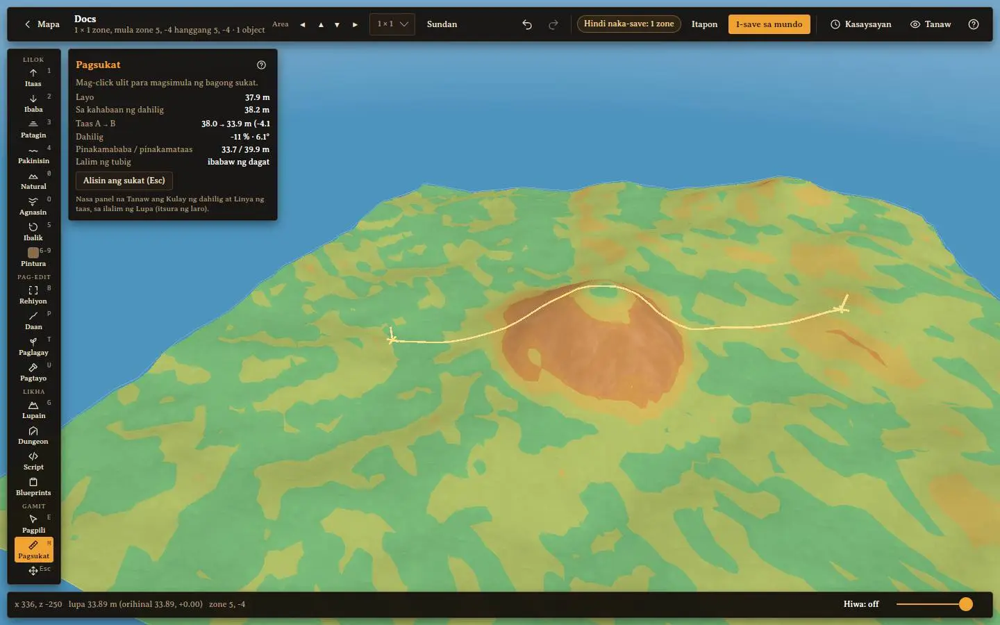
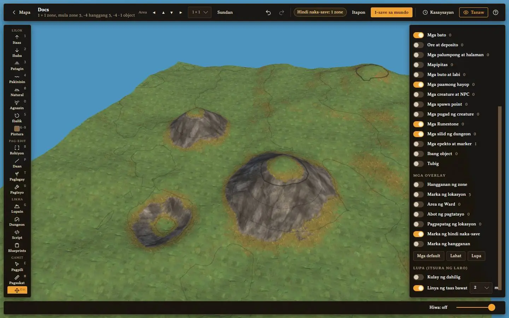
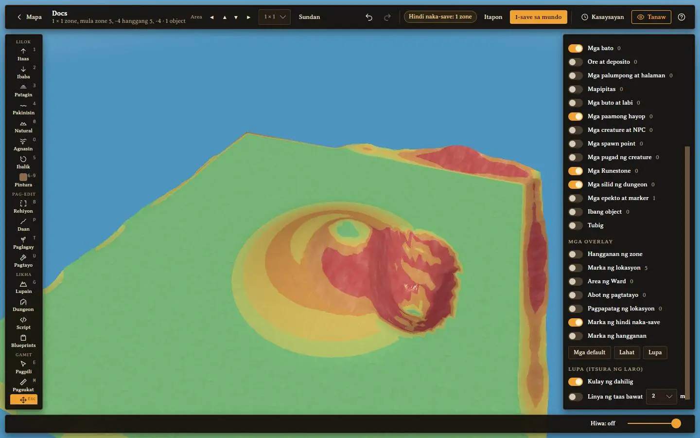

<!-- source: 164ad5c4 -->
# Pagsukat at mga overlay

Mag-click ng dalawang punto at basahin ang layo, ang pagitan ng taas at ang dahilig sa pagitan nila. Ipinapakita ng
dalawang overlay ng lupa, ang kulay ng dahilig at ang mga linya ng taas, ang tarik at taas sa lahat ng dako nang sabay
habang gumagamit ka ng kahit anong tool.

**Saan:** tool rail, seksiyong **GAMIT**; ang mga overlay sa panel na Tanaw · **Key:** `M` · **Gumagana sa:** mga
naka-save na mundo, live

*Isang sukat mula sa paanan ng bunton hanggang sa ibabaw nito, naka-on ang kulay ng dahilig. Sumusunod ang linya sa
lupa; ipinapakita ng panel ang layo, ang mga taas at ang dahilig.*

## Gamitin ito

1. Sa tool rail, i-click ang **Pagsukat** (`M`).
2. Mag-click ng unang punto sa lupa. Sumusunod ang linya sa cursor.
3. Mag-click ng pangalawang punto para itakda ang sukat. Ipinapakita ng panel ang mga resulta.
4. Mag-click ulit para magsimula ng bagong sukat, o pindutin ang **Alisin ang sukat (Esc)** para tanggalin ito.

Iginuguhit ang linya sa ibabaw ng lupa, kaya ipinapakita nito ang hugis ng lupa sa pagitan ng dalawang punto. Sinasabi
ng hint sa itaas ng panel kung ano ang gagawin ng susunod na click.

## Mga resulta

| Resulta | Ano ang ibig sabihin |
|---|---|
| **Layo** | Ang tuwid na layo kapag tiningnan mula sa itaas, gaya sa mapa (m). |
| **Sa kahabaan ng dahilig** | Ang haba ng tuwid na linya mula A hanggang B, kasama ang pagitan ng taas (m). |
| **Taas A → B** | Ang taas ng lupa sa dalawang punto at ang pagitan nila, halimbawa `35.0 → 42.5 m (+7.5)`. |
| **Dahilig** | Ang karaniwang dahilig mula A hanggang B, sa % at sa degree. Ang dahilig na 100% ay 45°. |
| **Pinakamababa / pinakamataas** | Ang pinakamababa at pinakamataas na lupa sa kahabaan ng linya, binabasa bawat metro: lumalabas dito ang umbok o lubak kahit magkapantay ang A at B. |
| **Lalim ng tubig** | Kung gaano kalalim sa ilalim ng dagat ang mas mababang punto (nasa 30 m ang dagat), o "ibabaw ng dagat". |

Ang mga taas ay sa laro, gaya sa status bar. Mapipili mo ang mga value sa panel at makokopya ang mga ito.

## Mga overlay ng lupa

Sa panel na Tanaw (`V`), sa ilalim ng **LUPA (itsura ng laro)**:

| Setting | Ano ang ginagawa nito |
|---|---|
| **Kulay ng dahilig** | Kinukulayan ang lupa ayon sa tarik, para makita mo kung saan masyadong matarik para sa rampa o pagtatayuan: berde sa ilalim ng 10°, dilaw-berde 10–20°, dilaw 20–30°, kahel 30–45°, pula sa itaas ng 45°. Nananatili ang liwanag at lilim ng mga burol. |
| **Linya ng taas bawat** *N* **m** | Gumuguhit ng mga linya ng taas (contour) bawat **1**, **2** (default), **5** o **10** m. Mas madilim at mas makapal ang bawat ikalimang linya. Ang mga linyang magkakalapit ay nangangahulugang matarik ang lupa. |

Kailangan ng dalawa ang **Itsura ng laro** (ang itsura ng lupa sa panel na Tanaw), nananatiling naka-on habang
gumagamit ka ng ibang tool, at natatandaan. Tumatama ang mga linya ng taas sa mga multiple ng hakbang, kaya laging may
linya sa antas ng dagat (30 m) at madaling sundan ang baybayin.

*Mga linya ng taas bawat 2 m sa dalawang bunton at isang hukay, naka-off ang mga hangganan ng zone. Ipinapakita ng
panel na Tanaw ang **Linya ng taas bawat** 2 m sa ilalim ng **LUPA (itsura ng laro)**; mas madilim ang bawat ikalimang
linya.*

*Kulay ng dahilig sa isang bunton: berde sa patag na lupa, saka dilaw-berde, dilaw at kahel paakyat sa banayad na
gilid nito, at pula sa banging hiniwa rito. Ipinapakita ng panel na Tanaw na naka-check ang **Kulay ng dahilig** sa
ilalim ng **LUPA (itsura ng laro)**.*

## Mga shortcut

| Key o mouse | Ano ang ginagawa nito |
|---|---|
| `M` | Piliin ang Pagsukat. |
| Click | Itakda ang punto A, saka ang punto B, saka magsimula ulit. |
| `Esc` | Alisin ang sukat; ang pangalawang `Esc` ay umaalis sa tool. |
| `V` | Ipakita o itago ang panel na Tanaw (ang mga overlay). |

## Mga tip at limitasyon

- **Walang binabago ang sukat** sa mundo at hindi ito sine-save.
- **Sumusunod sa lupa ang mga resulta.** Baguhin ang lupa gamit ang ibang tool at bumalik sa Pagsukat, o mag-undo:
  binabasa ulit ang mga taas, ang dahilig at ang pinakamababa at pinakamataas na punto sa parehong A at B.
- **Magplano ng rampa:** sukatin mula sa paanan nito hanggang sa itaas. Ang **Dahilig** ay ang dahilig na ibinibigay ng
  **Rampa** ng tool na [Daan](path.md) sa tuwid na linya sa pagitan ng parehong mga punto.
- Ang **Marka ng hangganan**, sa parehong panel na Tanaw, ay nagkukulay-pula sa lupang umabot sa ±8 m ng laro. Tingnan
  ang [Marka ng hangganan](concepts/ground-limits.md#marka-ng-hangganan).

## Kaugnay

- [Gumawa ng kalsada o rampa paakyat ng burol](guides/make-a-road.md)
- [Linisin ang mga puno at bato, patagin ang puwesto ng gusali](guides/clear-an-area.md)
- [Mga batayan ng editor](editor-basics.md): ang panel na Tanaw
- [Daan](path.md), [Lilok at pintura](terrain.md)
