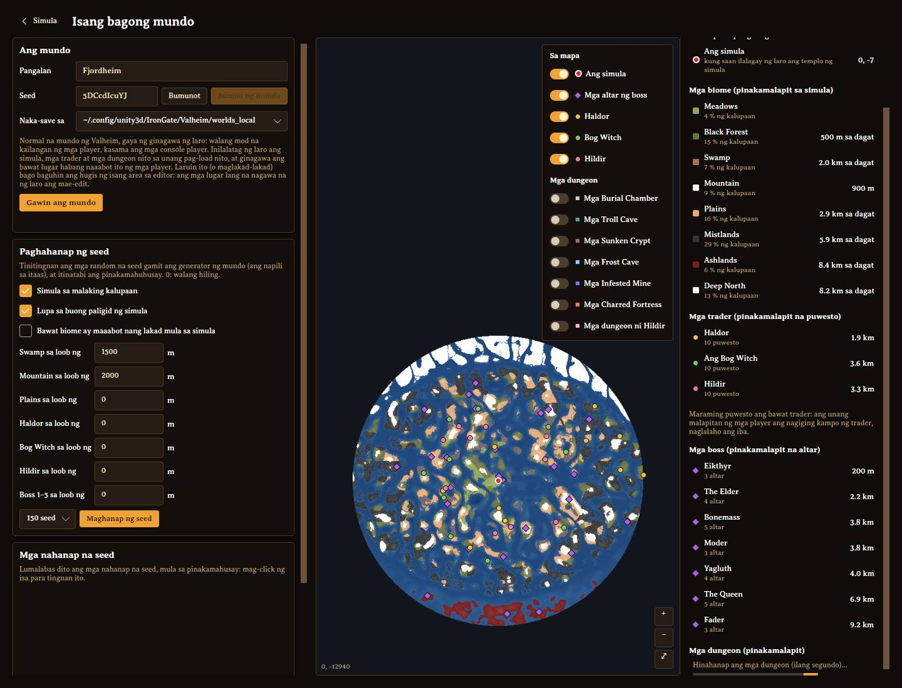
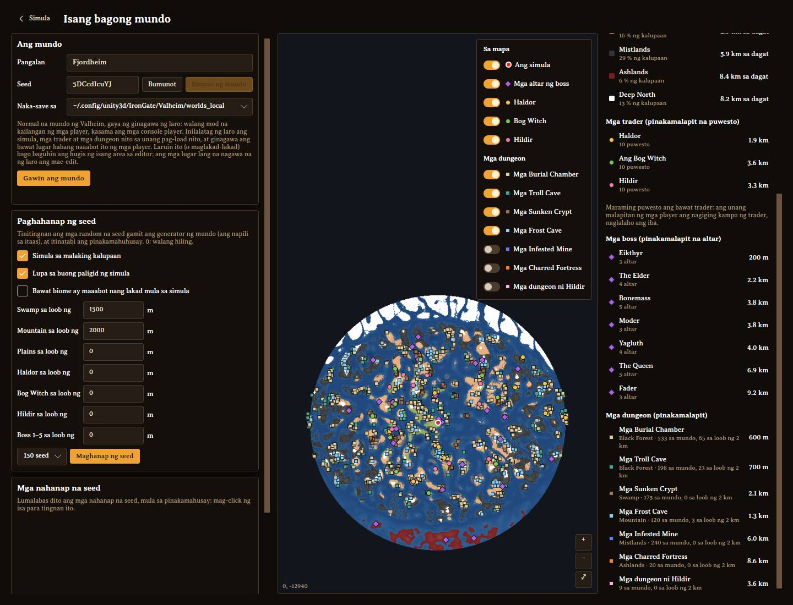
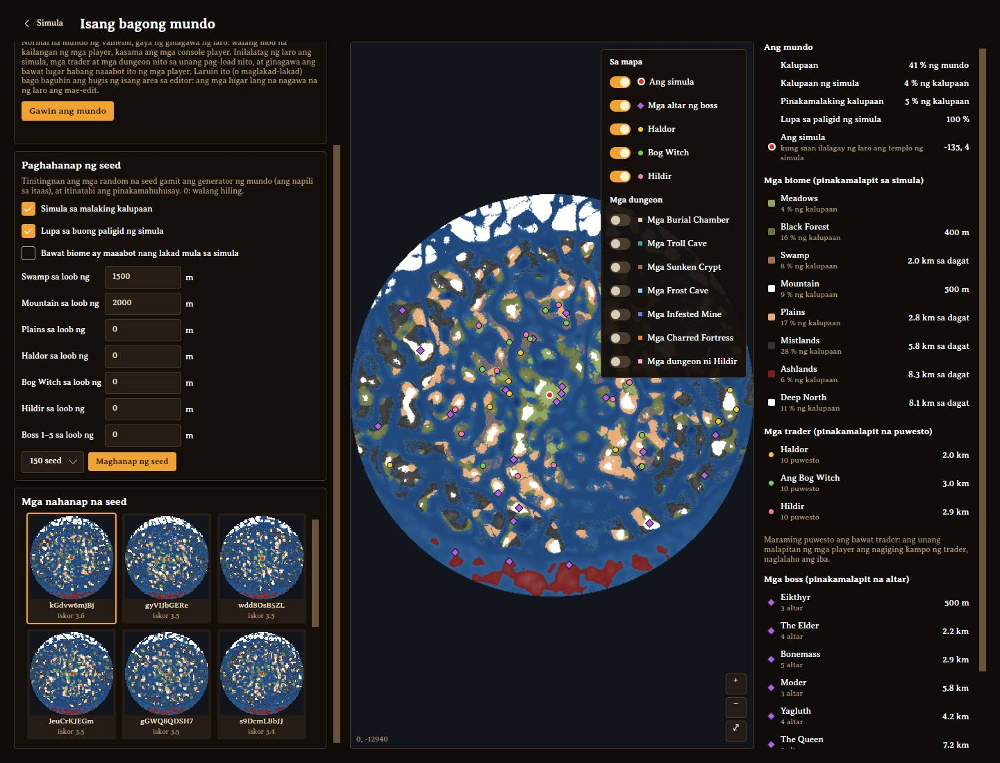

<!-- source: eca6c42a -->
# Isang bagong mundo

Tingnan ang mundo ng isang seed bago pa ito umiral, maghanap sa maraming seed ng isang babagay sa iyo, at gawin ang
mundo.

**Saan:** panimulang pahina, **Likha** → **Isang bagong mundo** → **Gumawa ng bagong mundo** · **Key:** wala ·
**Gumagana sa:** ang panimulang pahina (hindi kailangang may nakabukas na mundo)

*Ang pulang tuldok ang simula, ang mga lilang diyamante ang mga altar ng boss, ang mga dilaw, berde at rosas na tuldok
ang mga puwesto ng trader. Inililista ng hanay sa kanan ang mga detalye ng seed, dito naka-scroll pababa sa
pinakamalapit na mga altar ng boss.*

Normal na mundo ng Valheim ang mundong ginagawa mo, ginawa ayon sa sariling mga patakaran ng laro mula sa seed nito:
nakakasali rito ang mga player nang walang anumang mod, kasama ang mga console player sa crossplay (maliban kung pipiliin
mo ang generator ng isang mod sa pagbuo ng mundo, tingnan ang [Mga tip at limitasyon](#mga-tip-at-limitasyon)).

## Gamitin ito

1. Sa panimulang pahina, piliin ang **Isang bagong mundo** sa ilalim ng **Likha**, saka **Gumawa ng bagong mundo**.
   Ipinapakita ang mundo ng isang random na seed.
2. Mag-type ng seed at pindutin ang **Bumuo ng mundo** (o `Enter`), o pindutin ang **Bumunot** para sa isa pang random.
   Para hayaang maghanap ang editor, tingnan ang [Paghahanap ng seed](#paghahanap-ng-seed).
3. Tingnan ang mapa at ang mga detalye sa tabi nito. Opsiyonal: i-on ang mga uri ng dungeon na mahalaga sa iyo.
4. I-type ang **Pangalan** ng mundo, piliin kung saan ito **Naka-save sa**, at pindutin ang **Gawin ang mundo**.
   Isinusulat ng editor ang mundo at binubuksan ang mapa nito.
5. Simulan ang Valheim, i-load ang bagong mundo at maglakad sa paligid ng mga bahaging gusto mong i-edit. Ginagawa lang
   ng laro ang bawat lugar kapag lumalapit ang mga player dito.
6. Buksan ulit ang mundo sa editor para muling hubugin ang ginawa ng laro.

Bumabalik ang **Simula** (itaas na kaliwa) sa panimulang pahina; walang nagagawa.

## Mga setting

| Setting | Ang ginagawa nito |
|---|---|
| **Seed** | Hanggang 10 titik at digit, gaya sa laro. Laging parehong mundo ang ginagawa ng parehong seed. Mahalaga ang malaki at maliit na titik: dalawang mundo ang `Valheim` at `valheim`. |
| **Bumunot** | Naglalagay ng isa pang random na seed sa kahon at ipinapakita ang mundo nito. |
| **Bumuo ng mundo** | Ipinapakita ang mundo ng seed (o `Enter` sa kahon ng seed). Kulay abo habang ang seed sa kahon ang nakapakita. |
| **Sa mapa** | Ipakita o itago ang **Ang simula**, **Mga altar ng boss**, **Haldor**, **Bog Witch** at **Hildir**. |
| **Mga dungeon** | Ipakita kung saan mapupunta ang bawat uri ng dungeon (naka-off sa simula). Tingnan ang [Mga dungeon](#mga-dungeon). |
| **Pangalan** | Ang pangalan ng mundo, gaya ng paglista ng laro dito. Ito rin ang pangalan ng folder nito, kaya hindi ito puwedeng maglaman ng `/ \ : * ? " < > \|`. |
| **Naka-save sa** | Kung saang folder ng mga mundo ng laro ito mapupunta: ang mga lokal mong mundo (`worlds_local`) o ang mga mundo sa Steam cloud (`worlds`), ang mga umiiral sa computer na ito. Nauuna ang folder na pinagse-save-an ng naka-install na laro (sa Linux, iniingatan ng Windows build na pinapatakbo sa Proton ang mga mundo nito sa loob ng Steam prefix nito), para mailista ng laro ang mundo. |
| **Generator** | Ipinapakita lang kapag may ginagamit na add-on para sa isang mod sa pagbuo ng mundo at nahanap ang mod: ang generator ng mod o **Ang sa laro**. Tingnan ang [Mga tip at limitasyon](#mga-tip-at-limitasyon). |
| **Gawin ang mundo** | Ginagawa ang mundo at binubuksan ang mapa nito. Hindi kailanman pinapatungan ang mundong may parehong pangalan na nasa folder na iyon: hihingan ka ng ibang pangalan. |

## Ang mapa

Ipinapakita ng mapa ang mundo ng seed gaya ng paggawa rito ng laro: kalupaang kinulayan ayon sa biome (mas mapusyaw
ang mas mataas na lupa), asul ang tubig sa kalupaan, may lilim ang dagat ayon sa lalim, nasa itaas ang hilaga. Ilang
segundo ito; lumalabas ang "Tinitingnan ang mundo ng ……" habang naghihintay. Kapag naka-zoom in, iginuguhit ulit ang
view nang isang punto bawat pixel ng screen, kaya nananatiling matalas ang mga baybayin at ilog. Ipinapakita ng ibabang
kaliwang sulok ang mga coordinate sa ilalim ng pointer.

Nasa ibabaw ng mapa ang mga lugar na inilalatag ng laro sa unang pag-load nito sa mundo:

- ang **simula** (pulang tuldok na may puting singsing): ang start temple, kung saan dumarating ang mga bagong player;
- ang **mga altar ng boss** (mga lilang diyamante): Eikthyr, ang Elder, Bonemass, Moder, Yagluth, ang Queen at Fader;
- ang **mga puwesto ng trader**: Haldor (dilaw), ang Bog Witch (berde) at Hildir (rosas). Maraming puwesto ang bawat
  trader: ang unang malapitan ng mga player ang nagiging kampo, at nawawala ang iba.

Itapat ang pointer sa isang marka para sa mga coordinate nito at layo nito mula sa simula. Eksakto ang mga puwesto sa
kung saan ilalagay ng laro ang mga ito: inuulit ng editor ang mga patakaran ng laro sa paglalagay, binabasa mula sa mga
file ng Valheim mo (ilang segundo, sa unang pagkakataon).

## Mga dungeon

*Apat na uri ang naka-on: bawat maliit na parisukat ay isang dungeon, ang kulay nito ang uri nito, gaya sa mga switch
at sa **Mga dungeon (pinakamalapit)** (layo, biome, ilan sa mundo at sa loob ng 2 km).*

Ipinapakita ng mga switch na **Mga dungeon** ang **Mga Burial Chamber**, **Mga Troll Cave**, **Mga Sunken Crypt**,
**Mga Frost Cave**, **Mga Infested Mine**, **Mga Charred Fortress** at **Mga dungeon ni Hildir**. Nagsisimulang hanapin
ng editor ang mga ito sa sandaling ipakita ang isang seed (ilang segundo); lumalabas ang uring in-on mo sa sandaling
mahanap ito. Iniingatan ang mga dungeon ng huling 20 seed na tiningnan mo, kaya agad na lumalabas ang mga ito kapag
binalikan mo ang isa.

Ibinibigay ng **Mga dungeon (pinakamalapit)**, para sa bawat uri, kung gaano kalayo mula sa simula ang pinakamalapit,
ang biome nito, ilan ang nasa mundo at ilan ang nasa loob ng 2 km. Mag-click ng hilera para i-on ang uring iyon at
makita ang pinakamalapit sa mapa.

Kasama rito ang mga uring idinadagdag o hinaharangan ng isang **alt biome** (isang variant gaya ng Dark Meadows).
Hindi ipinapakita ang mga nayon, guho at ibang maliliit na lugar.

## Ang mga detalye ng seed

Sa tabi ng mapa, ang mundo ng seed bilang mga listahan. Mag-click ng hilerang may marka para makita ito, o ang
pinakamalapit sa uri nito, sa mapa.

- **Ang mundo**: **Kalupaan** (gaano kalaki sa mundo ang kalupaan), **Kalupaan ng simula** at **Pinakamalaking
  kalupaan** (bawat isa bilang bahagi ng buong kalupaan), **Lupa sa paligid ng simula** (lupa sa loob ng 400 m mula sa
  simula), at ang mga coordinate ng simula.
- **Mga biome (pinakamalapit sa simula)**: ang bahagi ng bawat biome sa kalupaan at gaano kalayo ang pinakamalapit na
  lupa nito, na may "sa dagat" kapag nasa ibang kalupaan ito (kailangan mo ng bangka).
- **Mga trader (pinakamalapit na puwesto)**: gaano kalayo ang pinakamalapit na puwesto ng bawat trader, at ilan ang
  puwesto nito.
- **Mga boss (pinakamalapit na altar)**: gaano kalayo ang pinakamalapit na altar ng bawat boss, at ilan ang mga ito.
- **Mga dungeon (pinakamalapit)**: tingnan ang [Mga dungeon](#mga-dungeon).

Ang lupa rito ay ang lupang matatayuan o malulusong mo: hanggang 1 m sa ilalim ng tubig, o 3 m sa Swamp. Ang kalupaan
ay lupang nakadugtong sa lupa nang hindi tumatawid sa mas malalim na tubig.

## Paghahanap ng seed

*Ang mga hiling (dito, malaking kalupaan na may lupa sa buong paligid, Swamp sa loob ng 1500 m at Mountain sa loob ng
2000 m, 150 seed); ang pinakamahusay na mga seed na nahanap sa ilalim ng **Mga nahanap na seed**, mula sa
pinakamahusay. Na-click ang una: lumiliwanag ang hangganan nito at pinupuno ng mundo nito ang malaking mapa.*

Tumitingin ang **Paghahanap ng seed** sa maraming random na seed sa background at itinatabi ang pinakamahusay para sa
mga hiling mo. Ang 0 sa kahon ng layo ay nangangahulugang "walang hiling". Para sa paghahanap nang hakbang-hakbang,
tingnan ang [Maghanap ng seed na may gusto mo malapit sa simula](guides/find-a-seed.md).

| Setting | Ang ginagawa nito |
|---|---|
| **Simula sa malaking kalupaan** | Unahin ang mga seed na nasa malaking kalupaan ang simula (naka-on sa simula). |
| **Lupa sa buong paligid ng simula** | Unahin ang mga seed na kaunti ang tubig sa loob ng 400 m mula sa simula (naka-on sa simula). |
| **Bawat biome ay maaabot nang lakad mula sa simula** | Unahin ang mga seed kung saan nasa sariling kalupaan ng simula ang pinakamalapit sa bawat biome. |
| **Swamp sa loob ng**, **Mountain sa loob ng**, **Plains sa loob ng** | Unahin ang mga seed kung saan nasa loob ng ganoong dami ng metro ang pinakamalapit na lupa ng biome na iyon (0 hanggang 8000 m, nang tig-250; 1500 para sa Swamp at 2000 para sa Mountain sa simula). |
| **Haldor sa loob ng**, **Bog Witch sa loob ng**, **Hildir sa loob ng** | Unahin ang mga seed kung saan nasa loob ng ganoong dami ng metro ang isa sa mga puwesto ng trader na iyon. |
| **Boss 1–5 sa loob ng** | Unahin ang mga seed kung saan nasa loob ng ganoong dami ng metro ang isang altar ng bawat isa kina Eikthyr, ang Elder, Bonemass, Moder at Yagluth. |
| Listahan ng seed | Ilang random na seed ang titingnan: **60 seed**, **150 seed** (ang default) o **400 seed**. |
| **Maghanap ng seed** | Sinisimulan ang paghahanap; ipinapakita ng bar sa ilalim nito kung gaano na ito kalayo. |
| **Ihinto** | Inihihinto ang paghahanap at ipinapakita ang pinakamahusay na nahanap sa ngayon. |

Lumalabas ang 12 pinakamahusay na seed sa ilalim ng **Mga nahanap na seed**, bawat isa ay maliit na mapa kasama ang
seed at iskor nito. Itapat ang pointer sa isa para sa mga detalye nito; i-click ito para makita ito sa malaking mapa
(nagkakaroon ito ng may-kulay na hangganan).

### Paano binibigyan ng iskor ang mga seed

- Nagdadagdag ang **Simula sa malaking kalupaan** ng hanggang 3 (ang bahagi ng kalupaan ng simula sa buong kalupaan,
  beses 3); nagdadagdag ang **Lupa sa buong paligid ng simula** ng hanggang 2 (ang bahagi ng lupa sa loob ng 400 m,
  beses 2).
- Ang hiling sa layo na natugunan ay nagdadagdag ng 1 hanggang 2, mas marami kung mas malapit. Ang hindi natugunan ay
  nagbabawas, mas marami kung mas malayo; nagbabawas ng 2 ang biome o trader na wala talaga sa seed. Binibilang ng
  **Boss 1–5 sa loob ng** ang average ng limang boss.
- Nagdadagdag ang **Bawat biome ay maaabot nang lakad** ng 0.25 para sa bawat biome na nasa kalupaan ng simula ang
  pinakamalapit na lupa.

Hindi kailanman bababa sa 0 ang iskor. Mas magaspang ang pagtingin ng paghahanap sa bawat seed kaysa sa malaking mapa
(mga puntong mga 210 m ang pagitan sa halip na mga 40 m), kaya baka hindi nito mapansin ang maliliit na isla at makikitid
na kipot: tingnan ang nahanap na seed sa malaking mapa bago mo ito piliin. Pinababagal nang ilang beses ng mga hiling
para sa mga trader o boss ang paghahanap.

## Mga shortcut

| Input | Aksiyon |
|---|---|
| `Enter` (sa kahon ng seed) | Ipakita ang mundo ng seed |
| Mouse wheel | Mag-zoom kung nasaan ang pointer |
| Drag | Ilipat ang mapa (mula kahit saan, kasama ang isang marka) |
| Double click | Ipakita ulit ang buong mundo |
| **+**, **−**, **⤢** (ibabang kanan) | Mas malapit, mas malayo, ang buong mundo |

## Mga tip at limitasyon

- **Laruin muna ang mundo bago mo ito i-edit.** Wala pang puno, bato o gusali ang bagong mundo, ang pangalan, seed at
  walang lamang listahan ng zone lang nito. Inilalatag ng laro ang simula, mga trader, mga altar at mga dungeon sa unang
  pag-load nito sa mundo (kung saan ipinakita ng pahinang ito), at ginagawa ang bawat zone habang lumalapit ang mga
  player. Ang mga zone lang na ginawa na ng laro ang kayang hubugin ng editor; hanggang doon, ipinapakita ng mapa ang
  lupa ng seed nang walang nakalagay.
- Isinusulat ang mundo sa save format ng Valheim 1.0.20 pataas, gaya ng pagsulat ng laro sa bagong mundo: tinatanggihan
  ito ng mas lumang laro o server, kaya i-update muna ito. Hindi kailanman pinapatungan ang mundong may parehong
  pangalan.
- Kung hindi mabasa mula sa mga file ng laro mo ang mga boss at trader, sinasabi iyon ng pahina: ipinapakita pa rin ng
  mapa ang mga biome, pero wala ang mga marka at hindi mahahanap ng paghahanap ang mga ito. Sinasabi ng log (**Buksan ang
  log** sa panimulang pahina) kung bakit.
- Kapag ginagamit ang [add-on ng Expand World](../../addons/ExpandWorld/README.md), sinusunod ng mga tinitingnang seed at
  ng ginawang mundo ang mga setting at data file ng mga mod (sinasabi iyon ng pahina sa itaas ng **Gawin ang mundo**):
  mas malawak na mundo, ibang mga biome at lugar, ang antas ng dagat ng mga mod. Lumalabas sa sarili nilang mga kulay sa
  mapa ang biome na idinadagdag ng mga mod at ang isang teritoryo.
- Kapag ginagamit ang [add-on ng Riverheim](../../addons/Riverheim/README.md) at naka-install ang Riverheim, nag-aalok ang
  **Generator** ng Riverheim (napili sa simula, dahil ginagawang mundo ng Riverheim ng laro ang bawat bagong mundo
  habang naka-install ang mod) o **Ang sa laro**. Kailangan ng mundo ng Riverheim ang Riverheim sa laro ng bawat player,
  kaya hindi makakasali rito ang mga console player sa crossplay. Ilang segundo ang bawat seed: inilalatag muna ng
  Riverheim ang buong mundo nito.
- Walang nagagawa hangga't hindi pinipindot ang **Gawin ang mundo**: walang naiiwang bakas ang **Simula** at ang
  pagsara sa pahina. Para tanggalin ang mundong ginawa mo, burahin ang folder nito mula sa folder ng mga mundo kung saan
  ito na-save.

*Kapag ginagamit ang add-on ng Riverheim, nakasulat sa **Generator** ang Riverheim at ang bersiyon nito, at sinasabi ng
tala sa ilalim nito kung ano ang hinihingi ng mundo ng Riverheim sa mga player nito. Ang mapa at ang mga detalye ay ang
sariling mundo ng Riverheim para sa seed na ito.*

## Kaugnay

- [Maghanap ng seed na may gusto mo malapit sa simula](guides/find-a-seed.md)
- [I-edit ang mundong ginawa gamit ang Expand World, Riverheim o Tunnelheim](guides/use-mods-worlds.md)
- [Mga area at zone](concepts/areas-and-zones.md#mga-zone): kung bakit dapat gawin ng laro ang isang zone bago mo ito
  ma-edit
- [Mga dungeon](dungeons.md): mag-edit ng dungeon kapag nagawa na ito ng laro
