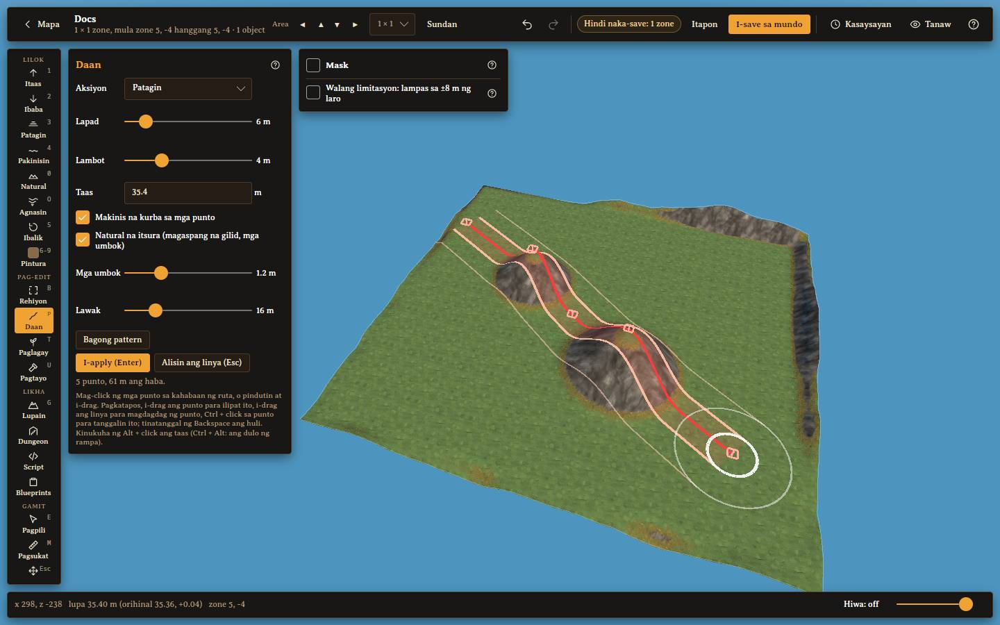
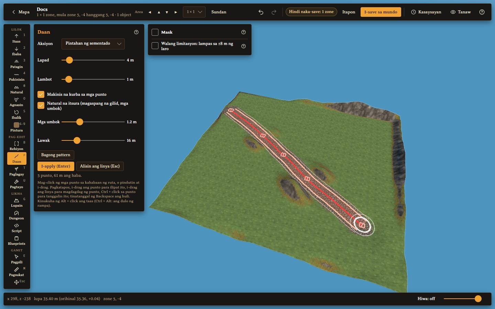
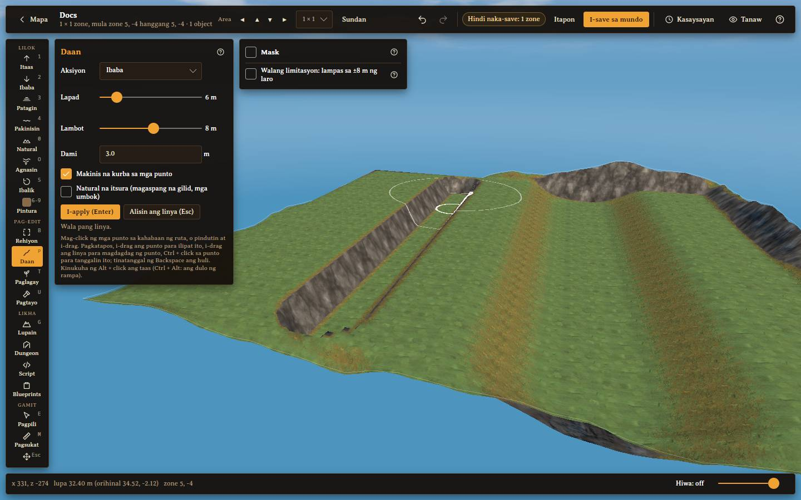
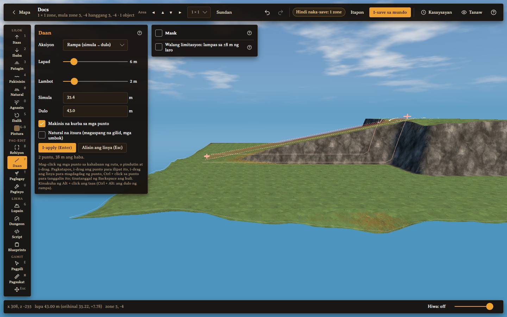
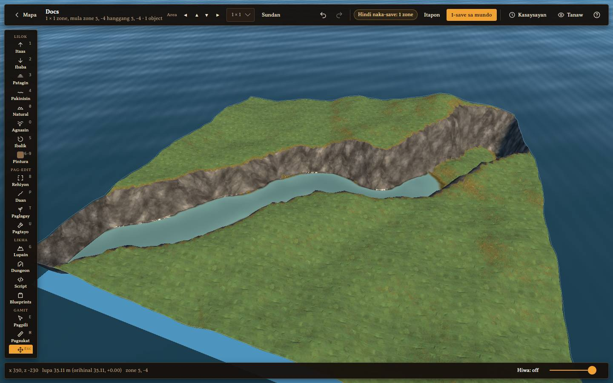

<!-- source: 2d41926b -->
# Daan

Gumuhit ng linya, saka patagin, gawing rampa, itaas, ibaba, pakinisin, hukayin o pintahan ang lupa sa kahabaan nito:
mga kalsada, rampa, tambak na daanan, kanal at ilog.

**Saan:** tool rail, seksiyong **PAG-EDIT** · **Key:** `P` · **Gumagana sa:** mga naka-save na mundo, live

*Linya ng limang punto na iginuhit sa ibabaw ng dalawang punso, napili ang **Patagin**, kinuha ang **Taas** nito mula sa
patag na lupa gamit ang `Alt`+click, at naka-on ang **Natural na itsura**. Wala pang nagbabago: ipinapakita ng banda ang
lapad at malambot na gilid ng daan hanggang pindutin mo ang **I-apply (Enter)**; sa pointer ang mga bilog sa huling
punto.*

## Gamitin ito

1. Sa tool rail, i-click ang **Daan** (`P`).
2. Mag-click ng mga punto sa kahabaan ng ruta, o pindutin nang matagal at mag-drag para iguhit ito nang malaya. Sa
   ilalim ng pointer, ipinapakita ng isang bilog ang lapad ng daan at ng mas malabong bilog ang malambot na gilid nito;
   kapag may mga punto na, ipinapakita ng banda ang dalawa sa kahabaan ng linya.
3. Opsiyonal: ayusin ang linya. I-drag ang isang punto para ilipat ito, i-drag ang linya sa pagitan ng dalawang punto
   para magdagdag ng punto roon, `Ctrl`+click ang isang punto para tanggalin ito, `Backspace` para tanggalin ang huli.
4. Sa panel, pumili ng **Aksiyon** at itakda ang mga setting nito.
5. Pindutin ang **I-apply (Enter)**. Isang hakbang ng undo ang pagbabago, ipinangalan sa aksiyon ("Daan: Patagin").
6. Opsiyonal: pumili ng ibang aksiyon at i-apply ito sa parehong linya (patagin, saka sementuhin), o ilipat ang mga
   punto nito at i-apply ulit. Nananatili ang linya hanggang pindutin mo ang **Alisin ang linya (Esc)**.

Ipinapakita ng panel kung ilang punto ang linya at kung gaano ito kahaba.

*Ang linya mula sa unang larawan, parehong camera: tumagos ang **Patagin** ng patag na kalsada sa dalawang punso, saka
sinementuhan ng **Pintahan ng sementado** na may **Lapad** na 4 m at **Lambot** na 1 m ang gitna nito.
Nananatili ang linya para sa susunod na aksiyon.*

## Mga setting

| Setting | Ang ginagawa nito |
|---|---|
| **Aksiyon** | Ang nangyayari sa kahabaan ng linya (tingnan ang [Mga aksiyon](#mga-aksiyon)). |
| **Lapad** | Lapad ng daan, 1 hanggang 40 m (default 8 m). Buong gumagana ang aksiyon sa kabuuan nito. |
| **Lambot** | Gaano kalayo humihina ang pagbabago sa bawat panig, 0 hanggang 15 m (default 4 m), para humalo ang daan sa lupa. Sa **0**, matalas ang gilid: isang trinsera na may tuwid at matarik na gilid. |
| **Taas** | **Patagin**: ang taas ng daan (m). Kinukuha ito ng `Alt`+click sa lupa. |
| **Dami** | **Itaas** / **Ibaba**: gaano karami (m, default 2). |
| **Simula**, **Dulo** | **Rampa**: ang taas sa una at sa huling punto (m). Tingnan ang [Rampa](#rampa). |
| **Lalim** | **Ilog / kanal**: gaano kalalim ang sahig nito sa ilalim ng antas ng dagat sa gitna (m, default 2). |
| **Makinis na kurba sa mga punto** | On (default): makinis na kurbang dumaraan sa mga punto mo. Off: mga tuwid na linya sa pagitan nila. |
| **Natural na itsura (magaspang na gilid, mga umbok)** | Lapad na nag-iiba-iba sa daan (hanggang 45% pataas o pababa) at magaspang na gilid, para sa bawat aksiyon; maliliit na umbok din sa ibabaw para sa **Patagin**, **Rampa**, **Itaas**, **Ibaba** at **Ilog / kanal**. Mukhang gamit na ang daan sa halip na gawa ng tool. |
| **Mga umbok**, **Lawak**, **Bagong pattern** | **Natural** at **Natural na itsura**: gaano kataas at kalapad ang mga umbok, at ibang random na pattern para sa kanila. Sa brush na [Natural](terrain.md#natural) sila: itakda man dito, doon o sa tool na [Rehiyon](area.md), pareho ang mga halaga. |
| **Anggulo ng tambak** | **Agnasin**: ang pinakamatarik na dahilig na hindi gumuguho, 10° hanggang 60° (default 33°). Sa brush na [Agnasin](terrain.md#agnasin), parehong halaga. |

*Dalawang tuwid na linya sa patag na lupa, bawat isa **Ibaba** nang 3 m na may **Lapad** na 6 m, tinitingnan sa
kahabaan nila. Kaliwa: **Lambot** 0, trinserang may matarik at tuwid na pader. Kanan: **Lambot**
8 m, unti-unting bumababa sa lupa ang mga pampang.*

## Mga aksiyon

| Aksiyon | Ang ginagawa nito |
|---|---|
| **Patagin** | Pinapatag ang daan sa **Taas**: kalsada, terasa sa kahabaan ng dahilig, tambak na daanan sa ibabaw ng lubak. |
| **Rampa (simula → dulo)** | Dahilig na pantay na tumataas o bumababa mula **Simula** hanggang **Dulo**. |
| **Itaas** | Iniaangat ang daan nang **Dami**, pinapanatili ang taas-baba nito: pampang, dike. |
| **Ibaba** | Hinuhukay pababa ang daan nang **Dami**: kanal, lubog na landas. |
| **Pakinisin** | Pinapantay ang lupa sa kahabaan ng daan: lumilipat ang bawat punto patungo sa karaniwang taas ng lupa sa loob ng 3 m. I-apply ulit para sa higit pa. |
| **Natural** | Mga umbok na mukhang natural sa kahabaan ng daan, sa ibabaw ng malawak na hugis ng lupa, gamit ang **Mga umbok**, **Lawak** at ang pattern: ang kailangan ng pinatag o itinaas na daan para magmukhang lupa ulit. |
| **Agnasin** | Inaagnas nang minsanan ang lupa sa kahabaan ng daan: humuhupa ang mga dahilig sa **Anggulo ng tambak**, umuukit ng mga bangin ang ulan at nag-iiwan ng mga tambak, humuhupa ulit ang mga dahilig. |
| **Ibalik** | Balik sa kung paano ito binuo ng mundo sa kahabaan ng daan, inalis ang pintura, kasama ang lupang itinaas o hinukay gamit ang Walang limitasyon: binabawi ang isang kalsada o kanal kahit matagal nang nawala ang kasaysayan ng undo. |
| **Ilog / kanal (tubig)** | Naghuhukay ng sahig sa ilalim ng antas ng dagat, para mapuno ito ng tubig (tingnan ang [Ilog o kanal](#ilog-o-kanal)). |
| **Pintahan ng hubad na lupa**, **Pintahan ng sementado**, **Pintahan ng binungkal** | Pinipintahan ang daan, buong kulay sa kabuuan ng lapad, humahalo palabas sa malambot na gilid. |
| **Alisin pintura** | Pinipintahan ng payak na lupa ng biome ang daan (tingnan ang [Brush na Pintura](terrain.md#brush-ng-pintura)). |

Ang **Patagin**, **Itaas**, **Ibaba**, **Pakinisin**, **Natural**, **Agnasin**, **Ibalik** at ang mga pintura ay
parehong aksiyon ng mga [brush](terrain.md) at ng tool na [Rehiyon](area.md), sa parehong pangalan (inililista ng
Rehiyon ang Ibalik bilang **Balik sa binuong lupa**, sa grupo nitong **Pagbawi**): sinasabi ng brush kung saan sa
pamamagitan ng stroke nito, ng tool na Rehiyon sa pamamagitan ng pinili, ng tool na Daan sa pamamagitan ng linya, at
pareho ang pagbabago ng lupa.

### Rampa

*Isang rampa ng dalawang punto mula sa gilid, mula sa lupa sa paanan nito (**Simula** 35.2 m) hanggang sa ibabaw ng
platapormang itinaas nang 8 m (**Dulo** 43 m). Pantay itong tumataas hanggang dulo.*

Hangga't hindi ka nagta-type o kumukuha ng taas, sinusundan ng **Simula** at **Dulo** ang lupa sa ilalim ng una at
huling punto, kaya naa-update sila kapag inilipat ang mga dulo. Kinukuha ng `Alt`+click sa lupa ang taas ng simula, ng
`Ctrl`+`Alt`+click ang taas ng dulo. Pinasusunod ulit sila ng **Alisin ang linya (Esc)** sa lupa. Pareho ang dahilig ng
paliku-likong rampa sa buong haba nito.

### Ilog o kanal

*Isang ilog na hinukay sa kabila ng zone gamit ang **Ilog / kanal (tubig)**: pinupuno ito ng dagat.*

Walang umaagos na tubig sa Valheim: ang tubig sa mga ilog ay ang dagat, sa parehong antas (30 m) saanman. Kaya may
tubig lang ang ilog kung saan nasa ilalim ng antas ng dagat ang sahig nito. Naghuhukay ang aksiyon ng sahig na hugis-U
na **Lalim** sa ilalim ng antas ng dagat sa gitna nito, tumataas hanggang sa waterline sa **Lapad**; ang **Lambot** ang bumubuo sa
mga pampang. Naghuhukay lang ito: nananatili ang lupang mas mababa na, kaya maaaring dumaloy ang
ilog papunta sa lawa o sa dagat.

Sa mataas na lupa, kailangan ng ilog ng malalim na hiwa, at pinahihinto ito ng hangganan ng laro na ±8 m sa lalim na
8 m (sinasabi ito ng status bar). Ibaba muna ang lupa malapit sa dagat, sundan ang mababang lupa, o i-on ang
[Walang limitasyon](terrain.md#walang-limitasyon).

## Mga shortcut

| Key o mouse | Ang ginagawa nito |
|---|---|
| `P` | Piliin ang Daan. |
| Click / pindutin nang matagal at mag-drag | Magdagdag ng mga punto / iguhit nang malaya ang linya (isang punto bawat 2 m). |
| I-drag ang punto / i-drag ang linya | Ilipat ang punto / magdagdag ng punto roon at ilipat ito. |
| `Ctrl`+click sa punto | Tanggalin ito. |
| `Backspace` | Tanggalin ang huling punto. |
| `Alt`+click | Kunin ang taas (Patagin) o ang simula ng rampa. |
| `Ctrl`+`Alt`+click | Kunin ang taas ng dulo ng rampa. |
| `Alt`+`Shift`+click | Itakda ang saklaw ng taas ng [Mask](masks.md) sa 2 m sa itaas at ibaba ng puwestong iyon, gaya ng sa brush. |
| `Enter` | I-apply ang aksiyon. |
| `Esc` | Alisin ang linya; lumalabas sa tool ang ikalawang `Esc`. |
| `Ctrl+Z` | I-undo ang huling I-apply. |

## Mga tip at limitasyon

- **Ina-apply ang [Mask](masks.md) sa bawat aksiyon**, at ganoon din ang hangganang ±8 m maliban kung naka-on ang
  [Walang limitasyon](terrain.md#walang-limitasyon). Kung saan umaabot ang daan sa hangganan, nagiging pula ang mga punto at
  sinasabi ito ng status bar. Nasa card na **Mask** sa tabi ng panel na Daan ang switch na Walang limitasyon: iisang
  switch para sa bawat tool sa lupa.
- **Ang matalas na kanto** ay nangangailangan ng dalawang magkalapit na punto, o naka-off na **Makinis na kurba sa mga
  punto**: dumaraan ang makinis na kurba sa bawat puntong kini-click mo.
- **Suriin muna ang dahilig ng rampa** gamit ang [Pagsukat](measure.md): kapag sinukat mula paanan hanggang itaas, ang
  **Dahilig** ang ibibigay ng rampa.
- **Ang linya lang ang tinatanggal ng Alisin ang linya (Esc).** Nananatili ang na-apply mo; binabawi ng `Ctrl+Z` ang
  isang I-apply bawat pagkakataon.
- **Sa loob lang ng bukas na area gumagana ang daan**, at hindi kailanman nito ginagalaw ang pinakalabas na hanay ng mga
  punto (tingnan ang [Ang naka-lock na gilid](concepts/areas-and-zones.md#ang-naka-lock-na-gilid)).

## Kaugnay

- [Gumawa ng kalsada o rampa paakyat ng burol](guides/make-a-road.md)
- [Humukay ng ilog o lawa](guides/make-a-river.md)
- [Mga hangganan ng lupa](concepts/ground-limits.md)
- [Lilok at pintura](terrain.md), [Pagsukat](measure.md)
- [Paano humihina ang gilid ng daan](concepts/ground-limits.md#paano-humihina-ang-gilid-ng-daan)
