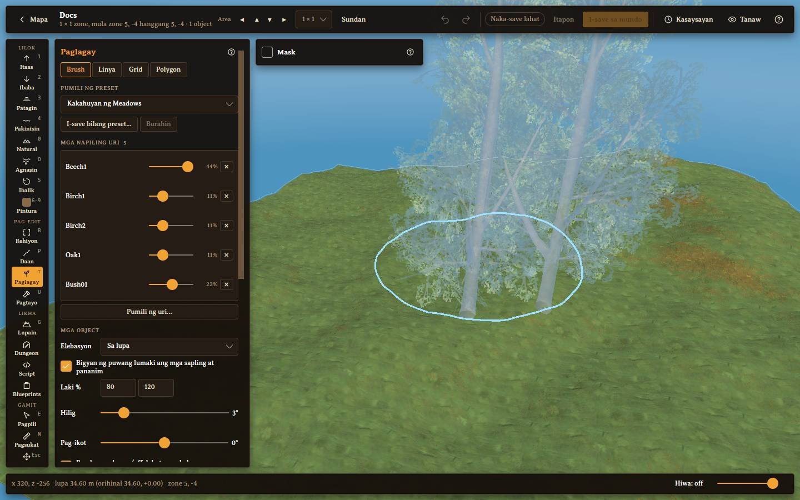
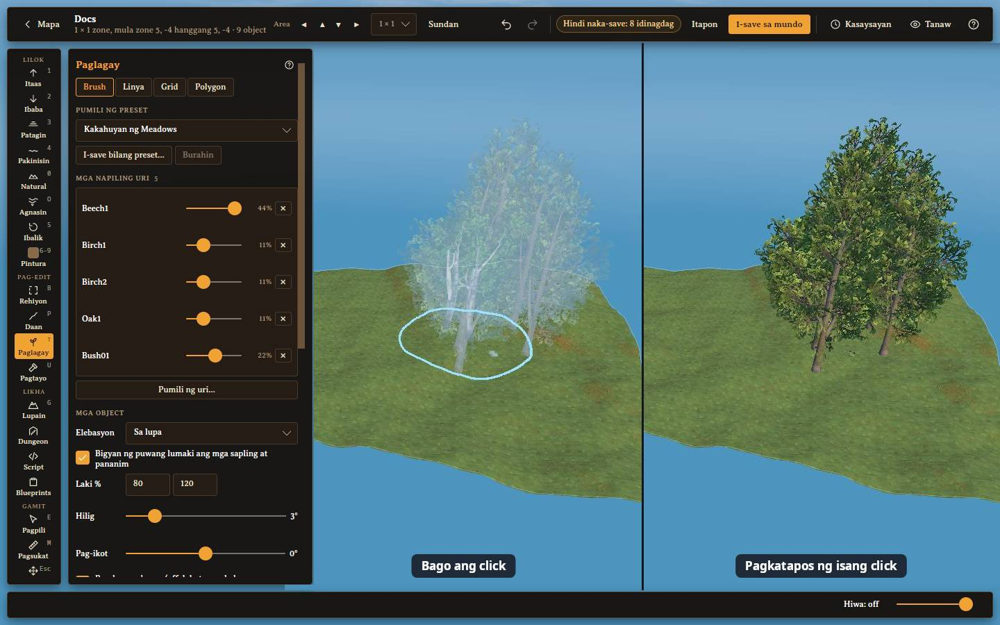
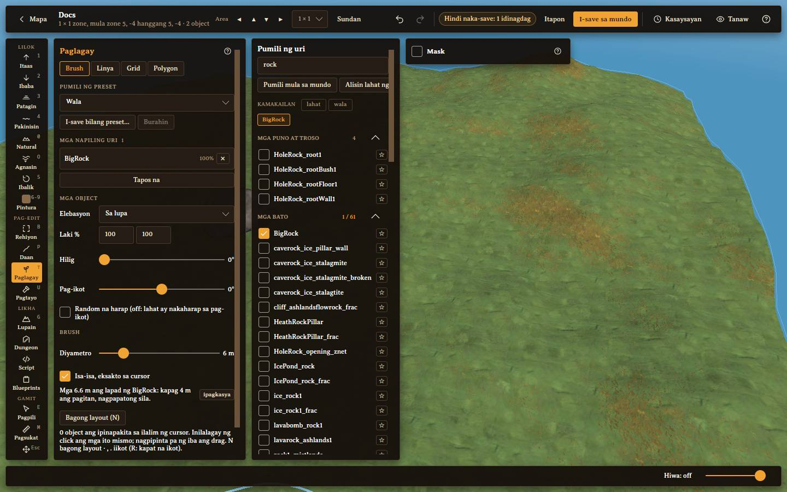
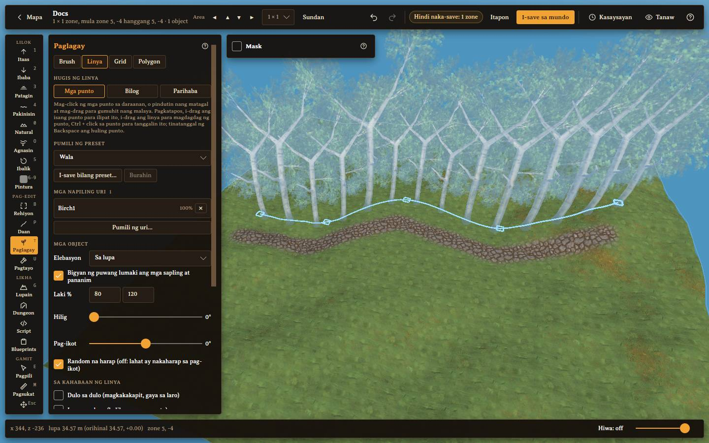
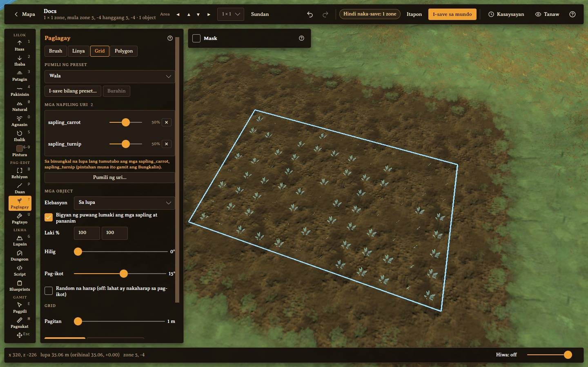
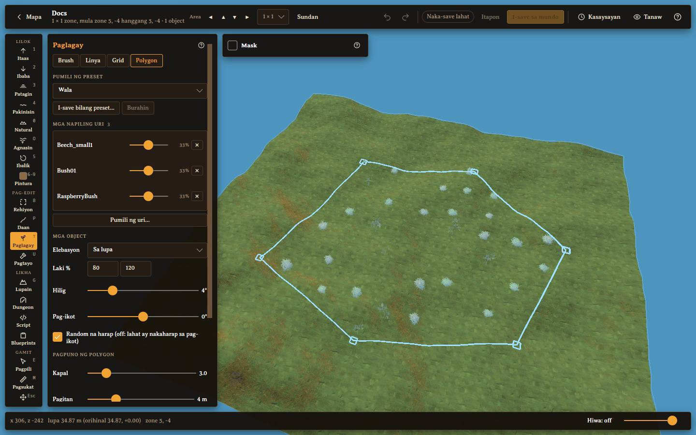
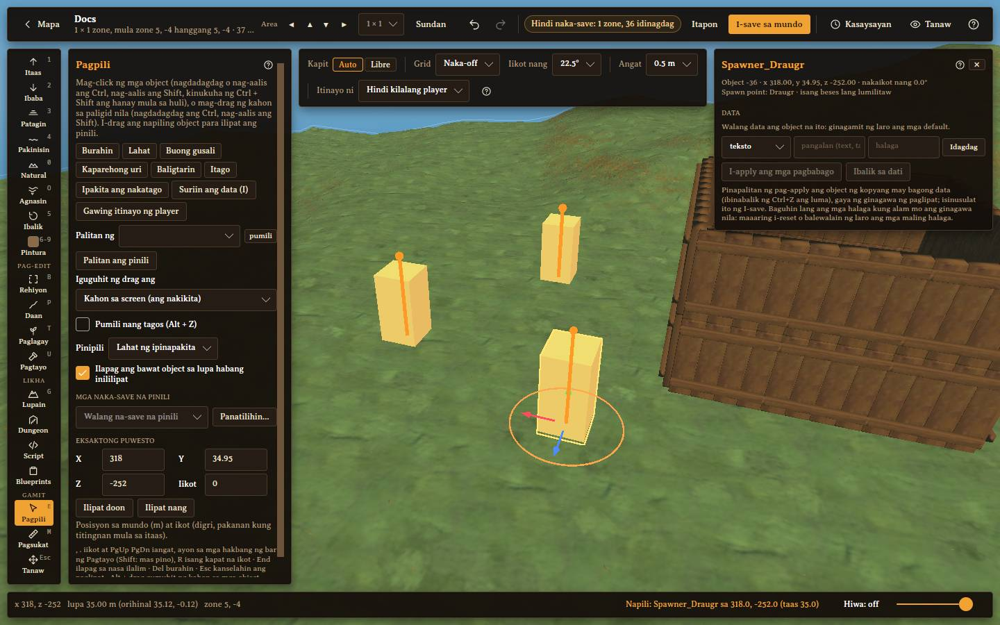

<!-- source: c6106c48 -->
# Paglagay

Maglagay ng mga puno, bato, palumpong, pananim at spawn point sa mundo, isa-isa o tig-iisang daan. Ang mga piece na
itinatayo ng mga player (pader, sahig, bakod, muwebles) ay inilalagay gamit ang [Pagtayo](build.md), ang tool sa ilalim
nito sa rail.

**Saan:** tool rail, seksiyong **PAG-EDIT** · **Key:** `T` · **Gumagana sa:** mga naka-save na mundo, live ([Pagtayo](build.md)
lang ang nasa Gawaan)

*Ang mga naaaninag na puno at palumpong na nakatayo sa bilog ng brush ay eksaktong ang ilalagay ng isang click;
ipinapakita ng panel ang preset na Kakahuyan ng Meadows at ang mga uri nito.*

*Kaliwa: ang naaaninag na preview sa bilog ng brush. Kanan: ang parehong puwesto pagkatapos ng isang click, nakatayo ang
mga puno at palumpong kung saan sila ipinakita ng preview.*

## Gamitin ito

Para magtanim ng maliit na kakahuyan:

1. Pindutin ang `T`.
2. Sa panel na **Paglagay**, sa ilalim ng **Pumili ng preset**, piliin ang **Kakahuyan ng Meadows**.
3. Sa itaas ng panel, piliin ang **Brush**.
4. Ituro ang lupa: ipinapakita ng naaaninag na preview ang ilalagay ng isang click.
5. Mag-click para ilagay ito, o mag-drag para patuloy na magdagdag.

Para sa Linya, Grid at Polygon, iguhit na lang ang hugis, tingnan ang preview, saka pindutin ang `Enter` (**Ilagay
(Enter)**). Nananatili ang hugis pagkatapos maglagay, walang laman na ang preview nito (naroon na ang ilalagay sana
nito): pindutin ang **Alisin ang hugis (Esc)** para iguhit ang susunod.

Isang hakbang ng undo (`Ctrl+Z`) ang bawat click, stroke o `Enter`. Walang naisusulat sa mundo hangga't hindi mo
pinipindot ang **I-save sa mundo** (o **I-apply nang live**). Para ilipat o burahin ang inilagay mo, gamitin ang
[Pagpili](select.md).

## Mga setting

Ang panel, mula itaas pababa. Nakatago ang mga row na hindi para sa napiling mode o mga uri. Iniingatan sa pagitan ng
mga paggamit ang mga may-tsek na uri at ang bahagi nila, ang **Bilis**, ang mga preset mo, mga paborito at kamakailang
uri; bumabalik sa default ang iba pang setting. Nasa sarili nitong card sa tabi ng panel ang [Mask](masks.md) at
ina-apply ito sa bawat mode.

| Setting | Ang ginagawa nito |
|---|---|
| **Brush**, **Linya**, **Grid**, **Polygon** | Ang mode: tingnan ang [Mga mode](#mga-mode). |
| **Hugis ng linya** | Sa mode na Linya lang: **Mga punto**, **Bilog** o **Parihaba**. Tingnan ang [Linya](#linya). |
| **Pumili ng preset** | Naglo-load ng isang halo: ang mga uri nito at ang bahagi nila, kasama ang Kapal, Pagitan, Kumpol, Saklaw, Laki at Hilig, na naka-on ang random na harap. Kasama na: **Kakahuyan ng Meadows**, **Gubat ng Black Forest**, **Swamp**, **Kumpol ng berry**, **Sahig ng gubat**, **Mga bato ng Meadows**; sumusunod ang sa iyo bilang **Iyo: *pangalan***. Iniiwan ang mga uring hindi mailalagay ng mundo (sinasabi ng status bar kung ilan). Walang nilo-load ang **Wala**; kapag pinili ito pagkatapos ng preset, inaalis ang tsek sa bawat uri. |
| **I-save bilang preset…** / **Burahin** | Sine-save sa isang pangalan ang mga napiling uri, bahagi at ang mga setting na iyon. Binubura ng **Burahin** ang isa sa mga sa iyo, matapos magtanong. |
| **Mga napiling uri** | Ang mga uring pinili mo, bawat isa may slider ng bahagi at ✕ para alisin ito ("Wala pa" habang wala pa). Kapag dalawa o higit pa ang uri, i-drag ang slider para itakda ang bahagi ng uring iyon: sumusunod ang iba para 100% ang kabuuan ng mga bahagi, at may hindi bababa sa 1% ang bawat isa. Ang Beech sa 75% kasama ang Birch ay nagbibigay ng tatlong beech sa bawat isang birch. |
| **Pumili ng uri…** | Binubuksan ang card na **Pumili ng uri**: tingnan ang [Piliin ang ilalagay](#piliin-ang-ilalagay). |
| **MGA OBJECT: Elebasyon** | **Sa lupa**: nakatayo sa lupa ang bawat object (ang bahagi ng guho, sa ilalim nito). **Sa itaas ng lupa**: **Taas** na metro sa itaas ng lupa sa ilalim nito. **Sa iisang taas**: nasa parehong **Taas** ang ilalim ng bawat object, anuman ang ginagawa ng lupa (isang patag na pader, isang plataporma). |
| **Taas** | Ang mga metro para sa Sa itaas ng lupa, o ang taas para sa Sa iisang taas. |
| **Kumapit sa mga piece na naroon na** | Ipinapakita kapag ang isang may-tsek na uri ay bahagi ng guho o dungeon na may snap point (nasa [Pagtayo](build.md) ang mga piece na itinatayo ng mga player). On: kumakapit ang bahagi sa mga piece sa paligid nito, gaya ng hammer. Sa mode na Brush, inilalagay ito ng **Katabi** nang dulo sa dulo sa piece na katabi ng cursor at ipinapatong ito ng **Sa ibabaw** sa piece sa ilalim ng cursor. Sinasabi ng linya sa ibaba ng panel kung saan ito kumapit ("Kumapit sa tabi ng *pangalan*."). Tingnan ang [Pagkapit](concepts/objects.md#pagkapit). |
| **Bigyan ng puwang lumaki ang mga sapling at pananim** | Ipinapakita kapag may tsek ang isang sapling, pananim o punong tumutubo mula sa isa. On: iniingatan nila ang puwang na kailangan ng laro para palakihin sila. Off: kasinsikip ng gusto mo (maaaring hindi sila lumaki). Tingnan ang [Mga patakaran sa pagtubo](concepts/objects.md#mga-patakaran-sa-pagtubo). |
| **Laki %** min / max | Nakakakuha ang bawat object ng random na laki sa pagitan ng dalawa, 10 hanggang 300% (80 hanggang 120 sa simula). |
| **Hilig** | Random na pagkiling, 0 hanggang 20°. |
| **Pag-ikot** | Iniikot ang pattern ng brush at ang harap ng bawat object, -180 hanggang 180°. |
| **Random na harap (off: lahat ay nakaharap sa pag-ikot)** | On: random ang harap ng bawat object. Off: lahat nakaharap sa Pag-ikot. |
| **BRUSH: Diyametro** | Radius ng brush, 1 hanggang 30 m. Ito rin ang laki ng mga brush sa paglilok: iisang halaga para sa dalawa. |
| **Bilis** | Brush: gaano kabilis nagtatanim ang pag-drag, 0.05 hanggang 1. Mas mataas, mas maagang napupuno ang bilog ng brush hanggang sa Kapal nito. Sariling setting ito ng brush ng Paglagay: hindi ito binabago ng **Lakas** ng mga brush sa paglilok. Nakatago kapag Isa-isa. |
| **Isa-isa, eksakto sa cursor** | Brush: isang object eksakto sa ilalim ng cursor bawat click; walang idinadagdag ang pag-drag. Ang object lang na mismong nasa puwestong iyon ang humaharang dito. |
| **Kapal** | Brush at Polygon: mga object bawat 100 m², 0.2 hanggang 20. |
| **Pagitan** | Brush at Polygon: ang pinakamaliit na layo sa pagitan ng mga object, 0.5 hanggang 15 m, pati mula sa mga object na naroon na. Sa Grid: ang laki ng cell, 1 hanggang 30 m. |
| **Kumpol** | Brush at Polygon: tinitipon ang mga object sa mga kakahuyan na may mga lantad na lugar sa pagitan, 0 hanggang 100%. Pantay na pagkalat ang 0. |
| **Saklaw** | Kasama ang Kumpol: gaano kalaki ang mga kakahuyan at lantad na lugar, 5 hanggang 120 m. |
| **ipagkasya** | Ipinapakita kapag mas malapad ang isang may-tsek na uri kaysa sa pagitan ("Mga 6.2 m ang lapad ng Beech1: kapag 4 m ang pagitan, nagpapatong sila."). I-click ito para itakda ang pagitan sa lapad na iyon. |
| **Ilagay (Enter)**, **Alisin ang hugis (Esc)**, **Tanggalin ang huling punto (Backspace)** | Linya, Grid at Polygon: ilagay ang ipinapakita ng preview, alisin ang hugis, o bawiin ang huling puntong na-click. |
| **Bagong layout (N)** | Bagong random na mga puwesto, uri, laki at harap para sa preview (at bagong mga kakahuyan kapag may Kumpol). |

Sinasabi ng linya sa ibaba kung ilang object ang ipinapakita ng preview at kung aling mga key ang gumagana. Nagbababala
ang kahel na linya sa ilalim ng mga napiling uri kapag may kailangang ingatan: "Wala pang ilalagay", o mga pananim na
"sa binungkal na lupa lang tumutubo (pintahan muna ito gamit ang Bungkalin)".

## Piliin ang ilalagay

Binubuksan ng **Pumili ng uri…** ang isang card sa tabi ng panel na may bawat uring sine-save ng laro sa isang mundo,
kasama ang mga uring wala pa sa mundo mo at ang mga uri ng mga mod mo. Wala rito ang mga creature, nahulog na item at
ragdoll, pati ang mga piece ng hammer at ng serving tray: nasa dock ng [Pagtayo](build.md) ang mga iyon. Nasa dalawa ang
mga sapling at pananim ng cultivator. Isinasara ito ng **Tapos na**.

*Ang card na Pumili ng uri na naghahanap ng "rock", may tsek ang BigRock: binibilang ng kategoryang Mga bato ang 1
may-tsek na uri sa tabi ng kabuuan nito, at nangunguna ang BigRock sa row na Kamakailan.*

| Kontrol | Ang ginagawa nito |
|---|---|
| **Maghanap ng uri (oak, bato, palumpong…)** | Sinasala ang listahan ayon sa pangalan at binubuksan ang bawat kategoryang may tugma. Nahahanap din ang mga spawn point at pugad ayon sa creature nila (nahahanap ng `boar` ang `Spawner_Boar`). |
| Mga tsek box | Inilalagay ang bawat may-tsek na uri; pumipili ang bawat object ng isa sa mga ito nang random, ayon sa bahagi. I-click ang pangalan ng kategorya para itiklop o buksan ito; pagkatapos ng pangalan, kung ilang uri ang mayroon ito, o "may tsek / lahat". |
| **Pumili mula sa mundo** | Mag-click ng object sa mundo para ilagay lang ang uri nito; idinadagdag ito ng `Shift` + click sa mga may-tsek na uri (o inaalis). Kinakansela ng `Esc`. Hindi kinukuha ang piece ng gusali: sinasabi ng status bar na ilagay ito gamit ang Pagtayo. |
| **Alisin lahat ng tsek** | Inaalis ang tsek sa bawat uri. |
| **Mga paborito** | I-click ang ☆ pagkatapos ng isang uri para lagyan ito ng bituin; lumalabas bilang mga button sa itaas ng listahan ang mga uring may bituin. |
| **Kamakailan** | Ang huling walong uring inilagay mo, pinakabago muna, pagkatapos ng mga uring napili ngayon. |
| Mga button ng Mga paborito at Kamakailan | Click: lagyan o alisan ng tsek ang uring iyon. `Shift` + click: ilagay lang ang uring iyon. Nilalagyan o inaalisan ng tsek ng **lahat** / **wala** ang buong row. |

Ang mga kategorya: **Mga puno at troso**, **Mga bato**, **Mga palumpong at halaman**, **Mapipitas**, **Ore at
deposito**, **Mga guho at istruktura**, **Muwebles at props**, **Mga buto at labi**, **Mga spawn point**, **Mga pugad
ng creature**, **Mga creature at NPC** (mga trader, ibon), **Mga epekto at marker** (ulap, musika, mga zone ng event ng
boss) at **Ibang object**. Lumalabas bilang mga kahon sa preview ang mga uring walang model.

## Mga mode

| Mode | Paano ito gumagana |
|---|---|
| **Brush** | Sinusundan ng preview ang cursor sa loob ng bilog ng brush. Eksaktong inilalagay ng click ang ipinapakita nito; patuloy na nagdadagdag ang pag-drag (sumusunod ang bilis sa Kapal at **Bilis**). Tinatanggal ng `Shift` + drag ang mga may-tsek na uri sa ilalim ng brush. Kapag mga kumakapit na bahagi lang ng guho ang may tsek, kusang naka-on ang **Isa-isa** at kumakapit ang bawat bahagi. |
| **Linya** | Mag-click ng mga punto sa kahabaan ng ruta, o gumuhit ng bilog o parihaba. Napupunta ang mga object bawat **Bawat** na metro, o dulo sa dulo. |
| **Grid** | Mag-drag ng kahon. Isang object ang napupunta sa gitna ng bawat cell; nakakakuha ang kahon ng kasindaming buong cell na kasya. |
| **Polygon** | Mag-click ng mga punto sa paligid ng isang bahagi ng lupa, o pindutin nang matagal at mag-drag para malayang iguhit ang balangkas nito. Napupunta ang mga object sa mga random na puwesto sa loob (Kapal, Pagitan). |

Sa Linya at Polygon, i-drag ang isang punto para ilipat ito, i-drag ang balangkas para magdagdag ng punto, at `Ctrl` +
click ang isang punto para tanggalin ito. Inilalagay ng pag-double-click sa huling punto ang hugis, gaya ng `Enter`. Sa
Grid at Polygon, iniikot ng `,` `.` at `Alt` + wheel ang buong kahon o polygon, kasama ang mga cell nito; iniikot ito ng
`R` nang isang kapat na ikot.

### Linya

*Mode na Linya na may **Mga punto**: mga birch bawat 4 m sa kahabaan ng makinis na kurba sa limang punto, sa tabi ng
sementadong landas, ipinapakita bago ang **Ilagay (Enter)**. Ang preview ang maputlang mga puno.*

| Kontrol | Ang ginagawa nito |
|---|---|
| **Mga punto** | Mag-click ng mga punto sa daan, o pindutin nang matagal at mag-drag para gumuhit nang malaya. Bumabalik ang **Isara ang loop (balik sa unang punto)** sa unang punto, para isara ang bakod sa paligid ng isang lugar. Gumuguhit ang **Makinis na kurba sa mga punto** ng kurba sa halip na mga tuwid na bahagi. |
| **Bilog** | Pindutin sa gitna at mag-drag palabas hanggang sa laki; bitawan para makita ito. |
| **Parihaba** | Pindutin sa isang sulok at mag-drag papunta sa katapat nito. |
| **Dulo sa dulo (magkakakapit, gaya sa laro)** | Nagsisimula ang bawat bahagi kung saan nagtatapos ang huli, nakaikot sa kahabaan ng linya, gaya ng pagkapit ng hammer sa kanila: pader ng guho, hanay ng lumang sahig. Nagsasalitan ang ilang may-tsek na uri. Kusa itong naka-on kapag bahaging pinakakapit ng laro ang bawat may-tsek na uri. Kasama ito, ikinakapit ng bilog ang laki nito sa buong mga bahagi, at napupuno ang mga gilid ng parihaba mula sa mga sulok para magtagpo ang mga sulok. Para ilatag nang dulo sa dulo ang mga piece ng hammer (bakod, pader ng tulos), gamitin ang **Ilatag** ng [Pagtayo](build.md#maglatag-ng-mga-piece-sa-kahabaan-ng-linya-o-sa-grid). |
| **Mga layer** | Kasama ang Dulo sa dulo: ang linyang isinalansan nang 1 hanggang 20 bahagi ang taas. |
| **Bawat** | Walang Dulo sa dulo: ang layo sa pagitan ng mga object, 0.5 hanggang 30 m. |
| **Alon** | Random na paglihis patagilid mula sa linya, 0 hanggang 5 m. |
| **Sundan ang linya (dagdag ang pag-ikot; pinapalitan ang random na harap)** | On (ang default): nakaharap sa kahabaan ng linya ang bawat object, dagdag ang Pag-ikot. Off: random na harap. Laging sinusundan ng mga bilog at parihaba ang balangkas nila. |

- Kapag hindi nagtatapos ang linya sa isang buong piece, sinasabi ng linya sa ibaba kung gaano karami ang natitira
  ("0.8 m ng linya ang natitira sa dulo: maglipat ng punto para isara ito").
- Ang linyang nagsisimula sa loob ng 1 m mula sa piece na naroon na (kapag naka-on ang **Kumapit sa mga piece na naroon
  na**) ay nagpapatuloy dito, sa antas nito.
- Sa dahilig, nananatiling patag ang mga bahaging dulo sa dulo at umaakyat o bumababa nang baitang kasabay ng lupa. Para
  sa iisang pantay na hanay, patagin muna ang lupa sa kahabaan ng linya ([Daan](path.md), Patagin), o gamitin ang **Sa
  iisang taas**.

### Grid

*Mga carrot at turnip sa grid na nakaikot nang 15°, tinitingnan mula sa malapit sa itaas para makita ang pananim ng
bawat cell. Nagbababala ang kahel na linya sa panel na kailangan ng mga pananim ng binungkal na lupa.*

### Polygon

*Isang polygon na iginuhit nang punto por punto, may mga palumpong at batang puno na naka-preview sa mga random na
puwesto sa loob.*

Isang beses binubunot ang mga puwesto at iniingatan habang hindi nagbabago ang polygon; bumubunot ng bago ang **Bagong
layout (N)**.

## Mga spawn point at pugad

Ang mga spawn point ay ang mga di-nakikitang marker ng laro na naglalagay ng mga creature sa mga kampo, nayon at
dungeon. Hanapin sila sa **Pumili ng uri** sa ilalim ng **Mga spawn point** (hanapin ang creature: `boar`), saka ilagay
sila gaya ng kahit anong uri. Ipinapakita ng bawat uri ang nililitaw nito, binasa mula sa laro mo:

- ang creature at ang mga bituin nito (`Boar · 0–2 ★`);
- **isang beses lang lumilitaw** (sa unang pagkakataong lumapit ang isang player, hindi na muli kapag namatay ito), o
  **bumabalik *N* min matapos itong mamatay**;
- **sa gabi lang**, **sa araw lang**, o **kapag ginising ito ng isang event** para sa iilang naghihintay.

Nakatakda bawat uri ang creature, mga bituin at oras ng pagbabalik: piliin ang uring naglilitaw ng gusto mo. Patuloy na
naglilitaw sa paligid nila ang **Mga pugad ng creature** (mga pugad ng greydwarf, tambak ng buto...) hanggang masira;
sinasabi ng linya nila kung ilan at gaano kalayo ("Greydwarf, Greydwarf_Elite · hanggang 3 sa paligid, sa loob ng
5 m"). Tingnan ang [Mga spawn point](concepts/objects.md#mga-spawn-point).

*Malapitang kuha ng dalawang spawn point ng boar at isa ng draugr sa tabi ng kubo. Sinasabi ng linya sa Inspector ng
napiling draugr kung ano ang nililitaw nito at kung bumabalik ito.*

Sa 3D na tanaw, lumalabas ang bawat spawn point at pugad bilang payak na kahon na may marker sa itaas, nakikita kahit
may nakaharang sa harap, sa loob ng 250 m: kahel para sa spawn point (pula kapag bumabalik ang creature nito), lila para
sa pugad. Nakatago sila sa simula: i-on ang **Mga spawn point** at **Mga pugad ng creature** sa
[panel na Tanaw](editor-basics.md).

## Mga shortcut

| Key o mouse | Ang ginagawa nito |
|---|---|
| `T` | Binubuksan ang Paglagay. |
| Click / drag | Brush: ilagay / patuloy na magdagdag. Linya at Polygon: magdagdag ng mga punto. Grid: iguhit ang kahon. |
| `Shift` + drag | Brush: tanggalin ang mga may-tsek na uri sa ilalim ng brush. |
| `Ctrl` + click sa punto | Linya at Polygon: tanggalin ang puntong iyon. |
| `Enter` | Ilagay ang linya, grid o polygon. |
| `Esc` | Kanselahin ang **Pumili mula sa mundo**; kung hindi, alisin ang hugis; kapag walang nakaguhit, balik sa **Tanaw**. |
| `Backspace` | Tanggalin ang huling punto. |
| `N` | Bagong layout. |
| `,` `.` o `Alt` + wheel | Iikot nang 15° (`Shift`, mas pino: 1°): ang harap, o sa Grid at Polygon ang buong kahon o polygon. |
| `R` | Iikot ang pareho nang isang kapat na ikot. |
| `[` `]` | Diyametro. |
| `PgUp` / `PgDn` o `Ctrl` + wheel | Itaas o ibaba ang elebasyon nang 0.5 m (`Shift`, mas pino: 0.1 m). Mula sa Sa lupa, nagsisimula itong umangat sa itaas nito. |
| `Alt` + click | Lumipat sa Sa iisang taas, sa ibabaw ng piece na na-click (para tumayo rito), o ng lupa roon. |
| `Ctrl+Z` | I-undo ang huling paglalagay. |

Nasa [Mga shortcut](help/shortcuts.md) ang lahat ng key ng editor.

## Mga tip at limitasyon

- **I-undo:** binabawi ng `Ctrl+Z` ang isang click, stroke o hugis, kahit pagkatapos mag-save (saka mag-save ulit).
  Tingnan ang [I-undo ang mga pagbabago](guides/undo-changes.md).
- Hindi hihigit sa 2000 object bawat linya, grid o polygon, at 400 bawat click ng brush.
- Sa loob lang ng bukas na area napupunta ang mga object, hindi sa pinakalabas na hanay ng mga punto nito, at kung saan
  pinapayagan ng Mask.
- Iniiwan ang object sa lupa kung saan mahigit 0.3 m ang lalim ng lupa sa ilalim ng tubig (maliban sa kelp at seaweed).
  Kapag Sa itaas ng lupa o Sa iisang taas, maaari itong tumayo sa ibabaw ng tubig.
- Pinapanatili ng Brush at Polygon ang Pagitan mula sa mga nakatayo na. Hindi ito pinapansin ng Linya at Grid, maliban
  sa object na mismong nasa puwesto, kaya hindi nadodoble ang parehong hugis kapag dalawang beses inilagay.
- Sa binungkal na lupa lang tumutubo ang mga pananim: pintahan muna ito gamit ang **Bungkalin** (o ang Pintura ng tool
  na Rehiyon).
- Itinayo ng player ang mga sapling at pananim na inilalagay mo, ng player na pinili sa **Itinayo ni** sa
  [bar ng Pagtayo](build.md#ang-bar-ng-pagtayo); hindi ang mga puno, bato, spawn point at bahagi ng guho. Tingnan ang
  [Mga piece na itinayo ng player](concepts/objects.md#mga-piece-na-itinayo-ng-player).
- Bago ang mga bagong object: walang laman, walang health. Para punuin ang chest, tingnan ang
  [Baguhin ang laman ng chest](guides/fill-a-chest.md).

## Kaugnay

- [Magtanim ng gubat, bukid o bakod na halaman](guides/plant-a-forest.md)
- [Linisin ang mga puno at bato, patagin ang puwesto ng gusali](guides/clear-an-area.md)
- [Ano ang object](concepts/objects.md#ano-ang-object)
- [Pagtayo](build.md) · [Pagpili](select.md) · [Mga mask](masks.md)
