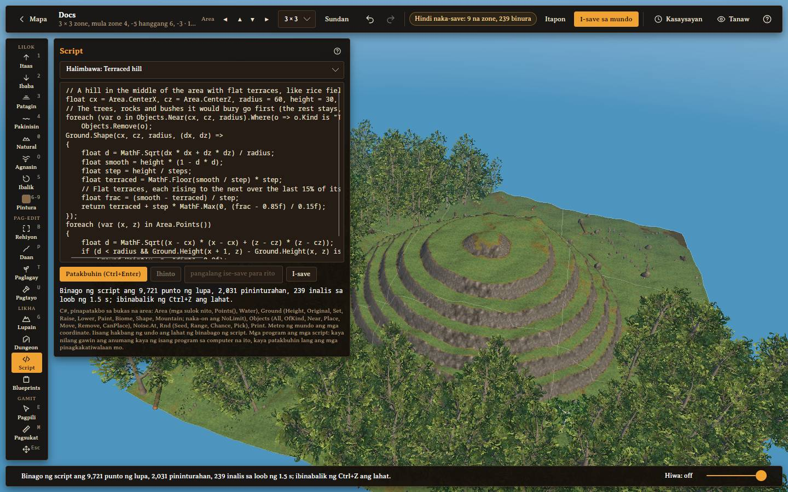
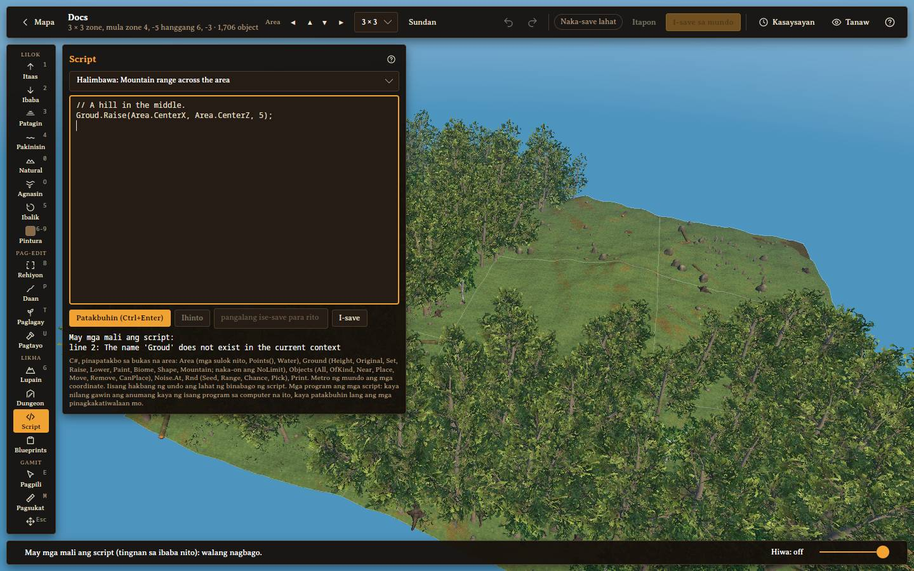

<!-- source: f2b8214d -->
# Script

Magsulat ng ilang linya ng C# na humuhubog, nagpipinta at pumupuno sa bukas na area ayon sa patakaran: isang hanay ng
bundok, gubat sa banayad na dahilig lang, mga terasa, sementadong plaza sa eksaktong karaniwang taas.

**Saan:** tool rail, seksiyong **LIKHA** · **Key:** wala (pinapatakbo ng `Ctrl+Enter` ang script) · **Gumagana sa:**
mga naka-save na mundo, live (hindi sa Gawaan)


*Ang halimbawang Terraced hill na pinatakbo sa 3 × 3 na area: ang code sa panel, at sa ilalim nito ang linya ng
resulta na nagsasabi kung ano ang binago ng script.*

Wala kang kailangang i-install: ang editor mismo ang nagko-compile ng script. Kung hindi ka pa nakapagsulat ng C#,
magsimula sa isang [halimbawa](#ang-mga-halimbawa) at baguhin ang mga numero nito, o sundin ang
[Ang una mong script](#ang-una-mong-script).

## Gamitin ito

1. Magbukas ng area sa 3D editor. Gumagana ang script sa **bukas na area** (ang mga zone na nakikita mo).
2. Piliin ang **Script** sa seksiyong **LIKHA** ng tool rail.
3. Pumili ng halimbawa o naka-save na script sa listahan, o isulat ang sarili mo sa kahon ng code.
4. Pindutin ang **Patakbuhin (Ctrl+Enter)**. Ipinapakita ng kahon ng output ang "Kino-compile…", "Tumatakbo…", saka
   ang ini-print ng script at ang binago nito, o kung ano ang nagkamali.
5. Tingnan ang resulta. Binabawi ng undo (ang arrow sa top bar) ang buong pagtakbo sa isang hakbang; ganoon din
   ang `Ctrl+Z` kapag nakapag-click ka na sa 3D view (sa kahon ng code, ina-undo nito ang tina-type mo). Baguhin ang
   mga numero at patakbuhin ulit hanggang magustuhan mo.
6. Pindutin ang **I-save sa mundo** (o **I-apply nang live**) para panatilihin ito, gaya ng anumang ibang pagbabago.

Walang nagbabago habang tumatakbo ang script: kapag tapos na ito, pumapasok nang sabay sa area ang lahat ng binago
nito, bilang isang hakbang ng undo. Kung may mali ito, pumalya, inihinto, o tumakbo nang 2 minuto, walang nagbabago.

## Ang una mong script

Nagtataas ang araling ito ng bunton sa gitna ng area, saka pinapataas ito.

1. Magbukas ng area at piliin ang **Script**.
2. Piliin ang lahat ng teksto sa kahon ng code at palitan ito ng:

   ```csharp
   // Isang bunton na 10 m ang taas at 30 m ang lapad, sa gitna ng area.
   Ground.Shape(Area.CenterX, Area.CenterZ, 15, (dx, dz) =>
   {
       float d = MathF.Sqrt(dx * dx + dz * dz) / 15;   // 0 sa gitna, 1 sa gilid
       return 10 * (1 - d);                            // metrong idaragdag
   });
   Print($"The top is at {Ground.Height(Area.CenterX, Area.CenterZ):0.0} m.");
   ```

3. Pindutin ang `Ctrl+Enter`. Umaangat ang bunton sa gitna ng area; sinasabi ng output kung nasaan ang tuktok nito at
   ilang punto ng lupa ang nagbago.
4. Mag-click sa 3D view, saka pindutin ang `Ctrl+Z`. Wala na ang bunton.
5. Mag-click sa kahon ng code, palitan ang `10 *` ng `20 *` at pindutin ulit ang `Ctrl+Enter`. Dalawang beses na mas
   mataas ang bunton.
6. Opsiyonal: mag-type ng pangalan sa kahon ng pangalan at pindutin ang **I-save** para mahanap ang script sa listahan
   sa susunod.

Idinadagdag ng `Ground.Shape` ang mga metrong ibinabalik ng function mo sa bawat punto sa loob ng 15 m mula sa gitna;
ang `dx` at `dz` ay ang mga metro mula sa gitna. Nasa [sanggunian ng API](#sanggunian-ng-api) ang bawat iba pang tawag.

## Mga setting

| Setting | Ano ang ginagawa nito |
|---|---|
| **Listahan** | Ang pitong halimbawa ("Halimbawa: …"), saka ang mga naka-save mong script, pinakabago muna. **Pinapalitan** ng pagpili ng isa ang teksto sa kahon ng code: i-save muna ang sarili mong script. Inaalisan ng laman ng halimbawa ang kahon ng pangalan; inilalagay doon ng naka-save na script ang pangalan nito. |
| **Kahon ng code** | Ang script. Nag-i-indent ang `Tab`; pinapatakbo ito ng `Ctrl+Enter`; ina-undo ng `Ctrl+Z` ang tina-type mo, hindi ang pagtakbo. |
| **Patakbuhin (Ctrl+Enter)** | Kino-compile at pinapatakbo ang script sa bukas na area. Ang mga pagbabago nito ay **isang hakbang ng undo**, pinangalanang "Script: " at ang pangalan ng entry sa listahan sa Kasaysayan. |
| **Ihinto** | Inihihinto ang tumatakbong script, anuman ang ginagawa nito: walang pinapanatili sa ginawa nito. |
| Kahon ng pangalan, **I-save** | Sine-save ang code sa ilalim ng na-type na pangalan at pinipili ito sa listahan. Nagiging `_` ang mga character na hindi puwede sa pangalan ng file. Nagtatanong muna ang pag-save sa ibabaw ng ibang naka-save na script. |
| **Output** | Ang ini-print ng script (`Print`), saka ang binago nito, o ang mga mali o error nito kasama ang linya nila. |

Ang mga naka-save na script ay mga file na `<name>.csx` sa folder na `scripts` ng data folder ng editor
(`~/.local/share/ValheimWorldEditor/scripts` sa Linux, `%LOCALAPPDATA%\ValheimWorldEditor\scripts` sa Windows,
`~/Library/Application Support/ValheimWorldEditor/scripts` sa macOS). I-edit ang mga ito sa anumang text editor, o
ibahagi: lumalabas sa listahan ang `.csx` na file na inilagay doon kapag nagsimula ulit ang editor, o pagkatapos mong
mag-save ng script.

## Ang mga halimbawa

Bawat halimbawa ay buong script, handang patakbuhin sa anumang bukas na area. Basahin ang mga ito para makita kung
paano ginagamit ang API.

| Halimbawa | Ano ang ginagawa nito |
|---|---|
| **Mountain range across the area** | Apat na bundok na Lone peak sa isang linya mula timog-kanluran hanggang hilagang-silangan, bawat isa 35 hanggang 60 m ang taas. `Rnd.Seed = 7`, kaya parehong hanay sa bawat pagtakbo. Ginagawa ng pag-save ang mga ito na mga ground disc (lampas sa 8 m na hangganan ng laro). |
| **Terraced hill** | Burol na 30 m ang taas at 60 m ang radius, hinati sa anim na patag na terasa gaya ng palayan. Inaalis muna ang mga puno, bato at palumpong na matatabunan nito (nananatili ang lahat ng iba pa); pinipintahan ng hubad na lupa ang matatarik na baitang. |
| **Canyon with a river** | Paliko-likong canyon mula kanluran hanggang silangan, 18 m sa bawat panig ng linya nito, hinukay hanggang 3 m sa ilalim ng antas ng dagat para mapuno ito ng tubig, humihina sa huling 30 m sa mga gilid ng area. |
| **Scatter boulders** | Malalaking bato (`rock4_forest`, `rock4_coast`, `rock4_heath`) bawat 6 m kung saan mataas ang noise, mas marami sa mga dahilig, bawat isa ay random ang ikot at laki. Ipini-print kung ilan. |
| **Ring of trees** | Bilog na 36 na beech, 40 m mula sa gitna; inaalis ang mga puno sa loob ng bilog. |
| **Flat paved base** | Parisukat na 40 × 40 m na pinantay sa sarili nitong karaniwang taas at sinementuhan, na may makinis na 10 m na dahilig papunta sa lupa sa paligid nito. Nananatili sa loob ng 8 m na hangganan (`Ground.NoLimit = false`). Ipini-print ang taas. |
| **Noise landscape** | Paalun-alon na lupa sa buong area: mga burol at lambak na hanggang 25 m pataas o pababa na may mas maliliit na umbok sa ibabaw, humihina pabalik sa dating lupa sa huling 40 m sa mga gilid. |

## Paano nakikita ng script ang mundo

- **Payak na C#.** Ang script ay listahan ng mga statement na pinapatakbo mula itaas hanggang ibaba. Maaari itong
  magdeklara ng mga variable, loop, function at class, at gumamit ng .NET (`MathF`, `System.Linq`…). Nandoon na ang
  `using System`, `System.Linq` at `System.Collections.Generic`.
- **Metro ng mundo.** Nasa metro ang bawat posisyon: **x** silangan, **z** hilaga, parehong mga numero ng status bar at
  ng command na `pos` ng laro. Ang mga taas ay metro sa itaas ng zero ng mundo; nasa `Area.Water` (30 m) ang dagat.
- **Isang punto bawat metro.** Binabago ng `Ground.Set(x, z, …)` ang puntong pinakamalapit sa (x, z); binabasa ng
  `Ground.Height` nang makinis sa pagitan ng mga punto, gaya ng pagguhit sa lupa.
- **Sariling mga pagbabago nito.** Nakikita ng script ang binago nito hanggang ngayon (magtaas ng punto, saka ibibigay
  ng `Ground.Height` ang bagong taas), pero nananatili ang `Objects.All` kung paano ang area noong nagsimula ito.
- **Ang bukas na area lang.** Nananatili ang panlabas na hanay ng mga punto, kaya dumudugtong pa rin ang area sa mga
  katabi nito; binabalewala nang walang error ang mga pagbabago roon o sa labas ng area. Magbukas ng mas malaking area
  (hanggang 17 × 17 zone) para sa mas malalaking gawa.
- **Lampas sa 8 m na hangganan.** Naka-on ang `Ground.NoLimit`, gaya ng switch na
  [Walang limitasyon](concepts/ground-limits.md#walang-limitasyon): maaaring umabot ang lupa nang hanggang 400 m sa itaas o
  ibaba ng binuong lupa, at ginagawa ito ng pag-save na mga ground disc na itinuturing ng laro ng bawat player bilang
  binuong lupa. Pinapanatili ng `Ground.NoLimit = false;` sa loob ng 8 m ng laro: humihinto roon ang mga puntong
  lumalampas, at sinasabi ng linya ng resulta kung ilan.
- **Walang Mask.** Nililimitahan ng [Mask](masks.md) ang mga tool na ginagamit mo nang mano-mano, hindi ang mga script.
  Suriin sa script ang kailangan mo (`Ground.Biome`, ang taas, ang dahilig).
- **Bagong simula sa bawat pagtakbo.** Nagsisimula ulit ang mga variable, `Rnd` at `Objects.All`. Isang script lang ang
  tumatakbo sa isang pagkakataon.

## Sanggunian ng API

### Area

Ang bukas na area.

| Member | Ang ibinibigay nito |
|---|---|
| `Area.MinX`, `Area.MinZ`, `Area.MaxX`, `Area.MaxZ` | Ang mga sulok nito (metro ng mundo). 192 m ang lapad ng 3 × 3 na area. |
| `Area.CenterX`, `Area.CenterZ` | Ang gitna nito. |
| `Area.Points()` | Bawat punto ng lupa na mababago ng script (hindi kasama ang panlabas na hanay), bilang `(x, z)`, hanay-hanay mula sa timog: `foreach (var (x, z) in Area.Points()) { … }`. Kinukuha ng `Area.Points(step: 4)` ang bawat ika-4 na metro, para sa pagkakalat. Ang hakbang na 0 o mas mababa, o masyadong maliit para umusad sa area, ay humihinto sa script nang may error. |
| `Area.Inside(x, z)` | Kung nasa loob ng area ang punto (hindi sa gilid nito). |
| `Area.Water` | Antas ng dagat (30 m, o kung saan ito inilagay ng mga setting ng Expand World Rivers ng mundo). |
| `Area.WorldSeed`, `Area.World` | Ang seed ng mundo (isang numero) at ang pangalan nito. |

### Ground

| Member | Ano ang ginagawa nito |
|---|---|
| `Ground.Height(x, z)` | Ang taas ng lupa roon ngayon (kasama ang mga pagbabago ng script hanggang ngayon). |
| `Ground.Original(x, z)` | Ang lupa bago ang anumang edit, gaya ng pagkabuo ng mundo (kasama ang mga ground disc na naka-save na). Ang pagkakaiba nito sa `Height` ay ang hinukay o itinambak. |
| `Ground.Set(x, z, height)` | Inilalagay ang punto ng lupa roon sa taas na iyon. |
| `Ground.Raise(x, z, metres)`, `Ground.Lower(x, z, metres)` | Itinataas o ibinababa ito nang ganoon kalaki. |
| `Ground.Shape(x, z, radius, (dx, dz) => metres)` | Idinadagdag ang mga metrong ibinibigay ng function mo sa bawat punto sa loob ng radius ng (x, z). `dx`, `dz`: metro mula sa gitna; ang `MathF.Sqrt(dx * dx + dz * dz)` ay ang layo. Naghuhukay ang negatibong value. |
| `Ground.Mountain(x, z, "Lone peak", height:, radius:, rough:, turn:, seed:)` | Bundok ng tool na [Lupain](landform.md#mountain), nasa (x, z) ang gitna nito: `"Lone peak"`, `"Ridge"`, `"Mountain range"`, `"Mesa"`, `"Volcano"` o `"Rolling hills"`. `height` at `radius` sa metro, `rough` mula 0 hanggang 1, `turn` sa degree (direksiyon ng tagaytay). Kapag hindi isinama ang isang value, random ito sa saklaw ng preset; parehong bundok ang ibinibigay ng parehong `seed`. Umaabot ito nang mga 1.15 × ng radius nito. Inaalis ang mga puno, bato, ore, palumpong at mapipitas na natatabunan nito nang higit sa 2 m; hindi gaya ng tool, hindi ito nagpapatubo ng puno sa ibabaw nito pagkatapos. |
| `Ground.Paint(x, z, "dirt")` | Pinipintahan ang punto: `"dirt"`, `"cultivated"`, `"paved"` o `"clear"` (pabalik sa sariling lupa ng biome). Ang huling numero mula 0 hanggang 1 ay nagpipinta nang bahagya lang (`0.5f`), humahalo sa pinturang naroon. |
| `Ground.Biome(x, z)` | Ang biome roon: `"Meadows"`, `"BlackForest"`, `"Swamp"`, `"Mountain"`, `"Plains"`, `"Ocean"`, `"Mistlands"`, `"AshLands"` o `"DeepNorth"` (`"None"` sa labas ng area). |
| `Ground.NoLimit` | `true` bilang default: lumalampas ang mga pagbabago sa 8 m ng laro. `false`: humihinto sila roon. Ang value nito kapag natapos ang script ang mahalaga. |

### Objects

Ang nakatayo sa area, kung paano ito noong nagsimula ang script. Bawat object (`Obj`) ay may pangalang `Prefab`,
posisyong `X`, `Y`, `Z`, ikot na `Yaw` at hilig na `Pitch` at `Roll` (degree), laking `Scale` (1: ang sariling laki ng
laro), `Kind`, at `Building` (piece na itinayo ng player). Hindi nagbabago ang `Objects.All` habang tumatakbo ang
script: wala rito ang mga object na inilalagay mo, at nakalista pa rin ang mga inaalis mo.

| Member | Ano ang ginagawa nito |
|---|---|
| `Objects.All` | Bawat object ng area. |
| `Objects.OfKind("Trees")` | Ang mga nasa isang uri (hindi mahalaga ang malaking titik): `Buildings`, `Ruins`, `Furniture`, `Trees`, `Rocks`, `Ore`, `Bushes`, `Pickables`, `Remains`, `Animals` (paamo), `Creatures` (ligaw, trader, ibon), `SpawnPoints`, `Nests`, `Runestones`, `Dungeons`, `Effects`, `Other`: ang mga uri ng panel na Tanaw. |
| `Objects.Near(x, z, radius)` | Ang mga nasa loob ng radius ng isang punto, sinusukat nang patag. |
| `Objects.Remove(o)` | Inaalis ito. |
| `Objects.Place("Beech1", x, z, yaw:, scale:, y:, pitch:, roll:, snap:)` | Bagong object ayon sa pangalan ng prefab nito (`Beech1`, `Pinetree_01`, `rock4_forest`, `piece_chest_wood`…: ang mga pangalang inililista ng tool na [Paglagay](place.md); para sa piece ng gusali, ituro ang tile nito sa [Pagtayo](build.md)). Kung walang `y`, nakatayo ito sa lupa **gaya ng pag-iwan ng script dito** (maghukay muna, saka maglagay: nakaupo ito sa hukay). Iniikot ito ng `yaw` (0: nakaharap pahilaga ang harap nito, 90: pasilangan), inihihilig ito ng `pitch` at `roll`, binabago ng `scale` ang laki nito (`0.5f` kalahati, `2` doble). Kapag `snap: true`, lumilipat ang piece ng gusali para salubungin ang mga snap point ng mga piece sa loob ng 0.5 m, gaya ng ginagawa ng hammer. Ang creature na inilagay sa loob ng piece ng gusali ay itinatayo sa ibabaw nito (sinasabi ng mensahe kung ilan). Ang mga piece ng gusali ay itinayo ng player, ng nagtayong pinili sa **Itinayo ni** sa [building bar](build.md#ang-bar-ng-pagtayo) (tingnan ang [Mga piece na itinayo ng player](concepts/objects.md#mga-piece-na-itinayo-ng-player)). Humihinto ang script sa puntong nasa labas ng area (kasama sa area ang gilid nito), sa value na hindi numero, o sa laking mas mababa sa 0. |
| `Objects.Move(o, x:, z:, y:, yaw:, pitch:, roll:, scale:)` | Inililipat, iniikot o binabago ang laki ng object; nananatili ang hindi mo isinama (o kung paano ito iniwan ng naunang `Move`). Pinapanatili nito ang hawak nito (laman ng chest, nagtayo…). Dapat higit sa 0 ang laki, nasa loob ng area ang lugar, at numero ang bawat value. |
| `Objects.CanPlace("Beech1")` | Kung kayang gawin ng editor ang object na iyon. Gamitin ito bago ang `Place` kapag maaaring mali ang pangalan: humihinto ang script sa `Place` na may pangalang hindi nito kayang gawin. |

### Noise at random na numero

| Member | Ang ibinibigay nito |
|---|---|
| `Noise.At(x, z, scale, seed)` | Makinis na natural na noise, mula mga -1 hanggang 1, ang uring bumubuo sa lupa ng Valheim at sa mga bundok ng tool na Lupain. Ang `scale` ay ang laki ng mga umbok nito sa metro (default na 32); ibang pattern ang ibinibigay ng ibang `seed` (default na 0). Umuulit ito bawat 256 × `scale` na metro. |
| `Rnd.Seed = 42;` | Ginagawang pareho ang mga random na numero sa ibaba sa bawat pagtakbo (kung wala ito, iba-iba ang bawat pagtakbo). |
| `Rnd.Next()` | Random na numero mula 0 hanggang 1. |
| `Rnd.Range(min, max)` | Random na numero sa pagitan ng `min` at `max`. |
| `Rnd.Int(min, max)` | Random na buong numero mula `min` hanggang, pero hindi kasama, ang `max`. |
| `Rnd.Chance(0.3f)` | `true` sa 30% ng pagkakataon. |
| `Rnd.Pick("Beech1", "Oak1", "Birch1")` | Isa sa mga value, random. |

### Pag-print

Nagsusulat ang `Print(anything)` ng linya sa kahon ng output: mga value, bilang, kung ano ang ginagawa ng script
(hanggang 2000 linya). Para suriin ang mga numero bago magbago ng anuman, gawing comment ang mga linyang nagbabago
(`//`) at mag-print na lang.

## Mga recipe

Bawat recipe ay buong script: i-paste ito sa kahon ng code at patakbuhin sa anumang bukas na area.

**Bilog na burol sa gitna ng area**, 25 m ang taas, 40 m ang lapad:

```csharp
Ground.Shape(Area.CenterX, Area.CenterZ, 40, (dx, dz) =>
{
    float d = MathF.Sqrt(dx * dx + dz * dz) / 40;   // 0 sa gitna, 1 sa gilid
    return 25 * (1 - d * d) * (1 - d * d);           // makinis na kampana
});
```

**Isang lawa**: maghukay ng bilog na lubak sa ilalim ng antas ng dagat; pinupuno ito ng dagat (nasa ilalim ng tubig ang
lupang mas mababa sa 30 m):

```csharp
float cx = Area.CenterX, cz = Area.CenterZ, radius = 35;
Ground.Shape(cx, cz, radius, (dx, dz) =>
{
    float d = MathF.Sqrt(dx * dx + dz * dz) / radius;
    float bed = Area.Water - 4 * (1 - d * d);         // 4 m ang lalim sa gitna
    float now = Ground.Height(cx + dx, cz + dz);
    return d < 0.8f ? bed - now : (bed - now) * (1 - d) / 0.2f;   // malambot na pampang
});
```

**Gubat ng pine sa banayad na dahilig lang**, mas makapal kung saan mataas ang noise, wala sa tubig:

```csharp
Rnd.Seed = 1;
int planted = 0;
foreach (var (x, z) in Area.Points(step: 5))
{
    float slope = MathF.Abs(Ground.Height(x + 1, z) - Ground.Height(x - 1, z)) / 2;   // taas bawat metro
    if (slope > 0.45f || Ground.Height(x, z) < Area.Water + 1) continue;             // mga 25°, at tuyong lupa
    if (Noise.At(x, z, 50, seed: 2) < 0 || !Rnd.Chance(0.6f)) continue;
    string tree = Rnd.Pick("Pinetree_01", "FirTree");
    float px = x + Rnd.Range(-2, 2), pz = z + Rnd.Range(-2, 2);   // bahagyang wala sa grid
    if (!Area.Inside(px, pz)) continue;
    Objects.Place(tree, px, pz, yaw: Rnd.Range(0, 360));
    planted++;
}
Print($"{planted} trees planted.");
```

**Linisin ang mababang halaman**: alisin ang bawat palumpong at mapipitas ng area (nananatili ang mga puno at gusali):

```csharp
int n = 0;
foreach (var o in Objects.OfKind("Bushes").Concat(Objects.OfKind("Pickables")))
{
    Objects.Remove(o);
    n++;
}
Print($"{n} removed.");
```

**Sementadong kalsada** sa pagitan ng dalawang punto, 6 m ang lapad, pinantay mula sa taas ng isang dulo hanggang sa
taas ng kabila:

```csharp
float x1 = Area.MinX + 20, z1 = Area.CenterZ, x2 = Area.MaxX - 20, z2 = Area.CenterZ + 30;
float h1 = Ground.Height(x1, z1), h2 = Ground.Height(x2, z2);
float length = MathF.Sqrt((x2 - x1) * (x2 - x1) + (z2 - z1) * (z2 - z1));
for (float s = 0; s <= length; s += 0.5f)
{
    float t = s / length, x = x1 + (x2 - x1) * t, z = z1 + (z2 - z1) * t;
    // Pahalang sa kalsada: 3 m sa bawat panig ng linya.
    float ax = -(z2 - z1) / length, az = (x2 - x1) / length;
    for (float w = -3; w <= 3; w += 0.5f)
    {
        Ground.Set(x + ax * w, z + az * w, h1 + (h2 - h1) * t);
        Ground.Paint(x + ax * w, z + az * w, "paved");
    }
}
```

**Mga bundok ayon sa biome**: mesa sa Plains, lone peak saanman, sa gitna ng area:

```csharp
float cx = Area.CenterX, cz = Area.CenterZ;
string preset = Ground.Biome(cx, cz) == "Plains" ? "Mesa" : "Lone peak";
Ground.Mountain(cx, cz, preset, height: 40, radius: 70, seed: 123);
Print($"{preset} in the {Ground.Biome(cx, cz)}.");
```

**Sarili mong function**: pinapadali ng mga function na basahin ang mas malalaking script. Dito, isang bilog ng mga
nakatayong bato:

```csharp
void Stone(float x, float z) =>
    Objects.Place("highstone", x, z, yaw: Rnd.Range(0, 360), scale: Rnd.Range(0.7f, 1.1f));

Rnd.Seed = 5;
for (int i = 0; i < 12; i++)
{
    float a = i * MathF.Tau / 12;
    Stone(Area.CenterX + MathF.Cos(a) * 18, Area.CenterZ + MathF.Sin(a) * 18);
}
```

**Itayo ang mga bato**: itinatayo nang tuwid ang bawat nakahilig na bato ng area, pinapanatili ang ikot nito:

```csharp
int n = 0;
foreach (var o in Objects.OfKind("Rocks"))
{
    if (o.Pitch == 0 && o.Roll == 0) continue;
    Objects.Move(o, pitch: 0, roll: 0);
    n++;
}
Print($"{n} rocks stood up.");
```

**Sahig na kahoy** ng mga 2 m na piece ng sahig, magkakakapit gaya ng gagawin ng hammer, sa patungang pinantay sa
ilalim nito:

```csharp
float cx = Area.CenterX, cz = Area.CenterZ, level = Ground.Height(cx, cz);
for (float z = cz - 6; z <= cz + 6; z++)
    for (float x = cx - 6; x <= cx + 6; x++)
        Ground.Set(x, z, level);
for (int i = -2; i <= 2; i++)
    for (int j = -2; j <= 2; j++)
        Objects.Place("wood_floor", cx + i * 2, cz + j * 2, y: level, snap: true);
```

## Kapag may nagkamali

Sinasabi ng kahon ng output kung ano ang nangyari; sinasabi ito nang maikli ng status bar. Sa bawat kaso sa ibaba, walang
nagbago.

- **Mga mali**: hindi ma-compile ang script. Nakalista ang mga ito kasama ang linya nila, hanggang 20: ang `line 4: The
  name 'Groud' does not exist in the current context` ay maling pagta-type sa linya 4.
- **Mga error** habang tumatakbo ay humihinto rito, kasama ang linya nila: pangalan ng object na hindi kayang gawin ng
  editor (`the editor cannot make
  a “Beech” (a prefab name, like Beech1 or rock4_forest)`), pintura o preset ng bundok na hindi nito kilala (inililista
  ng mensahe ang mga tama), laking 0 o mas mababa sa `Move`, paghahati sa zero…
- "**Walang statement na mapapatakbo ang script**": walang laman ang kahon ng code o mga comment lang ang laman nito.
  Magsulat ng kahit isang linya ng code, o pumili ng halimbawa sa listahan.
- "**Tumakbo ang script at walang binago.**" Suriin gamit ang `Print` na nahahanap ng loop mo ang inaasahan mo: pangalan
  ng uri na iba ang baybay, mga puntong nasa labas ng area o nasa gilid nito.
- "**Nagbago ang area habang tumatakbo ang script: walang nagbago. Patakbuhin ulit ito.**" Nag-edit, nag-undo o
  nag-save ka habang tumatakbo ito (o may ibang area na bumukas). Patakbuhin ulit ito at hintayin.


*Maling baybay na pangalan: pinapangalanan ng output ang linya at ang mali; sinasabi ng status bar na walang nagbago.*

### Paghinto sa script

Laging gumagana ang **Ihinto** at ang 2 minutong hangganan. Natatapos ang script sa susunod na ikot ng alinman sa
sarili nitong mga loop, sa susunod na punto ng `Area.Points()`, o sa susunod na hanay ng `Ground.Shape` o
`Ground.Mountain`. Ang iisang tawag na matagal nang mag-isa (napakalaking LINQ query, `Thread.Sleep`, recursion na hindi
natatapos) ay tinatapos makalipas ang isang segundo kasama ng process na pinagtatakbuhan ng script. Alinman doon, walang
pinapanatili sa ginawa nito.

Ang loop sa buong 17 × 17 na area ay mga 1.2 milyong punto, ilang segundong gawain. Gamitin ang `Area.Points(step: 4)`
kapag hindi kailangan ang bawat punto.

## Mga shortcut

| Key | Aksiyon |
|---|---|
| `Ctrl+Enter` (sa kahon ng code) | Patakbuhin ang script |
| `Tab` (sa kahon ng code) | Mag-indent |
| `Ctrl+Z` (sa labas ng kahon ng code) | Bawiin ang buong pagtakbo |

## Mga tip at limitasyon

- **Mga program ang mga script.** Tumatakbo ang script gamit ang mga karapatan mo at kayang basahin at isulat ang mga
  file mo, gaya ng anumang program; hindi sandbox ang process na pinagtatakbuhan nito. Patakbuhin lang ang mga script
  na isinulat mo o pinagkakatiwalaan mo. Tingnan ang [Mga script at Claude](concepts/safety.md#mga-script-at-si-claude).
- Ginagawang nauulit ng `Rnd.Seed` ang pagtakbo: parehong resulta ang ibinibigay ng parehong script at seed sa parehong
  area. Baguhin ang seed para sa ibang bersiyon.
- Karaniwang mga edit ang mga pagbabago ng script: itinatapon ang mga ito ng **Itapon**, inililista ng Kasaysayan ang
  pagtakbo bilang isang hakbang, at kapag live, ipinapadala ang mga ito ng **I-apply nang live** gaya ng iba.
- Nawawala ang mga object na inalis mo kapag nag-save ka. Ang pag-alis ng runestone ay nag-aalis sa lokasyon nito nang
  tuluyan, gaya sa tool na [Pagpili](select.md).
- Pinapanatili ng inilipat na object ang lahat ng data nito; kapag live, gumagalaw ito sa laro bilang parehong object
  kung kaya (tingnan ang [Paglipat ng mga bagay](live-mode.md#paglilipat-ng-mga-bagay)).
- Hindi kailanman umaalis o gumagalaw nang mag-isa ang bahagi ng magkakabit na grupo ng mod (barko at mga piece nito):
  inaalis o inililipat ng `Objects.Remove` o `Objects.Move` ng isang bahagi ang buong grupo nito, sa hugis nito, gaya
  ng ginagawa ng tool na Pagpili.
- C# 12 ang mga script. Pinapatakbo ni [Claude](claude.md) ang mga script sa parehong engine, at kaya nitong gumawa ng
  dry run na nagsasabi lang kung ano ang babaguhin ng script.

## Kaugnay

- [Hayaang humubog o magtayo si Claude](guides/connect-claude.md)
- [Mga hangganan ng lupa](concepts/ground-limits.md#walang-limitasyon): ang nangyayari sa lupang lampas sa 8 m kapag nag-save ka
- [Kaligtasan](concepts/safety.md#mga-script-at-si-claude): ang naaabot ng script sa computer mo
- [Lupain](landform.md), [Paglagay](place.md) at [Pagtayo](build.md): ang mga tool na sinusunod ng mga tawag ng script
