<!-- source: 24266405 -->
# Pagpili

Pumili ng mga object para ilipat, iikot, iangat, kopyahin, palitan o burahin sila, o buksan ang isa sa Inspector para
makita at baguhin ang hawak nito.

**Saan:** tool rail, seksiyong **GAMIT** · **Key:** `E` · **Gumagana sa:** mga naka-save na mundo, live, ang Gawaan

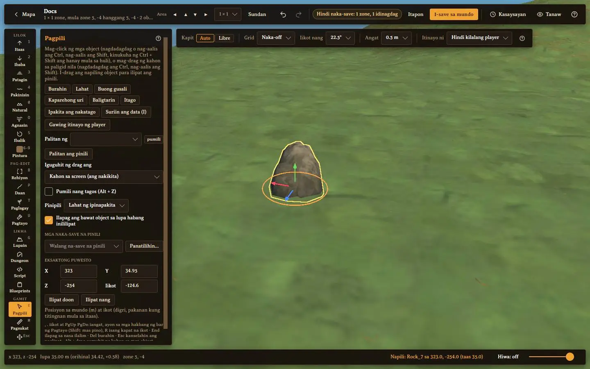
*Malapitan sa isang napiling bato: ang orange na balangkas nito, ang mga arrow na pulang X, berdeng Y at asul na Z na
naglilipat dito sa isang axis, at ang orange na singsing na umiikot dito. Nasa kaliwa ang panel ng Pagpili.*

## Gamitin ito

Para maglipat ng ilang object:

1. Pindutin ang `E`.
2. Mag-click ng object. `Ctrl` + click para sa iba pa, o mag-drag ng kahon sa screen sa paligid nila.
3. I-drag ang isang napiling object para ilipat silang lahat, o i-drag ang isang arrow para ilipat sa isang axis, o ang
   singsing para iikot.
4. Opsiyonal: mag-type ng eksaktong halaga sa ilalim ng **EKSAKTONG PUWESTO**, saka i-click ang **Ilipat doon**.

Mula sa tool na **Tanaw**, lumilipat sa Pagpili na napili ang object ang double-click dito. Ang mga object na
ipinapakita lang ang mapipili: i-on muna ang mga uri nila sa [panel na Tanaw](editor-basics.md). May malabong kahon ang
object sa ilalim ng cursor: iyon ang pinipili ng click.

Iisang hakbang ng undo (`Ctrl+Z`) ang bawat paglipat, pag-ikot, pagbura o pagbabago. Walang isinusulat sa mundo
hanggang **I-save sa mundo** mo (o **I-apply nang live**).

## Mga setting

Ang panel ng Pagpili, mula itaas pababa.

| Setting | Ano ang ginagawa |
|---|---|
| **Burahin** | Tinatanggal ang mga napiling object (`Del`). Ibinabalik sila ng `Ctrl+Z`. |
| **Lahat** | Pinipili ang bawat ipinapakitang object sa area (`Ctrl+A`). |
| **Buong gusali** | Idinadagdag ang bawat piece ng gusali na nakakonekta sa mga napili sa pamamagitan ng mga piece na nagdidikit: pader, sahig, bubong, biga. Hindi kasama ang mga piece na nakahiwalay. |
| **Kaparehong uri** | Pinipili ang bawat ipinapakitang object ng mga uring napili ngayon: pumili ng isang beech, makuha ang lahat ng beech. |
| **Baligtarin** | Pinipili ang bawat ipinapakitang object na hindi napili ngayon, at ang mga iyon lang (`Ctrl+I`). |
| **Itago** / **Ipakita ang nakatago** | Itinatago ang mga napiling object sa tanaw, para maabot ang tinatakpan nila (`Ctrl+H`), at ipinapakita ulit sila (`Alt+H`). Hindi iginuguhit o napipili ang mga nakatagong object; walang nagbabago sa mundo. Nakakalimutan ang itinago kapag nagbukas ng ibang area. |
| **Suriin ang data (I)** | Binubuksan ang [Inspector](#inspector) sa iisang napiling object. |
| **Gawing itinayo ng player** | Ibinibigay sa mga napiling piece na walang nagtayo ang player na pinili sa **Itinayo ni** sa [bar ng Pagtayo](build.md#ang-bar-ng-pagtayo), para ituring sila ng laro na itinayo ng player. Gamitin ito sa guhong gusto mong ayusin at panatilihin. Tingnan ang [Mga piece na itinayo ng player](concepts/objects.md#mga-piece-na-itinayo-ng-player). |
| **Palitan ng** + **pumili** + **Palitan ang pinili** | Pumili ng uri (o i-click ang **pumili**, saka ang isang object sa mundo), saka palitan nito ang bawat napiling object, sa parehong puwesto at direksiyon. Walang hawak ang mga bagong object mula sa data ng mga luma. |
| **Iguguhit ng drag ang** | **Kahon sa screen (ang nakikita)** o **Balangkas sa lupa (lahat sa ibabaw nito)**: tingnan ang [Pumili ng marami nang sabay](#pumili-ng-marami-nang-sabay). |
| **Pumili nang tagos (Alt + Z)** | Kinukuha rin ng kahon ang nakatago sa likod ng iba sa loob nito: ang muwebles sa loob ng bahay, ang pader sa likod ng isa pa. |
| **Pinipili** | Ang kinukuha ng mga click, kahon at balangkas: **Lahat ng ipinapakita**, **Mga itinayong piece lang** (ang itinayo ng mga player) o **Kalikasan lang** (mga puno, bato, ore, palumpong, mapipitas, labi). Iginuguhit pa rin ang hindi kasama pero hindi ito nakahahadlang: sa Mga itinayong piece lang, kinukuha ng kahon ang pader sa likod ng puno. Gumagana rin ito sa mga click ng tool na Tanaw; ang **Sa ibabaw** ng tool na Paglagay at ang mga eyedropper ay pumipili ng bawat uri. |
| **Ilapag ang bawat object sa lupa habang inililipat** | Naka-on: lumalapag ang bawat object sa sahig, mesa o bato sa ilalim nito kung saan ito napupunta, kung hindi ay sa lupa (walang sinusuportahan ang mga puno, palumpong at creature: nakatayo sa lupa ang punong inilipat sa isang kakahuyan); gumagalaw ang isang gusali bilang isang bloke at nakapatong sa nasa ilalim nito. Naka-off: gumagalaw ang buong pinili bilang isang bloke sa taas nito mula sa lupa. Naka-on sa simula. |
| **MGA NAKA-SAVE NA PINILI**: **Panatilihin…** | Itinatabi ang pinili sa ilalim ng isang pangalan, para sa mundong ito. Pumili ng isa sa listahan para sa mga button nito: **Pagpili** (kapalit ng kasalukuyang pinili), **Idagdag** (dito) at **Kalimutan** (matapos magtanong). Binibilang na nawawala ang mga object na inilipat o binura mula noon; sinasabi ng status bar kung ilan. |
| **EKSAKTONG PUWESTO**: **X**, **Y**, **Z**, **Iikot** | Ipinapakita kapag may pinili. Ang X (silangan–kanluran) at Z (hilaga–timog) ay ang gitna ng pinili, ang Y ay ang taas ng pinakamababang object nito, ang Iikot ay ang direksiyon ng unang object sa digri, pakanan mula sa itaas. |
| **Ilipat doon** | Inililipat at iniikot ang pinili sa mga na-type na halaga, bilang iisang hakbang ng undo. Eksakto ang mga na-type na halaga: walang kumakapit sa ibabaw nila. |
| **Ilipat nang** | Ginagawang dami ang mga field: metro pasilangan, pataas at pahilaga, at digri ng ikot. Ginagawa ito ng **Ilipat ayon dito**. |

## Pumili ng isang object sa bawat pagkakataon

| Aksiyon | Ano ang ginagawa |
|---|---|
| Click | Pinipili ang object, at iyon lang. |
| Click ulit sa parehong lugar | Pinipili ang susunod na object sa likod nito, saka ang kasunod: isang chest sa sahig, ang sahig, ang biga sa ibaba. |
| `Ctrl` + click | Idinadagdag ang object, o tinatanggal ito kapag napili na. |
| `Shift` + click | Tinatanggal ang object. |
| `Ctrl` + `Shift` + click | Idinadagdag ang hanay mula sa huling na-click na object hanggang dito: i-click ang pader 1, saka ang pader 3, at napipili ang mga pader 1 hanggang 3. |
| I-double-click ang piece ng gusali | Pinipili ang buong gusali. Ang chest (anumang container) ang eksepsiyon: mag-isa itong napipili at bumubukas sa Inspector. |
| I-double-click ang bahagi ng barko | Pinipili ang buong barko: tingnan ang [Mga barko at iba pang magkaugnay na object](#mga-barko-at-iba-pang-magkaugnay-na-object). |
| Mag-click sa bakanteng lupa, o `Alt+A` | Inaalis ang pinili. |

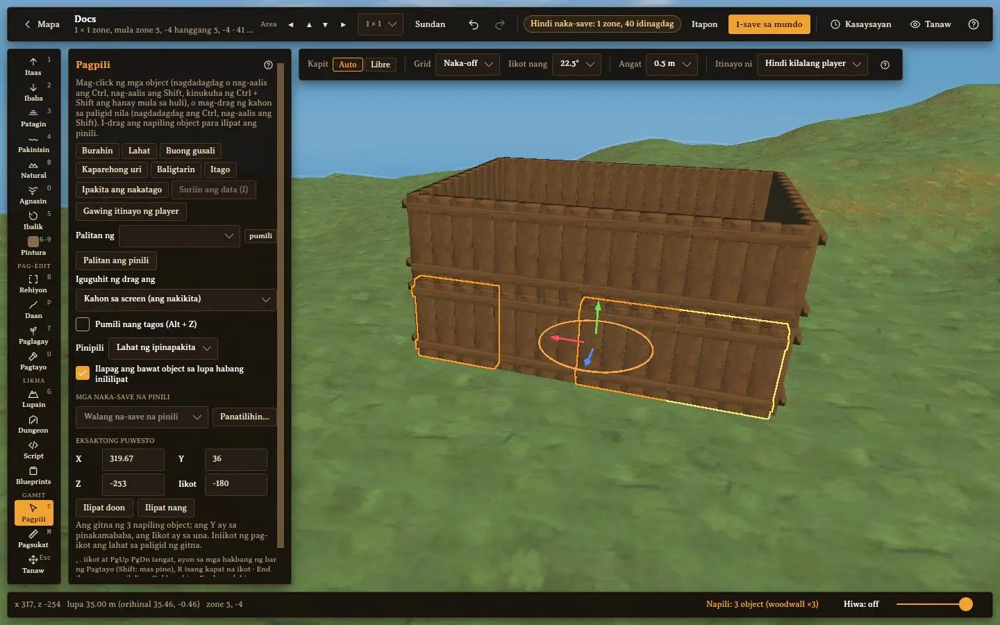
*Isang click sa isang piece ng pader, saka `Ctrl` + click sa dalawa pa: nakabalangkas sa mas mapusyaw na dilaw ang
huling na-click, orange ang iba, at binibilang ng status bar ang tatlo.*

## Pumili ng marami nang sabay

Gumuguhit ng kahon sa screen ang drag sa bakanteng lupa. Pagbitaw mo, napipili ang mga object na **nakikita** sa loob
nito, hindi ang mga nakatago sa likod ng iba. Iikot ang camera para pumili: mula sa itaas, ang sahig at itaas ng mga
pader ng gusali; mula sa gilid, iisang pader.

| Aksiyon | Ano ang ginagawa |
|---|---|
| Mag-drag sa bakanteng lupa | Iginuguhit ang kahon; nagiging pinili ang nakikita sa loob nito. |
| `Alt` + drag | Iginuguhit ang kahon kahit nagsimula ka sa ibabaw ng object (isang gusali, isang kakahuyan). |
| `Ctrl` + drag | Idinadagdag ang kinukuha ng kahon. |
| `Shift` + drag | Tinatanggal ito. |

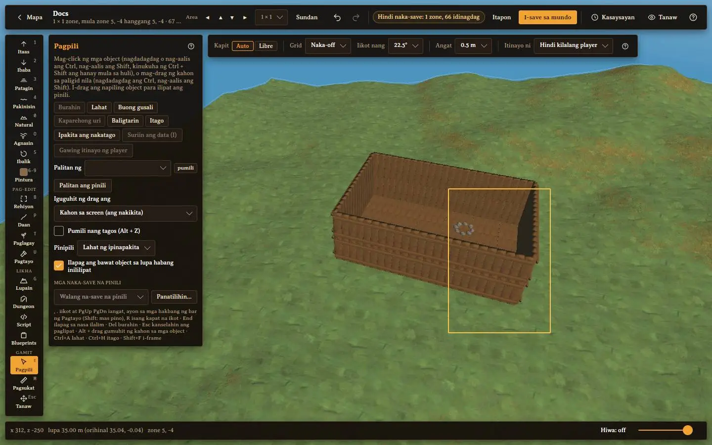
*`Alt` + drag mula sa gitna ng kubo sa kanang kalahati nito: iginuguhit ang kahon sa screen.*

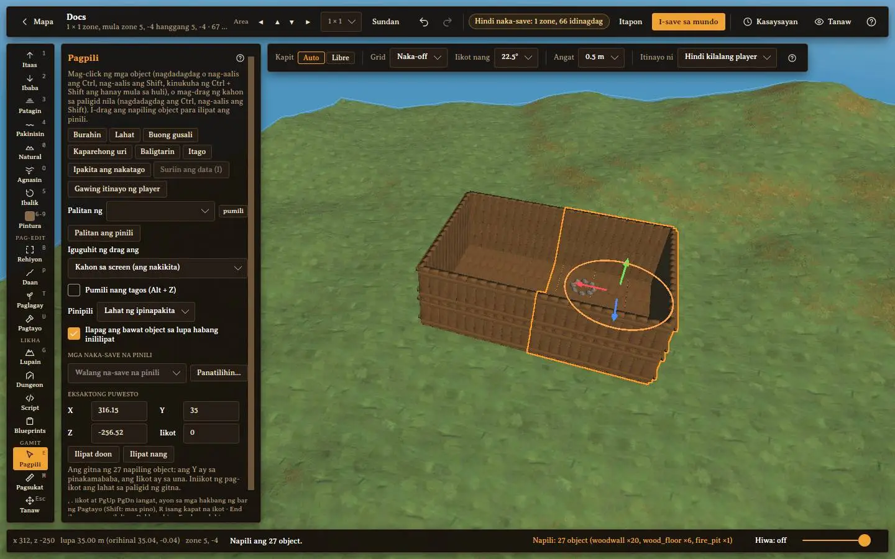
*Pagkatapos bumitaw: 27 piece ang nakabalangkas, ang mga pader, ang sahig na nakikita sa pagitan nila at ang fire pit;
hindi kasama ang sahig at chest na nakatago sa likod ng malapit na pader. Binibilang ng status bar ang mga object.*

*Ang parehong kahon na naka-on ang **Pumili nang tagos**: 34 piece, pati ang sahig at ang chest sa likod ng malapit na
pader.*

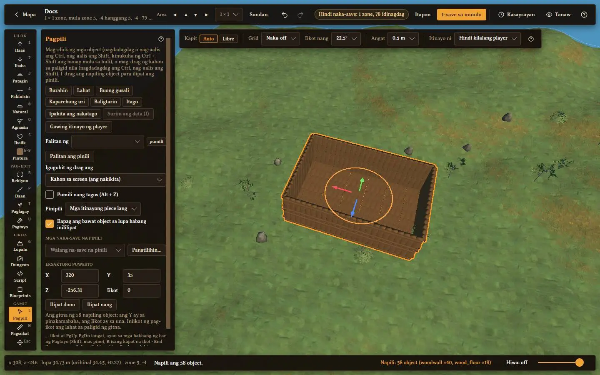
***Pinipili: Mga itinayong piece lang** at isang kahon sa ibabaw ng buong kubo sa gitna ng mga bato at palumpong: ang
58 piece lang ng kubo.*

Kapag **Iguguhit ng drag ang: Balangkas sa lupa (lahat sa ibabaw nito)**, gumuguhit na lang ang drag ng
balangkas sa lupa, at napipili ang bawat ipinapakitang object na nakatayo sa loob nito, nakatago man o hindi.
Gumagana ang `Alt`, `Ctrl` at `Shift` gaya ng sa kahon.

Para pumili ayon sa uri sa loob ng eksaktong kahon o polygon (bawat puno, o mga beech lang, at kung saan lang
pinapadaan ng [Mask](masks.md) ang lupa), gamitin ang tool na [Rehiyon](area.md#mga-aksiyon-sa-object): sa ilalim ng **Mga
object**, pinipili sila ng **Piliin ang mga object (Enter)** nito at lumilipat sa Pagpili, kung saan gumagana sa kanila
ang **Burahin** at **Palitan ang pinili**.

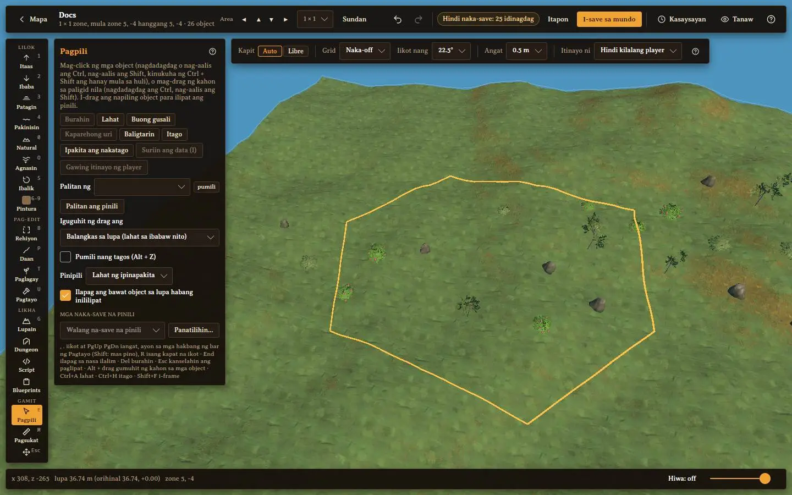
*`Alt` + drag paikot sa mga bato at palumpong: iginuguhit ang balangkas kahit nagsimula ang drag sa isang palumpong.*

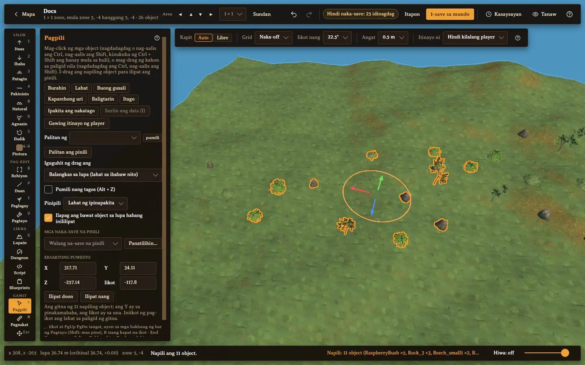
*Napili ang lahat ng ipinapakita sa loob, at ipinapakita ng **EKSAKTONG PUWESTO** kung nasaan ang pinili.*

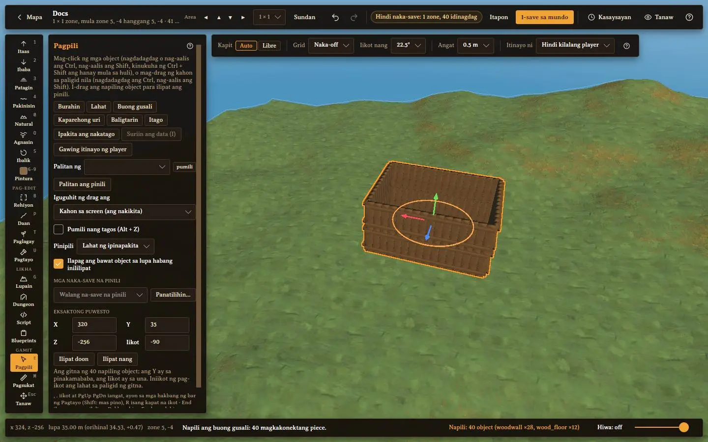
*Isang click sa pader, saka **Buong gusali**: napili ang bawat nakakonektang piece ng kubo.*

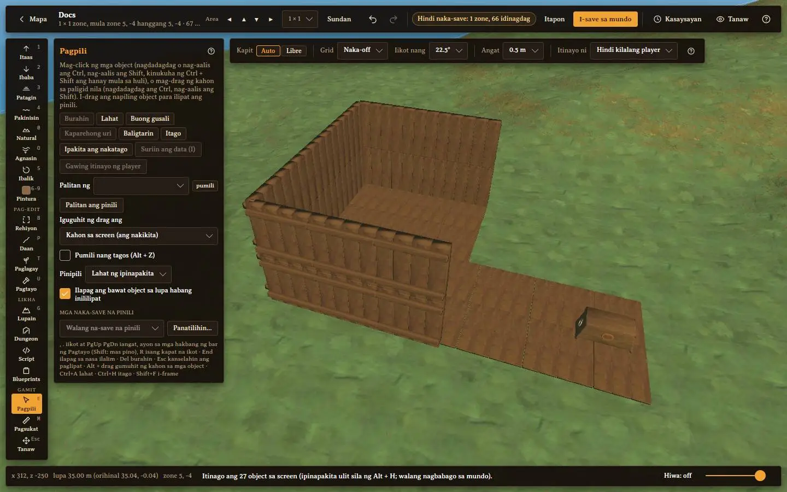
*Malapitan sa kubo matapos itago ng `Ctrl+H` ang nakakahong kanang kalahati nito: kitang-kita ang chest sa sahig sa
loob. Ibinabalik ng `Alt+H` ang mga pader.*

## Ilipat at iikot

| Aksiyon | Ano ang ginagawa |
|---|---|
| I-drag ang napiling object | Inililipat ang buong pinili, sinusundan ang cursor sa lupa. Kumakapit ang mga piece sa mga piece sa paligid, o sumusunod sa grid, ayon sa setting ng [bar ng Pagtayo](build.md#ang-bar-ng-pagtayo). |
| I-drag ang isang arrow | Inililipat sa isang axis: **pulang X** silangan–kanluran, **berdeng Y** taas–baba, **asul na Z** hilaga–timog. Pindutin nang matagal ang `Ctrl` para sa hakbang na 0.5 m. |
| I-drag ang orange na singsing | Iniikot ang pinili sa paligid ng gitna nito; pindutin nang matagal ang `Ctrl` para sa hakbang na 15°. |
| `End` | Ibinabagsak nang diretso ang bawat object sa nasa ilalim nito (sahig, mesa, bato), kung hindi ay sa lupa. |

Ang bar ng Pagtayo sa tabi ng panel ay ang ginagamit ng [Pagtayo](build.md) at ng Paste: **Kapit** (**Auto**:
kumakapit ang mga inilipat na piece sa pinakamalapit na snap point sa loob ng 0.75 m, gaya ng hammer; **Libre**:
nananatili sila kung saan mo sila i-drag), **Grid** (sinusunod ito ng mga piece na hindi kumakapit), **Iikot nang** at
**Angat** (ang mga hakbang ng mga key sa ibaba) at **Itinayo ni**.

Sinusundan ng status bar ang paglipat: "Inililipat ang 12 object: 4.5 m, nakaikot nang 15°, +0.25 m · kumapit sa
woodwall". Pinapanatili ng inilipat na object ang data nito: ang laman ng chest, ang teksto ng karatula, ang nagtayo
ng piece. Tingnan ang [Pagkapit](concepts/objects.md#pagkapit) kung paano lumalapag ang paglipat.

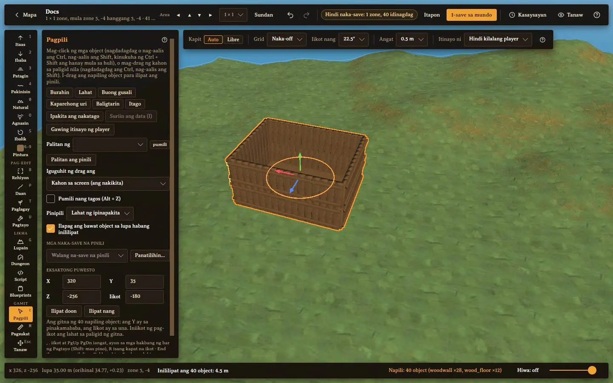
*Hinihila ang pulang X na arrow ng kubong napili nang buo: sinusundan ng status bar ang paglipat, "Inililipat ang 40
object: 4.5 m".*

## Kopyahin, gupitin at i-paste

Kinokopya ng `Ctrl+C` ang pinili; ipine-paste ito ng `Ctrl+V` gamit ang tool sa pag-paste (`R` iniikot, `X`
mina-mirror), dito o sa ibang area: tingnan ang [Rehiyon](area.md). Pinapanatili ng mga kopya ang lahat ng hawak ng mga
orihinal. Pinapanatili ng mga puno at mga katulad nito ang taas nila mula sa lupa kung saan sila lumalapag;
pinapanatili ng mga piece ng gusali ang hugis ng gusali at isinasama ang lupa sa ilalim nila (walang pintura).
Gumugupit ang `Ctrl+X`: ang parehong kopya, saka umaalis ang mga object sa mundo, kaya ang pag-paste ay paglipat sa
kanila.

Para itabi ang kopya bilang blueprint, buksan ang **Blueprints** sa rail at i-click ang **I-save bilang blueprint…** sa
row nitong **Clipboard**: tingnan ang [panel na Blueprints](workshop.md#panel-na-blueprints).

## Inspector

Ipinapakita ng Inspector ang lahat ng hawak ng isang object sa save at hinahayaan kang baguhin ito. Buksan ito gamit
ang **Suriin ang data (I)**, o i-double-click ang isang chest (o anumang object na hindi piece ng gusali).

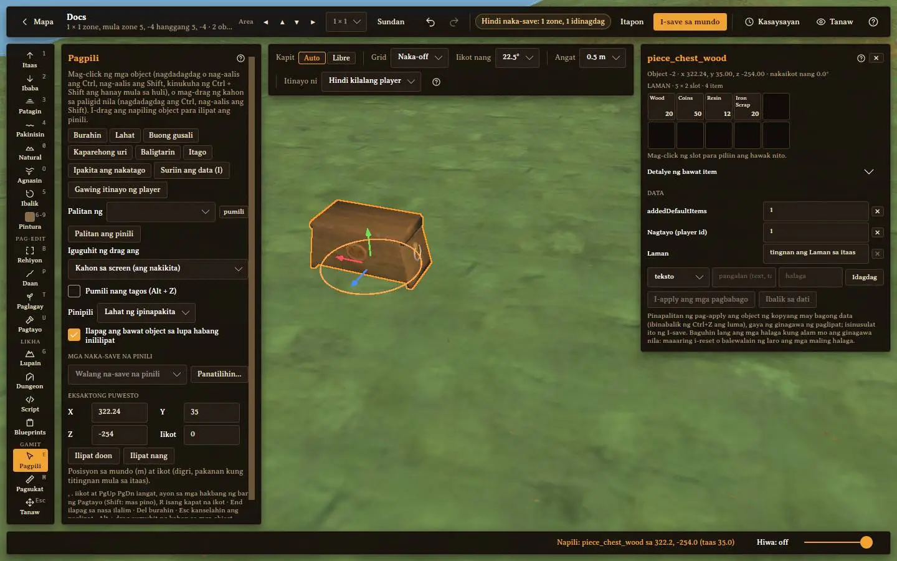
*Malapitan sa chest na may hawak na apat na item, bukas sa Inspector: ang mga slot nito gaya sa laro, bawat isa may
pangalan ng item at kung ilan, saka ang bawat halaga sa ilalim ng DATA.*

Sa itaas: ang pangalan, id, puwesto at ikot ng object. Para sa spawn point o pugad, ang inilalabas nito
(`Spawn point: Boar · 0–2 ★ · spawns once`); para sa object ng isang mod, kung saang mod ito galing.

| Bahagi | Ano ang ginagawa |
|---|---|
| **LAMAN** | Mga chest at iba pang container: ang mga slot gaya sa laro ("5 × 2 slot · 4 item"). Mag-click ng slot, saka **Maghanap ng item…** (mag-type ng ilang titik), **Ilan** at **Kalidad**. Inaalis ng **Walang laman** ang item; inililipat ito ng **Ilipat**, saka ng isa pang slot (nagpapalit ang dalawang item). Pinuputol ang Ilan sa pinakamalaking stack ng laro. |
| **Detalye ng bawat item** | Bawat item kasama ang stack, kalidad, tibay at slot nito. Naglalagay ng bago sa unang bakanteng slot ang **Magdagdag ng item**; nag-aalis ng isa ang **✕**; inililipat ng **Ayusin ang slot** ang bawat item sa mga unang bakanteng slot, hanay kada hanay. |
| **HAWAK** / **SUOT** | Mga item stand at armour stand. Ang tinatanggap lang ng stand na iyon ayon sa laro ang iniaalok ng listahan (tumatanggap din ng pagkain ang patag na stand, para maghanda ng mesa). Ang **Kalid.** ay ang kalidad nito, ang **Estilo** ay ang itsura nito, ang **Nakasabit** ay kung paano ito nakasabit, ang **Tindig** ay ang tindig ng armour stand; tinatanggal ito ng **✕**. |
| **DATA** | Bawat halaga, ayon sa pangalan ng laro, may label para sa mga karaniwan: Teksto (karatula), Tag (portal), Nagtayo (player id), Health, Gatong, Level (bituin)... Baguhin ang mga numero at teksto sa puwesto nila; tinatanggal ng **✕** ang isang halaga (ginagamit na ng laro ang default nito). Inililista pero hindi binabago ang ibang binary data. |
| **Idagdag** | Nagdadagdag ng halagang wala sa object: piliin ang uri nito, i-type ang pangalan nito ayon sa tawag ng laro (`text` para sa karatula, `tag` para sa portal) at ang halaga. |
| **I-apply ang mga pagbabago** | Pinapalitan ang object ng kopyang may bagong data, sa parehong puwesto: iisang hakbang ng undo. Isinusulat ito ng **I-save sa mundo** o **I-apply nang live**. |
| **Ibalik sa dati** | Kinakalimutan ang mga pagbabagong ginawa sa card. |

- Galing sa laro ang laki ng container. Nasa isang bahagi ang container ng mga cart at barko, kaya hindi alam ang laki
  nila.
- Nakatago sa laro ang mga item na nasa labas ng mga slot: nagtatanong ang editor bago i-apply iyon.
- Nagiging sariling laman ng chest ang binagong laman: hindi pinupuno ng chest na hindi pa nabubuksan ang sarili nito
  ng loot ng laro sa ibabaw nila.
- Bago at buo ang tibay, ayon sa kalidad nito, ng item na inilagay sa stand. Sa **Itsura ng laro**, iginuguhit ito ng
  3D na tanaw sa stand.
- Galing sa code ng laro at ng mga mod mo ang mga pangalan ng halaga (binabasa, hindi kailanman pinapatakbo). Numero
  ang lumalabas para sa hindi kilalang pangalan.

> [!WARNING]
> Baguhin lang ang isang halaga kapag alam mo ang ginagawa nito: maaaring i-reset o balewalain ng laro ang mga halagang
> hindi nito inaasahan. Ibinabalik ng `Ctrl+Z` ang lumang object hanggang mag-save ka.

## Mga barko at iba pang magkaugnay na object

Gumagawa ang ilang mod ng mga object mula sa iba: ang sasakyang-dagat ng isang mod ng barko ay isang ugat at ang mga
piece na itinayo rito, ang lokomotora ng isang mod ng tren at ang mga bagon na hinihila nito. Kapag inilalarawan sila ng
mod (ang `worldeditor.json` nito, tingnan ang [Modding](modding.md), o isang add-on gaya ng add-on na
[ValheimRAFT](../../addons/ValheimRAFT/README.md) o [Railroads](../../addons/Railroads/README.md)), iginuguhit ng
editor ang grupo gaya ng pagtatayo ng mod dito at pinapanatili itong magkasama:

- **Inililipat nang buo.** Kapag pinili ang anumang bahagi at inilipat, iniikot o binura, kasama ang buong grupo
  (sinasabi iyon ng status bar, sa mga salita ng mod: "a whole vehicle"). Pinapanatili ng inilipat na grupo ang taas
  nito (nananatiling nakalutang ang barko), hindi kumakapit at hindi bumabagsak sa `End`.
- **Kinokopya nang buo.** Kinokopya ng `Ctrl+C` sa anumang bahagi ang buong grupo, nang walang lupa. Sariling grupo
  ang bawat paste, may mga bagong id. Ipine-paste bilang karaniwang piece ang bahaging kinopya nang wala ang ugat nito.
- **Tinatanggal nang buo.** Binubura ng pagbura sa anumang bahagi ang buong grupo, pati kapag pinili ito ng tool na
  [Rehiyon](area.md#mga-aksiyon-sa-object).

Ganoon din ang ginagawa ng mga tool ni Claude. Tingnan ang [Ano ang object](concepts/objects.md#ano-ang-object).

## Mga shortcut

| Key o mouse | Ano ang ginagawa |
|---|---|
| `E` | Binubuksan ang Pagpili. |
| `Ctrl+A` / `Alt+A` | Piliin ang lahat ng ipinapakita / alisin ang pinili. |
| `Ctrl+I` | Baligtarin ang pinili. |
| `Ctrl+H` / `Alt+H` | Itago ang mga napiling object / ipakita ulit sila. |
| `Alt+Z` | I-on o i-off ang **Pumili nang tagos**. |
| `Shift+F` o Numpad `.` | I-frame ang pinili (pinapalitan ng `F` lang ang mata). |
| `Del` | Burahin ang pinili. |
| `I` | Buksan ang Inspector sa iisang napiling object. |
| `,` `.` o `Alt` + wheel | Iikot ayon sa hakbang na **Iikot nang** ng bar ng Pagtayo, 22.5° sa simula (`Shift`, mas pino: 1°). |
| `R` | Iikot nang isang kapat na ikot. |
| `PgUp` / `PgDn` o `Ctrl` + wheel | Iangat o ibaba ayon sa hakbang na **Angat** ng bar ng Pagtayo, 0.5 m sa simula (`Shift`, mas pino: ikalima nito). |
| `End` | Ibagsak ang bawat object sa nasa ilalim nito. |
| `Esc` | Isara ang Inspector; kung hindi, kanselahin ang kahon, balangkas o paglipat na nagaganap; kung hindi, bumalik sa tool na Tanaw (nananatili ang pinili). |
| `Ctrl+C` / `Ctrl+X` / `Ctrl+V` | Kopyahin, gupitin, i-paste. |
| `Ctrl+Z` | I-undo. Iisang hakbang ang mga key na pinindot nang magkakasunod sa loob ng isang sandali. |

Nasa [Mga shortcut](help/shortcuts.md) ang lahat ng key ng editor.

## Mga tip at limitasyon

> [!CAUTION]
> Mapipili at mabubura ang mga Runestone, pero hindi maililipat, maiikot, makokopya o masusuri: itinatayo ng laro ang
> bawat isa mula sa lokasyon nito tuwing nilo-load ang zone, kaya ang pagbura sa isa ay tuluyang nag-aalis sa lokasyong
> iyon (pati ang maliit na pagpapatag ng lupa sa paligid nito). Ginagawa itong permanente ng I-save sa mundo; hanggang
> doon, ibinabalik ito ng `Ctrl+Z`.

- **Pagbawi:** nabura o nailipat nang hindi sinasadya: `Ctrl+Z`, kahit pagkatapos mag-save (saka mag-save ulit). May
  naitago: `Alt+H`. Tingnan ang [I-undo ang mga pagbabago](guides/undo-changes.md).
- Hindi isinasama ng mga kahon, balangkas, **Lahat**, **Kaparehong uri**, **Baligtarin** at **Buong gusali** ang
  anumang higit sa 10 m sa ilalim ng lupa (mga object na itinatago roon ng isang mod, gaya ng mga crafting station sa
  ilalim ng bahay).
- Pumipili ang click ng object ayon sa iginuhit na hugis nito, hindi sa kahon nito: maki-click ang bato sa ilalim ng mga
  sanga ng puno sa pagitan ng mga sanga. Binibilang lang ang mga dahon at damo kung walang solidong bagay sa likod nila.
  Tingnan ang [Ano ang object](concepts/objects.md#ano-ang-object).
- Nawawala ang berdeng tuldok na hindi naka-save ng mga napiling object habang napili sila.
- Sa live mode, pinapanatili ng inilipat na object ang id nito sa tumatakbong laro kapag wala nang ibang nagbago rito.
  Tingnan ang [Ano ang ipinapadala at kailan](concepts/live-editing.md#ano-ang-ipinapadala-at-kailan).

## Kaugnay

- [Ilipat o kopyahin ang isang gusali](guides/move-a-building.md)
- [Baguhin ang laman ng chest o ang nakasulat sa karatula](guides/fill-a-chest.md)
- [Hanapin ang isang object, item sa chest o karatula](guides/find-things.md)
- [Mga object](concepts/objects.md#ano-ang-object) · [Pagkapit](concepts/objects.md#pagkapit)
- [Pagtayo](build.md) · [Paglagay](place.md) · [Rehiyon](area.md)
