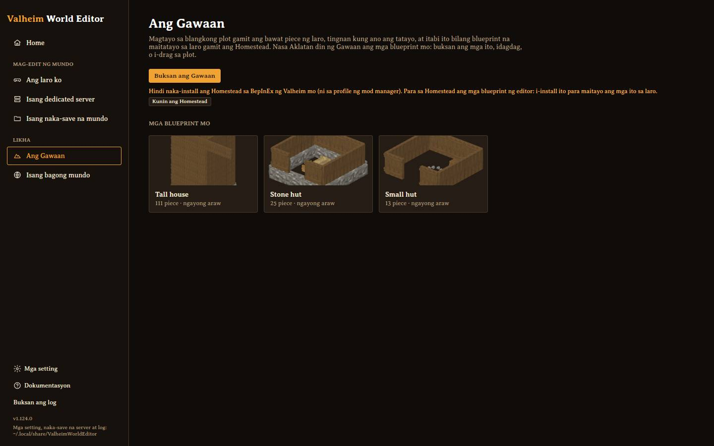
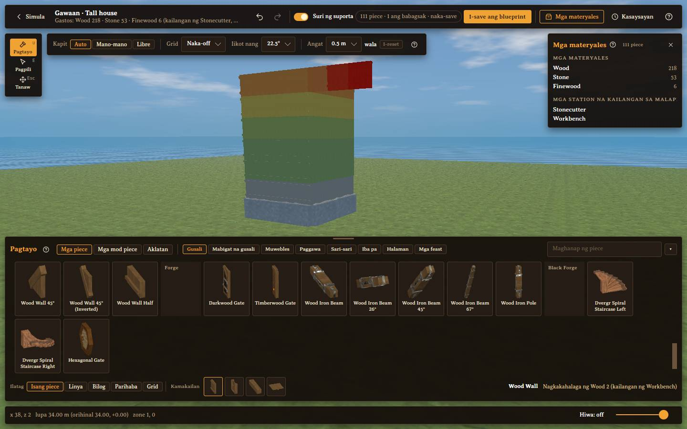
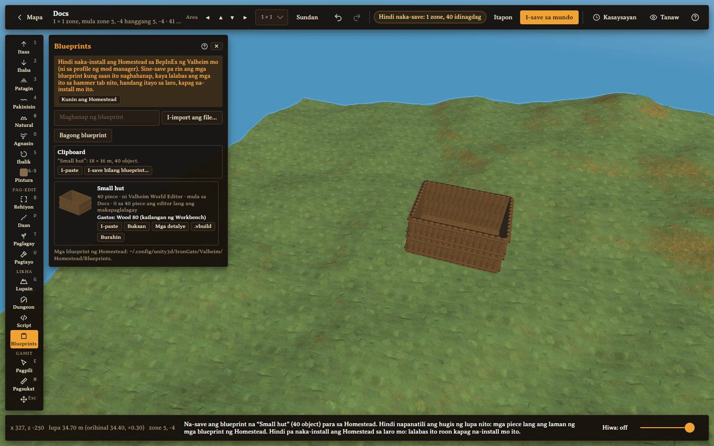

<!-- source: 491b2a7c -->
# Ang una mong gusali

Sa mga labinlimang minuto, magtatayo ka ng maliit na kubong kahoy sa Gawaan, panonoorin mong kulayan ito ng pagsusuri
ng suporta, iingatan ito bilang blueprint, at ipe-paste ito sa isang mundo. Hindi mo kailangan ng mundo para sa unang
bahagi: isang blangkong plot ang Gawaan.

**Kailangan mo:** naka-install ang editor ([I-install ang editor](install.md)). Para sa huling bahagi, isang mundong may
backup na kopya sa tabi nito, gaya sa [Ang una mong edit](first-edit.md).

## 1. Buksan ang Gawaan

1. Sa panimulang pahina, i-click ang **Ang Gawaan**, saka **Buksan ang Gawaan**.

*Ang **Ang Gawaan** ng panimulang pahina: **Buksan ang Gawaan**, kung naka-install ang Homestead, at ang mga blueprint
mo (tatlo rito; walang laman ang sa iyo sa unang pagkakataon).*

**Ang dapat mong makita:** isang patag at walang lamang plot ng meadow, ang dock ng **Pagtayo** sa ibaba na nasa tab
nitong **Mga piece**, at ang top bar na nagsasabing "Wala pang piece". **Pagtayo**, **Pagpili** at **Tanaw** lang
ang nasa rail, katabi ang bar ng Pagtayo.

## 2. Maglatag ng sahig

1. Sa dock ng **Pagtayo**, i-type ang `wood floor` sa **Maghanap ng piece**.
2. I-click ang tile ng sahig na kahoy. Lumalabas ang pangalan at gastos nito sa paanan ng dock, at napupunta ito sa
   **Kamakailan** doon.
3. Mag-click sa gitna ng plot. Nailalapag ang sahig.
4. Tumuro sa tabi ng gilid ng sahig at mag-click ulit. Kumakapit ang bagong sahig sa una, gilid sa gilid, gaya ng
   hammer ng laro. Maglapag ng apat na sahig nang pa-parisukat.

**Ang dapat mong makita:** isang parisukat na sahig, bawat piece ay mapusyaw na asul: nakatayo ito sa lupa, kaya buo ang
suporta nito. Binibilang ng top bar ang "4 piece · hindi naka-save bilang blueprint", at sa ilalim ng pamagat,
ang gastos ng kubo.

## 3. Itayo ang mga dingding

1. Hanapin ang `wood wall` at i-click ang tile ng dingding na kahoy.
2. Tumuro sa panlabas na gilid ng isang sahig at mag-click: kumakapit ang dingding sa gilid. Pindutin ang `,` o `.` para
   iikot muna ito kung mali ang direksiyong hinaharap nito.
3. Maglagay ng mga dingding sa paligid ng sahig. Mag-iwan ng isang puwang para sa pinto.
4. Hanapin ang `wood door`, i-click ang tile nito, at ilagay ang pinto sa puwang.
5. Maglagay ng ikalawang hanay ng mga dingding sa ibabaw ng una.

*Ang suri ng suporta sa isang matangkad na bahay: mapusyaw na asul ang batong pundasyon, berde ang mga dingding sa
itaas, saka dilaw at kahel habang nauubos ang suporta nila, at pula ang isang nakausli: babagsak ito.*

**Ang dapat mong makita:** berde (matibay) ang mga dingding sa sahig; mas mapusyaw na berde o dilaw ang ikalawang hanay,
na may mas kaunting suporta. Nagiging pula ang piece na babagsak sa laro, at sinasabi ng top bar kung ilan ang
babagsak. Bakit: tingnan ang [Ang suri ng suporta](../concepts/objects.md#ang-suri-ng-suporta).

May piece sa maling lugar? Pindutin ang `Ctrl+Z` para i-undo ito, o pindutin ang `E` (**Pagpili**), i-click ang piece,
pindutin ang `Del`, at pindutin ang `U` para bumalik sa pagtatayo.

## 4. I-save ang blueprint

1. I-click ang **I-save ang blueprint** sa top bar (o pindutin ang `Ctrl+S`).
2. I-type ang `My first hut` bilang **Pangalan**, ilang salita bilang **Paglalarawan**, at `hut, wood` bilang
   **Mga tag**.
3. I-click ang **I-save**. Kung may mga piece na babagsak sa laro, magtatanong muna ang editor: **Magpatuloy sa
   pagtatayo** para ayusin ang mga ito (nakapula ang mga ito), o **I-save pa rin**.

**Ang dapat mong makita:** ang mensaheng "Na-save ang blueprint na “My first hut” (… piece) para sa Homestead.", at
sinasabi ng top bar ang "naka-save". Nasa aklatan mo na ang blueprint, kasama ang larawan ng kubo. Kapag nasa laro
mo ang mod na [Homestead](https://thunderstore.io/c/valheim/p/sighsorry/Homestead/), lumalabas din ito sa hammer tab ng
Homestead, handang itayo sa laro.

## 5. I-paste ito sa isang mundo

1. I-click ang **Simula** sa itaas na kaliwa para bumalik sa panimulang pahina.
2. I-click ang **Isang naka-save na mundo**, saka ang mundo mo (hindi ang backup na kopya nito). Sa mapa nito, i-click
   ang isang lugar ng bukas na lupa na napuntahan mo na, at i-click ang **I-edit sa 3D**.
3. Sa rail, sa ilalim ng **LIKHA**, i-click ang **Blueprints**. Sa maikling window, mag-scroll sa rail gamit ang mouse
   wheel para maabot ito.
4. Hanapin ang **My first hut** sa listahan at i-click ang button nitong **I-paste**.
5. Igalaw ang mouse sa ibabaw ng bukas na lupa: sinusundan ito ng kubo, naaaninag. Pindutin ang `R` para iikot ito nang
   sangkapat.
6. Mag-click para ilapag ito, saka pindutin ang `Esc` para tumigil sa pag-paste.

*Ang panel na **Blueprints** katabi ng rail: isang naka-save na kubo kasama ang larawan, gastos at button nitong
**I-paste**.*

**Ang dapat mong makita:** nakatayo ang kubo sa lupa. Kapag naka-on ang **Linisin ang puwesto** sa panel ng I-paste
(naka-on ito sa simula), hinuhukay ang lupang nakaharang at nawawala ang mga puno at bato sa puwesto nito. Sinasabi ng
top bar ang "Hindi naka-save: … idinagdag".

Ang pulang balangkas bago mag-click ay nangangahulugang hindi kasya ang kubo sa nakabukas na area: magbukas ng mas
malaki mula sa mapa.

## 6. I-save ang mundo

1. Isara ang Valheim kung tumatakbo ito.
2. I-click ang **I-save sa mundo**, tingnan ang **Folder ng mundo** sa tanong, saka i-click ang **I-save**.
3. Simulan ang Valheim, i-load ang mundo at maglakad papunta sa lugar.

**Ang dapat mong makita:** ang kubo mo, nakatayo kung saan mo ito ini-paste. Itinayo ng player ang mga piece nito, kaya
itinuturing ito ng laro na base mo (tingnan ang [Mga piece na itinayo ng player](../concepts/objects.md#mga-piece-na-itinayo-ng-player)).

## Kung hindi ito gumana

- **Hindi kumakapit ang piece**: tumuro nang mas malapit sa gilid o itaas ng piece na naroon na; kinukuha ng pagkapit
  ang pinakamalapit na mga kapit-punto sa loob ng kalahating metro.
- **Sinasabi ng Gawaan na hindi naka-install ang Homestead**: ayos lang iyon. Sine-save ang mga blueprint kung saan
  naghahanap ang Homestead, at gumagana nang wala ito ang pag-paste sa mundo.
- **Pula ang balangkas ng pag-paste**: masyadong malapit ang kubo sa gilid ng area. Igalaw ang mouse papasok, o
  magbukas ng mas malaking area.
- **Hindi mo gusto ang resulta**: binabawi ng `Ctrl+Z` ang pag-paste bago ka mag-save. Pagkatapos mag-save, i-undo ito
  at **I-save sa mundo** ulit: tingnan ang [Mag-undo ng hakbang, bawiin ang isang pagbabago, o itapon ang lahat](../guides/undo-changes.md).

## Susunod

- [Ang Gawaan](../workshop.md): bawat tab ng piece, ang aklatan, Gupitin at kung paano kumakapit ang mga piece.
- [I-paste ang blueprint sa isang mundo](../guides/paste-a-blueprint.md)
- [Ilipat o kopyahin ang isang gusali](../guides/move-a-building.md)
