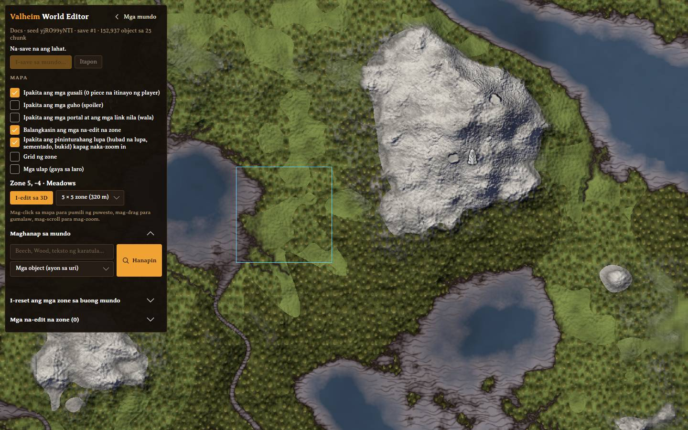
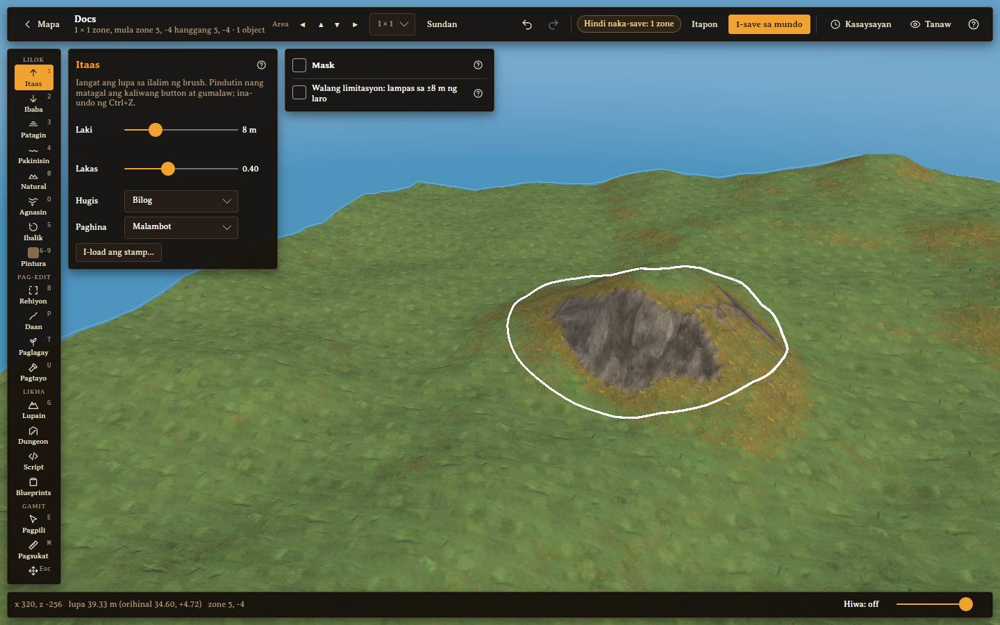
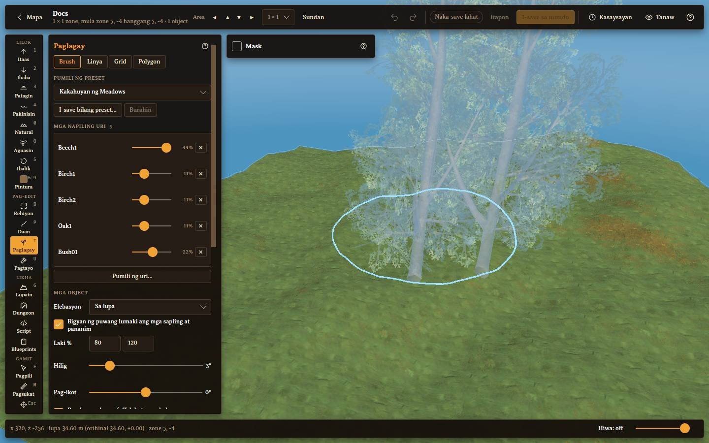
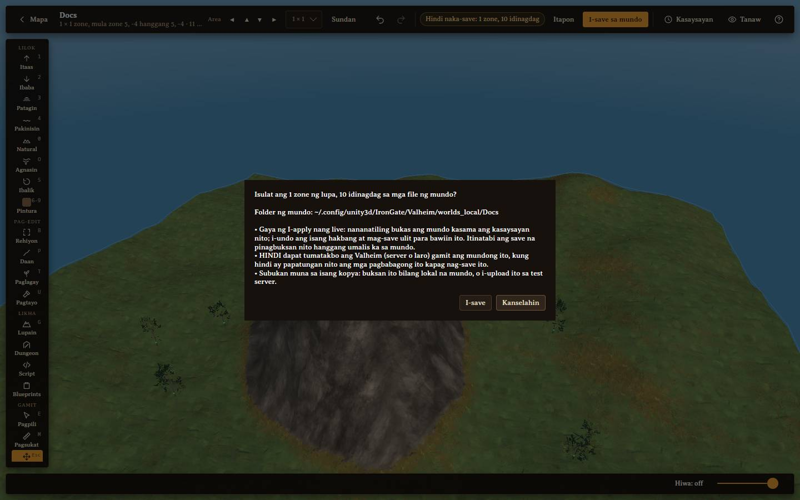

<!-- source: b94e61af -->
# Ang una mong edit

Sa mga sampung minuto, kokopyahin mo ang isang mundo, magtataas ng maliit na burol at magtatanim ng ilang puno sa tabi
ng base mo, mag-a-undo at magre-redo, magse-save, at lalakad papunta sa resulta sa Valheim. Pinapanatili ng kopya ang
mundo gaya ng dati, kaya walang mawawala.

**Kailangan mo:** naka-install na editor ([I-install ang editor](install.md)), at isang single-player na mundong
nalaro mo na: kung saan nagtayo ka ng base at gumamit ng hoe o pickaxe kahit isang beses. Dapat nakasara ang Valheim.

## 1. Kopyahin ang mundo

Ang kopya ang daan mo pabalik: anuman ang gawin mo pagkatapos, maibabalik mo ang mundo nang eksaktong gaya ngayon.

1. Isara ang Valheim.
2. Sa editor, sa panimulang pahina, i-click ang **Isang naka-save na mundo** at i-hover ang card ng mundo mo.
   Nagtatapos ang tooltip sa folder ng mundo, halimbawa `…/IronGate/Valheim/worlds_local/Midgard`.
3. Sa file manager mo, buksan ang folder na `worlds_local` na may hawak nito.
4. Kopyahin ang folder ng mundo at i-paste ang kopya sa parehong folder na `worlds_local`.
5. Palitan ang pangalan ng kopya ng `<World>_backup_<date>`, halimbawa `Midgard_backup_2026-10-22`.

**Ang dapat mong makita:** pagkalipas ng ilang segundo, inililista ng **Isang naka-save na mundo** ang dalawa: ang
mundo mo at ang `Midgard_backup_2026-10-22`. Ang mundo mismo ang ie-edit mo; nananatiling hindi ginagalaw ang kopya sa
tabi nito. Higit pa tungkol sa mga kopya: [Mag-backup ng mundo bago mag-edit](../guides/back-up-a-world.md).

## 2. Buksan ang mundo

1. Sa **Isang naka-save na mundo**, i-click ang mundo mo (hindi ang kopya). Bumubukas ito sa mapa nito.
2. Sa mapa, i-click ang isang lugar na bukas na lupa malapit sa base mo.
3. Sa side panel, piliin ang **3 × 3 zone (192 m)** sa listahan ng laki sa tabi ng **I-edit sa 3D**, saka i-click ang
   **I-edit sa 3D**.

*Ang mapa: pumili ng zone ang isang click (ang asul na parisukat); binubuksan ito ng **I-edit sa 3D** sa laking
napili sa tabi nito.*

**Ang dapat mong makita:** ang 3D na tanaw ng base mo at ng lupang nakapaligid dito, ang tool rail sa kaliwa, at ang
top bar na nagsasabing "Naka-save lahat". Kung malayo ang tanaw, i-scroll ang wheel para lumapit; iniikot ng kanang drag
ang tanaw.

## 3. Magtaas ng burol

1. Pindutin ang `1`, o i-click ang **Itaas** sa rail. Bumubukas ang panel nito sa tabi ng rail.
2. Sa panel, i-drag ang **Laki** sa mga 10 m.
3. Sa bukas na lupa sa tabi ng base mo, pindutin nang matagal ang kaliwang button ng mouse at igalaw ang mouse nang
   paikot-ikot nang ilang segundo.

*Itaas: ang balangkas ng brush sa lupa, isang punsong itinaas sa tabi nito, at ang panel na may **Laki** at **Lakas**.*

**Ang dapat mong makita:** tumataas ang lupa sa ilalim ng brush, at sinasabi ng top bar ang "Hindi naka-save: 1 zone"
na kulay amber. Wala pang isinusulat sa mundo: [nakabinbin](../concepts/saving-and-history.md#mga-nakabinbing-pagbabago) ang
pagbabago.

## 4. Magtanim ng mga puno

1. Pindutin ang `T`, o i-click ang **Paglagay** sa rail.
2. Sa panel ng **Paglagay**, i-click ang **Brush**, saka piliin ang **Kakahuyan ng Meadows** sa ilalim ng **Pumili ng
   preset**.
3. I-drag ang mouse sa paanan ng burol mo.

*Paglagay gamit ang **Brush** at ang preset na **Kakahuyan ng Meadows**: ipinapakita ng brush nang aninag ang mga
susunod na puno; nakatayo sa paligid nito ang mga naitanim na.*

**Ang dapat mong makita:** lumilitaw ang mga beech, birch, oak at palumpong kung saan ka nagda-drag, bawat isa may
maliit na berdeng tuldok (hindi pa naka-save), at nagdadagdag ang top bar ng "… idinagdag".

## 5. I-undo at i-redo

1. Pindutin ang `Ctrl+Z` (`Cmd+Z` sa Mac). Nawawala ang mga punong huli mong itinanim.
2. Pindutin ang `Ctrl+Y`. Bumabalik sila.
3. Pindutin ang `L` para buksan ang **Kasaysayan**.

**Ang dapat mong makita:** inililista ng Kasaysayan ang mga hakbang mo, pinakabago muna: "Inilagay ang …", saka
Itaas. Bumabalik dito ang **Bumalik dito** sa isang row; tinatanggal ng **Tanggalin** ang iisang pagbabagong iyon lang.
Pindutin ulit ang `L` para isara ito.

Higit pa: [Mag-undo ng hakbang, bawiin ang isang pagbabago, o itapon ang lahat](../guides/undo-changes.md).

## 6. I-save

1. I-click ang **I-save sa mundo** sa top bar (o pindutin ang `Ctrl+S`).
2. Basahin ang tanong: sinasabi nito ang isusulat nito at ang **Folder ng mundo**. Tiyaking ang mundo mo ang folder,
   hindi ang kopya, saka i-click ang **I-save**.

*Ang tanong bago mag-save: tingnan ang linyang **Folder ng mundo**, saka i-click ang **I-save**.*

**Ang dapat mong makita:** sinasabi ng status bar ang "Na-save ang lupa ng 1 zone, … bagong object sa save #…",
sinasabi ng top bar ang "Naka-save lahat", at wala na ang mga berdeng tuldok. Sumulat ang editor ng bagong save sa tabi
ng luma at binasa ito pabalik para suriin.

Nananatiling bukas ang mundo kasama ang Kasaysayan nito: puwede ka pa ring mag-undo ng hakbang at mag-save ulit para
bawiin ito.

## 7. Tingnan ito sa laro

1. I-click ang **Mapa** sa kaliwang itaas, saka ang **Mga mundo**, para umalis sa mundo.
2. Buksan ang Valheim at i-load ang mundo.
3. Maglakad papunta sa lugar sa tabi ng base mo.

**Ang dapat mong makita:** ang burol at mga puno mo, gaya sa editor. Sine-save sila ng laro gaya ng dati mula ngayon.

## Kung hindi ito gumana

- **"Hindi na-save: … not generated yet"** (hindi pa nabubuo): nag-edit ka ng zone na hindi pa napupuntahan ng
  player, kaya walang data ang mundo roon. Pumili ng lugar na nadaanan mo na, o puntahan muna ito sa laro.
- **"… the world has no terrain object to copy yet"** (wala pang terrain object na makokopya ang mundo): wala pang
  naghukay o nagpatag ng lupa sa mundong ito. Sa laro, gamitin ang hoe o pickaxe nang isang beses kahit saan, mag-save, umalis, at mag-save ulit sa editor.
- **"Na-save ng Valheim ang mundong ito … matapos itong basahin ng editor"**: tumatakbo ang laro, o na-save nito ang
  mundo, habang nag-e-edit ka. Tingnan ang [I-save sa mundo](../editor-basics.md#i-save-sa-mundo).
- **Hindi mo gusto ang resulta**: buksan ulit ang mundo, mag-undo (o **Tanggalin** ang mga hakbang sa Kasaysayan),
  saka **I-save sa mundo**. O ibalik ang kopya: tingnan ang
  [Mag-backup ng mundo bago mag-edit](../guides/back-up-a-world.md#i-undo-ito).

## Susunod

- [Ang una mong gusali](first-build.md): magtayo ng kubo sa Gawaan at i-paste ito sa mundong ito.
- [Ang window ng editor](../editor-basics.md): bawat bahagi ng window.
- [Mga shortcut](../help/shortcuts.md): bawat key at aksiyon ng mouse.

Sa editor, binubuksan ng `F1` (o ng maliit na **?** sa itaas ng isang panel) ang help na ito sa tool na ginagamit mo.
