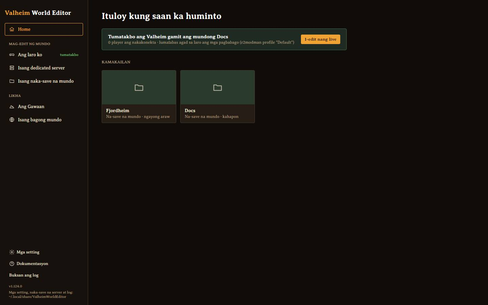
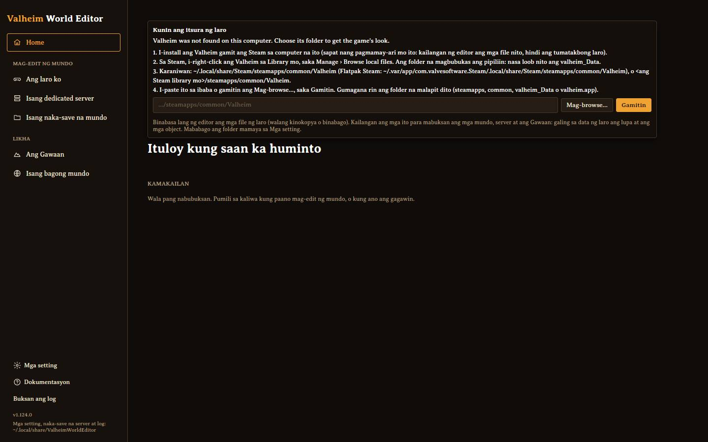
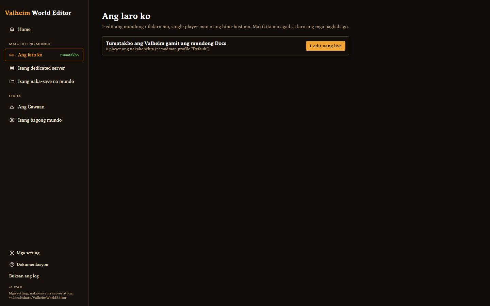
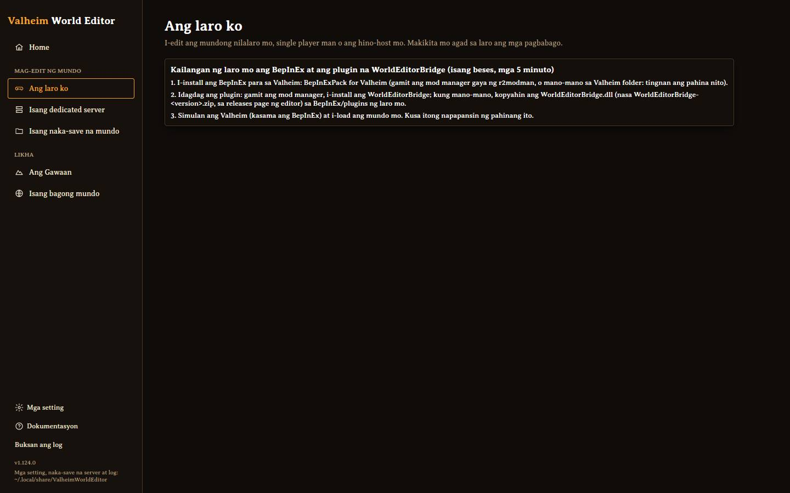

<!-- source: 68ffaeda -->
# I-install ang editor

I-download ang editor, simulan ito, at hayaang hanapin nito ang Valheim mo. Sa dulo, bukas ang editor sa panimulang
pahina nito at nabasa na nito ang mga file ng laro, handa para sa [una mong edit](first-edit.md).

## Ang kailangan mo

- **Windows 10 o 11**, o **Linux**, 64-bit; o **macOS 12 o mas bago sa Mac na may Apple silicon** (M1 at mas bago).
  Experimental ang build para sa Mac: hindi pa ito nasusubukan sa Mac, at hindi suportado ang mga Intel Mac.
- **Valheim**, naka-install sa pamamagitan ng Steam sa parehong computer. Sapat na ang pagmamay-ari nito: binabasa ng
  editor ang mga file ng laro (ang mga texture, model, lupa at mapa nito), hindi nito kailangang tumatakbo ang laro.
  Walang kinokopya o binabago.

Wala ka nang ibang kailangang i-install. Kasama na sa download ang lahat ng kailangan ng editor.

## I-download

1. Buksan ang [pahina ng mga release](https://github.com/Shuiei/valheim-world-editor/releases/latest).
2. I-download ang file para sa computer mo:
   - Windows: `ValheimWorldEditor-v<version>-win-x64.zip`
   - Linux: `ValheimWorldEditor-v<version>-linux-x64.tar.gz`
   - macOS: `ValheimWorldEditor-v<version>-macos-arm64-experimental.zip`

Nasa [Nexus Mods](https://www.nexusmods.com/valheim/mods/4348) din ang editor. Program ang editor, hindi mod: ang plugin
lang nito ang dala ng Thunderstore at Hexium (tingnan ang [Ang plugin para sa live na pag-edit](#ang-plugin-para-sa-live-na-pag-edit)).

## Simulan ito sa Windows

1. I-unzip ang download kahit saan, halimbawa sa Desktop. Panatilihing magkakasama ang mga file nito: kailangan ng
   `ValheimWorldEditor.exe` ang mga `.dll` na file sa tabi nito. Huwag itong patakbuhin mula sa loob ng zip.
2. I-double-click ang `ValheimWorldEditor.exe`.
3. Kung sabihin ng Windows na "Windows protected your PC", i-click ang **More info** (pinapangalanan nito ang
   publisher), saka ang **Run anyway**. Itatanong ito ng Windows hangga't hindi pa kilala ng SmartScreen ang signature
   ng editor.

<!-- picture: install-smartscreen.jpg: Windows 11, the blue "Windows protected your PC" dialog after More info was clicked, the publisher line and the Run anyway button visible, nothing else on screen -->

## Simulan ito sa Linux

1. I-unpack ang download kahit saan, halimbawa sa home folder mo.
2. I-double-click ang `ValheimWorldEditor` sa folder. Kung binubuksan ito ng file manager mo bilang teksto o nagtatanong
   kung ano ang gagawin, piliin ang **Run** (o i-right-click, **Run as program**). Mula sa terminal:
   `./ValheimWorldEditor`.

Gumuguhit ang editor gamit ang OpenGL 3.3, na mayroon ang anumang graphics driver ng nakaraang sampung taon (Mesa, AMD,
NVIDIA, Intel).

## Simulan ito sa macOS (experimental)

1. I-unzip ang download at ilipat ang **ValheimWorldEditor.app** kung saan mo gusto, halimbawa sa Applications.
2. I-double-click ito nang isang beses. Tatanggi ang macOS na buksan ito, dahil hindi naka-sign ang editor gamit ang
   Apple Developer certificate. Isara ang mensahe.
3. Buksan ang **System Settings › Privacy & Security**, mag-scroll pababa sa **Security**, i-click ang **Open Anyway**
   sa tabi ng ValheimWorldEditor, at kumpirmahin gamit ang password mo.
4. I-double-click ulit ang app. Mula ngayon, bumubukas ito sa isang double-click.

Sa halip na hakbang 2 at 3, maaari mong patakbuhin sa Terminal:
`xattr -dr com.apple.quarantine /Applications/ValheimWorldEditor.app` (gamit ang path kung saan mo ito inilagay).

Sa Mac, gumagana ang `Cmd` saanman sinasabi ng dokumentasyon ang `Ctrl`: nag-a-undo ang `Cmd+Z`, nagdadagdag sa
pinili ang `Cmd`+click. Iginuguhit ang lupa ng laro gamit ang sariling shader ng laro kapag may kasamang mababasa ng
editor ang laro sa Mac, kung hindi, sa payak na kulay. Kung may hindi gumagana,
[magbukas ng issue](https://github.com/Shuiei/valheim-world-editor/issues) kasama ang log ng editor (**Buksan ang log**
sa panimulang pahina).

## Ang unang pagsisimula

Bumubukas ang editor sa sarili nitong window, sa **Home** ng panimulang pahina. Sa unang pagkakataon, at pagkatapos ng
bawat update ng Valheim, sinasabi ng isang card ang **Inihahanda ang itsura ng laro** habang binabasa ng editor ang mga
file ng laro nang ilang segundo. Bumubukas ang mga mundo, server at ang Gawaan kapag sinabi na nito ang **Handa na ang
itsura ng laro.**

*Ang panimulang pahina: ang side menu sa kaliwa, ang Home sa kanan. Kapag may binuksang mundo, lumalabas ito sa ilalim
ng Kamakailan.*

## Kapag hindi nahanap ang Valheim

Kusang naghahanap ang editor sa bawat Steam library (pati sa Flatpak Steam). Kung hindi nito mahanap ang laro, sinasabi
ng card ang **Kunin ang itsura ng laro** at "Hindi nahanap ang Valheim sa computer na ito."

*Sinasabi ng mga hakbang ng card kung saan mahahanap ang folder; i-paste ito sa kahon (o **Mag-browse…**), saka
**Gamitin**.*

1. Sa Steam, i-right-click ang Valheim sa Library mo, saka **Manage › Browse local files**. Ang folder na magbubukas
   ang pipiliin: nasa loob nito ang `valheim_Data` (`valheim.app` sa Mac).
2. Kopyahin ang path nito, i-paste ito sa kahon ng card (o i-click ang **Mag-browse…** at piliin ito), saka i-click ang
   **Gamitin**.

Ang karaniwang mga lugar ay:

- Windows: `C:\Program Files (x86)\Steam\steamapps\common\Valheim`
- Linux: `~/.local/share/Steam/steamapps/common/Valheim` (Flatpak Steam:
  `~/.var/app/com.valvesoftware.Steam/.local/share/Steam/steamapps/common/Valheim`)
- macOS: `~/Library/Application Support/Steam/steamapps/common/Valheim`
- Ibang Steam library: `<library>/steamapps/common/Valheim`

Gumagana rin ang folder na malapit dito (`steamapps`, `common`, `valheim_Data` o `valheim.app`): hinahanap ng editor
ang folder ng laro mula roon. Mababago mo ito mamaya sa **Mga setting** (**Folder ng larong Valheim**), tingnan ang
[Mga setting](../editor-basics.md#mga-setting).

## Ang plugin para sa live na pag-edit

Para mag-edit ng mundo habang tumatakbo ang laro (sarili mong laro, o dedicated server habang may naglalaro),
kailangan ng larong nagho-host ng mundo ang **BepInEx** at ang plugin ng editor na **WorldEditorBridge**. Hindi
kailangan ng mga player na sumasali ang alinman sa dalawa, kasama ang mga player sa console. Para mag-edit ng mga
naka-save na mundo habang nakasara ang laro, o para magtayo sa Gawaan, hindi mo kailangan ang alinman.

Para sa sarili mong laro:

1. I-install ang BepInEx nang isang beses: [BepInExPack for Valheim](https://thunderstore.io/c/valheim/p/denikson/BepInExPack_Valheim/),
   gamit ang mod manager (r2modman, Thunderstore Mod Manager) o nang mano-mano sa Valheim folder, ayon sa pahina nito.
2. Idagdag ang plugin. Gamit ang mod manager, i-install ang WorldEditorBridge mula sa
   [Thunderstore](https://thunderstore.io/c/valheim/p/Tie/WorldEditorBridge/) o
   [Hexium](https://valheim.hexium.gg/mods/Tie/WorldEditorBridge) (kasama na ang BepInEx). Nang mano-mano, kopyahin ang
   `WorldEditorBridge.dll` mula sa `WorldEditorBridge-<version>.zip` (sa
   [pahina ng mga release](https://github.com/Shuiei/valheim-world-editor/releases/latest) o
   [Nexus Mods](https://www.nexusmods.com/valheim/mods/4348)) papunta sa `BepInEx/plugins` ng Valheim mo. Gamitin ang
   parehong bersiyon ng editor.
3. Simulan ang Valheim kasama ang BepInEx at i-load ang mundo mo (single player, o server na sinimulan mo mula sa
   laro). Sa unang pagsisimulang ito, isinusulat ng plugin ang mga setting nito,
   `BepInEx/config/Tie.WorldEditorBridge.cfg`, na may random na **token**.
4. Sa panimulang pahina ng editor, sinasabi na ngayon ng **Home** ang "Tumatakbo ang Valheim gamit ang mundong …" at
   ipinapakita ng **Ang laro ko** ang *tumatakbo*. Kusang hinahanap ng editor ang plugin at ang token nito, kasama ang
   mga profile ng mod manager. I-click ang **I-edit nang live**.

***Ang laro ko** habang tumatakbo ang laro: pinapangalanan ng card ang mundo, ang mga nakakonektang player at kung saan
nahanap ang plugin (dito, isang r2modman profile), kasama ang **I-edit nang live**.*

Hangga't hindi tumatakbo ang laro, sinasabi ng **Ang laro ko** kung ano ang kulang, hakbang-hakbang.

***Ang laro ko** bago ma-install ang BepInEx: ang tatlong hakbang, ginagawa nang isang beses. Kusang napapansin ng
pahina ang laro kapag tumatakbo na ito.*

Saka sundin ang [I-edit ang mundong nilalaro mo](../guides/edit-your-game-live.md).

Para sa **dedicated server**, i-install ang BepInEx (ayon sa mga tagubilin ng BepInExPack para sa mga dedicated
server) at kopyahin ang `WorldEditorBridge.dll` sa `BepInEx/plugins` ng server (o i-install ang plugin sa server
profile ng mod manager), saka simulan ang server nang isang beses para isulat nito ang token nito. Kumokonekta rito
ang editor gamit ang SSH, sa sarili nitong encrypted na tunnel, kaya dapat kang bigyan ng server ng SSH access sa
makina nito: tingnan ang [I-edit ang dedicated server habang may naglalaro](../guides/edit-a-server-live.md). Madalas
walang SSH access ang game server na inuupahan mula sa host: tingnan ang
[I-edit ang inuupahang server o server sa panel](../guides/edit-a-rented-server.md).

## Mga add-on para sa mga mod

May ilang mod sa world generation at pagtatayo na kailangan ng **add-on** para maiguhit o ma-edit ng editor ang
ginagawa nila. Hiwalay na download ang bawat isa sa [pahina ng mga release](https://github.com/Shuiei/valheim-world-editor/releases/latest):
`ValheimWorldEditor-addon-<Name>-<version>.zip`.

1. I-unpack ang add-on sa folder na `addons` sa tabi ng editor (sa macOS, sa tabi ng `ValheimWorldEditor.app`).
2. Buksan ang **Mga setting**: sa ilalim ng **Mga add-on**, inililista nito ang add-on at sinasabi kung ginagamit ito.
   Ginagamit ang add-on habang nasa mga BepInEx plugins folder mo ang mod nito; pinapatay ito ng switch nito nang hindi
   ito tinatanggal.

| Add-on | Para sa |
|---|---|
| [Expand World](../../../addons/ExpandWorld/README.md) | Mga mundong ginawa gamit ang mga mod na Expand World (Size, Rivers, Data). |
| [Riverheim](../../../addons/Riverheim/README.md) | Mga mundong ginawa gamit ang Riverheim. |
| [Tunnelheim](../../../addons/Tunnelheim/README.md) | Ang mga tunnel na hinuhukay ng Tunnelheim, at isang Tunnel tool. |
| [Railroads](../../../addons/Railroads/README.md) | Ang riles, mga istasyon at tren ng Railroads. |
| [ValheimRAFT](../../../addons/ValheimRAFT/README.md) | Ang mga barko at sasakyang panlupa ng ValheimRAFT, bawat isa ay inililipat, kinokopya at binubura nang buo. |

Code ang add-on na tumatakbo sa loob ng editor: i-install lang ang mga pinagkakatiwalaan mo. Tingnan ang
[I-edit ang mundong ginawa gamit ang Expand World, Riverheim o Tunnelheim](../guides/use-mods-worlds.md).

## Kung saan itinatabi ng editor ang mga file nito

Ang mga setting nito, mga naka-save na server (`servers.cfg`), ang natatandaan nito sa pagitan ng mga pagtakbo, ang
index ng mga file ng laro (`game-index.json`) at ang log nito (`ValheimWorldEditor.log`, bago sa bawat pagtakbo) ay
nasa:

- Windows: `%LOCALAPPDATA%\ValheimWorldEditor`
- Linux: `~/.local/share/ValheimWorldEditor`
- macOS: `~/Library/Application Support/ValheimWorldEditor`

Ipinapakita ng ibaba ng menu ng panimulang pahina ang folder na ito, at binubuksan ng **Buksan ang log** ang log. Nasa
folder ng Homestead ang mga blueprint mo, tingnan ang [ang Gawaan](../workshop.md).

## Susunod

[Ang una mong edit](first-edit.md): mag-backup ng mundo, magtaas ng burol, magtanim ng mga puno, mag-save, at tingnan
ito sa laro.
