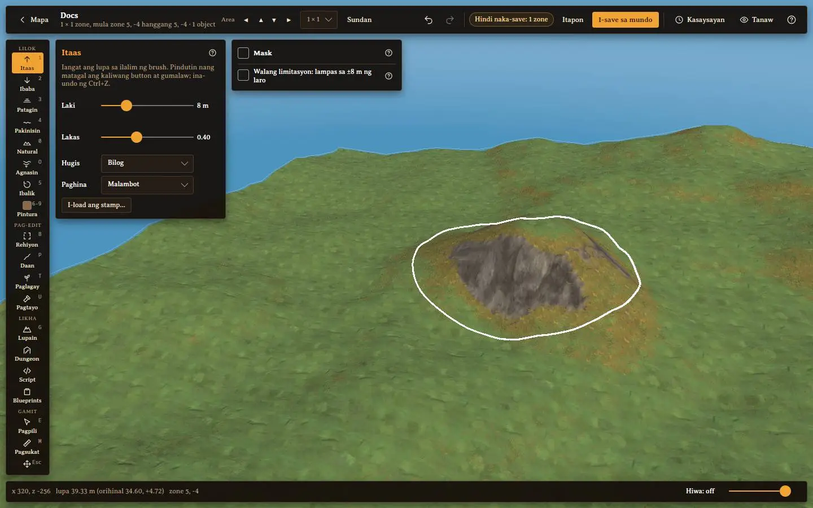
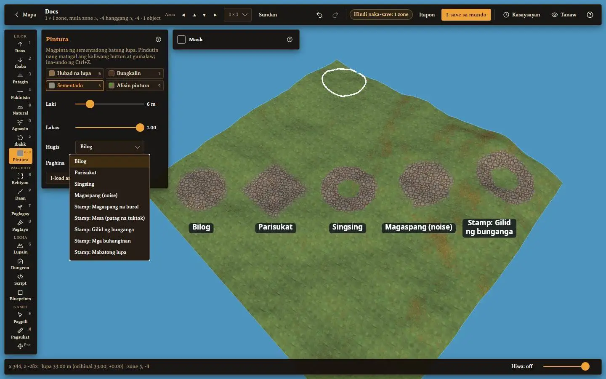
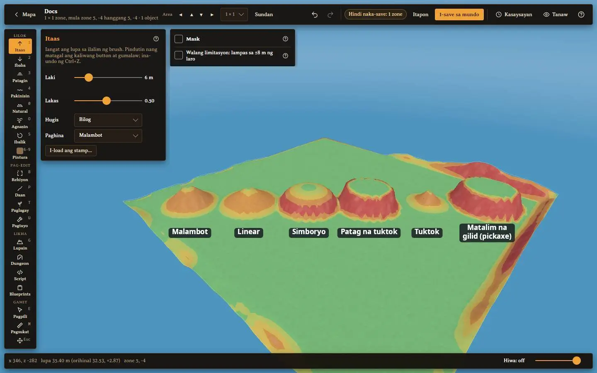
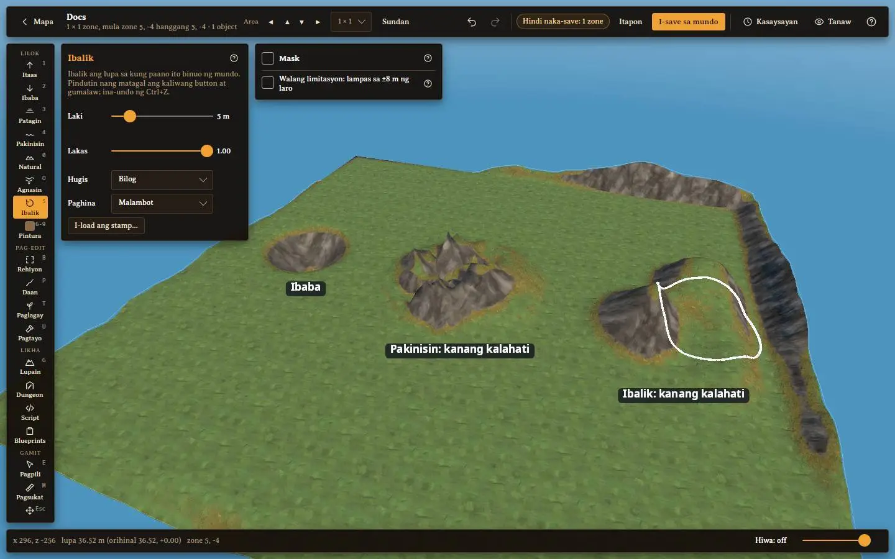
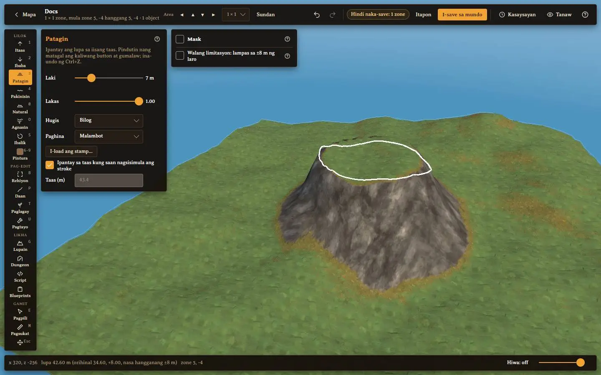
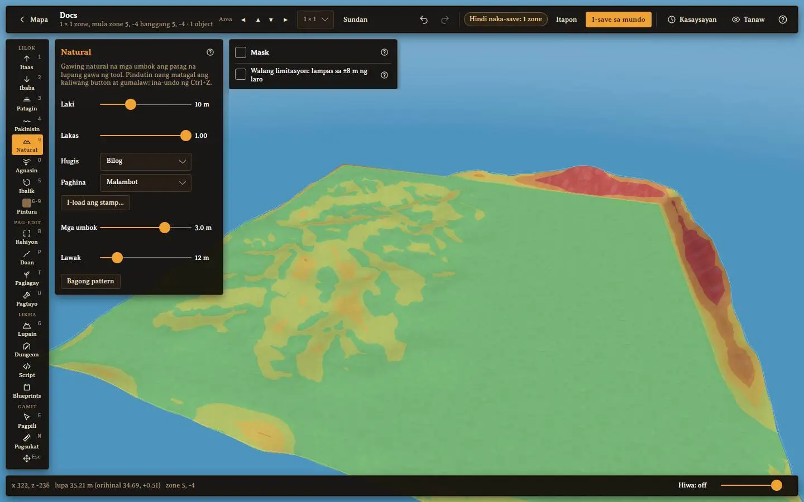
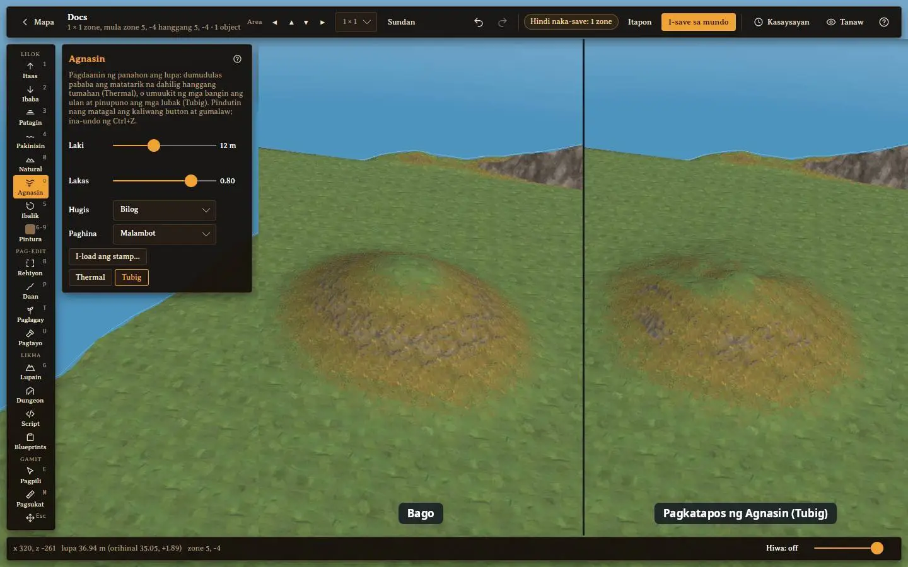
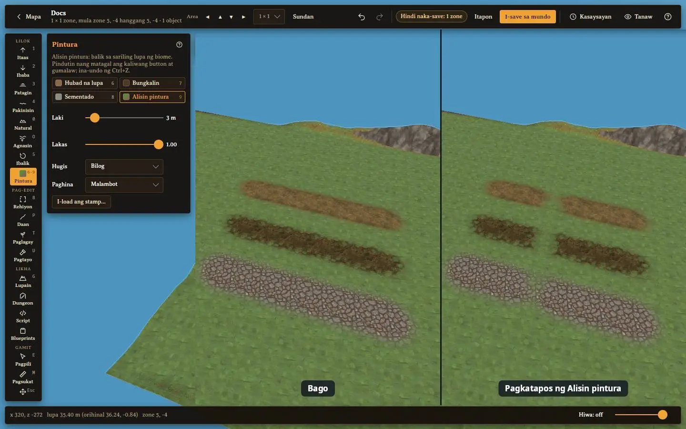
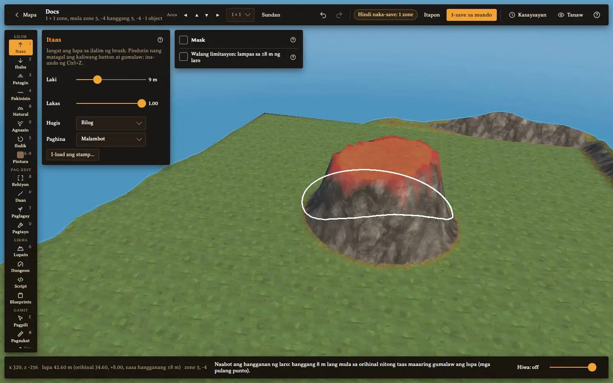
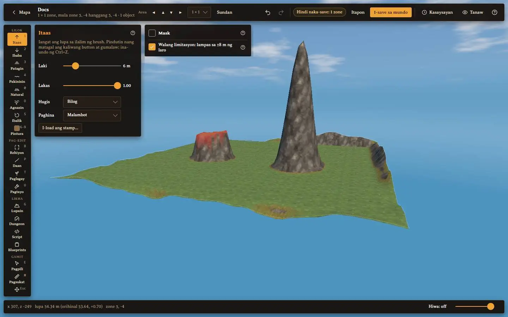

<!-- source: 9d7cf01c -->
# Lilok at pintura

Itaas, ibaba, patagin, pakinisin at pintahan ang lupa gamit ang brush na pinipindot at dina-drag mo, gaya ng hoe,
pickaxe at cultivator ng laro, pero mas mabilis at mas malaki.

**Saan:** tool rail, seksiyong **LILOK** · **Mga key:** `1` hanggang `9`, `0`, `O` · **Gumagana sa:** mga naka-save na
mundo, live

*Isang buntong ginawa gamit ang tatlong stroke ng Itaas. Ang puting singsing sa ibabaw nito ay ang brush; nasa panel sa
kaliwa ang mga setting nito.*

Sinusunod ng bawat pagbabago ang sariling mga patakaran ng laro, kaya nilo-load ang mundo sa laro ng bawat player,
kasama ang mga player sa console, nang walang mod. Isang hakbang ng undo ang bawat stroke (`Ctrl+Z`).

## Gamitin ito

1. Sa tool rail, i-click ang isang brush sa **LILOK**, o pindutin ang key nito (tingnan ang [Mga shortcut](#mga-shortcut)).
   Para magpinta, i-click ang **Pintura** at piliin ang pintura sa panel nito (tingnan ang [Brush ng pintura](#brush-ng-pintura)).
2. Sa panel, itakda ang **Laki** at **Lakas**. Binabago ng `[` at `]` ang laki habang nagtatrabaho ka.
3. Pindutin nang matagal ang kaliwang button ng mouse sa lupa at gumalaw. Patuloy na gumagana ang brush habang
   nakapindot ang button, kaya kapag hindi ka gumalaw, lalong nababago ang parehong puwesto.
4. Bitawan. Isang hakbang ng undo ang buong stroke, na ipinangalan sa brush ("Itaas").
5. Para panatilihin ang pagbabago, **I-save sa mundo** (o **I-apply nang live** sa [live mode](live-mode.md)). Hanggang
   doon, [nakabinbin](concepts/saving-and-history.md#mga-nakabinbing-pagbabago) ito.

Sinusundan ng singsing sa lupa ang mga burol sa ilalim nito at ipinapakita ang hugis ng brush: ipinapakita ng
parisukat o stamp ang nakaikot nitong balangkas, ng hugis na Singsing ang pangalawang balangkas sa loob.

## Mga setting

Ipinapakita ng panel ang mga setting na pareho sa bawat brush, saka ang sariling mga setting ng napiling brush.
Natatandaan ang Hugis at Paghina.

| Setting | Ano ang ginagawa nito |
|---|---|
| **Laki** | Ang radius ng brush, 1 hanggang 30 m (para sa parisukat, kalahati ng gilid nito). Default na 6 m. |
| **Lakas** | Kung gaano kabilis gumagana ang brush, 0.05 hanggang 1 (default na 0.40). |
| **Hugis** | **Bilog**, **Parisukat**, **Singsing**, **Magaspang (noise)**, o isang larawan (**Stamp: …**, tingnan ang [Mga stamp](#mga-stamp)). |
| **Paghina** | Kung paano humihina ang epekto mula sa gitna hanggang sa gilid (nasa ibaba). Nakatago para sa mga stamp: may sariling paghina ang larawan. |
| **Iikot** | Para sa **Parisukat** at mga stamp lang: iniikot ang brush, -180° hanggang 180°. |
| **I-load ang stamp…** / **Kalimutan ang stamp** | Magdagdag ng larawan bilang hugis ng brush, o tanggalin ang idinagdag mo (tingnan ang [Mga stamp](#mga-stamp)). |
| Mga setting ng Patagin, Natural, Agnasin | Ipinapakita lang para sa brush na iyon (tingnan ang [Mga brush ng lilok](#mga-brush-ng-lilok)). |

Dalawang setting ang para sa bawat tool sa lupa, hindi lang sa mga brush, kaya nasa card na **Mask** sila sa tabi ng
panel: ang [Mask](masks.md) mismo, at ang **Walang limitasyon: lampas sa ±8 m ng laro** sa ilalim nito (tingnan ang
[Walang limitasyon](#walang-limitasyon)).

### Mga hugis

| Hugis | Ang sakop nito |
|---|---|
| **Bilog** | Bilog na brush. |
| **Parisukat** | Parisukat na kasinlapad ng brush. Umiikot ito gamit ang **Iikot**. |
| **Singsing** | Isang banda lang: wala sa loob ng 40% ng laki, buong lakas sa 70%, wala sa gilid. Para sa gilid ng bunganga, moat at pader na lupa. |
| **Magaspang (noise)** | Bilog na brush na ang gilid ay pumapasok at lumalabas nang hanggang sangkatlo ng laki. Nakapirmi sa mundo ang pattern, kaya pareho ang gilid ng dalawang stroke sa parehong lugar. |

*Isang pahid ng Sementado bawat hugis, bawat isa may label: Bilog, Parisukat, Singsing, Magaspang (noise) at ang stamp
na Gilid ng bunganga. Bukas sa panel ang listahang Hugis.*

### Mga paghina

| Paghina | Paano ito humihina | Mabuti para sa |
|---|---|---|
| **Malambot** (default) | Kurbang S: banayad sa gitna at sa gilid. | Karamihan ng gawain. |
| **Linear** | Pantay mula sa gitna hanggang sa gilid. | Mga kono, pantay na dahilig. |
| **Simboryo** | Nananatiling malakas hanggang malayo, saka mabilis na bumababa malapit sa gilid. | Bilog na burol na matarik ang paanan. |
| **Patag na tuktok** | Buong lakas sa loob na 80%, humihina lang sa panlabas na ikalima. | Mga patungan, terasa, burol na patag ang tuktok. |
| **Tuktok** | Malakas lang malapit sa gitna. | Mga tore ng bato at hukay. |
| **Matalim na gilid (pickaxe)** | Buong lakas hanggang sa gilid, wala sa labas nito. | Matarik na pader at tuwid na hiwa. |

*Ang parehong stroke ng Itaas sa bawat paghina, may label: Malambot, Linear, Simboryo, Patag na tuktok, Tuktok,
Matalim na gilid (pickaxe). Naka-on ang kulay ng dahilig: habang mas matarik ang gilid, mas pula.*

## Mga brush ng lilok

| Brush (label sa rail) | Key | Ano ang ginagawa nito |
|---|---|---|
| **Itaas** | `1` | Itinataas ang lupa habang pinipindot mo ang button. |
| **Ibaba** | `2` | Hinuhukay pababa ang lupa. |
| **Patagin** | `3` | Pinapantay ang lupa sa iisang taas: itinataas ang mas mababang lupa, hinihiwa ang mas mataas. |
| **Pakinisin** | `4` | Pinapantay ang mga umbok at matatalim na gilid. Daanan ulit ang lugar para sa higit pa. |
| **Natural** | `0` | Ginagawang natural na mga umbok ang patag na lupang gawa ng tool. |
| **Agnasin** | `O` | Pinapadaan sa panahon ang lupa: dumudulas pababa ang matatarik na dahilig, o umuukit ng mga bangin ang ulan. |
| **Ibalik** | `5` | Ibinabalik ang lupa sa kung paano ito binuo ng mundo, at tinatanggal ang pintura. |

*May label mula sa kaliwa: hukay na ginawa gamit ang Ibaba; magaspang na bunton na pinantay ng Pakinisin ang kanang
kalahati; itinaas na bunton na ibinalik ng Ibalik ang kanang kalahati sa binuong lupa, nasa ibabaw nito ang singsing ng
brush.*

Hindi kailanman lumalampas ang Patagin, Pakinisin, Natural at Ibalik: sa bawat sandali, iginagalaw nila ang lupa nang
bahagi ng daan papunta sa layunin nila, kaya ang mas matagal na pagpindot ay naglalapit lang dito.

May parehong mga aksiyon sa parehong mga pangalan ang mga tool na [Rehiyon](area.md) at [Daan](path.md), na ina-apply
nang minsanan sa isang pinili o sa kahabaan ng linya sa halip na sa ilalim ng brush na pinipindot mo. (Inililista ng
Rehiyon ang Ibalik bilang **Balik sa binuong lupa**, sa grupong **Pagbawi** nito.) Pareho ang paraan ng pagbago nila sa
lupa: inililipat ng isang **Pakinisin** doon ang bawat punto sa karaniwang taas ng lupa sa loob ng 3 m, halos kapareho
ng pagpindot sa brush na Pakinisin sa isang puwesto nang isa o dalawang segundo sa default na lakas.

### Patagin

*Pinatag ng isang stroke ng Patagin na sinimulan sa ibabaw ng bunton ang tuktok nito. Naka-on ang **Ipantay sa taas
kung saan nagsisimula ang stroke**, kaya naka-grey ang **Taas (m)** at ipinapakita ang taas na kinuha nito: 43.4 m.*

| Setting | Ano ang ginagawa nito |
|---|---|
| **Ipantay sa taas kung saan nagsisimula ang stroke** | Naka-on (default): ang lupa kung saan mo pinindot ang button ang nagtatakda ng taas para sa buong stroke. Ipinapakita ito ng **Taas (m)**. |
| **Taas (m)** | Ginagamit kapag naka-off ang opsiyon sa itaas: pinapantay ng bawat stroke sa taas na ito. |

Para ipantay sa taas na pinili mo, mag-`Alt`+click sa lupa gamit ang anumang brush: lumilipat ang editor sa
**Patagin**, ino-off ang opsiyon sa itaas at inilalagay ang taas na iyon sa **Taas (m)**. Gamitin ito para magtugma ang
ilang patungan, o para ipantay ang pagtatayuan sa taas ng pintong naitayo mo na.

### Natural

| Setting | Ano ang ginagawa nito |
|---|---|
| **Mga umbok** | Gaano kataas ang mga umbok, 0.2 hanggang 4 m (default na 1.2 m). |
| **Lawak** | Gaano kalapad ang mga ito, 4 hanggang 60 m (default na 16 m): magaspang na lupa ang maliliit na value, banayad na alon ang malalaki. |
| **Bagong pattern** | Bagong random na pattern ng umbok para sa susunod na Natural (ng brush na ito, ng Rehiyon o ng tool na Daan) at para sa mga daang may natural na itsura. Mula sa parehong pattern ang gilid ng hugis na **Magaspang (noise)** at ang noise ng mga pormula ng [Lupain](landform.md#sumulat-ng-pormula), kaya nagbabago rin ang mga ito. |

Hindi nagpapatong ng mas maraming umbok ang pangalawang stroke sa parehong lugar. Nakapirmi sa mundo ang pattern, kaya
nagdudugtong nang walang tahi ang magkakatabing stroke. Ginagamit ng **Natural** at **Natural na itsura** ng tool na
[Daan](path.md) at ng **Natural** ng tool na [Rehiyon](area.md) ang parehong mga setting at pattern, at ipinapakita ang
mga ito sa sarili nilang panel: ang value na itinakda sa isa ay itinatakda sa tatlo.

*Pinatag na lupa na naka-on ang kulay ng dahilig. Ginawang natural ang kaliwang kalahati (Mga umbok 3 m, Lawak
12 m): lumalabas ang mga umbok nito bilang dilaw na patse. Nananatiling patag at payak na berde ang kanang kalahati.*

### Agnasin

| Setting | Ano ang ginagawa nito |
|---|---|
| **Thermal** | Dumudulas ang lupang mas matarik sa **Anggulo ng tambak** pababa sa mas mababang katabi nito hanggang tumahan: mga tambak ng bato sa ibaba ng bangin, pinalambot na pader na gawa ng tool. Inililipat lang ang lupa, hindi kailanman nawawala. |
| **Tubig** | Ulan: pumapatak ang mga patak sa ilalim ng brush, umaagos pababa, kumukuha ng lupa kung saan sila mabilis umagos at ibinabagsak ito kung saan sila bumabagal. Gumagawa ang maraming patak ng mga bangin, pamaypay ng materyales sa paanan ng mga dahilig at mas makinis na sahig ng lambak. Itinatakda ng **Lakas** kung ilang patak ang pumapatak. |
| **Anggulo ng tambak** | Para sa **Thermal** lang: ang pinakamatarik na dahilig na hindi gumagalaw, 10° hanggang 60° (default na 33°). Mas pinapatag ng mas mababang value. |

Maaaring bumagsak sa labas lang ng brush ang materyales na dumudulas o naaanod palabas nito. Ginagawa ng **Agnasin** ng
mga tool na [Rehiyon](area.md) at [Daan](path.md) ang dalawang uri nang sabay, sa buong pinili o sa kahabaan ng linya,
gamit ang **Anggulo ng tambak** na ito (ipinapakita rin ito ng mga panel nila).

*Ang parehong bunton mula sa parehong camera. Kaliwa: kung paano ito itinaas. Kanan: pagkatapos ng dalawang segundo ng
Agnasin (Tubig): kinain ng ulan ang tuktok nito at ginuhitan ang mga gilid nito ng maliliit na bangin.*

### Ibalik

Inaalis ng **Ibalik** ang mga edit mo nang paunti-unti bawat sandali, hanggang maging gaya ng pagkabuo ng mundo ang
lupa. Binabawi rin nito ang lupang itinaas o hinukay gamit ang [Walang limitasyon](#walang-limitasyon), naka-save man o hindi:
inaalis ng susunod na save ang mga ground disc na hindi na nito kailangan. Tinatanggal lang nito ang pintura sa loob na
bahagi ng brush, kaya nananatiling malinis ang gilid ng pintura.

## Brush ng pintura

Ang **Pintura**, ang huling button ng seksiyong **LILOK** ng rail, ay iisang brush para sa apat na pintura. Ipinapakita
ng panel nito ang mga ito bilang apat na swatch: i-click ang isa para magpinta gamit ito. Nakabalangkas ang napiling
swatch, at kinukuha ng button sa rail ang kulay nito.

| Pintura | Key | Ano ang ginagawa nito |
|---|---|---|
| **Hubad na lupa** | `6` | Hubad na lupa, gaya ng daang nilalakaran. |
| **Bungkalin** | `7` | Binungkal na lupa, gaya ng ginagawa ng cultivator. Sa laro, dito lang maitatanim ang mga pananim. |
| **Sementado** | `8` | Sementadong batong lupa. |
| **Alisin pintura** | `9` | Nagpipinta ng payak na lupa ng biome. |

Pinipili ng bawat key ang brush na Pintura na may pinturang iyon, mula sa anumang tool. Bumabalik ang button sa rail na
may pinturang huli mong ginamit (Hubad na lupa sa simula).

Ginagamit ng Pintura ang parehong Laki, Lakas, Hugis, Paghina at Mask ng mga brush ng lilok. Binabago nito ang itsura ng
lupa at kung ano ang tumutubo roon, hindi kailanman ang taas nito. Halo ang ibinibigay ng magaan na stroke o ng
malambot na gilid ng brush; pindutin nang mas matagal para sa buong kulay.

**Alisin pintura o Ibalik?** Nagpipinta ang **Alisin pintura** ng payak na lupa ng biome sa ibabaw ng lahat,
kaya tinatakpan din nito ang hubad na lupang binuo ng mundo roon. Tinatanggal ng **Ibalik** ang pintura mo, kaya
ipinapakita ulit ng lupa ang binuo ng mundo.

*Kaliwa: mga guhit ng sementado, binungkal at hubad na lupa. Kanan: ang parehong mga guhit pagkatapos ng isang stroke ng
Alisin pintura sa ibabaw ng tatlo (ang panel ng Pintura sa kaliwa).*

## Mga stamp

Ang stamp ay larawang ginagamit bilang hugis ng brush: buong gumagana ang mga puting bahagi, bahagya ang mga grey, at
hindi talaga ang mga itim. Pumili ng isa sa **Hugis**, kung saan nakalista ang mga stamp bilang **Stamp: …**. Sumasakop
ang stamp ng parisukat na dalawang beses ang lapad sa **Laki** at umiikot gamit ang **Iikot**. Gumagana ito sa bawat
brush ng lilok at sa Pintura.

| Stamp | Hugis |
|---|---|
| **Magaspang na burol** | Maliit na tuktok na may magaspang na gilid. |
| **Mesa (patag na tuktok)** | Patag na tuktok na may matarik at bahagyang magaspang na gilid. |
| **Gilid ng bunganga** | Pader na pabilog, para sa mga bunganga (gamitin ang Ibaba sa loob nito pagkatapos) at lumang tambak-lupa. |
| **Mga buhanginan** | Magkakahanay na tagaytay sa loob ng bilog na patse. |
| **Mabatong lupa** | Bukol-bukol at baku-bakong lupa. |

| Setting | Ano ang ginagawa nito |
|---|---|
| **I-load ang stamp…** | Gumagamit ng anumang larawan (PNG, JPEG…) bilang stamp: heightmap mula sa ibang tool, logo, hugis na iginuhit ng kamay. Ang liwanag nito ang lakas; itinuturing na itim ang mga transparent na bahagi. Iniaangkop ito sa parisukat na 128 × 128 punto, kaya naiipit ang malapad na larawan at nawawala ang pinong detalye. Itinatabi ito para sa susunod sa ilalim ng pangalan ng file nito. |
| **Kalimutan ang stamp** | Tinatanggal ang na-load na larawang napili sa **Hugis**. Ipinapakita lang para sa mga na-load na larawan: nananatili ang mga built-in na stamp. |

**Para ilagay ang buong larawan sa lupa sa isang click**, sa taas na itinakda mo, gamitin ang uring **Larawan** ng tool
na [Lupain](landform.md#larawan) sa halip na brush: inaalok nito ang parehong mga larawan, at ang mga nilo-load mo rito.

## Walang limitasyon

Pinapanatili ng laro ang bawat pagbabago sa lupa sa loob ng 8 m mula sa lupang binuo nito. Humihinto roon ang brush,
kinukulayan ng pula ang punto, at sinasabi ng status bar ang "Naabot ang hangganan ng laro: hanggang 8 m lang mula sa
orihinal nitong taas maaaring gumalaw ang lupa (mga pulang punto)."
Tingnan ang [Ang 8 m na hangganan ng laro](concepts/ground-limits.md#ang-8-m-na-hangganan-ng-laro).

*Pinindot ang Itaas hanggang huminto ang lupa nang 8 m pataas. Kapag naka-on ang **Marka ng hangganan**, pula ang tuktok
nito; ipinapakita ng status bar ang mensahe at nagtatapos ang readout ng cursor sa "nasa hangganang ±8 m".*

Ang **Walang limitasyon: lampas sa ±8 m ng laro**, sa card na **Mask** sa tabi ng panel ng tool (sa ilalim ng Mask), ay
nagpapahintulot sa mga tool sa lupa na umabot nang hanggang 400 m mula sa binuong lupa: mga bangin, canyon, tore ng
bato, malalalim na hukay. Iisang switch ito para sa bawat tool na sakop nito, at ipinapakita ito ng card kasama ng
bawat isa sa kanila: bawat brush ng lilok, [Lupain](landform.md) (ang mga uri nitong **Pormula** at **Larawan**),
[Daan](path.md) at [Rehiyon](area.md) (pati ang pag-import nito ng heightmap). Nananatili itong naka-on para sa bawat
tool hanggang i-off mo ito, at naka-off ito tuwing nagsisimula ang editor. Laging lumalampas sa hangganan ang uring
**Mountain** ng Lupain at ang pag-paste ng kinopyang lugar.

> [!IMPORTANT]
> Binabasa ulit ng pag-save ng lupang Walang limitasyon ang area mula sa mundo at **binubura ang Kasaysayan nito**: hindi
> ka makakapag-undo lampas sa save na iyon. Suriin ang hugis bago ka mag-save.

*Ang parehong stroke ng Itaas na naka-off ang Walang limitasyon (kaliwa: huminto sa 8 m, pula ang tuktok) at naka-on
(kanan: mas mataas nang malayo). Nasa card na Mask ang switch, naka-check gaya ng para sa kanan.*

Kapag nag-save ka, ang lupang lampas sa ±8 m ay nagiging mga hindi nakikitang ground disc na binubuo sa parehong paraan
ng laro ng bawat player. Sinasabi ng mensahe ng pag-save kung ilang disc ang ginawa at ilang puno at bato ang inalis,
halimbawa "Lupang walang limitasyon: 312 ground disc, 40 puno/bato ang inalis; may lupang hanggang 2.5 m ang layo
(masyadong matarik)". Kung paano ito gumagana at ano ang binabago nito sa laro: [Walang limitasyon](concepts/ground-limits.md#walang-limitasyon).

Pagkatapos mag-save:

- Nawawala ang mga puno, bato, ore, palumpong at mapipitas kung saan gumalaw ang lupa nang higit sa 2 m (matatabunan
  sila o lulutang). Nananatili ang mga piece ng gusali.
- Itinuturing na binuo ang bagong lupa: gumagana ang hoe at pickaxe ng laro nang ±8 m mula rito. Para alisin ang
  naka-save na hugis, **Ibalik** ito (pabalik sa lupang binuo ng mundo), o ibaba ulit ito na naka-on ang Walang
  limitasyon.
- Lumalabas na medyo mas malambot kaysa sa iginuhit ang mga napakatarik na pader.
- Pinapanatili ng mga zone na hindi pa napupuntahan ng sinumang player ang luma nilang lupa; sinasabi ng mensahe kung
  ilan. Puntahan muna ang mga ito sa laro.
- Hindi ipinapakita ng mapa sa laro ang bagong hugis.

## Mga shortcut

| Key o mouse | Ano ang ginagawa nito |
|---|---|
| `1` `2` `3` `4` `0` `O` `5` | Itaas, Ibaba, Patagin, Pakinisin, Natural, Agnasin, Ibalik. |
| `6` `7` `8` `9` | Ang brush na Pintura na may Hubad na lupa, Bungkalin, Sementado, Alisin pintura. |
| `[` / `]` | Paliitin / palakihin ang Diyametro nang 1 m. |
| Pindutin nang matagal ang kaliwang button at mag-drag | Baguhin ang lupa. |
| `Alt`+click | Kunin ang taas doon: lumilipat sa Patagin sa taas na iyon. |
| `Alt`+`Shift`+click | I-on ang [Mask](masks.md) para sa 2 m sa ibaba hanggang 2 m sa itaas ng puwestong iyon (pati sa tool na Daan). |
| Drag gamit ang gitnang button | Igalaw ang tanaw (pati habang may napiling brush). |
| `Ctrl+Z` | I-undo ang huling stroke. |
| `Esc` | Iwanan ang brush (balik sa Tanaw). |

Lahat ng key ng editor: [Mga shortcut](help/shortcuts.md).

## Mga tip at limitasyon

- **Basahin ang lupa sa ilalim ng cursor** sa status bar: `lupa 41.20 m (orihinal 35.00, +6.20)`. Idinadagdag nito
  ang "nasa hangganang ±8 m" kapag naroon ang punto. Nasa 30 m ang dagat.
- **Hindi kailanman nagbabago ang pinakalabas na linya ng mga punto ng area**, para dumugtong ang area sa lupa sa
  paligid nito. Para magtrabaho roon, ilipat o palakihin ang area: tingnan ang
  [Ang naka-lock na gilid](concepts/areas-and-zones.md#ang-naka-lock-na-gilid).
- **Iisa ang taas ng lupa bawat metro.** Laging mga isang metro ang saklaw ng pader at hindi maaaring umungos ang lupa
  (naghuhukay ng tunay na tunnel ang mod gaya ng Tunnelheim: tingnan ang [I-edit ang mundong ginawa gamit ang Expand World, Riverheim o Tunnelheim](guides/use-mods-worlds.md)). Nagpapakita ng maliit na
  ngipin-lagari ang gilid na iginuhit mula hilagang-silangan hanggang timog-kanluran, pati sa laro.
- **Pinapatag ng mga village, ng trader at ng mga pasukan ng dungeon ang lupa sa paligid nila.** Nakapatong doon ang
  mga edit mo; i-on ang **Pagpapatag ng lokasyon** sa panel na Tanaw para makita kung saan. Tingnan ang
  [Pinapatag ng mga lokasyon ang lupa](concepts/ground-limits.md#pinapatag-ng-mga-lokasyon-ang-lupa).
- **Bilis:** iginagalaw ng Itaas at Ibaba ang gitna ng brush nang mga 2.4 m bawat segundo sa default na Lakas, 6 m
  bawat segundo sa Lakas na 1.
- **Walang nagbago?** Maaaring hindi isinasama ng [Mask](masks.md) ang lahat ng lupa sa ilalim ng brush; sinasabi ito ng
  status bar.
- **Para bawiin ang isang pagbabago:** `Ctrl+Z` para sa huling stroke, **Ibalik** para sa isang lugar, **Itapon** para
  sa lahat ng hindi naka-save. Tingnan ang [I-undo ang mga pagbabago](guides/undo-changes.md).

## Kaugnay

- [Itaas o hukayin lampas sa 8 m na hangganan ng laro](guides/raise-past-the-limit.md)
- [Linisin ang mga puno at bato, patagin ang puwesto ng gusali](guides/clear-an-area.md)
- [Mga hangganan ng lupa](concepts/ground-limits.md)
- [Mask](masks.md), [Lupain](landform.md)
- [Paano itinatabi ang lupa](concepts/ground-limits.md#paano-iniingatan-ang-lupa), [gaano kabilis gumagana ang brush](concepts/ground-limits.md#gaano-kabilis-gumagana-ang-brush)
