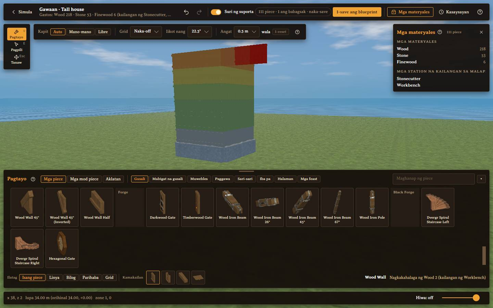
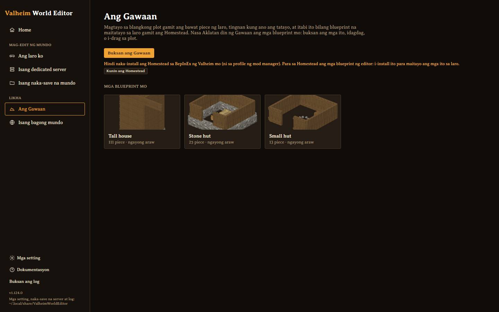
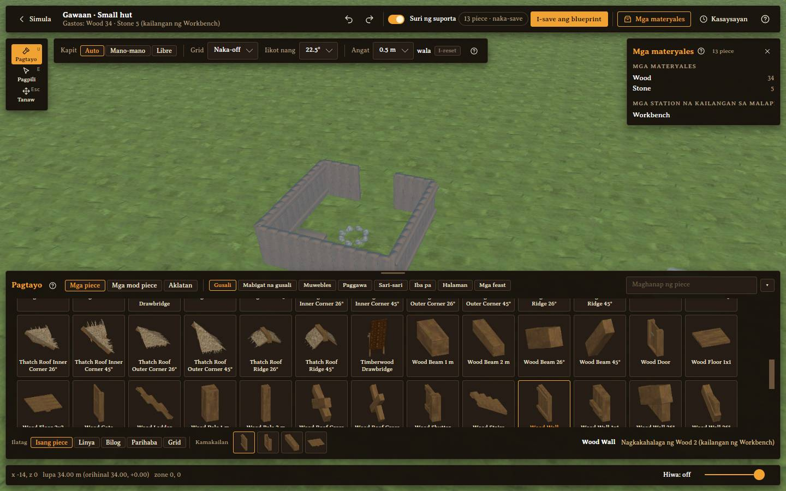
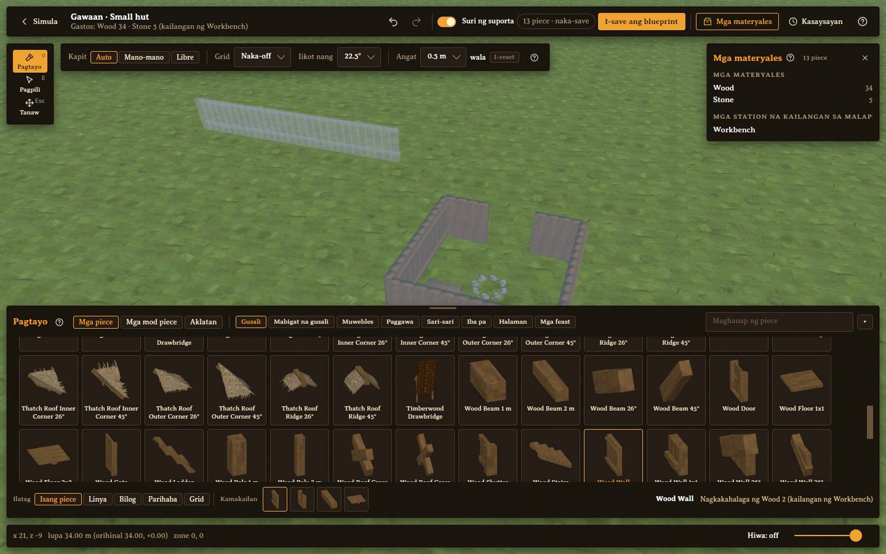
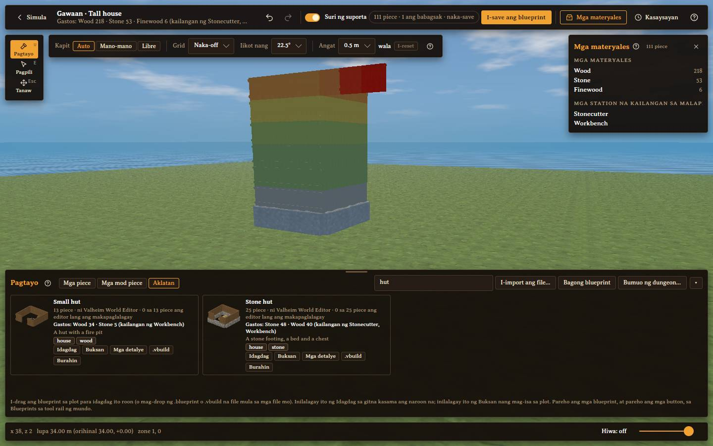
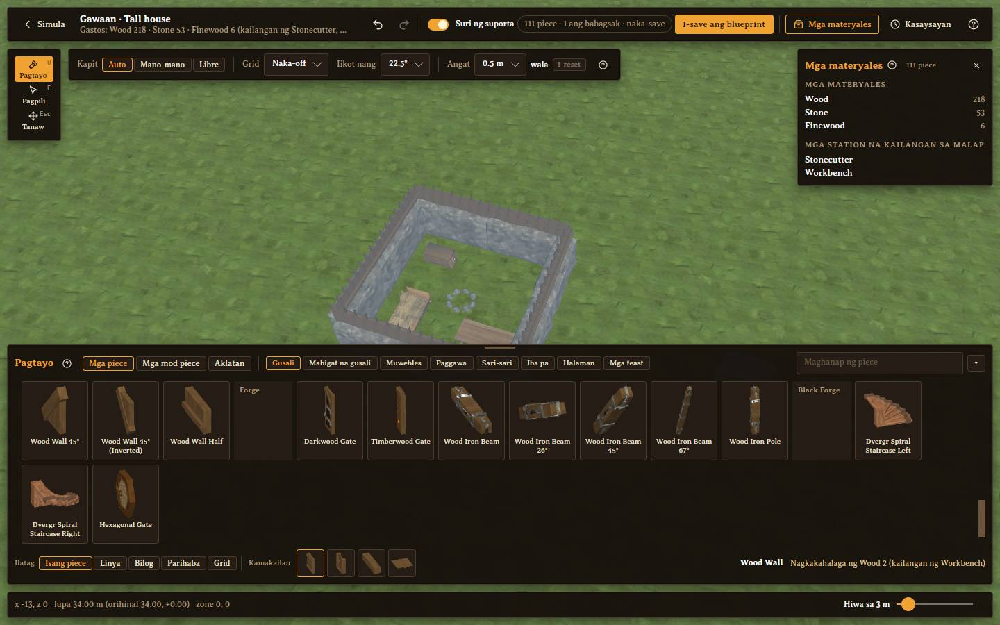
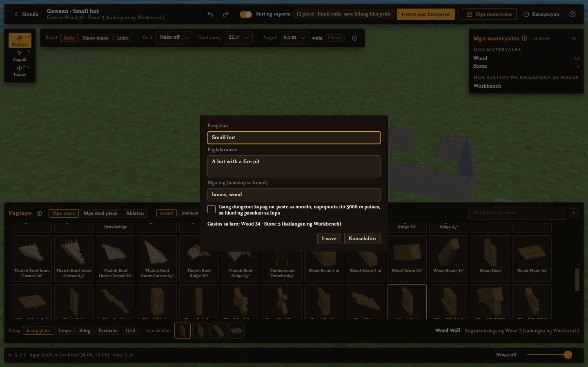
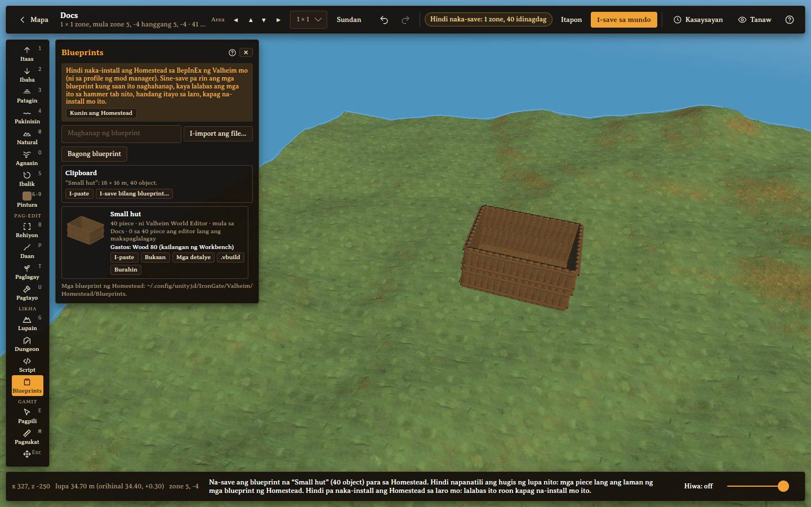

<!-- source: 820eb141 -->
# Gawaan

Magtayo sa isang blangkong plot gamit ang bawat piece ng laro, tingnan kung ano ang tatayo at magkano ang gastos, at
itabi ito bilang blueprint na maitatayo sa laro o mai-paste sa kahit anong mundo.

**Saan:** panimulang pahina, **Ang Gawaan** → **Buksan ang Gawaan**; sa isang mundo, **Blueprints** (tool rail,
seksiyong **LIKHA**) → **Bagong blueprint** · **Key:** wala · **Gumagana sa:** sariling plot ng Gawaan (gumagana ang
panel na **Blueprints** sa mga naka-save na mundo at live)

*Isang matangkad na bahay na naka-on ang **Suri ng suporta**: mapusyaw na asul ang batong pundasyon, berde ang mga
dingding na kahoy sa itaas, saka dilaw, saka kahel malapit sa itaas, at ang nakausling lumalabas mula sa pinakamataas na
hanay ay kahel, saka pula. Nakasulat sa top bar ang `111 piece · 1 ang babagsak · naka-save`.*

Ang blueprint ay isang file ng [Homestead](https://thunderstore.io/c/valheim/p/sighsorry/Homestead/), ang mod sa
pagtatayo sa laro: lumalabas ang parehong file sa hammer tab ng Homestead, handang itayo sa laro, at mai-paste sa isang
mundo mula sa editor.

## Gamitin ito

Para magtayo ng kubo at itabi ito:

1. Sa panimulang pahina, i-click ang **Ang Gawaan**, saka **Buksan ang Gawaan**. (Mula sa mundo: **Blueprints** sa
   tool rail, saka **Bagong blueprint**; magtatanong muna ang mundong may hindi naka-save na pagbabago.)
2. Sa dock ng **Pagtayo** sa ibaba, pumili ng piece sa tab na **Mga piece**.
3. Mag-click sa plot para ilapag ito. Kumakapit ito sa mga piece na naroon na, gaya ng hammer.
4. Iikot ang piece gamit ang `,` at `.`; iangat ito gamit ang `PgUp` at `PgDn` (o `Ctrl` + wheel); pindutin nang
   matagal ang `Alt` para malayang ilagay ito sa bawat kapat ng metro. Para ilipat o burahin ang mga piece, pindutin ang
   `E` (Pagpili).
5. Bantayan ang mga kulay ng **Suri ng suporta** at ang bilang ng "babagsak" sa top bar, at ang gastos nito sa panel na
   **Mga materyales** sa kanan.
6. I-click ang **I-save ang blueprint** (`Ctrl+S`), at bigyan ito ng pangalan, paglalarawan at mga tag.
7. I-click ang **Simula** para bumalik sa panimulang pahina.

Para baguhin ang naka-save na blueprint, i-click ito sa ilalim ng **Mga blueprint mo** sa panimulang pahina (o sa
**Home**), o i-click ang **Buksan** sa tabi nito sa aklatan (ang panel na Blueprints ng isang mundo, o ang tab na
**Aklatan** ng Gawaan).

*Ang **Ang Gawaan** ng panimulang pahina: **Buksan ang Gawaan**, **Kunin ang Homestead** (hindi ito naka-install
dito), at tatlong blueprint sa ilalim ng **Mga blueprint mo**, bawat isa kasama ang larawan nito, mula sa pinakabago.*

## Ang plot

Hindi bahagi ng anumang mundo ang plot: 3 × 3 zone (192 m ang lapad) ng patag na meadow sa iisang taas. Ang gitna nito,
sa antas ng lupa, ay ang **angkla** ng blueprint, ang puntong pinagsusukatan ng Homestead sa bawat piece.

- Ang tool rail ay may [Pagtayo](build.md) (`U` o `T`), **Pagpili** (`E`) at **Tanaw** lang. Para sa mga mundo ang mga
  tool sa lupa.
- Katabi ng rail, ang **bar ng Pagtayo**: **Kapit**, **Grid**, **Iikot nang** at **Angat** (tingnan ang
  [Ang bar ng Pagtayo](#ang-bar-ng-pagtayo)).
- Sa ibaba, ang **dock ng Pagtayo**: ang mga piece, ang mga piece ng mga mod mo at ang mga blueprint mo (tingnan ang
  [Ang dock ng Pagtayo](#ang-dock-ng-pagtayo)).
- Sa kanan, ang panel na **Mga materyales**: ang gastos ng gusali (tingnan ang [Mga materyales](#mga-materyales)).
- Walang Mask, walang panel na Tanaw at walang hangganan ng zone, at iginuguhit nang solido ang mga gusali.
- Ang top bar ay may **Simula**, undo at redo, ang switch na **Suri ng suporta**, **I-save ang blueprint**, **Mga
  materyales** at **Kasaysayan**. Binibilang nito ang mga piece, sinasabi kung ilan ang babagsak at kung naka-save ang
  gusali (`12 piece · 2 ang babagsak · hindi naka-save bilang blueprint`).
- Sa ilalim ng pamagat: ang gastos ng gusali sa laro, pinaikli; nagtatapos sa "…" ang mahabang linya.
- Ang status bar ay may slider na **Hiwa**, gaya sa isang mundo (tingnan ang [Hiwa](#hiwa)).

Walang **Itapon**: mag-undo, o buksan ulit ang blueprint. Magtatanong muna kapag aalis nang hindi naka-save bilang
blueprint ang gusali (**Simula**, pagbukas ng iba, pagsara).

*Ang Gawaan na may maliit na kubo sa plot: ang rail na may **Pagtayo**, **Pagpili** at **Tanaw** lang, ang bar ng
Pagtayo katabi nito; ang top bar na may **Simula**, **Suri ng suporta**, ang bilang ng piece, **I-save ang blueprint** at
**Mga materyales**; ang panel na **Mga materyales** sa kanan; ang dock ng Pagtayo sa ibaba sa tab na **Gusali**, kasama
ang apat na huling napiling piece sa ilalim ng **Kamakailan** at napili ang dingding na kahoy.*

## Mga setting

### Ang dock ng Pagtayo

Sakop ng dock ng **Pagtayo** (ang sa tool na [Pagtayo](build.md), pareho sa isang mundo) ang ibaba ng window, kaya
nasa plot ang natitira. Ang itaas na hanay nito ay may tatlong tab, **Mga piece**, **Mga mod piece** at **Aklatan**,
saka ang sariling mga pagpipilian ng tab at ang paghahanap nito. I-drag pataas o pababa ang itaas na gilid nito para
pataasin o paikliin ito, at i-click ang **▾** sa kanang dulo nito para itiklop ito hanggang sa hanay na iyon (binubuksan
ulit ito ng **▴**). Iniingatan ang dalawa para sa susunod.

Inililista ng **Mga piece** ang lahat ng itinatayo ng mga player, bawat isa may larawan mula sa model ng laro:

| Tab | Ang hawak nito |
|---|---|
| **Gusali**, **Mabigat na gusali**, **Muwebles**, **Paggawa**, **Sari-sari**, **Iba pa** | Ang sariling mga tab ng hammer, sa pagkakasunod ng laro. |
| **Halaman** | Ang mga piece ng cultivator: mga pananim, sapling at bulaklak. |
| **Mga feast** | Ang mga piece ng serving tray. |

Sa bawat tab, nakagrupo ang mga piece ayon sa crafting station na kailangan nila, sa pagkakasunod ng pagkuha ng mga
player sa mga ito (wala, workbench, stonecutter, forge, artisan table, black forge, galdr table), saka ayon sa pangalan.
Nagsisimula ang bawat grupo sa pangalan ng station.

Inililista ng **Mga mod piece** ang mga piece na idinadagdag ng mga mod mo, isa-isang mod: piliin ang mod sa listahan sa
kaliwang gilid nito (kasama ang bilang ng piece nito). Ang mga heading ay ang sariling mga grupo ng mod (ang crafting
station nito para sa piece na wala nito). Galing sa dalawang lugar ang mga piece:

- **Ang mga mod na naka-install sa computer na ito**, sa mga BepInEx folder na alam ng editor (sa Valheim mo, sa mga
  profile ng mod manager mo, sa mga idinagdag sa Mga setting). Binabasa ng Gawaan ang mga file nila sa unang pagbukas
  nito, nang wala ang laro, at ulit lang kapag nagbago ang mga ito; binabasa ulit ang mga ito ngayon ng **I-scan muli
  ang mga mod**. Galing sa sariling mga file ng mga mod ang mga pangalan at larawan nila. Kumakapit sa sarili nitong
  mga punto ng kapit ang piece na nabasa sa ganitong paraan, pero hindi alam ang gastos nito (itinatakda ito ng mga mod
  kapag nagsimula ang laro): nakasulat ang `Hindi alam ang gastos`, at inililista ito ng [Mga materyales](#mga-materyales) sa
  ilalim ng **Walang kilalang recipe**.
- **Isang live na laro** na nagpapatakbo ng mga mod kasama ang WorldEditorBridge (tingnan ang
  [Live mode](live-mode.md#mga-larong-may-mod)): sinasabi nito ang tunay nilang mga pangalan at gastos, na nananaig sa
  sinasabi ng mga file.

Ang mga mod na gumagawa ng mga piece nila sa code (Railroads) ay inililista sa pamamagitan ng [add-on](modding.md) nila,
na nagpapangalan sa mga ito.

<!-- picture: workshop-mod-pieces.jpg, the Mod pieces tab with Moonforged Build Pieces and Railroads installed: the two mods down its side, Moonforged's walls with their pictures, two of them snapped together on the plot -->

| Setting | Ang ginagawa nito |
|---|---|
| **Maghanap ng piece** | Naghahanap ng mga piece sa bawat tab, pati sa mga mod, ayon sa pangalan o prefab (`stone floor`, `woodwall`). Dapat tumugma ang bawat salita. |
| Tile ng isang piece | Pinipili ito. Lumalabas ang pangalan at gastos nito sa paanan ng dock (`Wood Wall · Nagkakahalaga ng Wood 2 (kailangan ng Workbench)`), kasama ang pangalan ng mod nito para sa piece ng mod. Tumuro sa tile para sa pangalan ng prefab nito. |
| **Kamakailan** | Ang huling 12 piece na pinili mo, mula sa pinakabago, sa paanan ng dock: mag-click ng isa para piliin ulit ito. Iniingatan para sa susunod. |

Isang piece ang inilalapag ng bawat click. Kapag walang napiling piece, pinipili ng Pagtayo ang dingding na kahoy.
Inilalagay naman ng **Ilatag**, sa paanan ng dock, ang piece sa kahabaan ng linya, paikot sa bilog o parihaba, o sa
isang grid: tingnan ang
[Maglatag ng mga piece sa kahabaan ng linya o sa grid](build.md#maglatag-ng-mga-piece-sa-kahabaan-ng-linya-o-sa-grid).

**Mabibilis na paraan** habang naka-on ang **Pagtayo**:

| Mouse | Ang ginagawa nito |
|---|---|
| Drag | Naglalatag ng hanay ng piece mula sa kung saan ka pumindot: mga kopyang gilid sa gilid, isang haba ng piece ang pagitan (ang lapad ng dingding, ang gilid ng sahig), sa kahabaan ng alinmang gilid ng piece na mas malapit sa drag, sa taas ng una, hanggang 64. Sa kahabaan lang ng lapad nito humahanay ang dingding: iikot muna ito para humanay sa kabilang direksiyon. Bitawan para ilapag ang hanay, isang hakbang ng undo. |
| `Shift` + right click | Inaalis ang piece sa ilalim ng pointer (ibinabalik ito ng `Ctrl+Z`). Iniikot pa rin ng right drag ang view, at idinudulas pa rin ito ng `Shift` + right drag. |
| Middle click | Nagtatayo gamit ang uri ng piece sa ilalim ng pointer, gaya ng eyedropper: napipili ito sa dock at nauuna sa ilalim ng **Kamakailan**. Idinudulas pa rin ng middle drag ang view. |

*Isang drag mula sa kaliwa: isang hanay ng mga dingding na kahoy na inilatag nang dulo sa dulo, naaaninag hanggang
bitawan ang button.*

### Ang bar ng Pagtayo

Hawak ng bar katabi ng tool rail kung paano ilalapag ang piece: **Kapit** (**Auto**, **Mano-mano**, **Libre**),
**Grid**, **Iikot nang** at **Angat**. Ito rin ang bar sa isang mundo, kung saan kahati ito ng Pagpili at Paste at may
**Itinayo ni** din: tingnan ang [Ang bar ng Pagtayo](build.md#ang-bar-ng-pagtayo).

### Tab na Aklatan

*Ang tab na **Aklatan** na naghahanap ng "hut": ang paghahanap, **I-import ang file…**, **Bagong blueprint** at **Bumuo
ng dungeon…** sa itaas na hanay ng dock, saka ang dalawang kubo na magkatabi (hindi kasama ang matangkad na bahay), bawat
isa kasama ang larawan, mga piece, gastos, paglalarawan, mga tag at ang mga button nitong **Idagdag**, **Buksan**,
**Mga detalye**, **.vbuild** at **Burahin**.*

Ang Aklatan ay ang parehong listahan ng [panel na Blueprints](#panel-na-blueprints) ng isang mundo: ang parehong mga
blueprint, ipinapakita sa parehong paraan, may parehong mga button. Ang paglalapag lang ang naiiba: kinukuha ito ng plot
gamit ang **Idagdag** (o kapag dinrag), ng mundo gamit ang **I-paste**.

| Setting | Ang ginagawa nito |
|---|---|
| **Maghanap ng blueprint** | Pinapanatili ang mga blueprint na may bawat salitang tina-type mo sa pangalan, gumawa, paglalarawan o mga tag nila. |
| **Idagdag** | Idinadagdag ang blueprint sa plot, sa gitna nito. Isang hakbang ng undo. |
| I-drag ang blueprint sa plot | Idinadagdag ang blueprint kung saan mo ito ibinagsak. |
| **Buksan** | Ang blueprint lang sa plot, para baguhin ito (nagtatanong muna kapag hindi naka-save ang plot). Isinusulat itong muli ng **I-save ang blueprint**. |
| **Mga detalye** | Binabago ang pangalan, paglalarawan, mga tag at ang switch ng dungeon nito. Pinapalitan ng bagong pangalan ang pangalan ng file at larawan kapag bakante ang pangalang iyon. Para sa blueprint sa plot, kinukuha ng Gawaan ang bagong pangalan, at isinusulat ng **I-save ang blueprint** ang file na iyon. |
| **.vbuild** | Isinusulat ang mga object nito bilang `.vbuild` na file sa `export` folder ng folder ng mga blueprint ng editor, at sinasabi kung saan. |
| **Burahin** | Tinatanggal ang file at larawan nito, pagkatapos magtanong. Nawawala rin ito sa Homestead. Iniiwan sa plot ang gusali kapag binura ang blueprint sa plot, minarkahang *hindi naka-save bilang blueprint*. |
| Mag-drop ng mga file sa plot | Ini-import ang mga file na `.blueprint` at `.vbuild` mula sa file manager mo, saka idinadagdag kung saan bumagsak ang mga ito. Kapag ibinagsak sa isang mundo, ini-import lang ang mga ito. |
| **I-import ang file…** | Nag-i-import ng `.blueprint` (Homestead, PlanBuild) o `.vbuild` na file sa aklatan. |
| **Bagong blueprint** | Isang blangkong plot (nagtatanong muna kapag hindi naka-save ang plot). |
| **Bumuo ng dungeon…** | Ipinapakita ang generator ng dungeon (mga piece ng gusali lang; tingnan ang [Dungeon](dungeons.md)). Inilalagay doon nang mag-isa ng **Buksan sa plot** ang dungeon, idinadagdag ito sa gitna ng **Idagdag sa plot**; alinman dito, iniingatan ang blueprint nito sa aklatan, nang walang `.png` na larawan sa tabi nito. Bumabalik ang **← Aklatan**. |

Pinapanatili ng binuksan o idinagdag na blueprint ang eksaktong anyo nito, inilipat bilang isa para nakapatong sa plot
ang pinakamababang piece ng gusali nito. Pinapanatili ng blueprint ng Homestead ang angkla nito sa gitna ng plot;
igingitna ang ibang mga file. Pinapanatili ng muling pag-save dito ang taas ng angkla, kaya tatayo ang gusali gaya ng
dati kapag itinayo ito ng Homestead. Hindi isinasama ang mga piece mula sa mga mod na wala sa iyo, at inililista sila ng
mensahe. Nagtatanong ang blueprint na binuksan mula sa labas ng folder ng Homestead bago patungan ang blueprint sa
aklatan na may parehong pangalan.

Inililista ang mga blueprint mula sa mga bersiyon ng editor bago ang Homestead pagkatapos ng iba, sa ilalim ng **Mga
lumang blueprint ng editor**: itinatabi ng **Sa Homestead** ang isa bilang blueprint ng Homestead, na maidadagdag o
mabubuksan pagkatapos.

### Mga materyales

Inililista ng panel na **Mga materyales** sa kanan ang gastos sa laro ng gusali sa plot, at sumusunod sa bawat
pagbabago:

| Bahagi | Ang inililista nito |
|---|---|
| **Mga materyales** | Bawat materyal kasama kung ilan, mula sa pinakamarami. |
| **Mga station na kailangan sa malapit** | Ang mga crafting station na dapat nasa malapit para maitayo ito. |
| **Walang kilalang recipe** | Mga piece na walang alam na recipe ang editor (ng isang mod, bago ito sabihin ng live na laro), ayon sa mod. Hindi sila binibilang. |
| **Editor lang ang makapaglalagay** | Mga estatwa, prop, barko at creature: nilalaktawan sila ng hammer ng Homestead, kaya hindi sila binibilang. |

Isinasara at binubuksan ito ng **Mga materyales** sa top bar (o ng **✕** ng panel); inaalala ng Gawaan kung alin.

### Suri ng suporta

Kinukulayan ng **Suri ng suporta** (naka-on bilang default) ang bawat piece ng gusali ng mga kulay na ibinibigay ng
build mode ng laro sa suporta nito:

| Kulay | Kahulugan |
|---|---|
| **Mapusyaw na asul** | Buong suporta: nakatayo ito sa lupa. |
| **Berde** | Matibay. |
| **Dilaw**, **kahel** | Mas mahina. |
| **Pula** | Malapit nang masira: sa laro, babagsak ito sa sandaling lumapit ang isang player. |

Sinasabi ng top bar kung ilang piece ang babagsak, at nagtatanong muna ang **I-save ang blueprint** kapag may babagsak
(pati kapag naka-off ang switch: itinatago lang nito ang mga kulay). Kayang tumayo nang mataas ng bato pero hindi ito
makakausli; mas malayo ang naaabot na usli ng kahoy pero hindi kasingtaas. Tingnan ang
[Ang suri ng suporta](concepts/objects.md#ang-suri-ng-suporta).

### Hiwa

*Ang parehong bahay na may **Hiwa sa 3 m**, tinitingnan mula sa itaas: nakatago ang lahat ng nasa itaas ng 3 m, kaya
nakikita mo ang loob ng ground floor nito, kasama ang fire pit, ang kama, ang mesa at ang chest.*

Itinatago ng slider na **Hiwa**, sa status bar, ang lahat ng nasa itaas ng isang taas, 0 hanggang 39 m sa itaas ng plot,
at tumatagos ang cursor sa nakatago, kaya makakapagtayo ka sa loob. Naka-off ang kanang dulo nito (`Hiwa: off`). Ito rin
ang slider sa isang mundo at sa isang dungeon, kung saan binibilang ang mga metro nito mula sa lupa o sa sahig ng
dungeon: tingnan ang [Hiwa](editor-basics.md#hiwa).

## I-save ang blueprint

Humihingi ang **I-save ang blueprint** (`Ctrl+S`) ng:

| Field | Ano ito |
|---|---|
| **Pangalan** | Inililista ito ng Homestead sa ilalim ng pangalang ito; ipinapangalan dito ang file. |
| **Paglalarawan** | Ilang salita, ipinapakita sa aklatan at sa mga taong pinagbahagian mo nito. Nagiging espasyo ang mga line break. |
| **Mga tag (hiwalay sa kuwit)** | Mga salitang paghahanapan dito: `house, viking, stone`. Hanggang 12, tinatanggal ang mga duplicate. |
| **Isang dungeon: kapag na-paste sa mundo, napupunta ito 5000 m pataas, sa likod ng pasukan sa lupa** | Ginagawa itong blueprint ng dungeon: tingnan ang [Dungeon](dungeons.md). |

Ipinapakita ng dialog ang **Gastos sa laro**. Pinapatungan ng pag-save sa binuksan mong blueprint ang blueprint na
iyon; gumagawa ng bago ang ibang pangalan, at pinapalitan lang ang may ganoong pangalan pagkatapos magtanong. May
larawang sine-save sa tabi ng file (isang `.png`, ang gusaling tinitingnan mula sa itaas nang pahilis, sa transparent na
background), na ginagamit ng Homestead bilang icon nito. Iginuguhit ito gamit ang mga model ng laro kapag nababasa ng
editor ang mga ito, kung hindi ay ang hugis ng bawat piece sa kulay ng materyal nito. Ang blueprint na ginawa sa ibang
lugar nang walang larawan ay iginuguhitan ng isa sa aklatan, sa memory lang.

*Pag-save ng kubo: **Pangalan** "Small hut", **Paglalarawan** "A hut with a fire pit", **Mga tag** "house, wood",
naka-off ang **Isang dungeon**, at ang linyang **Gastos sa laro** sa itaas ng **I-save**.*

Ang iniingatan:

- **Lahat ng nakatayo sa plot**, hindi ang lupa ng plot. Hubad ang plot sa simula, kaya sa iyo ang lahat ng ito: ang mga
  piece na itinayo mo, at anumang dinala ng binuksan o idinagdag na blueprint (mga puno, bato, creature). Dapat may
  kahit isang piece ng gusali.
- **Ang hawak ng mga object**: laman ng chest, teksto ng karatula, item ng item stand, mga bituin ng creature. Pumili ng
  object at pindutin ang `I` para makita o baguhin ito: tingnan ang [Inspector](select.md).
- **Kung guho ito**: mga piece na walang nagtayo, gaya ng mga guho at binuong dungeon ng laro. Walang nagtayong
  isinusulat para sa iba: sinumang magtayo nito sa laro ang nagiging nagtayo nito.
- **Mga piece na pang-editor lang**: mga estatwa, prop, barko at creature. Nilalaktawan sila ng hammer ng Homestead;
  inilalagay sila ng pag-paste mula sa editor. Binibilang sila ng aklatan
  (`2 sa 40 piece ang editor lang ang makapaglalagay`), at hindi sila isinasama sa gastos.

## Panel na Blueprints

*Ang panel na **Blueprints** sa isang mundo: ang banner ng Homestead, **Maghanap ng blueprint** at **I-import ang
file…**, **Bagong blueprint**, ang **Clipboard** kasama ang **I-paste** at **I-save bilang blueprint…**, saka isang
naka-save na kubo kasama ang larawan, mga piece, gastos at ang mga button nitong **I-paste**, **Buksan**,
**Mga detalye**, **.vbuild** at **Burahin**.*

Sa isang mundo, binubuksan ng **Blueprints** sa tool rail (o ng **Mga blueprint…** sa panel ng Rehiyon) ang aklatan
katabi ng rail; bumabalik sa Tanaw ang **✕**. Sinasabi ng isang banner kung naka-install ang Homestead, kasama ang
bersiyon nito, o inaalok ang **Kunin ang Homestead**. Ipinapakita ng bawat blueprint ang larawan, mga piece, gumawa, ang
mundong pinagmulan nito, ang gastos, paglalarawan at mga tag nito. Tinutugma ng **Maghanap ng blueprint** ang pangalan,
gumawa, paglalarawan at mga tag. Ito rin ang listahan, may parehong mga button, ng [tab na Aklatan](#tab-na-aklatan) ng
Gawaan; iginuguhitan din dito ng larawan ang blueprint na wala nito.

| Button | Ang ginagawa nito |
|---|---|
| **I-paste** | Isinasara ang panel at sinisimulang i-paste ito sa bukas na area (tingnan ang [Kopya at paste](area.md#kopyahin-at-i-paste)). Hindi isinasama at inililista ang mga uring hindi kayang gawin ng mundong ito. Umaakyat naman sa likod ng isang pasukan ang blueprint ng dungeon. |
| **Buksan** | Binubuksan ito sa Gawaan, mag-isa sa plot, para baguhin ito. |
| **Mga detalye** | Binabago ang pangalan, paglalarawan, mga tag at ang switch ng dungeon nito. Pinapalitan ng bagong pangalan ang pangalan ng file at larawan kapag bakante ang pangalang iyon. |
| **.vbuild** | Isinusulat ang mga object nito (hindi ang lupa) bilang `.vbuild` na file (BuildShare at mas lumang mga tool) sa `export` folder ng folder ng mga blueprint ng editor, at sinasabi kung saan. |
| **Burahin** | Tinatanggal ang file at larawan nito, pagkatapos magtanong. Nawawala rin ito sa Homestead. |
| **I-import ang file…** | Nag-i-import ng `.blueprint` o `.vbuild` na file. |
| **Bagong blueprint** | Binubuksan ang Gawaan sa isang blangkong plot. |

Ipinapakita ng hanay na **Clipboard**, sa itaas ng mga blueprint, ang huling kinopya gamit ang tool na Rehiyon o gamit
ang `Ctrl+C` sa Pagpili (ang laki nito at ilang object), o na wala pang nakokopya:

| Button | Ang ginagawa nito |
|---|---|
| **I-paste** | Ipine-paste ang clipboard, gaya ng `Ctrl+V`. |
| **I-save bilang blueprint…** | Sine-save ang mga object ng clipboard bilang blueprint ng Homestead, may pangalan, paglalarawan at mga tag, at kung dungeon ito (tingnan ang [Mga dungeon](dungeons.md)). Hindi iniingatan ang lupa at mga nagtayo. Pinapalitan ang blueprint na may parehong pangalan, pagkatapos magtanong. Pareho ito sa **I-save ang blueprint…** sa panel ng Rehiyon. |

Nasa ilalim ng **Mga lumang blueprint ng editor** ang mga blueprint mula sa mga bersiyon ng editor bago ang Homestead,
kasama ang **I-paste**, **Sa Homestead** (itinatabi ito bilang blueprint ng Homestead, may numero kapag kinuha na ang
pangalan), **.vbuild** at **Burahin**. Walang hawak na lupa ang mga blueprint ng Homestead: hindi iniingatan ang hugis
ng lupa ng isang kopya, at sinasabi iyon ng mensahe.

**Para mag-save ng blueprint mula sa isang mundo**, kumopya ng isang bagay gamit ang tool na Rehiyon o Pagpili
(`Ctrl+C`), buksan ang **Blueprints** sa rail at i-click ang **I-save bilang blueprint…** sa hanay na **Clipboard**.
Tingnan ang [I-paste ang blueprint sa isang mundo](guides/paste-a-blueprint.md) para sa kabilang direksiyon.

## Mga file ng blueprint

Itinatayo ng Homestead sa laro ang mga blueprint ng editor, kasama ang chest para sa mga materyales. Hinahanap ng
panimulang pahina at ng panel na Blueprints ang `Homestead.dll` sa bawat `BepInEx/plugins` folder na alam ng editor: sa
Valheim mo, sa profile ng mod manager na pinagpapatakbuhan ng editor, sa mga folder na idinagdag sa Mga setting, at sa
mga profile ng r2modman at Thunderstore Mod Manager. Sine-save ang mga blueprint kung saan naghahanap ang Homestead
kahit hindi ito naka-install, kaya lalabas ang mga ito sa laro kapag na-install mo ito.

Nasa folder ng Homestead sa save folder ng Valheim ang mga blueprint (ang mayroon na nito, kung wala ay ang save folder
ng mga mundo mo):

- Linux: `~/.config/unity3d/IronGate/Valheim/Homestead/Blueprints`
- Windows: `%USERPROFILE%\AppData\LocalLow\IronGate\Valheim\Homestead\Blueprints`

Para ibahagi ang isang gusali, ibahagi ang `.blueprint` file nito at ang `.png` sa tabi nito.

Binabasa ng **I-import** ang mga `.blueprint` file ng Homestead at PlanBuild (hindi iniingatan ang mga marka ng lupa
nila) at ang mga `.vbuild` file. Nagiging blueprint ng Homestead ang file sa ilalim ng sarili nitong pangalan, may numero
(`House (2)`) kapag kinuha na ang pangalan. Sinasabi ng mensahe kung ilang piece ang hindi kilala at ilang linya ang
hindi nabasa.

Ang blueprint ng Homestead ay isang PlanBuild `.blueprint` file na may mga linya ng header (`#Name:`, `#Creator:`,
`#Description:`, `#Category:`, `#HomesteadVersion:`...) at isang linya bawat piece pagkatapos ng `#Pieces`:
`prefab;Building;x;y;z;qx;qy;qz;qw;"";1;1;1`, ang puwesto nito sa metro mula sa angkla, ang ikot at scale nito.
Nagdadagdag ang editor ng sarili nitong mga linya (`#Tags:`, `#EditorData:` para sa hawak ng mga object, `#EditorRuin:1`),
na nilalaktawan ng Homestead at PlanBuild, kaya naitatayo pa rin ang file sa laro. Isinusulat ang mga piece mula sa
pinakamababa, hanggang milimetro. Ang pangalan ng file ay ang pangalan ng blueprint, pinapalitan ng `_` ang mga
character na tinatanggihan ng Windows o Linux, hanggang 64 na character.

Galing ang gastos sa mga recipe sa sarili mong Valheim: ang mga materyal ng bawat piece beses kung ilan, mula sa
pinakamarami, kasama ang mga station na dapat nasa malapit
(`Wood 120 · Stone 64 · Core wood 20 · … (kailangan ng Stonecutter, Workbench)`). Hiwalay na inililista ang mga piece na walang kilalang recipe (mula sa mga mod); kapag walang
kilala, nakasulat ang `Hindi alam ang gastos (mga piece mula sa mod?)`.

## Mga shortcut

| Key o mouse | Ang ginagawa nito |
|---|---|
| `U` o `T` | Pagtayo. Nasa pahina ng [Pagtayo](build.md#mga-shortcut) ang mga key nito (ikot, angat, mga punto ng kapit, hanay, linya). |
| `E` | Pagpili: ilipat, iikot, burahin ang mga piece (kapag nasa **Mano-mano** ang **Kapit** sa Pagtayo: ang susunod na punto ng kapit). |
| `Esc` | Tanaw. |
| `Ctrl+S` | I-save ang blueprint. |
| `Ctrl+Z` | I-undo. |
| `Ctrl+Y` o `Ctrl+Shift+Z` | I-redo. |

Nasa [Mga shortcut](help/shortcuts.md) ang lahat ng key ng editor.

## Mga tip at limitasyon

- **Pagbawi:** gumagana ang `Ctrl+Z` sa plot. Nananatili sa aklatan ang naka-save na blueprint: ibinabalik ito ng
  **Buksan**.
- Hanggang 300 piece lang ang ipinapakita ng isang tab: maghanap para makita ang iba.
- **Ang bumabalik.** Kapag na-paste mula sa editor, hawak ng mga object ng blueprint ang dati nilang hawak (laman ng
  chest, karatula, ang boss). Kapag itinayo sa laro gamit ang Homestead, mga piece lang: walang laman ang mga chest at
  walang dumarating na creature.
- Para sa mga mundo ang kopya at paste: walang ginagawa ang `Ctrl+V` sa plot, kaya tinatanggal lang ng `Ctrl+X` doon
  ang mga piece (ibinabalik sila ng `Ctrl+Z`). Para magdagdag ng gusali, gamitin ang **Idagdag** o mag-drag ng
  blueprint papasok.
- Bumubukas nang wala ang mga piece nila ang blueprint na ginawa gamit ang mga mod na wala sa iyo; kapag sine-save ito
  pagkatapos, isinusulat ito nang wala ang mga iyon.
- Ang mga creature sa loob ng isang piece ng gusali ay itinatayo sa ibabaw ng pinakamataas na piece sa ilalim nila
  (sinasabi ng mensahe kung ilan). Binibilang ng top bar ang mga nasa loob pa ng isang piece.
- Hindi isinasama ng suri ng suporta ang mga bato at puno (wala nito ang plot) at binibilang ang mga hugis ng mesh ayon
  sa kahon nila.
- Sinusuri ng Homestead ang mga bersiyon kasama ang server: dinidiskonekta ng server na nagpapatakbo nito ang mga player
  na wala nito (hindi ito magkakaroon ang mga console player). Kailangan lang ito ng mga player sa sarili nilang laro
  para magtayo ng mga blueprint.
- Para magtayo sa bukas na lupa ng isang mundo o sa loob ng dungeon gamit ang parehong dock ng Pagtayo, tingnan ang
  [Pagtayo](build.md) at [Dungeon](dungeons.md).
- Kayang magtayo ni **Claude** sa plot at mag-save ng mga blueprint: tingnan ang [Claude](claude.md).

## Kaugnay

- [I-paste ang blueprint sa isang mundo](guides/paste-a-blueprint.md)
- [Ang una mong gusali](start/first-build.md)
- [Ang suri ng suporta](concepts/objects.md#ang-suri-ng-suporta) · [Pagkapit](concepts/objects.md#pagkapit)
- [Pagtayo](build.md) · [Dungeon](dungeons.md) · [Pagpili](select.md)
