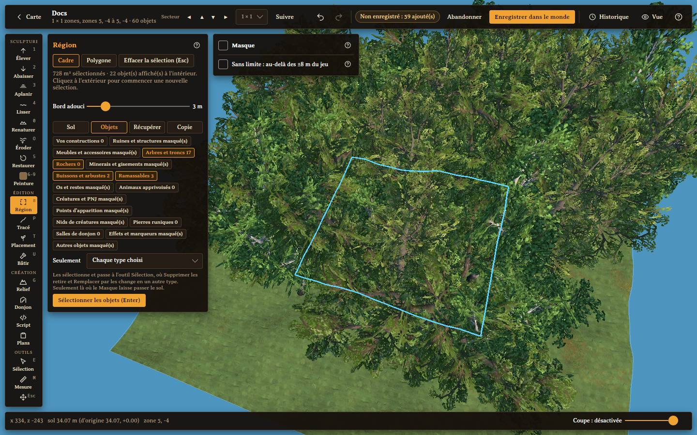
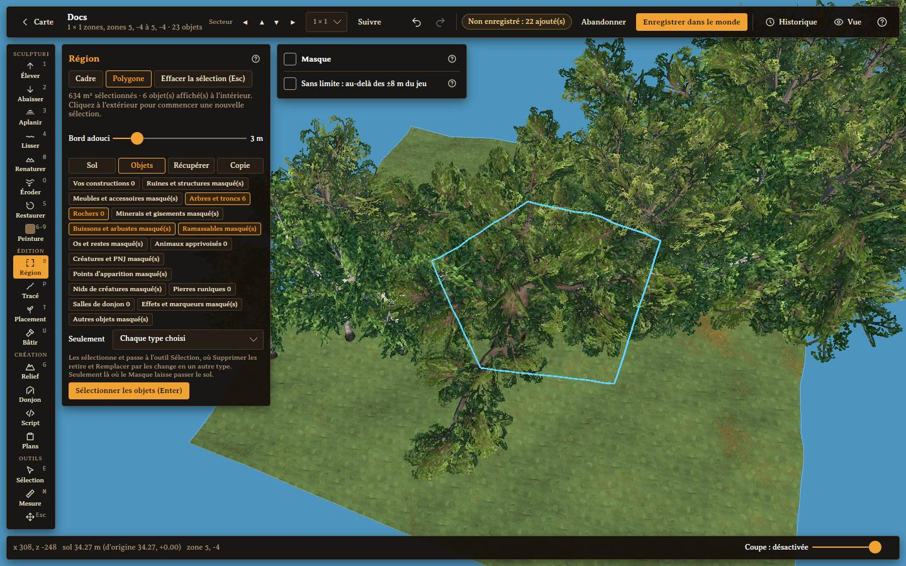
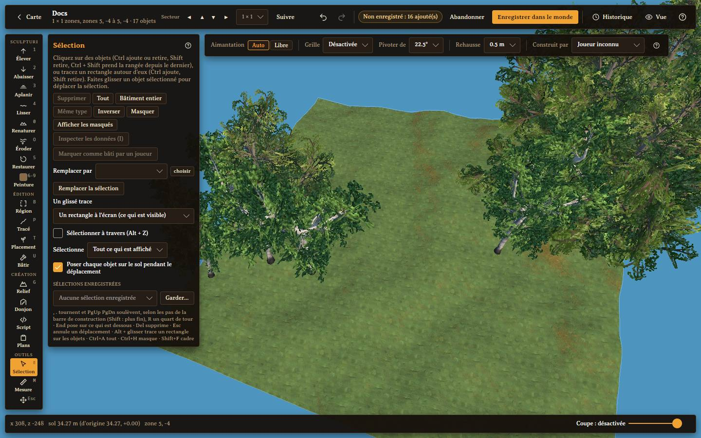
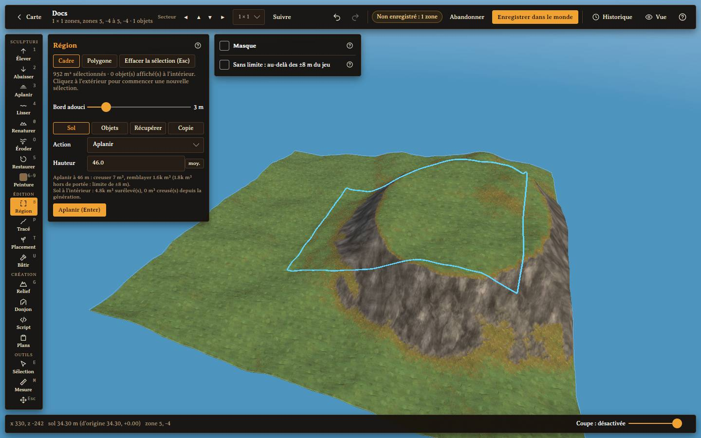
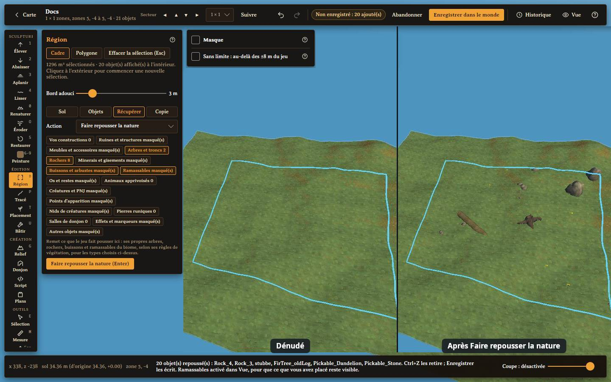
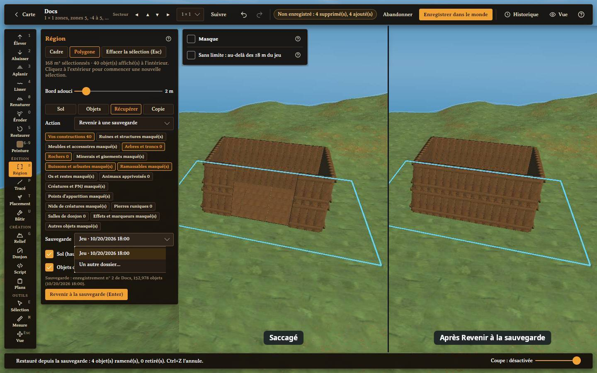
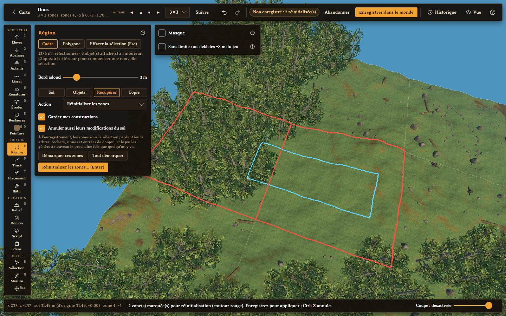
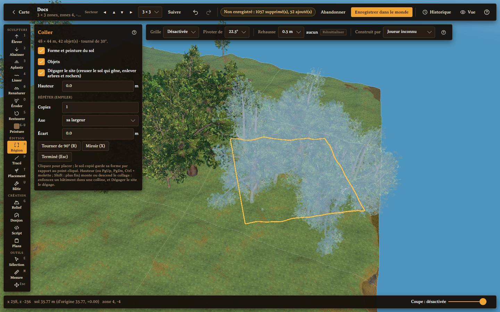
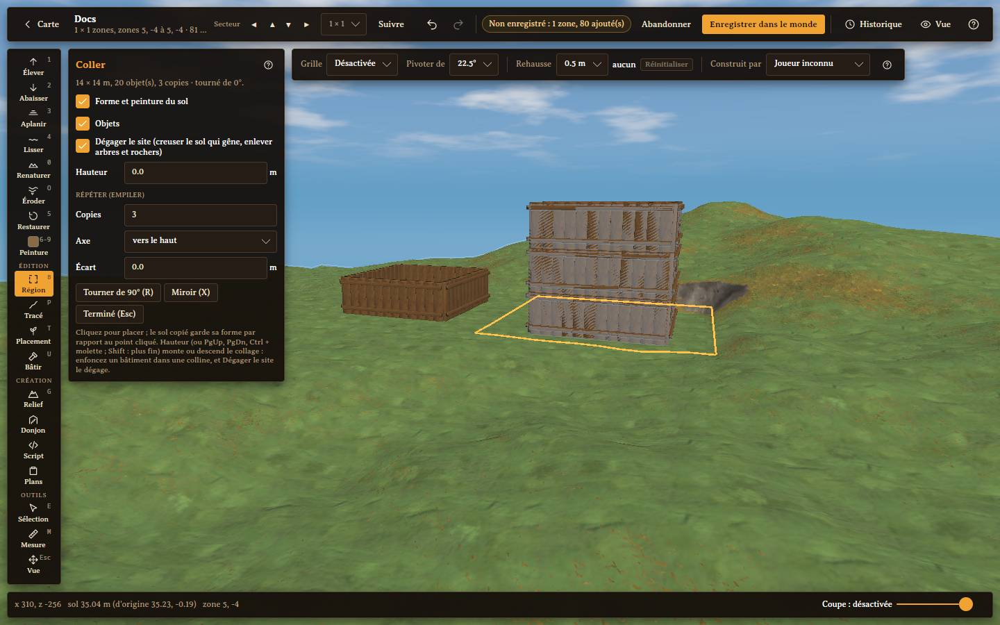
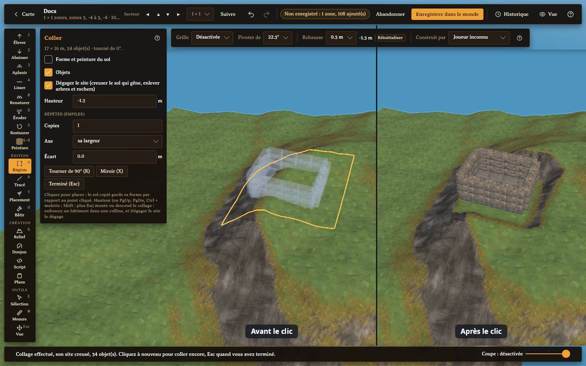

<!-- source: 89a0aafb -->
# Région, copier et coller

Modifiez d'un coup tout ce qui se trouve dans un rectangle ou un polygone : aplanissez ou peignez son sol, choisissez
ses objets pour les supprimer ou les remplacer, copiez-le et collez-le, ou remettez-le comme il était : le sol généré,
une sauvegarde, la nature propre au jeu.

**Où :** barre d'outils, section **ÉDITION** · **Touche :** `B` · **Fonctionne dans :** mondes enregistrés, en direct

*Un cadre tracé autour d'un bosquet avec **Objets** choisi : les pastilles de type comptent les arbres, rochers,
buissons et ramassables à l'intérieur. Rien n'a encore changé : le bouton du bas les sélectionne.*

## L'utiliser

1. Dans la barre d'outils, cliquez sur **Région** (`B`).
2. En haut du panneau, choisissez **Cadre** ou **Polygone** et tracez la sélection sur le sol.
3. Choisissez un groupe : **Sol**, **Objets**, **Récupérer** ou **Copie**. Sol et Récupérer proposent alors
   leurs actions dans la liste **Action**. Le panneau n'affiche que les réglages de l'action choisie et une ligne qui
   dit ce qu'elle fait.
4. Appuyez sur le bouton du bas, ou sur `Enter`. Son libellé nomme l'action : **Aplanir (Enter)**, **Sélectionner les
   objets (Enter)**, **Faire repousser la nature (Enter)**…
5. Le résultat ne convient pas ? `Ctrl+Z` l'annule : chaque action est une étape dans l'Historique. **Enregistrer dans
   le monde** (ou **Appliquer en direct**) la conserve.

| Groupe | Ce qu'il contient |
|---|---|
| **Sol** | [Actions sur le sol](#actions-sur-le-sol) : Aplanir, Élever, Abaisser, Lisser, Renaturer, Éroder, Peinture, et [Carte des hauteurs](#carte-des-hauteurs). |
| **Objets** | [Sélectionner des objets](#actions-sur-les-objets) : les objets à l'intérieur, par type, confiés à l'outil Sélection pour les supprimer, les remplacer ou les déplacer. |
| **Récupérer** | [Ce qui était là](#récupérer-ce-qui-était-là), ramené : [Revenir au sol généré](#revenir-au-sol-généré), [Faire repousser la nature](#faire-repousser-la-nature), [Revenir à une sauvegarde](#revenir-à-une-sauvegarde), [Réinitialiser les zones](#réinitialiser-les-zones). |
| **Copie** | [Copier et coller](#copier-et-coller), et les [plans](#plans). |

L'action choisie est retenue, et chaque groupe revient sur la dernière action utilisée. Le [Masque](masks.md), sur sa
propre carte à côté du panneau, limite les actions sur le sol, la sélection d'objets, Faire repousser la nature et
Revenir à une sauvegarde au sol qu'il laisse passer.

## Réglages

| Réglage | Ce qu'il fait |
|---|---|
| **Cadre** | Faites glisser un rectangle sur le sol. Un cadre de moins d'un mètre est ignoré. Faire glisser ailleurs commence un nouveau cadre. |
| **Polygone** | Cliquez les coins. Un double-clic ou `Enter` ferme la forme (trois coins au moins) ; `Backspace` retire le dernier coin. Cliquer une fois la forme fermée en commence une nouvelle. |
| **Effacer la sélection (Esc)** | Efface la sélection, pour en commencer une nouvelle. |
| **Bord adouci** | De 0 à 20 m (3 m au départ). Les actions sur le sol s'estompent sur ce nombre de mètres à l'intérieur du contour, pour que le résultat se fonde dans le terrain alentour. À **0**, le bord est net et suit droit un contour en biais. |
| **Sol**, **Objets**, **Récupérer**, **Copie** | Le groupe d'actions affiché (voir le tableau ci-dessus). |
| **Action** | Les actions du groupe, pour Sol et Récupérer. Objets et Copie n'ont qu'une action chacun, donc pas de liste. |

La ligne sous les boutons donne la surface et le nombre d'objets affichés à l'intérieur (« 1250 m² sélectionnés · 84
objet(s) affiché(s) à l'intérieur »). La sélection n'est dessinée que dans l'outil Région et pendant un collage ; elle
est conservée quand vous utilisez un autre outil.

*Un polygone fermé autour d'une partie d'un bois, avec **Objets** choisi.*

*Après **Sélectionner les objets (Enter)**, puis `Del` dans l'outil Sélection : les arbres à l'intérieur du polygone
ont disparu, ceux de l'extérieur sont toujours debout.*

## Actions sur le sol

Chaque point est atténué par le **Bord adouci** et par le Masque. Ce sont les actions des [pinceaux](terrain.md) et de
l'outil [Tracé](path.md), sous les mêmes noms : ici, elles s'appliquent à toute la sélection en une fois.

| Action | Ce qu'elle fait |
|---|---|
| **Aplanir** | Met le sol intérieur à niveau à la **Hauteur** (m). **moy.** règle la Hauteur sur la hauteur moyenne du sol à l'intérieur. |
| **Élever** / **Abaisser** | Soulève / creuse le sol intérieur de la **Quantité** (m). |
| **Lisser** | Atténue les bosses : chaque point se rapproche de la moyenne du sol dans un rayon de 3 m. |
| **Renaturer** | Le sol est lissé, puis des bosses naturelles sont ajoutées. **Bosses**, **Taille bosses** et **Nouveau motif** apparaissent en dessous : ce sont ceux du pinceau [Renaturer](terrain.md#renaturer), les mêmes valeurs où que vous les régliez. |
| **Éroder** | Altère le sol en une fois : les pentes se tassent, la pluie creuse des ravines et laisse des cônes de déjection, les pentes se tassent à nouveau. **Angle de repos** apparaît en dessous : celui du pinceau [Éroder](terrain.md#éroder), la même valeur où que vous la régliez. |
| **Peinture** | Peint le sol intérieur en **Terre**, **Cultivé**, **Pavé** ou **Effacer la peinture** (la liste en dessous). |
| **Carte des hauteurs** | Le sol sous forme d'image en niveaux de gris, à exporter puis réimporter : voir [Carte des hauteurs](#carte-des-hauteurs). |

Pour ramener le sol tel que le monde l'a créé, choisissez **Récupérer**, puis
[Revenir au sol généré](#revenir-au-sol-généré).

Les actions sur le sol restent dans les ±8 m du jeu, sauf si **Sans limite : au-delà des ±8 m du jeu** est coché sur
la fiche **Masque** à côté du panneau : c'est l'unique interrupteur pour tous les outils de sol, et il reste activé
jusqu'à ce que vous le désactiviez. Voir [Sans limite](terrain.md#sans-limite).

Sous **Aplanir**, **Élever** et **Abaisser** :

| Réglage | Ce qu'il fait |
|---|---|
| Ligne de déblai et remblai | La quantité de sol que l'action déplacerait (« Aplanir à 35 m : creuser 120 m³, remblayer 340 m³ »), et pour Aplanir ce qui est hors de portée (« (40 m³ hors de portée : limite de ±8 m) » ; avec Sans limite activé, seulement ce qui dépasse ses ±400 m). La seconde ligne, « Sol à l'intérieur : … surélevé(s), … creusé(s) depuis la génération », compare avec le monde tel que généré. Les deux suivent chaque modification, le bord adouci et le Masque. |

*Un cadre au-dessus d'une colline avec **Aplanir** à 46 m et **Sans limite** désactivé : « Aplanir à 46 m : creuser
0 m³, remblayer 1.5k m³ (2.2k m³ hors de portée : limite de ±8 m) », et en dessous le sol déjà surélevé à l'intérieur
depuis la génération du monde.*

### Carte des hauteurs

Exportez le sol sous forme d'image en niveaux de gris, modifiez-la dans un éditeur d'images (GIMP, Krita…) ou un outil
de terrain (Gaea, World Machine…), et réimportez-la.

| Réglage | Ce qu'il fait |
|---|---|
| **Exporter** | Écrit le sol du rectangle de la sélection, ou de tout le secteur ouvert quand rien n'est sélectionné, en PNG 16 bits en niveaux de gris : le noir est son point le plus bas, le blanc son point le plus haut, le nord en haut, un pixel par mètre (un secteur entier de 3 × 3 fait 193 × 193 pixels). Le fichier va dans le dossier `heightmaps` du dossier de données de l'éditeur ; la barre d'état indique où. Un polygone est exporté sous la forme du rectangle qui l'entoure. |
| **Importer…** | Lit un PNG (niveaux de gris ou couleur, 8 ou 16 bits) et l'ajuste au rectangle de la sélection, ou à tout le secteur quand rien n'est sélectionné. |
| **Plus bas** / **Plus haut** | Les hauteurs du noir et du blanc. Une image exportée par l'éditeur apporte les siennes, si bien qu'une image inchangée remet le sol exactement comme avant. |
| **L'intégrer au sol** | Règle le sol sur les hauteurs de l'image, en une étape d'annulation. Dans une sélection, le **Bord adouci** la fond dans le terrain. Le Masque et la limite de ±8 m s'appliquent (sauf si Sans limite est activé) : les points qui ne peuvent pas atteindre leur hauteur deviennent rouges, et la barre d'état les compte. |
| **Annuler** | Oublie l'image sans changer le sol. |

Utilisez 16 bits quand vous le pouvez : une image 8 bits n'a que 256 paliers entre Plus bas et Plus haut (des paliers
de 20 cm sur 50 m).

*Sans rien de sélectionné, après **Exporter**, puis **Importer…** de la même image : « Image 65 × 65 ajustée à 65 × 65
m (tout le secteur), avec les hauteurs de son export », **Plus bas** et **Plus haut** lus dans l'image. Rien ne change
avant **L'intégrer au sol**.*

## Actions sur les objets

L'outil Région choisit **quels** objets : ceux qui sont dans la sélection, des types que vous activez, là où le Masque
laisse passer le sol. L'outil [Sélection](select.md) agit ensuite **sur** eux : supprimer, remplacer, déplacer,
tourner, copier, masquer.

Une rangée de **pastilles de type** choisit les types. Chaque pastille indique combien d'objets de son type se trouvent
à l'intérieur (« Arbres et troncs 42 »). Au départ, **Arbres et troncs**, **Rochers**, **Buissons et arbustes** et
**Ramassables** sont activés ; choisissez **Vos constructions** pour les pièces bâties par des joueurs, **Minerais et
gisements** pour le cuivre, l'étain, l'argent et autres. Les mêmes pastilles choisissent les types pour
[Faire repousser la nature](#faire-repousser-la-nature) et [Revenir à une sauvegarde](#revenir-à-une-sauvegarde).

Une pastille marquée « masqué(s) » est un type désactivé dans le [panneau Vue](editor-basics.md) : ses objets ne sont pas
comptés et restent intacts, sauf avec **Revenir à une sauvegarde**.

| Réglage | Ce qu'il fait |
|---|---|
| Pastilles de type | Les types d'objets pris. |
| **Seulement** | **Chaque type choisi** les prend tous. Ou choisissez un objet parmi ceux de l'intérieur, listés avec leur nombre, du plus courant au moins courant (« Beech1 (42) ») : seuls ceux-là sont pris. La liste suit les pastilles. |
| **Sélectionner les objets (Enter)** | Les sélectionne et passe à l'outil Sélection. La barre d'état indique combien. Quand rien des types choisis ne se trouve à l'intérieur, elle le dit et l'outil Région reste actif. |

Ensuite, dans l'outil Sélection :

| Pour | Faites ceci |
|---|---|
| Les retirer | Appuyez sur `Del` (ou **Supprimer**). Une étape dans l'Historique ; `Ctrl+Z` les ramène. Un groupe lié (le navire d'un mod) part en entier. |
| Les remplacer par un autre type | Choisissez le type dans **Remplacer par** (ou **choisir** pour le prendre dans le monde), puis **Remplacer la sélection**. Pour ne remplacer que les hêtres d'un bois, choisissez-les d'abord dans **Seulement**. Voir [Sélection](select.md#réglages). |
| Les déplacer, tourner, copier, masquer | Comme toute sélection : voir [Sélection](select.md). |
| Revenir | Appuyez sur `B` : le cadre ou le polygone est toujours là. |

## Récupérer ce qui était là

Quatre façons de ramener ce qui était là, de la plus légère à la plus lourde.

| Action | Ce qu'elle ramène |
|---|---|
| **Revenir au sol généré** | Le sol intérieur tel que le monde l'a généré. Les objets restent. |
| **Faire repousser la nature** | Les arbres, rochers, buissons et ramassables que le jeu fait pousser ici, sur le sol tel qu'il est maintenant. |
| **Revenir à une sauvegarde** | Le sol et les objets intérieurs tels qu'ils étaient dans une sauvegarde de ce monde. |
| **Réinitialiser les zones** | Des zones entières, recréées par le jeu la prochaine fois que quelqu'un y va. |

### Revenir au sol généré

Le sol intérieur revient tel que le monde l'a généré : sa hauteur (y compris le sol élevé ou creusé avec Sans limite)
et sa peinture. Atténué par le **Bord adouci** et par le Masque, comme les [actions sur le sol](#actions-sur-le-sol). Cela
fait pour un rectangle ou un polygone ce que le pinceau [Restaurer](terrain.md#restaurer) fait sous le curseur.

### Faire repousser la nature

*À gauche : un cadre sur un sol nu. À droite : le même cadre après **Faire repousser la nature** : les arbres et
rochers propres au biome, et la barre d'état qui dit ce qui a poussé.*

Faire repousser la nature remet les arbres, rochers, buissons, ramassables et minerais que le jeu fait pousser ici, pour
les types choisis avec les [pastilles de type](#actions-sur-les-objets), dans la sélection et là où le Masque le permet.
Servez-vous-en pour annuler le défrichage d'un bois, ou pour habiller un sol que vous avez remodelé.

- **Il suit les règles du jeu** et la graine du monde : sur un sol encore tel que généré, vous retrouvez les mêmes
  arbres aux mêmes endroits. Les biomes alternatifs (Dark Meadows, Rock Black Forest…) reçoivent ce qu'ils ajoutent.
- **Il utilise le sol tel qu'il est maintenant** : une colline que vous avez élevée reçoit ce qui pousse à sa nouvelle
  hauteur et sur sa nouvelle pente.
- **Il ne double pas ce qui est déjà là** : rien ne pousse à moins de 1 m d'un objet, de 3 m d'un objet du même type
  ou de 4 m d'une pièce de construction, ni là où un lieu (un village, l'entrée d'un donjon) garde son sol dégagé.
- **Jusqu'à 16 zones à la fois** (256 × 256 m) : choisissez une sélection plus petite pour davantage.
- Si un type qu'il a fait pousser est masqué dans Vue, il l'active, pour que ce qui a poussé reste visible.

Les règles complètes : [Règles de pousse](concepts/objects.md#règles-de-croissance).

### Revenir à une sauvegarde

Remettez la sélection comme elle était dans une sauvegarde de ce monde, pour réparer un saccage, un raid raté ou une
modification que vous regrettez, sans revenir en arrière sur tout le monde. Pas à pas :
[Restaurer un secteur depuis une sauvegarde](guides/restore-from-backup.md).

| Réglage | Ce qu'il fait |
|---|---|
| **Sauvegarde** | Les sauvegardes à côté du dossier du monde, de la plus récente à la plus ancienne : celles du jeu (« Jeu · date ») et celles de l'éditeur des versions précédentes (« Éditeur · date »). **Un autre dossier…** choisit n'importe quelle autre copie du même monde, comme une sauvegarde de serveur copiée sur cet ordinateur ; en direct, la liste est vide, c'est donc la marche à suivre. Une copie d'un autre monde (une autre graine) est refusée. La ligne en dessous indique de quel enregistrement il s'agit et combien d'objets il contient. |
| **Sol (hauteur et peinture)** | Le sol intérieur revient exactement comme dans la sauvegarde, y compris le sol Sans limite ; dans le **Bord adouci**, il se fond dans le terrain. Le Masque s'applique. |
| **Objets des types choisis ci-dessus** | Les objets des types choisis avec les [pastilles de type](#actions-sur-les-objets) reviennent avec toutes leurs données : un coffre restauré retrouve son contenu. Choisissez **Vos constructions** pour ramener des constructions. |
| **Revenir à la sauvegarde (Enter)** | Effectue l'opération : une étape dans l'Historique. |

Un objet identique des deux côtés (même type, même place, même orientation) est laissé tel quel. Tout autre objet des
types choisis à l'intérieur est retiré, même masqué dans Vue, et chaque objet de la sauvegarde sans correspondance
revient. Les pierres runiques ne sont jamais touchées. Quand rien ne diffère, la barre d'état indique « Rien à
restaurer : la sélection est telle qu'elle était dans la sauvegarde. »

*À gauche : un polygone autour d'une cabane dont une partie du mur avant a disparu, **Revenir à une sauvegarde**
choisi, la liste **Sauvegarde** ouverte sur la sauvegarde du jeu et **Vos constructions** activé. À droite : après
**Revenir à la sauvegarde (Enter)**, le mur est de nouveau entier ; la ligne au-dessus du bouton nomme l'enregistrement
de la sauvegarde, la barre d'état compte ce qui est revenu.*

### Réinitialiser les zones

Marquez les zones sous la sélection pour que le jeu les génère à nouveau : nouveaux arbres, rochers, minerais et lieux.
Pour choisir des zones dans tout le monde par biome ou par distance aux constructions, utilisez la
[carte du monde](map.md#réinitialiser-des-zones-dans-tout-le-monde), qui a les deux mêmes interrupteurs et marque de la même façon ;
pas à pas : [Générer à nouveau des zones](guides/reset-zones.md).

| Réglage | Ce qu'il fait |
|---|---|
| **Garder mes constructions** | Les objets bâtis par des joueurs dans les zones sont conservés. Activé au départ. Désactivé, les constructions des zones partent aussi. |
| **Annuler aussi leurs modifications du sol** | Annule aussi les modifications du sol des zones : hauteur (y compris le sol Sans limite) et peinture. La vue montre le sol revenu à l'état généré dès que les zones sont marquées. Activé au départ. |
| **Réinitialiser les zones… (Enter)** | Marque pour réinitialisation chaque zone sous la sélection (contour rouge), après confirmation. |
| **Démarquer ces zones** | Démarque les zones sous la sélection : elles ne sont pas réinitialisées. |
| **Tout démarquer** | Démarque chaque zone marquée pour réinitialisation, y compris celles marquées sur la carte et hors du secteur ouvert. Une étape dans l'Historique. |

Une zone compte dès que le contour englobe au moins un de ses points de sol, quel que soit le bord adouci : une zone
qui reste en dehors de la sélection n'est pas réinitialisée. La réinitialisation a lieu quand vous enregistrez (hors
ligne) ou appliquez en direct (WorldEditorBridge 0.10.0 ou plus récent).

> [!CAUTION]
> **Une fois enregistrée ou appliquée, une réinitialisation ne peut pas être annulée.** Chaque arbre, rocher, ruine,
> entrée de donjon, créature et objet au sol des zones disparaît ; les pierres tombales des joueurs restent. Les
> animaux apprivoisés n'ont pas de bâtisseur, ils partent donc aussi : déplacez-les d'abord hors des zones.

*Un cadre sur deux zones, **Réinitialiser les zones** avec **Garder mes constructions** et **Annuler aussi leurs
modifications du sol** activés, après **Réinitialiser les zones… (Enter)** : les deux zones ont un contour rouge, la
barre d'état les compte. Rien n'est réinitialisé avant l'enregistrement.*

## Copier et coller

*Un bois copié de quelques dizaines d'arbres et de rochers suit le curseur, transparent et tourné de 30° ; la ligne en
haut du panneau Coller dit ce que contient le presse-papiers. Un clic le pose.*

Le groupe **Copie** affiche ces boutons. `Ctrl+C` et `Ctrl+X` fonctionnent avec n'importe quelle action de
l'outil Région (et dans l'outil Sélection) ; `Ctrl+V` fonctionne dans tous les outils.

| Réglage | Ce qu'il fait |
|---|---|
| **Copier (Ctrl+C)** | Copie chaque objet affiché à l'intérieur (quoi que disent les pastilles de type), et le sol sur lequel reposent ses constructions. Une fois collés, les arbres, rochers et autres gardent leur hauteur au-dessus du sol là où chacun atterrit ; les pièces de construction gardent la forme du bâtiment. Les types que le monde ne sait pas créer sont laissés de côté. La copie est retenue : collez-la dans un autre secteur, un autre monde, ou après avoir redémarré l'éditeur. |
| **Couper (Ctrl+X)** | La même copie, puis les objets copiés quittent le monde (`Ctrl+Z` les ramène), si bien qu'un collage les déplace. Le sol reste. |
| **Coller (Ctrl+V)** | Commence le collage : la copie suit le curseur ; cliquez pour la poser. Collez autant de fois que vous voulez ; `Esc` arrête. |
| **Enregistrer un plan…** / **Plans…** | Voir [Plans](#plans). |

La ligne sous les boutons dit ce que contient le presse-papiers (« Presse-papiers : 24 × 18 m, 54 objet(s). », avec le
nom du plan s'il vient de la bibliothèque). Une sélection sans objet affiché à l'intérieur ne copie rien (son sol ne
part qu'avec des constructions) : la barre d'état le signale, et le presse-papiers garde ce qu'il contenait.

Une copie contient :

- **Les objets, avec toutes leurs données** : le contenu d'un coffre, le texte d'un panneau, leur santé, qui les a
  bâtis.
- **Seulement le sol sous les constructions** : sous chaque pièce de construction plus 1 m, s'estompant sur 3 mètres de
  plus. Le reste du sol de la sélection n'est pas copié, si bien qu'une ville collée s'installe dans le terrain où elle
  atterrit.
- **Des hauteurs de deux façons.** Les arbres, rochers et autres éléments naturels gardent leur hauteur au-dessus du
  sol et suivent le sol là où chacun atterrit. Les pièces de construction et les parties d'un groupe lié (le navire
  d'un mod) gardent la forme du bâtiment, mesurée depuis le sol moyen de la copie, qui se place à la hauteur du sol là
  où vous cliquez.

La copie de l'outil [Sélection](select.md) ne contient que les objets que vous avez sélectionnés, et le sol sous leurs
pièces de construction sans sa peinture. Elle se colle de la même façon.

### Coller

*Un seul clic avec **Copies** à 3 et **Axe** sur vers le haut, vu du sol : à côté de la cabane d'origine, trois copies
empilées en trois étages (le contour est le prochain collage, qui suit le curseur).*

Le collage doit tenir dans le secteur ouvert : son contour devient rouge quand ce n'est pas le cas, et un clic à cet
endroit le signale. Ouvrez d'abord un secteur plus grand (la liste de taille du secteur dans la barre du haut, ou la
[carte](map.md)).

| Réglage | Ce qu'il fait |
|---|---|
| **Forme et peinture du sol** | Colle le sol sous les constructions, en gardant sa forme par rapport au point où vous cliquez, au-delà des ±8 m du jeu si nécessaire. Un bâtiment repose sur le sol sur lequel il a été bâti. |
| **Objets** | Colle les objets copiés. |
| **Dégager le site (creuser le sol qui gêne, enlever arbres et rochers)** | Activé au départ. Creuse le sol qui gêne les pièces de construction collées jusqu'à la pièce la plus basse (sans jamais élever le sol), et enlève arbres, rochers, minerais, buissons et ramassables de leur emprise. Les constructions et les créatures restent. |
| **Hauteur** | Monte ou descend le collage (m) ; `PgUp`, `PgDn` et `Ctrl` + molette aussi. Enfoncez un bâtiment dans une colline et Dégager le site le dégage en creusant. |

Sous **RÉPÉTER (EMPILER)** :

| Réglage | Ce qu'il fait |
|---|---|
| **Copies** | Combien de copies pose un clic, de 1 à 50, le tout en une étape d'annulation. |
| **Axe** | Dans quel sens elles se suivent : **sa largeur** ou **sa profondeur** (elles tournent et se mettent en miroir avec le collage), ou **vers le haut** (étages empilés). |
| **Écart** | L'espace entre deux copies (m) ; une valeur négative les fait se chevaucher. Vers le haut, la taille d'une copie est sa hauteur plus un mètre. |

En bas du panneau :

| Réglage | Ce qu'il fait |
|---|---|
| **Tourner de 90° (R)** | Un quart de tour. `,` et `.` tournent du pas **Pivoter de** de la barre de construction (`Shift` : 1°). |
| **Miroir (X)** | Inverse le collage d'est en ouest, avant de le tourner. |
| **Terminé (Esc)** | Arrête le collage et revient à l'outil Région. |

Pendant le collage, [la barre de construction](build.md#la-barre-de-construction) s'affiche à côté du panneau, la même que
celle de Bâtir et de Sélection : **Grille** (le collage la suit), **Pivoter de** et **Rehausse** (les pas de `,` `.` et
de `PgUp` `PgDn` ; la barre affiche la hauteur, **Réinitialiser** la ramène à zéro) et **Construit par**.

Des copies côte à côte reposent chacune sur le sol là où elles atterrissent ; empilées vers le haut, seule la première
façonne le sol. La ligne en haut du panneau dit ce que contient le presse-papiers : nom, taille, objets, copies,
rotation, miroir. La barre d'état dit ce que le collage a fait : « Collage effectué avec le sol, 54 objet(s),
7 arbre(s), rocher(s) et autres retirés du site. »

*Avec **Dégager le site** activé (**Forme et peinture du sol** désactivé, **Hauteur** à -1.5 m) : à gauche, la copie
transparente enfoncée dans le flanc d'une butte ; à droite, après le clic, le sol creusé autour de ses murs.*

## Plans

Un plan est un bâtiment enregistré dans un fichier, à coller dans n'importe quel monde ou à construire en jeu avec
[Homestead](https://thunderstore.io/c/valheim/p/sighsorry/Homestead/). La bibliothèque, l'Atelier et le contrôle de
stabilité sont présentés dans [L'Atelier](workshop.md).

| Réglage | Ce qu'il fait |
|---|---|
| **Enregistrer un plan…** | Enregistre les objets du presse-papiers (ce que Région ou Sélection a copié en dernier) comme plan Homestead, avec un nom, une description et des étiquettes, et en indiquant s'il s'agit d'un donjon (voir [Donjons](dungeons.md)). Le sol et les bâtisseurs ne sont pas conservés. Un plan du même nom est remplacé, après confirmation. |
| **Plans…** | Ouvre la bibliothèque (aussi **Plans** dans la barre d'outils). **Coller** met un plan dans le presse-papiers et commence le collage. |

Les pièces collées gardent ce que contient le plan (textes des panneaux, objets sur les présentoirs, contenu des
coffres) et sont bâties par le joueur choisi dans **Construit par** sur [la barre de construction](build.md#la-barre-de-construction)
(les pièces que personne n'a bâties le restent). Les types que le jeu ne connaît pas (mods non installés) sont laissés
de côté, et l'éditeur dit lesquels. Un plan de donjon se place 5 000 m plus haut, derrière une entrée posée sur le sol
là où vous cliquez, comme le jeu range ses donjons.

## Raccourcis

| Touche ou souris | Ce qu'elle fait |
|---|---|
| `B` | Choisir Région. |
| Glisser (Cadre) / cliquer les coins (Polygone) | Tracer la sélection. |
| Double-clic ou `Enter` | Fermer le polygone. |
| `Backspace` | Retirer le dernier coin du polygone. |
| `Enter` | Effectuer l'action choisie. |
| `Enter`, puis `Del` | Avec **Objets** choisi : sélectionner les objets à l'intérieur, puis les supprimer (dans l'outil Sélection). |
| `Esc` | Effacer la sélection ; un second `Esc` quitte l'outil. |
| `Ctrl+C` / `Ctrl+X` / `Ctrl+V` | Copier / couper la sélection / coller. |
| Pendant un collage : `R`, `X` | Tourner de 90°, mettre en miroir. |
| Pendant un collage : `,` `.` ou `Alt`+molette | Tourner du pas **Pivoter de** de la barre de construction, 22.5° au départ (`Shift`, plus fin : 1°). |
| Pendant un collage : `PgUp` / `PgDn` ou `Ctrl`+molette | Hauteur, du pas **Rehausse** de la barre de construction, 0.5 m au départ (`Shift`, plus fin : un cinquième). |
| Pendant un collage : `Esc` | Terminé. |

## Astuces et limites

- **Tracez la sélection quelques mètres plus large que les constructions** : le sol copié s'estompe dans le **Bord
  adouci**, si bien qu'une construction proche du contour emporte moins de son sol.
- **Une grande ville demande un grand secteur** : choisissez 9 × 9 ou plus dans la liste de taille du secteur avant de
  coller.
- **Les objets collés sont de nouveaux objets** avec toutes les données copiées, si bien qu'un collage fonctionne aussi
  dans un autre monde. Les groupes liés (le navire d'un mod) reçoivent leurs propres nouveaux identifiants. En direct,
  un **Couper** suivi d'un collage déplace les objets dans le jeu en cours quand c'est possible (voir
  [Mode direct](live-mode.md)).
- **Aucune action ne touche la rangée de points la plus extérieure du secteur** (voir
  [Le bord verrouillé](concepts/areas-and-zones.md#le-bord-verrouillé)).
- **Pour annuler une action**, `Ctrl+Z`, même après un enregistrement (enregistrez ensuite à nouveau :
  l'[Historique](concepts/saving-and-history.md#historique) est conservé) ; pour une modification plus ancienne que
  l'historique, [Restaurer un secteur depuis une sauvegarde](guides/restore-from-backup.md).

## Voir aussi

- [Dégager arbres et rochers, aplanir un terrain à bâtir](guides/clear-an-area.md)
- [Restaurer un secteur depuis une sauvegarde](guides/restore-from-backup.md)
- [Déplacer ou copier un bâtiment](guides/move-a-building.md)
- [Générer à nouveau des zones](guides/reset-zones.md)
- [Objets](concepts/objects.md), [Sauvegardes](concepts/saving-and-history.md#sauvegardes)
- [Comment un collage dégage son site](concepts/objects.md#comment-un-collage-dégage-son-site), [comment Faire repousser décide de ce qui pousse](concepts/objects.md#comment-faire-repousser-décide-de-ce-qui-pousse)
