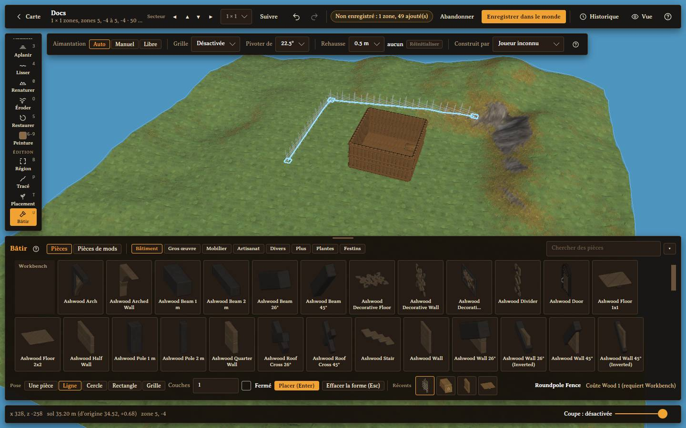
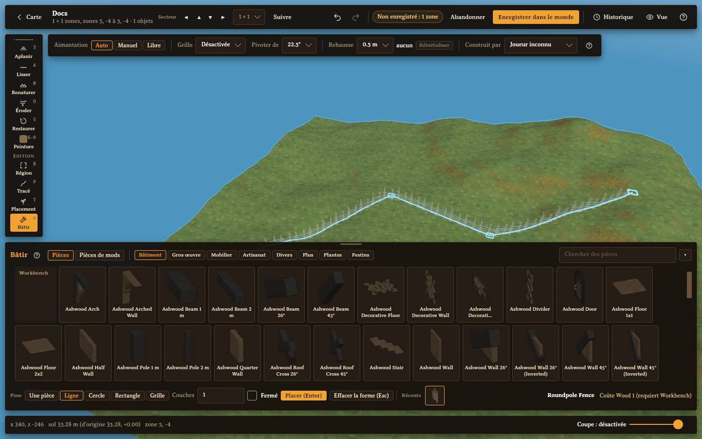
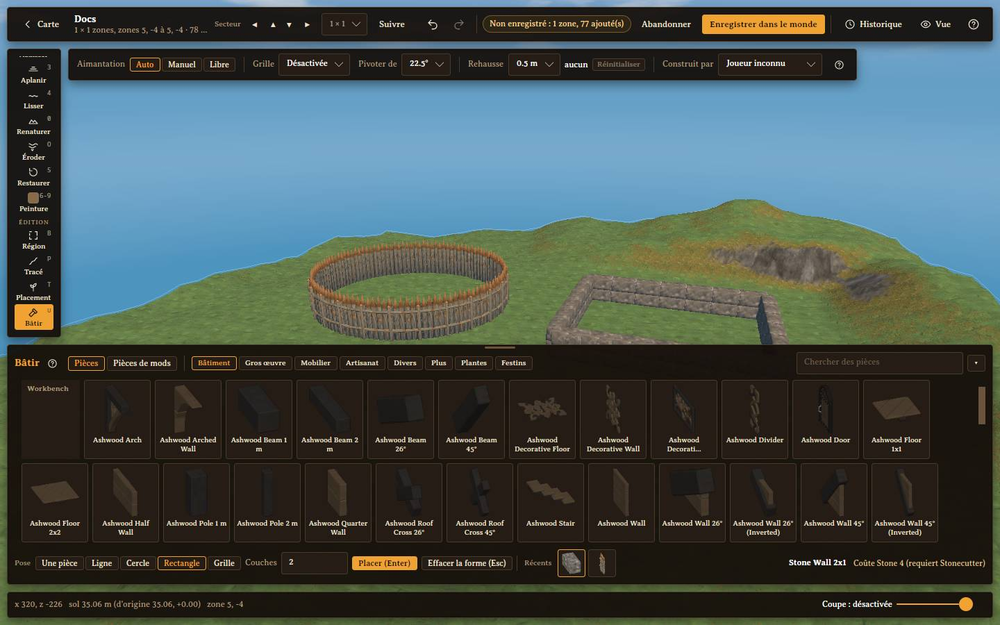
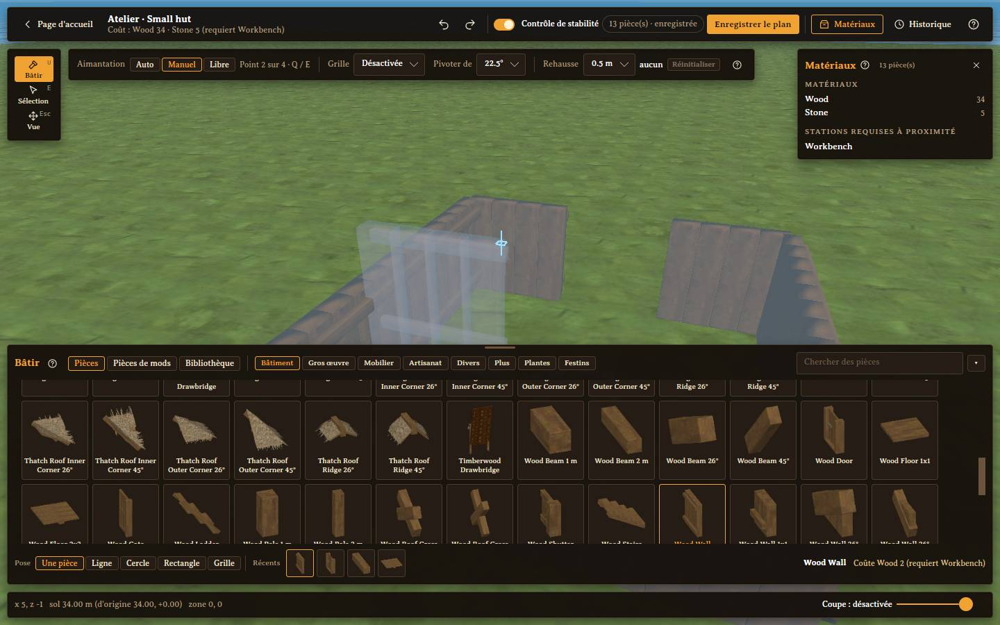

<!-- source: 1f261984 -->
# Bâtir

Posez les pièces que construisent les joueurs (murs, sols, toits, clôtures, meubles, stations d'artisanat), une à la
fois comme le marteau du jeu, ou le long d'une ligne, autour d'un cercle ou d'un rectangle, ou en grille.

**Où :** barre d'outils, section **ÉDITION** · **Touche :** `U` (dans l'Atelier, `T` aussi) · **Fonctionne dans :**
les mondes enregistrés, en direct, l'[Atelier](workshop.md), et les salles d'un donjon avec [Construire ici](dungeons.md)

*Bâtir dans un monde : une cabane montée sur un sol aplani et une clôture de rondins posée le long d'une ligne de
trois points (**Pose** sur **Ligne**, montrée avant **Placer (Enter)**). En bas : le panneau Bâtir avec les pièces de
l'onglet **Bâtiment** et la rangée **Pose**. En haut : la barre de construction, avec **Aimantation**, **Grille**,
**Pivoter de**, **Rehausse** et **Construit par**.*

## L'utiliser

Pour monter un mur et une clôture dans un monde :

1. Appuyez sur `U`. Le panneau **Bâtir** s'ouvre en bas de la fenêtre, et
   [la barre de construction](#la-barre-de-construction) à côté de la barre d'outils.
2. Dans le panneau, cliquez sur une pièce (cherchez `wall`). Elle suit le pointeur, transparente, là où le marteau la
   poserait.
3. Visez le sol ou une pièce : la pièce s'aimante aux pièces déjà présentes. Cliquez pour la poser.
4. Appuyez sur `,` ou `.` pour tourner la suivante, sur `PgUp` ou `PgDn` pour la rehausser ou l'abaisser.
5. Pour une clôture, choisissez-la, puis au pied du panneau choisissez **Pose** → **Ligne**, cliquez des points sur le
   sol et appuyez sur `Enter`.

Chaque clic, chaque rangée ou chaque `Enter` est une étape d'annulation (`Ctrl+Z`). Rien n'est écrit dans le monde
avant que vous fassiez **Enregistrer dans le monde** (ou **Appliquer en direct**). Pour déplacer, tourner ou supprimer
des pièces, utilisez [Sélection](select.md), qui partage la barre de construction.

Les arbres, les rochers, les cultures en champ et les points d'apparition se placent avec [Placement](place.md), pas
avec Bâtir.

## Le panneau Bâtir

Le panneau occupe le bas de la fenêtre. Ses onglets, sa recherche, **Récents**, le coût de la pièce et les raccourcis
(glisser une rangée, `Shift` + clic droit pour retirer une pièce, clic milieu pour construire avec le type d'une pièce)
sont les mêmes partout : voir [Le panneau Bâtir](workshop.md#le-panneau-bâtir) sur la page de l'Atelier.

Ce qui change selon l'endroit :

| Où | Le panneau |
|---|---|
| Le terrain ouvert d'un monde | **Pièces** et **Pièces de mods**. Pas de **Bibliothèque** : collez un plan avec le [panneau Plans](workshop.md#panneau-plans). Le [Masque](masks.md) ne s'applique pas à Bâtir. |
| L'Atelier | **Pièces**, **Pièces de mods** et **Bibliothèque** ; **Matériaux** compte ce que coûte la construction. Pas de **Construit par** : un plan ne garde aucun constructeur. |
| Un donjon (**Construire ici**) | **Pièces** et **Pièces de mods**, une pièce à la fois : les lignes et la grille de **Pose** se dessinent sur le sol, loin sous les salles d'un donjon. |

La barre d'outils et les panneaux de droite s'arrêtent au-dessus du panneau ; la barre d'outils défile avec la
molette. Repliez le panneau avec **▾** pour gagner de la place.

## Poser des pièces le long d'une ligne ou en grille

**Pose**, au pied du panneau, choisit comment la pièce choisie se pose. Le choix est conservé pour la prochaine fois.

| Pose | Ce qu'elle fait |
|---|---|
| **Une pièce** | Une pièce là où vous visez, comme le marteau. Faites glisser pour poser une rangée. |
| **Ligne** | Cliquez des points sur le sol : la pièce est posée bout à bout le long des segments droits qui les relient, chacune rejoignant la précédente par ses points d'aimantation (une clôture, un mur, une route de sols). Faites glisser un point pour le déplacer, faites glisser la ligne pour en ajouter un, `Ctrl` + clic en retire un, `Backspace` le dernier. **Fermé** revient au premier point, pour clôturer une cour. |
| **Cercle** | Appuyez au centre et faites glisser vers l'extérieur. La taille est arrondie pour que des pièces entières ferment l'anneau. |
| **Rectangle** | Appuyez à un coin et faites glisser jusqu'au coin opposé. Les côtés se remplissent depuis les coins pour que les coins se rejoignent. |
| **Grille** | Appuyez à un coin et faites glisser jusqu'à l'autre : une pièce au milieu de chaque case, espacées de l'**Espacement** (2 m pour les sols de 2 m du jeu), autant de cases entières que possible. `,` et `.` tournent toute la grille. |

| Réglage | Ce qu'il fait |
|---|---|
| **Couches** | Ligne, Cercle et Rectangle : la ligne empilée sur 1 à 20 pièces de haut (un mur de 3 de haut, une double clôture). |
| **Espacement** | Grille : la distance entre les pièces, de centre à centre, de 0.5 à 30 m. |
| **Placer (Enter)** | Pose ce que montre l'aperçu transparent, en une étape d'annulation. Un double-clic sur le dernier point d'une ligne fait de même. |
| **Effacer la forme (Esc)** | Retire la ligne, la figure ou le cadre tracés. Ils restent après le placement, leur aperçu vide, jusqu'à ce que vous les effaciez. |

*Une clôture posée bout à bout le long d'une ligne passant par quatre points, transparente jusqu'à ce que `Enter` la
pose.*

*Un **Cercle** (un anneau de murs de pieux) et un **Rectangle** (murs de pierre, **Couches** 2), chacun posé avec
`Enter`.*

- Une ligne qui commence à moins de 1 m d'une pièce déjà présente la prolonge, à son niveau (avec **Aimantation** sur
  **Auto** ou **Manuel**).
- Sur une pente, les pièces restent de niveau et montent ou descendent par paliers avec le sol, comme une clôture qui
  gravit une colline. Pour un mur bien régulier, aplanissez d'abord le sol le long de la ligne ([Tracé](path.md),
  Aplanir).
- La rehausse (`PgUp`, `PgDn`) soulève toute la ligne ou toute la grille au-dessus du sol : un sol posé à 2 m de haut
  fait un toit.
- Au plus 2 000 pièces par ligne ou par grille.

## La barre de construction

La barre à côté de la barre d'outils contient les réglages de construction. C'est une seule barre pour **Bâtir**,
[Sélection](select.md) et [Coller](area.md#copier-et-coller) : ce que vous réglez dans l'un vaut pour les autres, et est
conservé pour la prochaine fois. Chaque outil affiche les parties qu'il utilise. Dans une fenêtre étroite, la barre
passe sur deux rangées.

| Réglage | Bâtir | Sélection | Coller |
|---|---|---|---|
| **Aimantation** | **Auto** (par défaut) : la pièce s'aimante aux pièces déjà présentes, comme avec le marteau. **Manuel** : un seul de ses points d'aimantation rejoint les autres, jusqu'à 1,5 m ; `Q` et `E` choisissent lequel, marqué sur la pièce (`Point 2 sur 8 · Q / E`). **Libre** : elle reste là où elle touche ce que vous visez. | **Auto** : les pièces déplacées s'aimantent aux pièces voisines, à moins de 0,75 m. **Libre** : elles restent là où vous les faites glisser. | Non utilisé. |
| **Grille** | **Désactivée** (comme en jeu), **0.5 m**, **1 m** ou **2 m** : un point sur le sol est arrondi à cette grille, comptée depuis le milieu du secteur. Une pièce pointée vers une autre pièce s'aimante comme d'habitude. | Les pièces glissées sur le sol qui ne s'aimantent pas suivent la grille. | Le collage suit la grille. |
| **Pivoter de** | De combien `,` et `.` (ou `Alt` + molette) tournent la pièce : **1°**, **15°**, **22.5°** (le pas du jeu, par défaut), **45°** ou **90°**. | Les mêmes touches tournent la sélection. | Les mêmes touches tournent le collage. |
| **Rehausse** | De combien `PgUp`, `PgDn` ou `Ctrl` + molette soulèvent la pièce : **0.1 m**, **0.25 m**, **0.5 m** (par défaut) ou **1 m**. La barre affiche la rehausse (`+1.5 m`) ; **Réinitialiser** la ramène à zéro. | Les mêmes touches soulèvent la sélection. | Les mêmes touches montent ou descendent le collage (sa **Hauteur**) ; **Réinitialiser** la ramène à zéro. |
| **Construit par** | Le joueur inscrit comme constructeur des pièces que vous posez. | Le constructeur qu'inscrivent **Marquer comme bâti par un joueur** et **Remplacer**. | Le constructeur des pièces collées. |

**`Shift` rend toujours un pas plus fin**, dans les trois outils : `,` et `.` tournent de 1°, et la rehausse avance
d'un cinquième de son pas (0,1 m pour 0,5 m). `R` tourne d'un quart de tour dans les trois, quel que soit le pas.

Maintenez `Alt` pendant la construction pour placer une pièce par quart de mètre, sans aimantation, quel que soit le
réglage **Aimantation** (comme maintenir `Alt` en jeu, avec un pas). Voir [Aimantation](concepts/objects.md#aimantation).

***Aimantation** sur **Manuel**, `E` pressé une fois : la barre indique `Point 2 sur 4 · Q / E`, et le mur
transparent qui suit le pointeur rejoint le mur de la cabane par son coin supérieur, marqué d'une croix.*

### Construit par

**Construit par** liste les joueurs qui ont construit dans ce monde (avec leur nombre de pièces), les joueurs nommés
sur des lits, des protections et des tombes, et les personnages de cet ordinateur, marqués « (cet ordinateur) ». Au
départ, il choisit le joueur qui a le plus de pièces, sinon votre propre personnage, sinon un joueur nommé dans le
monde. **Autre id de joueur…** demande n'importe quel id (un nombre entier). **Personne (pas bâti par un joueur)** pose
les pièces sans constructeur, comme des parties de ruine. Si aucun joueur n'est connu, les pièces reçoivent **Joueur
inconnu** (id 1) : les protections et les coffres privés n'obéissent alors à personne ; choisissez donc votre propre id
quand vous le pouvez. Le choix est mémorisé pour chaque monde.

Il n'est pas sur la barre dans l'Atelier : un plan ne garde aucun constructeur, et ses pièces reçoivent le leur quand
il est collé. Pourquoi le constructeur compte : voir [Pièces bâties par un joueur](concepts/objects.md#pièces-bâties-par-un-joueur).

## Raccourcis

| Touche ou souris | Ce qu'elle fait |
|---|---|
| `U` | Ouvre Bâtir (dans l'Atelier, `T` aussi). |
| Clic | Poser la pièce (**Une pièce**) ; ajouter un point (**Ligne**). |
| Glisser | **Une pièce** : une rangée de la pièce. **Cercle**, **Rectangle**, **Grille** : le tracer. |
| `,` `.` ou `Alt` + molette | Tourner la pièce du **Pivoter de** de la barre (`Shift` : 1°). En **Grille** : toute la grille. |
| `R` | Tourner de même d'un quart de tour. |
| `PgUp` / `PgDn` ou `Ctrl` + molette | Rehausser ou abaisser la pièce de la **Rehausse** de la barre (`Shift` : un cinquième). |
| `Alt` (maintenu) | Placer par quart de mètre, sans aimantation. |
| `Q` / `E` | Aimantation **Manuel** : le point d'aimantation précédent / suivant de la pièce. |
| `Shift` + clic droit | Retirer la pièce sous le pointeur. |
| Clic milieu | Construire avec le type de la pièce sous le pointeur. |
| `Enter` | Poser la ligne, la figure ou la grille. |
| `Backspace` | Retirer le dernier point de la ligne. |
| `Esc` | Effacer la ligne, la figure ou la grille ; si rien n'est tracé, revenir à **Vue**. |
| `Ctrl+Z` | Annuler la dernière pièce, rangée ou ligne. |

Toutes les touches de l'éditeur sont dans [Raccourcis](help/shortcuts.md).

## Astuces et limites

- **Annuler :** `Ctrl+Z` reprend une pièce, une rangée ou toute une ligne, même après un enregistrement (enregistrez
  alors à nouveau). Voir [Annuler des modifications](guides/undo-changes.md).
- Les pièces ne se posent qu'à l'intérieur du secteur ouvert, pas sur sa ligne de points la plus extérieure.
- L'éditeur ne vérifie pas que les pièces tiennent dans un monde : utilisez le
  [Contrôle de stabilité](workshop.md#contrôle-de-stabilité) de l'Atelier pour une construction que vous comptez garder, ou
  construisez-la là-bas puis collez-la.
- Les nouvelles pièces sont neuves : santé pleine, coffres vides. Pour remplir un coffre, voir
  [Modifier le contenu d'un coffre](guides/fill-a-chest.md).
- L'onglet **Plantes** contient les pousses et les cultures du cultivateur, une à la fois ou en **Grille** ;
  [Placement](place.md) les a aussi, avec son pinceau, et garde la place dont elles ont besoin pour pousser.

## Voir aussi

- [Concevoir une maison et l'enregistrer comme plan](start/first-build.md)
- [Atelier](workshop.md) : la parcelle, la Bibliothèque, les Matériaux, le contrôle de stabilité
- [Sélection](select.md) · [Placement](place.md) · [Région, copier et coller](area.md)
- [Aimantation](concepts/objects.md#aimantation) · [Pièces bâties par un joueur](concepts/objects.md#pièces-bâties-par-un-joueur)
