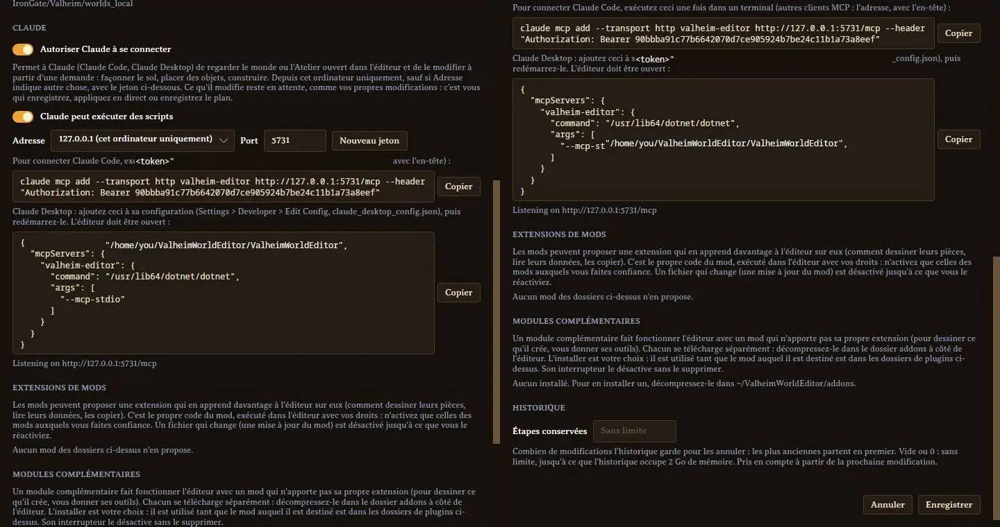
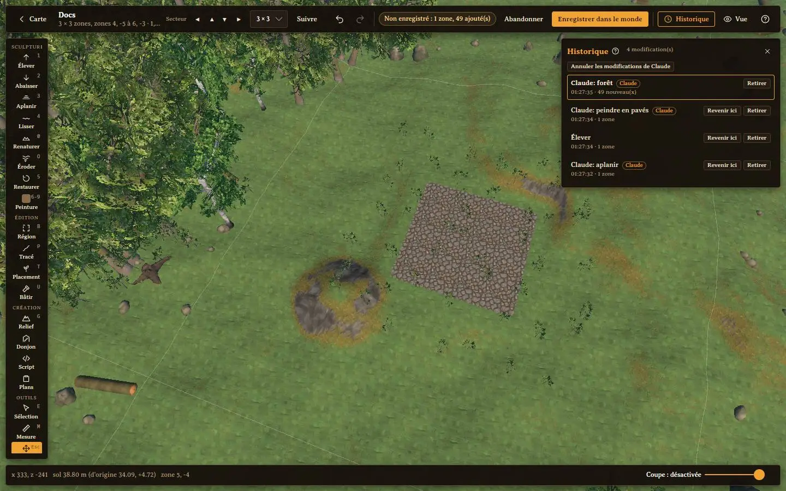

<!-- source: 3de08343 -->
# Claude

Laissez Claude (dans Claude Code, Claude Desktop ou un autre client MCP) façonner le sol, planter, construire et
générer des donjons dans le monde ou l'Atelier que vous avez ouvert, à partir d'une demande, pendant que vous regardez
dans la vue 3D.

**Où :** page d'accueil, **Paramètres** → **Claude** · **Touche :** aucune · **Fonctionne dans :** mondes enregistrés,
en direct (avec **Auto** désactivé), l'Atelier


*À gauche : la section **Claude** activée et à l'écoute ; copiez la commande dans un terminal (Claude Code) ou les
lignes dans la configuration de Claude Desktop. À droite : le bas des Paramètres, avec **Enregistrer**. Votre commande
contient votre propre jeton là où cette image indique `<token>`, et les lignes le chemin de votre propre programme.*

Tout ce que Claude modifie reste **en attente**, comme vos propres modifications : une étape de l'Historique chacune
(`Ctrl+Z` l'annule), comptée dans la barre du haut. Claude n'enregistre jamais un monde et n'applique jamais rien à
une partie en direct : c'est vous qui le faites, quand ce que vous voyez vous plaît. Pour la mise en place pas à pas,
voir [Laisser Claude façonner ou construire](guides/connect-claude.md).

## L'utiliser

1. Dans **Paramètres** sur la page d'accueil, activez **Autoriser Claude à se connecter** et appuyez sur
   **Enregistrer**.
2. Ajoutez l'éditeur à Claude une fois : exécutez la commande qu'affichent les Paramètres (Claude Code), ou ajoutez ses
   lignes à la configuration de Claude Desktop.
3. Ouvrez un secteur d'un monde ou l'Atelier (ou demandez à Claude d'en ouvrir un).
4. Demandez à Claude ce que vous voulez ([Demander](#demander)) et regardez-le travailler dans la vue 3D.
5. Gardez ce qui vous plaît : **Enregistrer dans le monde**, **Appliquer en direct** ou **Enregistrer le plan**.
   Annulez ce qui ne vous plaît pas avec `Ctrl+Z`, **Abandonner**, ou **Annuler les modifications de Claude** dans
   l'Historique.

## Réglages

Dans **Paramètres** (sur la page d'accueil), section **Claude** :

| Réglage | Ce qu'il fait |
|---|---|
| **Autoriser Claude à se connecter** | Activé : l'éditeur accepte les requêtes de Claude, depuis cet ordinateur seulement (sauf si **Adresse** dit autre chose), de la part des appelants qui ont le jeton. Désactivé : rien ne peut se connecter. |
| **Claude peut exécuter des scripts** | Activé : Claude peut exécuter des scripts C#, comme le fait l'outil [Script](scripting.md), chacun vous étant d'abord montré pour l'exécuter ou le refuser. Un script est un programme qui a vos droits sur cet ordinateur, vos fichiers compris. Désactivé (par défaut) : les scripts de Claude sont refusés ; ses autres outils fonctionnent toujours. |
| **Adresse** | D'où Claude peut se connecter : choisissez dans la liste, ou tapez une adresse. `127.0.0.1 (cet ordinateur uniquement)`, par défaut ; `0.0.0.0 (tous les réseaux)` ; ou l'un des réseaux de cet ordinateur avec son adresse (`192.168.1.20 (Ethernet)`) : ce réseau seulement. Avec tous les réseaux, une ligne sous la commande donne les adresses qu'utilise un autre ordinateur : le nom de cet ordinateur (`http://my-pc.local:5731/mcp`), là où le réseau répond aux noms `.local` (mDNS), et son adresse sur chaque réseau (`http://192.168.1.20:5731/mcp`), qui fonctionne toujours mais change quand le réseau lui en attribue une autre. Voir [Sécurité](#sécurité). |
| **Port** | Le port auquel Claude se connecte : 5731 au départ, de 1024 à 65535. Changez-le si un autre programme utilise 5731. |
| **Nouveau jeton** | Crée un autre jeton. Dès que vous **Enregistrez**, l'ancien cesse de fonctionner : ajoutez à nouveau l'éditeur à Claude avec la nouvelle commande. |
| Commande Claude Code, **Copier** | La commande qui ajoute l'éditeur à Claude Code. Elle contient le jeton : gardez-la pour vous. |
| Lignes Claude Desktop, **Copier** | Les lignes à ajouter à la configuration de Claude Desktop. |

Après **Enregistrer**, la section affiche « Listening on http://127.0.0.1:5731/mcp » (sur une autre adresse,
« Listening on 0.0.0.0:5731, from other computers too »), ou la raison de l'échec (« Could not listen on
127.0.0.1:5731: … » quand le port est pris, ou quand une adresse réseau n'est plus celle de cet ordinateur).

## Ajouter l'éditeur à Claude

**Claude Code :** exécutez une fois dans un terminal la commande qu'affichent les Paramètres. Elle ressemble à ceci,
avec votre jeton :

```sh
claude mcp add --transport http valheim-editor http://127.0.0.1:5731/mcp --header "Authorization: Bearer <token>"
```

Dans Claude Code, `/mcp` liste ensuite **valheim-editor** comme connecté tant que l'éditeur tourne.

**Claude Desktop** lance un programme au lieu de se connecter à une adresse. Ajoutez les lignes qu'affichent les
Paramètres à sa configuration (Claude Desktop → Settings → Developer → Edit Config, `claude_desktop_config.json`), puis
redémarrez-le :

```json
{
  "mcpServers": {
    "valheim-editor": { "command": "/path/to/ValheimWorldEditor", "args": ["--mcp-stdio"] }
  }
}
```

`--mcp-stdio` n'ouvre aucune fenêtre : il transmet les messages de Claude à l'éditeur en cours d'exécution (avec
**Autoriser Claude à se connecter** activé), avec le jeton de ses paramètres.

**Les autres clients MCP** se connectent à l'adresse (HTTP diffusable, « streamable HTTP ») avec le même en-tête
`Authorization`.

L'éditeur doit être ouvert pour que Claude puisse le joindre.

## Ce que Claude peut faire

Les outils de Claude appellent le même code que les outils et boutons de l'éditeur : ce qu'il crée suit donc les mêmes
règles du jeu que vos modifications : la limite de 8 m du sol du jeu (seul un script de sa main la dépasse),
l'aimantation des pièces de construction, les zones, les lieux.
Chacune de ses étapes est nommée « Claude: … » dans l'Historique et porte une étiquette **Claude**. Il vérifie son
travail avec des images de la vue 3D et de la carte, et avec le contrôle de stabilité.

| Claude peut | Ses outils |
|---|---|
| Voir ce qui est ouvert, les mondes de cet ordinateur, ainsi que les hauteurs, biomes, eaux et objets d'un secteur ; ouvrir un secteur de 1 à 17 zones ; chercher dans tout le monde un type, un objet dans un coffre ou le texte d'un panneau ; lister le départ, les marchands, les autels et les entrées de donjon | `editor_state`, `list_worlds`, `open_world`, `open_area`, `describe_area`, `list_objects`, `ground_at`, `search_world`, `list_locations` |
| Regarder son travail : des images de la vue 3D (n'importe quelle caméra, ou quatre vues d'un endroit à la fois) ou de la carte, une carte du secteur vue de dessus avec une grille en mètres, le contrôle de stabilité (quelles pièces tomberaient) | `screenshot`, `area_map`, `support_check` |
| Utiliser votre sélection, et vous montrer ce qu'il en comprend | `get_selection`, `select_objects` |
| Régler n'importe quelle commande comme vous le feriez (interrupteurs de Vue, la Coupe de la barre d'état, les réglages des outils, la barre d'outils) | `list_controls`, `set_control` |
| Consulter les pièces du jeu et la façon dont elles s'assemblent | `find_prefabs`, `piece_info`, `building_guide`, `list_blueprints` |
| Examiner le monde d'une graine (biomes, départ, marchands, boss) et créer un nouveau monde d'un nom et d'une graine | `preview_seed`, `create_world` |
| Aplanir, peindre, lisser, renaturer, éroder, restaurer, élever ou abaisser le sol ; appliquer un tampon ou une image de carte des hauteurs ; creuser une rivière, des douves ou une rampe le long d'une ligne, ou aplanir, élever, abaisser, lisser, renaturer, éroder ou restaurer le sol le long de celle-ci ; tracer une route ; marquer des zones pour réinitialisation ; faire repousser les arbres et rochers du jeu | `flatten`, `paint_area`, `shape_ground`, `stamp`, `import_heightmap`, `dig_path`, `road`, `reset_zones`, `regrow_nature` (la plupart acceptent un [Masque](masks.md)) |
| Planter des arbres ou des rochers, poser des pièces et des objets (ils s'aimantent comme avec le marteau), copier des objets une fois ou en ligne ou en anneau, remplacer des objets par un autre type, retirer des objets | `forest`, `place_pieces`, `copy_objects`, `replace_objects`, `remove_objects` |
| Construire un plancher, des murs avec portes et un toit à deux pans (26° ou 45°, chaume ou bardeaux) sur un rectangle ; ouvrir l'Atelier ; ajouter un plan à la parcelle ou à un secteur ; enregistrer la parcelle comme plan | `build_floor`, `build_walls`, `build_roof`, `place_pieces`, `open_workshop`, `add_blueprint`, `save_blueprint` |
| Déplacer et tourner des objets en groupe, ou placer, incliner et dimensionner chacun exactement ; remplir un coffre, habiller un support d'armure ou un présentoir, écrire sur un panneau, donner des étoiles à une créature ; changer l'étiquette d'un portail, un bâtisseur, les joueurs autorisés d'une protection, la santé, le combustible, le niveau d'une créature ou son état d'apprivoisement | `move_objects`, `set_transform`, `get_object`, `set_object_data`, `set_contents` |
| Générer un donjon sur la parcelle ou au-dessus d'un point du monde, derrière son entrée ; lister les salles d'un donjon du jeu ; ajouter une salle à une extrémité ouverte, en retirer une, fermer toutes les extrémités ouvertes, placer une porte | `generate_dungeon`, `list_dungeons`, `dungeon_rooms`, `add_dungeon_room`, `remove_dungeon_room`, `close_dungeon_ends`, `set_dungeon_door` |
| Exécuter un script (avec votre accord) | `run_script`, `script_reference` |
| Annuler et rétablir | `undo`, `redo` |

Quelques règles à connaître :

- `open_world` est refusé tant que le monde ouvert ou l'Atelier a des modifications non enregistrées.
- `save_blueprint` n'enregistre la construction de l'Atelier que sur demande, et ne remplace jamais un plan sans qu'on
  le lui dise. Réenregistrer un plan garde sa description et ses étiquettes.
- `generate_dungeon` refuse un biome, un style ou un matériau de mur qu'il ne connaît pas, et liste ceux qu'il connaît.
- `move_objects` garde la forme d'un bâtiment, et une partie du groupe lié d'un mod (un navire et ses pièces) entraîne
  tout son groupe, y compris pour les copies et les suppressions.
- Un donjon que Claude génère sur la parcelle de l'Atelier fait partie de la construction de la parcelle, en attente
  comme le reste ; il n'est pas ajouté à votre bibliothèque.
- Quand Claude se connecte, l'éditeur lui donne un petit guide pour y travailler, et deux demandes toutes prêtes :
  *build_in_workshop* et *shape_area*.

## Demander

Ouvrez vous-même le monde ou l'Atelier, ou demandez à Claude de le faire. Ensuite, par exemple :

- « Ouvre le secteur autour de 1200, -340 et crée une vallée avec une rivière qui coule vers le nord, bordée de
  bouleaux. »
- « Aplanis un carré de 40 m au milieu du secteur, pave-le, et mets un cercle de torches autour. »
- « Dans l'Atelier, construis une petite maison longue : plancher en pierre, murs en bois avec deux portes, toit de
  chaume à 45°. Vérifie qu'elle tient debout. »
- « Ouvre le secteur autour de 800, 950 et génère au-dessus une crypte des Marécages à deux niveaux. »
- « Ces arbres que j'ai sélectionnés : remplace-les par des hêtres. » (Sélectionnez-les d'abord ; Claude lit votre
  sélection.)

Les travaux du sol, les forêts et les donjons sont les plus faciles à demander. Les bâtiments détaillés posés pièce par
pièce peuvent demander quelques allers-retours (« le toit dépasse côté est, corrige-le »), ou partir de l'un de vos
plans.


*Les étapes de Claude sont nommées « Claude: … » et étiquetées **Claude** ; votre propre **Élever** se trouve entre
elles. **Annuler les modifications de Claude**, en haut, retire les étapes de Claude et garde les vôtres.*

## Annuler les modifications de Claude

- `Ctrl+Z` annule la dernière étape, de Claude ou de vous.
- Dans l'**Historique**, **Retirer** sur une étape étiquetée **Claude** retire cette étape et garde tout ce qui a été
  fait après.
- **Annuler les modifications de Claude** (en haut de l'Historique, tant que Claude a des modifications en cours)
  retire chaque étape faite par Claude dans l'historique du secteur ouvert, de la plus récente à la plus ancienne, et
  garde les vôtres, même celles faites après celles de Claude. La barre d'état indique combien ont été annulées, et
  combien d'étapes de Claude faites dans d'autres secteurs sont conservées : ouvrez ces secteurs pour les annuler aussi
  (voir [L'historique appartient au monde](concepts/saving-and-history.md#lhistorique-appartient-au-monde)).
- **Abandonner** jette tout ce qui n'est pas enregistré, vos modifications comprises.

Cela fonctionne aussi après un enregistrement ou une application : le prochain **Enregistrer dans le monde** ou
**Appliquer en direct** l'écrit. Voir
[Annuler une étape, retirer une modification ou tout abandonner](guides/undo-changes.md).

## Sécurité

- **Cet ordinateur seulement.** L'éditeur écoute sur `127.0.0.1` (ou une autre adresse de bouclage que vous tapez,
  comme `::1`) et refuse toute requête adressée à un autre nom : une page web que vous visitez ne peut donc pas le
  joindre. Avec une autre **Adresse**, les ordinateurs de ce réseau peuvent aussi le joindre, sous n'importe lequel des
  noms de cet ordinateur, avec le jeton. Seulement les réseaux propres à cet ordinateur : un ordinateur dont l'adresse
  n'est pas locale (`10.x`, `172.16`–`172.31`, `192.168.x`, lien local, IPv6 `fc00::/7`) ou qui n'est pas sur le
  réseau où écoute l'éditeur est refusé, si bien qu'Internet ne le joint jamais, même en IPv6. Avec `0.0.0.0`, ces
  réseaux sont ceux qui ont une passerelle (pas ceux propres à Docker, WSL ou Hyper-V, ni un tunnel VPN). Un VPN comme
  Tailscale, dont les adresses vont de `100.64.x.x` à `100.127.x.x`, est accepté aussi quand cet ordinateur y est
  connecté : écoutez sur son adresse Tailscale ou sur `0.0.0.0`, et l'autre ordinateur se connecte à cette adresse. Le
  VPN chiffre le trajet : le jeton n'est donc pas lisible sur le réseau.
- **Des scripts depuis cet ordinateur seulement.** Un Claude sur un autre ordinateur se voit refuser les scripts
  (`run_script`, le bouton Exécuter de l'outil Script) même avec **Claude peut exécuter des scripts** activé : sinon,
  quiconque lirait le jeton sur le réseau pourrait exécuter des programmes avec vos droits. Ses autres outils
  fonctionnent comme ici.
- **Non chiffré hors de cet ordinateur.** La connexion est en HTTP simple : avec une autre **Adresse**, n'importe qui
  sur ce réseau peut lire le jeton et tout ce que l'éditeur et Claude s'envoient, et, avec le jeton, utiliser
  l'éditeur. C'est un compromis acceptable sur un réseau domestique de confiance, et les Paramètres le signalent sous
  l'adresse dès que vous en choisissez une. Partout ailleurs, gardez `127.0.0.1` et joignez-le depuis un autre
  ordinateur par un tunnel SSH, qui le chiffre : `ssh -L 5731:127.0.0.1:5731 you@this-computer`.
- **Le jeton.** Chaque requête doit porter le jeton (48 caractères aléatoires créés pour votre éditeur). **Nouveau
  jeton** en crée un autre.
- **En attente seulement.** Claude n'enregistre jamais, n'applique jamais en direct, n'abandonne jamais, ne recharge
  jamais, n'écrit ni ne supprime jamais vos fichiers, et ne se connecte jamais à une partie en direct : aucun outil ne
  fait ces choses, et `set_control` refuse ces commandes.
- **Les scripts demandent votre accord, chacun.** `run_script` (essais à blanc compris) et le bouton **Exécuter** de
  l'outil Script sont refusés tant que vous n'activez pas **Claude peut exécuter des scripts**. Ensuite, chaque script
  que Claude écrit vous est montré avant de s'exécuter : **L'exécuter** ou **Refuser** (Enter et Esc refusent). Un
  essai à blanc suivi de l'exécution du même script dans le même secteur ne demandent qu'une fois ; toute autre
  exécution redemande. Les autres outils de Claude (`flatten`, `road`, `forest`…) exécutent le code propre de
  l'éditeur et ne demandent rien.
- **Ce que dit un monde n'est pas un ordre.** Les panneaux, les étiquettes de portail et les noms sont écrits par des
  joueurs, et un plan ou les données d'un mod par d'autres : Claude a pour consigne de les traiter comme des données.
  Un panneau qui tente de donner des ordres à Claude ne peut pas exécuter de script sans que vous le voyiez d'abord.
- **En direct avec Auto activé : rien.** Tant que le monde ouvert est en direct avec **Auto** activé, chaque
  modification atteindrait aussitôt le jeu : Claude ne modifie donc rien d'autre que le panneau Vue et vous demande de
  désactiver Auto.
- **Désactivé, c'est désactivé.** Désactivez **Autoriser Claude à se connecter** et rien ne peut se connecter.

Plus d'informations dans [Scripts et Claude](concepts/safety.md#scripts-et-claude).

## Raccourcis

Claude n'ajoute aucune touche. `Ctrl+Z` et `Ctrl+Y` annulent et rétablissent ses étapes comme les vôtres.

## Astuces et limites

- L'éditeur doit être ouvert, avec **Autoriser Claude à se connecter** activé, pour que Claude puisse le joindre. S'il
  n'y arrive pas, voir [Claude ne parvient pas à se connecter](help/troubleshooting.md#claude-ne-peut-pas-se-connecter).
- Après **Nouveau jeton** et **Enregistrer**, exécutez à nouveau la nouvelle commande Claude Code (l'ancien jeton cesse
  de fonctionner). Claude Desktop lit le nouveau jeton de lui-même.
- Claude ne voit que le secteur ouvert. Demandez-lui d'ouvrir un autre secteur, ou un plus grand, pour de plus grands
  travaux.

### La compétence de construction (Claude Code)

Facultatif, pour des bâtiments qui doivent avoir l'air faits à la main : le dépôt de l'éditeur contient une compétence
(skill) Claude Code, [`.claude/skills/valheim-build`](../../.claude/skills/valheim-build/SKILL.md). Avec elle, Claude
cherche de vraies constructions Valheim pour s'en inspirer, rédige un court cahier des charges, façonne le sol, essaie
les pièces qu'il connaît mal sur une petite maquette, construit par étapes avec des aides éprouvées (fenêtres en arc,
corniches, créneaux, tours rondes, toits de tuiles, halles à colombages), puis vérifie son propre travail à la recherche
de fenêtres bouchées, de pièces en double et de mauvaises jonctions. Les intérieurs reçoivent charpente, éclairage et
mobilier ; l'extérieur, chemins, lumières et plantations.

Claude Code la charge de lui-même quand vous travaillez dans le dépôt. Pour l'avoir partout, copiez le dossier dans vos
propres compétences : `cp -r .claude/skills/valheim-build ~/.claude/skills/`. Demandez ensuite comme d'habitude, par
exemple « Construis un château gothique avec des douves dans l'Atelier ». Ce qu'elle sait des pièces se trouve dans son
`references/pieces.md` ; les corrections y sont les bienvenues.

## Voir aussi

- [Laisser Claude façonner ou construire](guides/connect-claude.md)
- [Annuler une étape, retirer une modification ou tout abandonner](guides/undo-changes.md)
- [Sécurité](concepts/safety.md#scripts-et-claude) : les scripts et Claude
- [Script](scripting.md) : ce qu'exécute `run_script`
