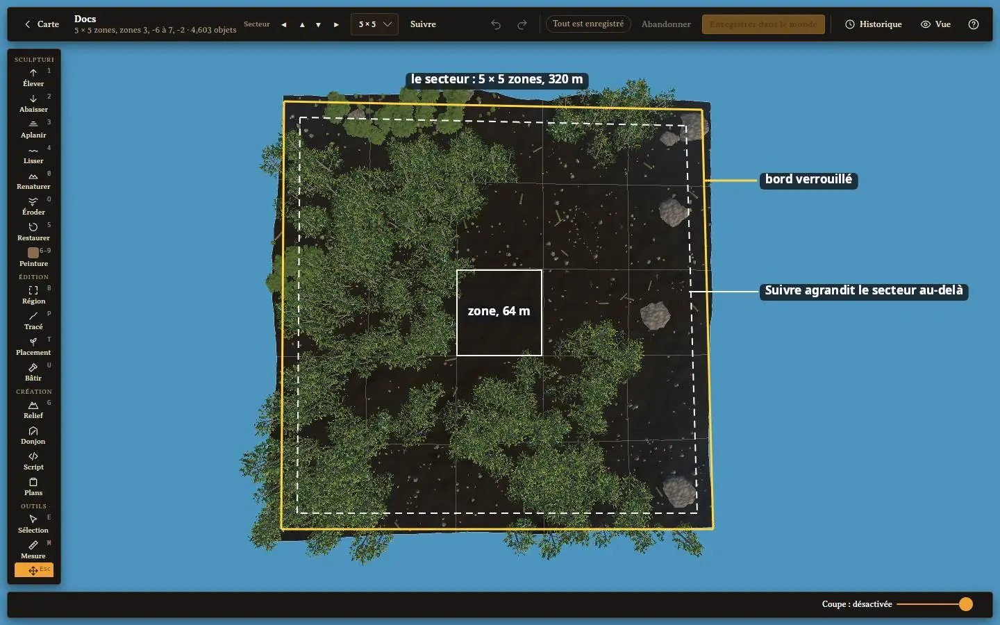

<!-- source: 24741409 -->
# Secteurs et zones

Valheim découpe son monde en **zones** carrées de 64 m, et l'éditeur en ouvre un bloc à la fois, le **secteur**. Cette
page explique pourquoi certains endroits ne peuvent pas encore être enregistrés, pourquoi le bord du secteur ne bouge
jamais, et pourquoi un grand secteur est lent.


*Le secteur est un bloc de zones. Sa ligne de points de sol la plus extérieure (en jaune) ne change jamais ; avec
**Suivre** activé, des zones sont ajoutées quand le point que vous regardez franchit la ligne pointillée, 12 m à
l'intérieur.*

## Zones

Une zone est un carré de 64 × 64 m. La barre d'état nomme la zone sous la souris (`zone 20, -6`), **Vue → Limites des
zones** trace leurs lignes en 3D, et la **Grille des zones** de la carte les trace sur la carte.

Le jeu crée une zone la première fois qu'un joueur s'en approche : ses arbres, rochers et minerais, et le lieu qu'elle
contient (un village, une entrée de donjon). On appelle cela **générer** la zone. Jusque-là, les fichiers du monde ne
contiennent rien à cet endroit, pas même le sol. Pour vous, cela signifie :

- **Les modifications dans une zone que personne n'a visitée ne peuvent pas être enregistrées.** Le message
  d'enregistrement les liste. Passez d'abord par l'endroit en jeu, puis modifiez-le.
- **Un nouveau monde est vide.** L'éditeur peut montrer les terres d'une graine avant que quiconque y joue, mais il n'y
  a rien à modifier tant que le jeu n'a pas créé les zones (voir [Un nouveau monde](../new-world.md)).
- **Le jeu décide par zone.** Il dispose un donjon par zone, réinitialise des zones entières (voir plus bas), et la
  ligne des modifications en attente compte les zones dont vous avez modifié le sol.

Chaque zone contient 65 × 65 points de sol, un par mètre ; des zones voisines partagent les points de leur bord commun.
Voir [Comment le sol est stocké](ground-limits.md#comment-le-sol-est-enregistré).

## Le secteur

Le secteur est le bloc de zones ouvert dans l'éditeur 3D : de 3 × 3 jusqu'à 17 × 17 zones autour de l'endroit que vous
avez choisi sur la [carte](../map.md).

| Taille | Largeur | Idéal pour |
|---|---|---|
| 3 × 3 | 192 m | Une maison, un champ, des modifications rapides ; le plus rapide à ouvrir. |
| 5 × 5 (par défaut) | 320 m | Une base et ses environs. |
| 7 × 7, 9 × 9 | 448 m, 576 m | Un village, une longue route, coller une ville. |
| 13 × 13, 17 × 17 | 832 m, 1 088 m | Une chaîne de montagnes, une côte. Lents à ouvrir et à afficher. |

L'éditeur affiche chaque objet et chaque point de sol du secteur : c'est pourquoi il ouvre un bloc et non le monde
entier. Tout ce que vous faites se passe à l'intérieur : un collage, une montagne ou un script doit tenir dans le
secteur ouvert, alors ouvrez-en un plus grand avant un gros travail.

**Vos modifications appartiennent au monde, pas au secteur.** L'éditeur garde un seul ensemble de modifications en
attente pour tout le monde. Déplacez le secteur, changez sa taille, ou revenez à la carte et ouvrez un autre endroit :
ce que vous avez fait ailleurs attend toujours et est enregistré avec le reste. L'historique suit aussi (voir
[Historique](saving-and-history.md#historique)).

Les flèches de la barre du haut déplacent le secteur d'une zone (64 m) à la fois, et la caméra reste où elle est dans le
monde. La liste des tailles rouvre le secteur à une autre taille autour de la même zone centrale. Les deux attendent ce
qu'attend Suivre, et abandonnent ce qu'il abandonne (voir [Suivre](#suivre)). Ouvrir un autre secteur fait réapparaître
les objets masqués.

## Le bord verrouillé

La ligne de points de sol la plus extérieure du secteur ne change jamais. Aucun pinceau, tracé, action de Région, collage
ou script ne la déplace, et l'outil Placement n'y pose rien.

La raison : ces points sont partagés avec les zones juste à l'extérieur du secteur, que l'éditeur n'a pas chargées. Si
l'éditeur les déplaçait, le sol extérieur rencontrerait une marche ou une falaise qu'il ne peut pas voir. Avec le bord
verrouillé, le secteur se raccorde toujours aux terres qui l'entourent, sans couture. Un script qui écrit là n'est pas
arrêté : la modification est simplement laissée de côté.

```text
 extérieur │ verrouillé │    ce que vous pouvez modifier     │ verrouillé │ extérieur
 ──────────┼────────────┼────────────────────────────────────┼────────────┼──────────
           │    1 m     │      tout le reste du secteur      │    1 m     │
```

Pour travailler près d'un bord, déplacez le secteur avec les flèches, choisissez une taille plus grande, ou activez
**Suivre**.

## Suivre

Avec **Suivre** activé (dans la barre du haut), le secteur s'agrandit de lui-même à mesure que vous travaillez vers son
bord. Quand le point que vous regardez arrive à moins de 12 m du bord, une rangée de zones est ajoutée de ce côté, ou
des deux côtés près d'un coin. Un secteur de 3 × 3 devient 4 × 3, puis 4 × 4, et ainsi de suite.

Suivre ne fait qu'ajouter des zones, il n'en retire jamais : rien de ce sur quoi vous travaillez ne quitte le secteur.
Il s'arrête à 17 zones dans chaque direction (environ 1 km) et le signale ; déplacez alors le secteur avec les flèches,
ou ouvrez un autre endroit depuis la carte.

Suivre attend, et la barre d'état dit pourquoi, tant que l'agrandissement ferait perdre quelque chose : le monde est en
cours d'enregistrement ou de lecture, des objets sont sélectionnés, un coup de pinceau est en cours, un tracé est
dessiné et pas appliqué, ou des modifications sont encore en cours d'envoi vers un jeu en direct. Il n'attend pas pour
un cadre de Région, une ligne, une grille ou un polygone de Placement, ni une mesure : l'agrandissement les abandonne.

## Réinitialiser des zones

Une réinitialisation fait générer à nouveau une zone par le jeu, comme si personne n'y était jamais venu. Utilisez-la
pour obtenir le nouveau contenu d'une mise à jour de Valheim là où personne n'a construit, ou pour faire revenir un bois
ou un donjon. Vous marquez les zones avec l'outil [Région](../area.md) ou dans tout le monde depuis la
[carte](../map.md) ; rien ne se passe tant que vous n'enregistrez pas ou n'appliquez pas en direct.

Quand la réinitialisation est écrite :

- **Tout ce qui est dans la zone disparaît** : arbres, rochers, minerais, ramassables, ruines, entrées de donjon et
  leurs salles, générateurs de créatures, objets qui traînent et créatures, animaux apprivoisés compris (sortez-les
  d'abord).
- **Certaines choses restent** : les pierres tombales des joueurs, toujours ; les pièces bâties par des joueurs avec
  **Garder mes constructions** activé (sur la carte, les zones qui en contiennent sont alors entièrement laissées de
  côté ; désactivé, les constructions disparaissent avec le reste) ; les modifications du sol, sauf si vous avez choisi
  de les annuler aussi.
- **Le jeu la recrée** la prochaine fois qu'un joueur s'en approche : une nouvelle végétation, et son lieu reconstruit
  à sa place, avec un butin et des créatures neufs. En direct, une zone près de laquelle se trouve un joueur est
  recréée aussitôt.

Une zone compte comme sélectionnée quand le contour de la sélection englobe au moins un de ses points de sol, quel que
soit le bord adouci : une sélection qui empiète un tant soit peu sur une zone la réinitialise.

Une réinitialisation ne peut pas être annulée une fois enregistrée ou appliquée ; jusque-là, annulez le marquage. Après
l'écriture d'une réinitialisation, l'éditeur relit le monde, et l'historique suit sans ce qu'il a fait dans les zones
réinitialisées (voir [Ce qu'une étape ne peut pas annuler](saving-and-history.md#ce-quune-étape-ne-peut-pas-reprendre)).
