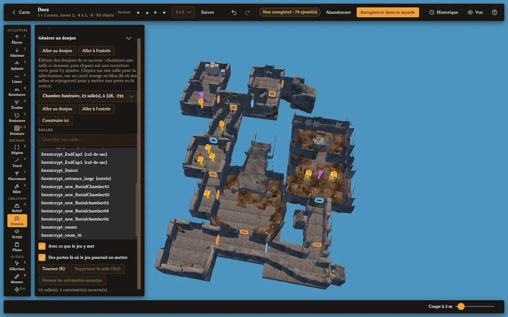

<!-- source: 5e6370cb -->
# Donjons

Valheim conserve ses donjons d'une façon inhabituelle : haut dans le ciel, sous forme d'une liste de salles que le jeu
construit quand quelqu'un s'approche. Le savoir explique pourquoi un donjon que personne n'a visité paraît vide dans
l'éditeur, pourquoi un donjon modifié n'a besoin d'aucun mod, et comment un donjon fait de pièces de construction peut
tenir à 5 000 m d'altitude. L'outil [Donjon](../dungeons.md) repose sur ce fonctionnement.

## Comment le jeu conserve les donjons

**Les donjons ne sont pas creusés dans le sol.** Chacun est un **lieu** en surface (le tertre d'une chambre funéraire,
l'entrée d'une Frost Cave) dont la porte vous téléporte dans le donjon lui-même, **5 000 m au-dessus**, où le jeu traite
tout comme un intérieur. Dans l'éditeur, la caméra cesse de suivre le sol là-haut, et **Vue → Salles de donjon**
affiche ou masque les salles.

```text
   5000 m  ┌───────────────┐  les salles du donjon
           │ ▢─▢─▢─▢       │  ◄── sa porte ramène en bas
           └───────────────┘
              ▲  téléportation
   sol     ───┴─── l'entrée (un lieu : tertre, entrée de grotte, mine)
```

**Un donjon du jeu est une liste de salles.** Le jeu construit ses donjons à partir de salles toutes faites. Dans la
sauvegarde, un donjon est un objet qui contient sa **liste de salles** : quelle salle, où, tournée dans quel sens. Quand
un joueur s'approche, le jeu construit les salles d'après cette liste, quoi qu'elle contienne, sans la vérifier selon
ses propres règles. C'est pourquoi un donjon modifié fonctionne dans le jeu de chaque joueur sans aucun mod : l'éditeur
ne change que la liste.

**Tant qu'aucun joueur ne s'est approché, la liste est vide.** Le jeu dispose un donjon la première fois que quelqu'un
vient : l'éditeur n'a donc aucune salle à montrer ni à modifier avant cela. Visitez-le en jeu, puis rouvrez le secteur.
Les villages fuling et les fermes des Prairies sont disposés de la même façon, au sol.

### Salles, ouvertures et culs-de-sac


*Un donjon du jeu à 5 000 m d'altitude, ses toits retirés : chaque salle est une entrée de la liste. Les carrés marquent
l'endroit où deux salles se rejoignent : bleu avec une porte, orange sans.*

Chaque salle a des **ouvertures**, les passages où elle rejoint la suivante, et chaque ouverture a un type : une Frost
Cave a de simples ouvertures de grotte, des ouvertures de glace, des ouvertures de sanctuaire et d'autres encore. Le jeu
ne relie que des ouvertures du même type, mais certaines salles (un couloir de glace) relient un type à un autre. Un
**cul-de-sac** est une petite salle qui ferme une ouverture, pour que rien ne mène hors du donjon.

Le jeu empêche ses salles de se chevaucher et les garde dans l'espace du donjon (pour la plupart des types, 64 × 64 m
autour du milieu de sa zone). Une liste écrite par l'éditeur est construite de toute façon : l'éditeur se contente donc
d'avertir quand une salle enfreint ces règles.

**Ce qu'il y a dans les salles.** Quand le jeu dispose un donjon pour la première fois, il tire au sort ce qui va dans
chaque salle : coffres, générateurs de créatures, torches, braseros, glace, décorations. Chaque élément a sa chance,
tirée de la graine du monde, de l'emplacement de la salle, du thème du donjon et de la hauteur de la salle. L'éditeur
les tire de la même façon : une salle qu'il ajoute vient avec ce que le jeu y aurait mis. Quelques éléments (stalactites
de glace, cristaux, poissons) se posent en jeu sur la surface la plus proche, et peuvent donc se trouver un peu ailleurs
que là où l'éditeur les montre.

**Portes.** Là où deux salles se rejoignent, le jeu met parfois une porte, selon sa propre chance : les rideaux de tissu
et les murs de glace d'une Frost Cave, les grilles d'une crypte, les portes des mines. Chaque type de donjon a les
siennes pour chaque type d'ouverture, et la porte se dresse à l'ouverture de la salle qui était là la première.

### Entrées, une par zone

Le jeu dispose **un donjon par zone**, et garde libre l'espace au-dessus d'une entrée avant même que le donjon soit
disposé. L'éditeur ne place donc un donjon derrière l'entrée du jeu que là où rien n'occupe encore l'espace là-haut ;
sinon, mettez l'entrée dans une autre zone. Un donjon des Plaines, auquel on accède plutôt par un portail, est empilé
plus haut par paliers de 50 m quand l'espace est occupé.

L'entrée d'un donjon placé est le lieu propre du jeu pour ce biome, écrit comme le jeu écrit un lieu : le jeu crée sa
porte, ses pierres et son accès chaque fois que la zone se charge. Le donjon va là où le jeu dispose celui de cette
entrée (pour une Frost Cave, au milieu de sa zone), tourné de sorte qu'un joueur qui franchit la porte arrive face à
l'intérieur. Les Plaines n'ont pas de donjon à elles : là, une paire de portails liés remplace l'entrée, l'un au sol,
son jumeau là où arrivent les joueurs.

Le jeu affiche les donjons sombres, éclairés seulement par leurs torches. L'éditeur les éclaire comme l'extérieur, pour
que vous voyiez ce que vous modifiez.

## Comment le générateur dispose un donjon

Le générateur peut faire un donjon de deux choses : **les salles du jeu**, ou **des pièces de construction**.

**Avec les salles du jeu**, il les relie à la manière du jeu. Il choisit le donjon du biome (une chambre funéraire dans
les Prairies et la Forêt noire, une crypte engloutie dans les Marécages, une Frost Cave dans les Montagnes et le Grand
Nord, une mine infestée dans les Terres brumeuses), commence par une de ses salles d'entrée, et ajoute des salles aux
ouvertures libres, pondérées comme le jeu les pondère, là où elles tiennent, jusqu'à avoir environ 8, 14, 20 ou 26
salles selon la taille. Il ferme chaque extrémité ouverte, remplit chaque salle comme le ferait le jeu, et met des
portes là où les salles se rejoignent selon la chance du jeu. Le résultat est un objet donjon avec sa liste de salles,
exactement comme ceux du jeu. Une fois placé dans le monde, les salles sont disposées à partir de l'objet donjon là où
l'entrée le met, et gardées dans l'espace de cette zone, comme le fait le jeu : l'endroit de sa zone où se trouve
l'entrée et la direction vers laquelle elle est tournée changent les salles qui tiennent.

**Avec des pièces de construction**, il planifie le donjon sur une grille de dalles de 2 m, un niveau à la fois, puis le
construit et le meuble. Les mêmes choix et la même graine donnent toujours le même donjon. Chaque niveau est disposé
dans cet ordre :

| | Ce qui est disposé |
|---|---|
| **Hall d'entrée** | Ouvre le premier niveau. Les joueurs arrivent devant son mur du fond, le nom du donjon sur un panneau à côté d'eux. |
| **Le chemin principal** | Environ deux salles sur cinq sont tour à tour les salles principales du style (la grande salle, la croisée, la galerie et la chapelle d'une crypte), chacune reliée à la précédente, le plus souvent tout droit. |
| **La descente, ou le boss** | Chaque niveau sauf le dernier se termine par une cage d'escalier (8 × 24 m) qui descend au niveau inférieur, 6 m plus bas. Le dernier se termine par une antichambre, l'arène du boss (24 × 24 m) et la salle du trésor au-delà. |
| **Salles annexes et ailes** | Des salles annexes partent sur les côtés, le plus souvent depuis les croisées et les longues salles, choisies selon les poids du style. Une salle annexe en prolonge souvent une autre, et tend à aller avec elle : une cuisine près de la salle du festin, des cellules près de la salle des gardes, une forge près de l'atelier. |
| **Jumelles** | Les salles annexes reçoivent souvent une jumelle en miroir de l'autre côté de leur salle (presque toujours dans un temple, rarement dans un terrier de gobelins), si bien que le plan se lit comme un bâtiment, selon des axes. |
| **Boucles** | Des salles distantes de trois ou plus le long du chemin qui se trouvent être proches sont reliées : il y a ainsi plus d'un chemin. |
| **Impasses et caches** | Un couloir ou deux ne mènent qu'à une cache. Une cache secrète (deux au-delà de 20 salles) se trouve à côté d'une salle annexe, derrière un mur fissuré ou une tapisserie. |
| **La clé** | Avec le boss derrière une grille, la clé va dans un coffre de la salle annexe la plus éloignée de l'arène. |
| **Portes** | La grille du boss demande la clé ; la salle du trésor est derrière une grille ; les cellules ont plus souvent des grilles ; les grandes salles ont parfois de grandes grilles doubles ; le reste suit le style. Là où l'escalier descend, un passage ouvert devient une grille, pour que ce qui vit en bas reste en bas. |

Les salles varient dans ce cadre. Leur **taille** dépend de leur type (une réserve peut faire 8 × 8 m, une grande salle
12 à 20 m de large et 20 à 32 m de long). Certaines ont des coins échancrés, une abside au bout, ou un coin manquant.
Les **couloirs** vont tout droit ou tournent, et certaines salles se touchent mur contre mur. Les salles font 4 m de
haut, mais les grandes salles, les chapelles, les salles du trône et l'arène peuvent s'élever à 10 m, à travers le
niveau du dessus. Les longues salles peuvent avoir des **alcôves** sur les côtés.

### Pourquoi il tient à 5 000 m

En jeu, chaque pièce de construction a besoin d'un soutien depuis le sol, et il n'y a pas de sol là-haut. Un donjon de
pièces de construction repose donc sur des **dalles de sol en marbre noir** (8 × 8 m), le sol et le toit de chaque partie
utilisée : la seule pièce dont le jeu ne vérifie jamais le soutien (voir [La vérification du soutien](objects.md#le-contrôle-de-stabilité)).
Tout le reste repose dessus. Ce qui se pose sur un sol est soulevé de 5 cm, car une pièce dont le centre est pile sur
une surface n'en reçoit aucun soutien. Pour faire votre propre donjon de pièces, faites de même : des sols en marbre
noir, et tout le reste dessus.

Tout ce que place le générateur n'a pas de constructeur, comme dans les donjons du jeu : le jeu le prend donc pour une
ruine (voir [Pièces bâties par des joueurs](objects.md#pièces-bâties-par-un-joueur)).

## Ameublement, lumière et gardes

Un donjon de pièces de construction est aménagé salle par salle. **Lumière** et **Ruine** tirent leurs propres nombres
aléatoires : les changer ne change rien d'autre dans le donjon.

**Chaque salle est meublée selon sa fonction**, de l'une de deux à quatre façons choisies par la graine :

| Salle | Une partie de son mobilier |
|---|---|
| Grandes salles | Des colonnades avec un autel ; une salle d'hydromel autour d'un feu avec des tables à tréteaux ; une salle des morts avec un sarcophage sur une estrade ; une salle nue aux piliers effondrés. |
| Chapelles | Des bancs face à un autel entre des statues ; un autel surélevé dans un cercle de braseros ; une nef de tapis et de bougies. |
| Chambres funéraires, ossuaires, galeries | Des rangées de sarcophages ou une seule tombe sur une estrade ; des os le long des murs ou en tas ; des niches, des statues, des toiles d'araignée. |
| Casernes, réserves, cabinets d'étude | Des lits ou des couchages autour d'un feu ; des provisions le long des murs ou des étagères en rangées ; des bureaux et des étagères. |
| Salles du festin, salles du trône | De longues tables, ou une table d'honneur sur une estrade ; des colonnades, une salle de guerre, des colonnes effondrées autour de l'estrade. |
| Arènes, sanctuaires | Un cercle de colonnes autour du boss, un trône au-dessus de crânes, ou une fosse creusée sous des corniches. |
| Cuisines, forges, ateliers | Les vraies stations du jeu : fours, chaudrons, fermenteurs, fonderies, la forge noire. |

**Plus à l'intérieur.** Une grande salle de pierre peut porter une mezzanine sur poteaux au-dessus de l'entrée ; une
chambre funéraire peut contenir un caveau intérieur ; les alcôves et les niches abritent un sarcophage, une statue ou un
tonneau. Les coins reçoivent de petits groupes adaptés à la salle (un campement, un repas, le bureau d'un scribe, une
armurerie), et les grandes salles peuvent recevoir une **pièce maîtresse** présente une seule fois dans tout le donjon :
un dolmen, le crâne d'un géant, une fontaine de feux follets. Chaque biome ajoute ses propres éléments (racines dans les
bois, boue et goudron dans les marécages, stalactites de glace dans les montagnes, chair de Seeker dans les mines, pointes
dans les Terres cendrées), et les couloirs varient : à demi effondrés, bordés d'os, couverts de tapis, fermés par une
grille à mi-chemin, ou piégés. Environ une salle ordinaire sur douze reste presque nue, une pièce et une lumière dans le
noir. Avec **Mobilier** sur Meublé ou Riche, les grandes salles de pierre reçoivent des dalles de marbre noir et les
quartiers d'habitation des planchers de bois, une fois sur deux chacun.

**Une lumière selon la fonction.** Les salles sont éclairées par des torches, des appliques ou des braseros dans les
lumières propres au biome : une tous les 5 m de mur en **Lumineux**, 8 m en **Tamisé**, 12 m en **Sombre** (et alors
seulement dans les salles qui comptent). Les grandes salles sont éclairées plus serré ; les salles des morts, les
cellules, les réserves et les caches plus espacé. Dans les catacombes et les prisons, certains couloirs restent sombres
entre des salles éclairées.

**Plus profond, plus riche et plus dangereux.** Chaque niveau plus bas contient un cinquième de plus des monstres et du
butin du niveau supérieur : le deuxième niveau 1,2 fois celui du haut, le sixième deux fois, le seizième quatre fois.

**Gardes.** Une salle reçoit environ un monstre pour 75 m² de sol au taux habituel de son type, multiplié par
**Monstres**, multiplié par sa profondeur, posté à l'écart de l'entrée et tourné vers elle. Le coffre à clé est gardé
par une des élites du biome, les tombes en abritent une, la salle du trône deux. Le **boss** est toujours placé une fois
dans l'arène, en tant que créature elle-même : sans étoile avec **Monstres** à aucun, une étoile à × 1, deux étoiles à
× 2 ou plus. Avec **Les monstres reviennent** activé, les autres viennent des générateurs de créatures du jeu et
reviennent un moment après avoir été tués (voir [Points d'apparition](objects.md#points-dapparition)) ; les salles du jeu
apportent toujours des générateurs.

**Butin.** Les coffres, les trésors qui traînent et les pièces et lingots du métal du biome dans la salle du trésor
augmentent avec **Butin** et la profondeur. Le coffre à clé contient la clé de la crypte et quelques objets de valeur,
écrits dans le coffre pour que le jeu ne le remplisse pas de son propre butin, et la grille de la clé porte un panneau :
*Sealed. The key lies within these halls.* (« Scellé. La clé se trouve dans ces salles. »)

Construit en jeu avec Homestead, un plan de donjon n'est que ses pièces : pas de clé dans le coffre, pas de boss.
