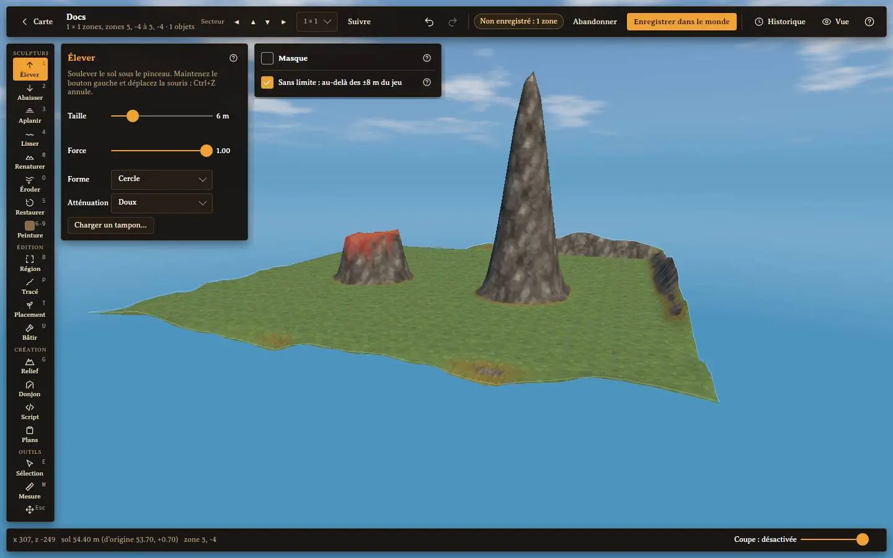
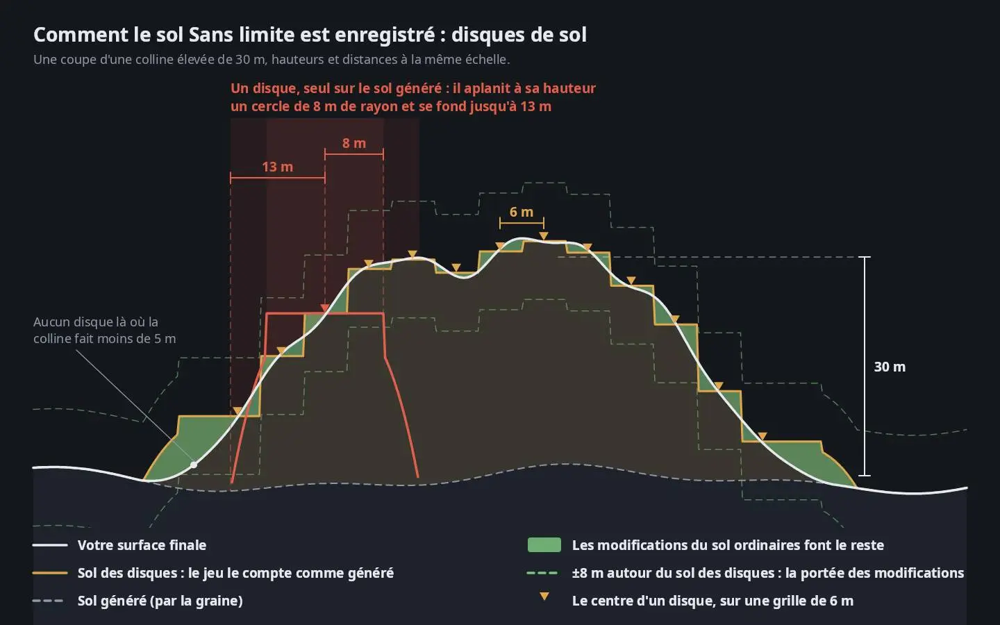
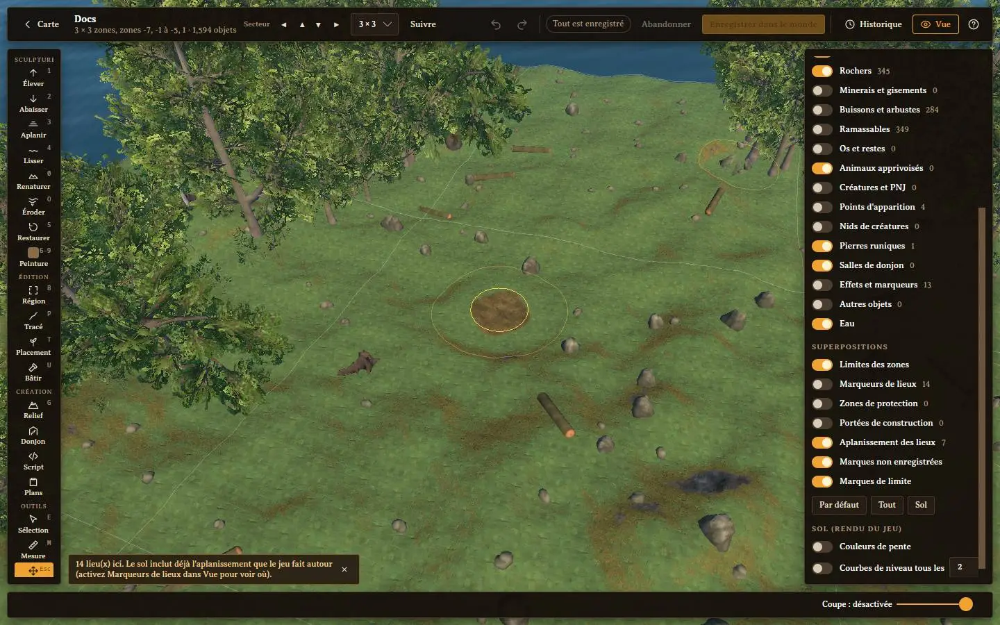

<!-- source: d97e56fa -->
# Limites du sol

Le jeu laisse le sol bouger d'au plus 8 m vers le haut ou vers le bas par rapport à l'endroit où le monde l'a généré.
L'éditeur respecte cette règle : chaque monde qu'il enregistre se charge ainsi dans le jeu de chaque joueur, joueurs
sur console compris, sans aucun mod. **Sans limite** la dépasse d'une façon que le jeu lui-même comprend. Cette page
explique la limite, comment Sans limite la contourne, et comment les lieux du jeu façonnent le sol.

## La limite de 8 m du jeu

Le jeu n'enregistre pas la hauteur du sol. Il enregistre la **graine** du monde, en calcule le sol généré, et ne
sauvegarde que vos **modifications** de ce sol : pour chaque point de sol, de combien il a été élevé ou creusé. Cette
modification peut être d'au plus **±8 m** (plus une modification de lissage d'au plus ±1 m, que fait la houe du jeu).
Tout ce qui va plus loin est jeté quand le jeu charge la zone. L'éditeur applique la même règle : un point qui atteint
la limite s'y arrête.

Ce que cela signifie en pratique :

- **Elle se mesure depuis le sol généré, pas depuis le sol actuel.** Une colline élevée de 8 m ne peut pas monter plus
  haut, et un sol creusé de 8 m ne peut pas descendre plus bas, quelle que soit la façon d'y arriver. La barre d'état
  affiche les deux hauteurs sous la souris : `sol 41.20 m (d'origine 35.00, +6.20)`.
- **Les grands travaux l'atteignent en premier** : une plateforme de construction taillée à flanc de colline, une
  rivière à travers des terres hautes (son lit doit être sous le niveau de la mer, voir
  [Comment le sol est enregistré](#comment-le-sol-est-enregistré)), une montagne.
- **Les outils du jeu la respectent aussi.** La houe et la pioche d'un joueur travaillent à ±8 m du sol généré, en jeu
  comme dans l'éditeur.

```text
        ┌──────────────────────── +8 m : le plus haut que garde le jeu
        │      ╭──╮  le sol élevé s'arrête ici
  ──────┼─────╯    ╰──────────── sol généré (la hauteur « d'origine »)
        │
        └──────────────────────── −8 m : le plus bas que garde le jeu
```

## Sans limite

L'interrupteur **Sans limite : au-delà des ±8 m du jeu** laisse les outils de sol déplacer le sol jusqu'à 400 m du sol
généré : montagnes, falaises, canyons, fosses profondes. C'est un seul interrupteur, sur la fiche **Masque** à côté du
panneau de chaque outil qu'il concerne (les pinceaux de sculpture, les formules et les images de Relief, Tracé et
Région), et il est désactivé à chaque démarrage de l'éditeur. Les montagnes de l'outil [Relief](../landform.md) et le
collage d'une copie dépassent toujours la limite quand ils en ont besoin, et les scripts aussi sauf indication
contraire.

Pendant que vous travaillez, la partie au-delà de ±8 m est gardée comme une rehausse distincte par-dessus le sol ;
l'annulation, l'Historique et **Restaurer** la traitent comme n'importe quelle autre modification. La barre d'état
indique la position de l'interrupteur chaque fois que vous le basculez.


*Le même coup de pinceau sans et avec Sans limite. À gauche, le sol s'arrête à 8 m de haut et son sommet devient rouge ;
à droite, il continue de monter. L'interrupteur se trouve sur la fiche Masque.*

### Comment c'est enregistré : les disques de sol

Le jeu ne garde jamais les modifications du sol au-delà de 8 m, mais il aplanit bien le sol sous ses **lieux**
(villages, camp du marchand) sans aucune limite, et compte ce sol aplani comme généré (voir
[Les lieux aplanissent le sol](#les-lieux-aplanissent-le-sol)). L'éditeur s'en sert. Quand vous enregistrez ou appliquez
en direct, il transforme le sol au-delà de la limite en **disques de sol** : des lieux invisibles propres au jeu, sans
modèle. Chaque disque aplanit un cercle de 8 m de rayon à sa hauteur et fond le sol autour jusqu'à environ 13 m : juste
après le cercle, le sol va environ aux trois quarts de la hauteur du disque (le jeu compte la transition depuis le
milieu du disque, elle commence donc par une petite marche), puis de moins en moins, jusqu'à rien à 13 m.

1. Les disques se placent sur une grille de 6 m, seulement là où votre sol est à plus de 5 m de ce que serait le sol
   sans eux.
2. L'éditeur calcule le sol exactement comme le jeu le construira à partir des disques, dans l'ordre du jeu, et ajuste
   leurs hauteurs en plusieurs passes pour s'approcher au mieux de votre forme. Là où l'écart reste trop grand, il
   ajoute un disque et recommence.
3. Des modifications de sol ordinaires, à ±8 m du nouveau sol, complètent le reste.

Le jeu de chaque joueur construit le même sol à partir des disques, joueurs sur console compris, sans aucun mod.


*Une colline élevée de 30 m, telle qu'elle est enregistrée. Les sommets plats des disques (orange) montent la colline
par paliers sur une grille de 6 m, sous votre surface (blanc) ; un disque, en rouge, aplanit 8 m autour de son milieu
et fond le sol jusqu'à 13 m. Les modifications ordinaires (vert) complètent le reste, à ±8 m du sol des disques. Là où
la colline fait moins de 5 m de haut, il n'y a pas de disque.*

### Ce que cela change pour vous

| | |
|---|---|
| **Le message d'enregistrement** | Indique combien de disques ont été créés (et combien d'anciens ils remplacent), combien d'arbres et de rochers ont été retirés, et de combien le sol le plus raide s'écarte encore : « Sol Sans limite : 312 disque(s) de sol, 40 arbre(s)/rocher(s) retiré(s) ; une partie du sol s'écarte jusqu'à 2.5 m (trop raide) ». |
| **L'Historique reste** | L'éditeur garde votre sol Sans limite et en calcule les disques : annulez un collage ou un coup de pinceau, enregistrez ou appliquez à nouveau, et ses disques disparaissent, le sol autour revenant lui aussi à son état d'avant. Cela tient même après la réouverture du monde (voir [Ce qu'une étape ne peut pas annuler](saving-and-history.md#ce-quune-étape-ne-peut-pas-reprendre)). |
| **Le nouveau sol compte comme généré** | En jeu, la houe et la pioche travaillent à ±8 m du sol des disques. Une fois le monde rouvert, la hauteur « d'origine » de la barre d'état est elle aussi celle du sol des disques. **Restaurer** ramène toujours le sol au premier sol du monde, sous les disques aussi. Pour retirer une forme enregistrée, restaurez-la, annulez-la dans l'Historique, ou ramenez-la vers le bas avec Sans limite activé : les disques sont recalculés au prochain enregistrement, et disparaissent là où ils ne sont plus nécessaires. |
| **Les arbres et les rochers sont retirés** | Les arbres, rochers, minerais, buissons et ramassables situés là où le sol a bougé de plus de 2 m seraient enterrés ou flotteraient : ils disparaissent donc. Les pièces de construction restent. |
| **Les parois très raides ressortent plus douces** | Un disque ne peut pas suivre une entaille plus étroite que lui. |
| **Les zones que personne n'a visitées** | Gardent leur ancien sol : leur rehausse est abandonnée, et le message indique combien. Visitez-les d'abord en jeu. |
| **Les disques se chargent en premier** | Le jeu d'un joueur crée les disques avant les pièces et les arbres qui les entourent : le sol est donc terminé dès les premiers instants d'une visite. Sur un serveur, le plugin WorldEditorBridge garde cet ordre. |
| **Vu de loin** | La nouvelle forme apparaît à mesure que vous approchez, comme le sol aplani d'un village. |
| **La carte du jeu** | Est dessinée à partir de la graine : elle ne montre donc pas la nouvelle forme. |
| **Terre** | Le jeu peint le sol d'un disque en terre ; l'éditeur repeint ces points avec le sol propre au biome, pour que les disques ne se voient pas. |

L'éditeur masque les disques : ils n'apparaissent ni comme lieu, ni comme marqueur, ni comme objet.

## Les lieux aplanissent le sol

Les villages, le marchand, les entrées de donjon, les autels des boss et les autres **lieux** du jeu aplanissent le sol
autour d'eux. Ce sol plat n'est pas enregistré dans la sauvegarde : le jeu l'aplanit à nouveau chaque fois qu'il charge
la zone, avant d'appliquer les modifications de quiconque. Puis il ajoute par-dessus les modifications de sol
enregistrées.

L'éditeur montre le sol avec cet aplanissement déjà fait, et vos modifications s'ajoutent par-dessus, comme en jeu. Une
note en bas à gauche de la vue 3D compte les lieux du secteur (et ceux à moins de 40 m), et **Vue → Aplanissement des
lieux** dessine là où ils aplanissent : un anneau pour la partie plate, un plus pâle là où elle se fond dans le
terrain.


*Vue → **Aplanissement des lieux** activé, autour de l'autel d'Eikthyr : l'anneau plein est la partie plate que le jeu
aplanit, l'anneau plus pâle là où elle se fond à nouveau dans le terrain. La note en bas à gauche compte les lieux du
secteur.*

Pourquoi c'est important :

- **Les ±8 m se comptent depuis le sol aplani**, puisque le jeu le compte comme généré.
- **Retirer un lieu retire son aplanissement.** Supprimer une pierre runique retire son lieu pour de bon, et avec lui
  le petit aplanissement qui l'entoure. Une réinitialisation de zone replace le lieu, et son aplanissement revient.
- **Les parties d'un lieu ne sont pas des objets.** Les rochers de l'entrée d'une crypte, le camp du marchand, l'autel
  d'un boss ou les parois d'une grotte de troll sont recréés à partir du lieu chaque fois que la zone se charge :
  l'éditeur les dessine donc (sous **Ruines et structures**) mais ne peut ni les choisir ni les modifier.
- **Certains lieux gardent leur sol dégagé.** Rien ne pousse dans le carré qui entoure un lieu dont le type dégage son
  sol, et Faire repousser le garde ainsi, comme le fait le jeu (voir [Règles de croissance](objects.md#règles-de-croissance)).
- **Les disques de sol** sont ce même mécanisme, utilisé volontairement (voir [Sans limite](#sans-limite)).

## Marques de limite

Le sol qui a atteint la limite de ±8 m devient **rouge** dans la vue 3D (avec Rendu du jeu ; **Vue → Marques de
limite**, activé au départ), et la barre d'état ajoute « , à la limite de ±8 m » sous la souris. Après un coup de
pinceau qui l'a atteinte, elle indique « Limite du jeu atteinte : le sol ne peut s'écarter que de 8 m de sa hauteur
d'origine (points rouges). »

Les autres outils le disent à leur façon :

| Outil | Comment il montre la limite |
|---|---|
| [Tracé](../path.md) | Les points de sol qui l'ont atteinte deviennent rouges, et la barre d'état le signale. |
| [Région](../area.md) : Aplanir | La ligne déblai-remblai indique ce qui est hors de portée : « (40 m³ hors de portée : limite de ±8 m) ». Pour Élever et Abaisser, la ligne ne compte que le sol que la limite laisse bouger. |
| Région : Carte des hauteurs | Les points qui ne peuvent pas atteindre leur hauteur deviennent rouges, et la barre d'état les compte. |
| [Script](../scripting.md) | Avec `Ground.NoLimit = false`, la ligne de résultat compte les points qui se sont arrêtés. |

Un sol rouge n'est pas une erreur : c'est un sol que le jeu ne laisserait pas aller plus loin. Pour continuer, activez
**Sans limite**, ou changez le projet (une rivière qui suit les terres basses, une plateforme taillée un peu plus haut).

## Comment le sol est enregistré

**Une hauteur par mètre.** Le sol a un point de hauteur par mètre : 65 × 65 points dans une zone de 64 m, les zones
voisines partageant leurs points de bord. Une paroi de sol s'étend donc toujours sur environ un mètre : elle ne peut
pas être plus verticale que cela, dans l'éditeur comme en jeu, et le sol ne peut jamais former de surplomb. Un vrai
tunnel ou une vraie grotte sous le sol demande un mod qui les creuse, comme Tunnelheim (voir
[Modifier un monde créé avec Expand World, Riverheim ou Tunnelheim](../guides/use-mods-worlds.md)).

**Deux triangles par mètre carré.** Chaque mètre carré est dessiné en deux triangles séparés par la même diagonale
qu'en jeu, de son coin sud-est à son coin nord-ouest. Un bord orienté nord-ouest–sud-est ressort net ; un bord orienté
nord-est–sud-ouest montre une petite dent de scie, en jeu aussi.

**Les hauteurs sont celles du jeu.** La mer est à 30 m. Valheim n'a pas d'eau qui coule : l'eau des rivières et des
lacs est la mer, au même niveau partout, et le sol n'est donc recouvert d'eau que là où il est sous 30 m. Une rivière à
travers des terres hautes demande une entaille profonde.

**Peinture.** Chaque point de sol a aussi une valeur de peinture : une part de terre, de terre cultivée et de pierre
pavée, et une marque indiquant qu'il a été peint. Un point jamais peint montre la peinture que le monde a générée (le
sol du biome, et de la terre là où le monde en a mis). Un pinceau de peinture déplace un peu les parts du point vers
sa couleur à chaque instant : un coup de pinceau léger ou le bord adouci du pinceau donne donc un mélange. C'est aussi
pourquoi **Effacer la peinture** et **Restaurer** diffèrent :

| | Ce qu'il fait à un point |
|---|---|
| **Effacer la peinture** | Peint le sol nu du biome. Le point reste peint : il masque donc aussi la terre que le monde a générée à cet endroit. |
| **Restaurer** | Retire la marque de peinture : le point montre à nouveau ce que le monde a généré. |

**Biome.** Le biome d'un point vient de la graine. Modifier le sol ne le change jamais.

## Comment le Masque juge le sol

Le [Masque](../masks.md) limite un outil au sol qui correspond à tous ses réglages. Il juge chaque point de sol
séparément, et il n'y a pas de transition : là où il exclut le sol, l'outil ne fait rien du tout ; là où il laisse
passer le sol, l'outil travaille comme d'habitude.

| Réglage | Ce qui est comparé |
|---|---|
| **Biome** | Le biome que le monde a généré à ce point. Modifier le sol ne le change pas. |
| **Hauteur** | La hauteur du sol à cet endroit, telle que le jeu la compte (la mer est à 30 m). |
| **Pente** | Calculée à partir des hauteurs à 1 m de part et d'autre du point, est–ouest et nord–sud. |
| **Peinture** | Un point compte comme peint quand il a été peint et a un peu de couleur : **Effacer la peinture** le laisse donc non peint pour le Masque. **Seulement terre**, **Seulement cultivé** et **Seulement pavé** demandent que cette couleur fasse au moins la moitié de la peinture. |

**Un coup de pinceau est jugé sur le sol tel qu'il était au début du coup.** Ainsi, un coup d'Élever sur un sol
sous la hauteur du Masque continue de monter au-delà jusqu'à ce que vous relâchiez, et un coup qui change la pente ne
se désactive pas à mi-chemin. Les modifications faites d'un seul coup (Relief, un collage, Tracé, les actions de
l'outil Région) sont chacune jugées sur le sol juste avant elles.

Comme il n'y a pas de bord adouci, sculpter avec un Masque peut laisser une marche là où le sol retenu rencontre le sol
exclu, surtout avec Élever, Abaisser et un Relief. Lissez-la ensuite avec le Masque désactivé.

## Comment les outils façonnent le sol

La plupart des outils se contentent d'élever, de creuser ou d'aplanir. Quelques-uns suivent un motif ou un modèle qui
vaut d'être connu, car il explique ce qu'ils donnent et ce qu'ils ne peuvent pas faire.

### À quelle vitesse travaille un pinceau

Avec une **Force** de 1, Élever et Abaisser déplacent le milieu du pinceau de jusqu'à 6 m par seconde (2,4 m par
seconde à la valeur par défaut de 0.40). Aplanir, Lisser, Renaturer et Restaurer n'ajoutent pas de quantité fixe : à
chaque instant, ils rapprochent chaque point d'une part du chemin vers leur but, si bien que le sol se pose sur le but
sans jamais le dépasser. Lisser rapproche chaque point de la moyenne de lui-même et de ses 8 voisins : repasser sur un
endroit le lisse donc davantage. Restaurer retire une part de la modification à chaque instant, et un point à moins de
1 cm de sa hauteur générée compte à nouveau comme inchangé ; il ne retire la peinture que là où le pinceau travaille à
plus de la moitié de sa force, pour que le bord de la peinture ne s'effiloche pas.

### Le motif de Renaturer

**Renaturer** calcule d'abord la forme générale du sol : le sol flouté sur quelques mètres, tel qu'il était au début
du coup de pinceau. Il ajoute à cette forme des bosses tirées d'un motif de bruit, hautes de **Bosses** et larges de
**Taille bosses**, et tire le sol vers le résultat. Comme le but reste le même, un deuxième coup sur le même
endroit n'empile pas de plus en plus de bosses : il ne fait que s'approcher du même sol.

Le motif est fixé au monde, pas au pinceau : des coups voisins et des secteurs voisins se raccordent donc sans
couture. L'aspect naturel de l'outil Tracé, le Renaturer de l'outil Région et le `n(x, z)` d'une formule de l'outil
Relief utilisent le même motif ; **Nouveau motif** le change pour tous.

### Érosion

L'érosion **Thermique** déplace le sol partout où deux points voisins sont plus raides que l'**Angle de repos** : la
matière glisse du point le plus haut vers ses voisins plus bas, la moitié de l'excédent à la fois, pour que les pentes
se stabilisent au lieu d'osciller. Le sol est seulement déplacé, jamais perdu, ce qui forme des éboulis au pied des
falaises. L'érosion par l'**Eau** est la pluie : des gouttes tombent sur des points au hasard et ruissellent vers le bas
sur jusqu'à 40 pas, emportant du sol là où elles coulent vite et le déposant là où elles ralentissent ou remplissent un
creux. De nombreuses gouttes creusent des ravines le long des pentes et laissent des cônes de matière à leur pied. Le
sol juste en dehors du pinceau peut recevoir ce qui en glisse ou en est emporté.

### Comment une montagne est créée

Le corps d'une montagne suit un profil naturel, plus raide en haut et s'adoucissant au pied, et son contour est
déformé par du bruit pour qu'il ne soit jamais un cercle parfait (jusqu'à 15 % au-delà du rayon). **Accidentée**
ajoute de larges renflements et des crêtes séparées par des ravines le long des pentes, en proportion de la taille de
la montagne, et un peu de détail fin limité à quelques mètres : des entailles profondes et étroites auraient l'air
déchirées, et les disques de sol ne pourraient pas les suivre. À son bord, elle se fond de nouveau dans le terrain, et
elle s'ajoute au sol présent : elle garde donc l'inclinaison propre du terrain. Chaque montagne vient d'une **graine** :
le même préréglage, les mêmes valeurs et la même graine recréent la même montagne. Les pentes douces gardent herbe et
arbres ; les pentes raides montrent la roche nue, comme le jeu les dessine. Une montagne dépasse toujours ±8 m, et
l'enregistrement la transforme en [disques de sol](#comment-cest-enregistré-les-disques-de-sol).

### Comment s'estompe le bord d'un tracé

Chaque point de sol proche d'un tracé est mesuré depuis le point le plus proche de sa ligne. À l'intérieur de la
moitié de la **Largeur**, l'action agit pleinement ; à travers le **Bord adouci**, elle s'estompe selon une courbe en
S, pour qu'une route se fonde dans la pente au-dessus et au-dessous d'elle. Avec un bord adouci de 0, les points que
le bord traverse reçoivent une part de la modification selon la distance à laquelle la ligne passe d'eux : le bord
suit ainsi la ligne bien droit au lieu de progresser par paliers d'un point à l'autre. Avec **Aspect naturel**, la
largeur varie jusqu'à 45 % dans un sens ou dans l'autre et les bords sont irréguliers, d'après le motif de Renaturer.
Le lit d'une rivière est une forme en U sous le niveau de la mer qui ne fait que creuser : elle peut ainsi se jeter
dans un lac ou dans la mer.
