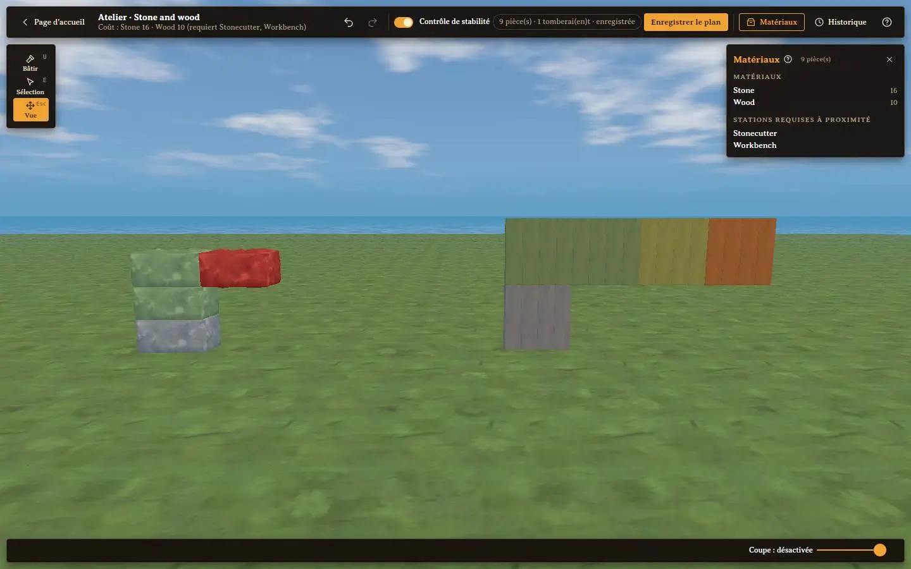
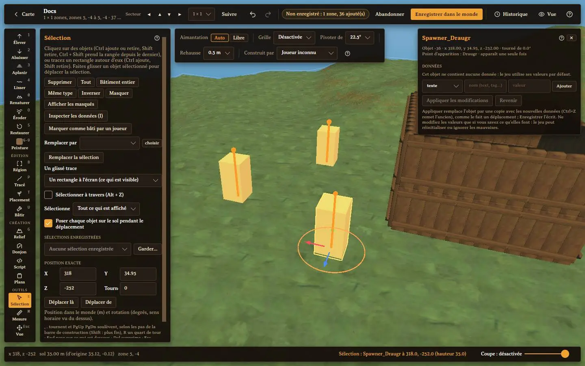
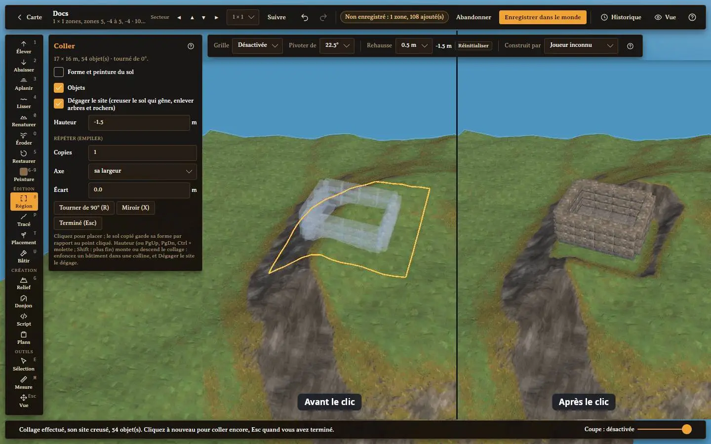

<!-- source: 551a19e3 -->
# Objets

Tout ce qui, dans un monde Valheim, n'est pas du sol est un **objet** : un arbre, un rocher, un mur, un coffre, une
créature, un point d'apparition invisible. Cette page explique ce que le jeu garde de chacun, à qui il attribue sa
construction, comment les pièces de construction s'aimantent et tiennent, les règles selon lesquelles les plantes
poussent, et ce que font les points d'apparition.

## Ce qu'est un objet

Dans la sauvegarde, chaque objet est un court enregistrement :

| Partie | Exemple |
|---|---|
| Son **type**, le nom que le jeu lui donne (son *prefab*) | `Beech1`, `rock4_forest`, `piece_chest_wood`, `Spawner_Boar` |
| Sa **position**, sa **rotation**, son inclinaison et sa taille | x 1250, z −380, hauteur 32,4 m, orienté à 90° |
| Ses **données** : les valeurs que le jeu garde pour lui | Le texte d'un panneau, le contenu d'un coffre, qui l'a construit, sa santé, quand il a été planté, l'étiquette d'un portail |

L'[Inspecteur](../select.md) montre tout cela. Les noms des valeurs viennent du code du jeu et du code de vos mods,
que l'éditeur lit dans leurs fichiers sans jamais l'exécuter. Ne modifiez une valeur que si vous savez ce qu'elle fait :
le jeu peut réinitialiser ou ignorer les valeurs qu'il n'attend pas.

**Les id changent ; le type et la position non.** Chaque objet a aussi un id, mais le jeu donne de nouveaux id aux
objets quand il sauvegarde, et l'éditeur écrit un objet déplacé comme une copie à sa nouvelle position. Donc, chaque fois
que l'éditeur doit retrouver un objet plus tard, il cherche le même type à la même position : une sélection enregistrée
(à 5 cm près à l'horizontale et 20 cm en hauteur), vos modifications reportées sur une sauvegarde plus récente, une
restauration depuis une sauvegarde, une annulation après une application en direct. Un objet déplacé ou disparu entre-temps
compte comme manquant.

**Les nouveaux objets partent de zéro.** Un objet placé est une copie vierge d'un objet de son type présent dans le
monde, sans rien d'unique (ni contenu, ni santé), ou un nouvel objet tel que le jeu le crée. Un objet remplacé est
neuf lui aussi : un coffre remplacé par un autre type de coffre est vide. Une copie collée ou un plan, en revanche,
garde tout ce que ses objets contenaient : le contenu du coffre, le texte du panneau. Les types que le monde ne peut
pas créer (ceux d'un mod qui n'est pas installé) sont laissés de côté, et l'éditeur dit lesquels.

**Le contenu que vous définissez reste le vôtre.** Un coffre que le jeu n'a jamais ouvert se remplit du butin du jeu la
première fois qu'il se charge. Quand vous modifiez le contenu d'un coffre, l'éditeur le marque comme propre au coffre,
et le jeu le laisse tel quel. Un objet posé sur un présentoir est enregistré en entier, neuf et à pleine durabilité
pour sa qualité.

**Tout ce que vous voyez n'est pas un objet.** Les parties des lieux du jeu (les rochers de l'entrée d'une crypte, le
camp du marchand, l'autel d'un boss) sont recréées à partir du lieu chaque fois que la zone se charge : on ne peut donc
ni les choisir ni les modifier (voir [Les lieux aplanissent le sol](ground-limits.md#les-lieux-aplanissent-le-sol)). Il
en va de même pour une pierre runique : vous pouvez la supprimer, ce qui retire son lieu pour de bon, mais pas la
déplacer, la copier ni l'inspecter.

**Certains mods cachent des objets loin sous terre**, comme des stations d'artisanat 10 km sous une maison. Les cadres,
les contours, **Tout** et **Bâtiment entier** laissent de côté ce qui se trouve à plus de 10 m sous le sol : ces objets
ne sont donc pas pris avec ce qui se dresse au-dessus.

### Groupes liés : navires et véhicules

Certains mods construisent une seule chose à partir de nombreux objets : le vaisseau d'un mod de navires est un objet
racine sur lequel des pièces sont construites. Chaque pièce est enregistrée avec l'id de ce à quoi elle est accrochée
et son décalage par rapport à lui, et le mod la remet en place quand le groupe se charge. Un mod en informe l'éditeur
dans un fichier `worldeditor.json` qu'il fournit ; l'éditeur ne connaît aucun mod par lui-même. L'éditeur dessine alors
le groupe tel que le mod le construit, et le déplace, le copie et le supprime en entier, jamais une partie seule.
Chaque collage donne de nouveaux id au groupe, car deux groupes partageant leurs id partageraient leurs parties en jeu.

### Les créatures se tiennent sur les pièces

Une créature dont la position se trouve dans une pièce de construction (le boss d'un donjon, un sanglier apprivoisé
dans un enclos) est posée sur la plus haute pièce située sous elle chaque fois que l'éditeur positionne des objets :
ouverture ou ajout d'un plan, déplacement, collage, script, outils de Claude. Le sol n'est pas une pièce : une
créature posée dessus reste là où elle est placée.

## Pièces bâties par un joueur

Tout ce qu'un joueur peut placer avec le marteau, la houe, le cultivateur ou le plateau de service est **bâti par un
joueur** dans le jeu : la pièce enregistre **qui l'a construite**, sous la forme d'un id de joueur. Cela compte plus
qu'il n'y paraît. Sans constructeur, le jeu prend une pièce pour une partie de ruine :

| | Bâtie par un joueur | Sans constructeur (une ruine) |
|---|---|---|
| La démonter | Rend tous ses matériaux | En rend un tiers |
| Un feu à côté | Forme une base : les monstres n'y apparaissent pas | Ne forme pas de base |
| Les raids | La ciblent | L'ignorent |
| Une protection ou un coffre privé | Obéit à son constructeur | N'obéit à personne |

L'éditeur écrit donc un constructeur sur chaque pièce qu'il place, colle ou construit : le joueur choisi dans
**Construit par** sur [la barre de construction](../build.md#la-barre-de-construction). Cette liste propose les joueurs qui ont
construit dans ce monde (avec leur nombre de pièces), les joueurs nommés sur des lits, des protections et des tombes,
et les personnages de cet ordinateur. Elle commence par le joueur qui a le plus de pièces, sinon par votre propre
personnage. **Personne (pas bâti par un joueur)** place volontairement les pièces comme des parties de ruine. Si aucun
joueur n'est connu, les pièces reçoivent **Joueur inconnu** : elles comptent comme bâties, mais les protections et les
coffres privés n'obéissent à personne ; choisissez donc votre propre id quand vous le pouvez.

Certaines choses gardent ou abandonnent volontairement le constructeur :

- Déplacer ou modifier un objet garde son constructeur.
- Un plan ne garde aucun constructeur : celui qui le construit en jeu en devient le constructeur. Un plan enregistré à
  partir d'une ruine se souvient que c'est une ruine.
- Un donjon généré n'a pas de constructeur, comme ceux du jeu : les raids l'ignorent et il rend un tiers de ses
  matériaux.
- **Marquer comme bâti par un joueur** (l'outil [Sélection](../select.md)) donne un constructeur aux pièces qui n'en ont
  pas : une ruine que vous voulez réparer et garder, ou des pièces placées par d'anciennes versions de l'éditeur.

Une ruine sur laquelle vous avez construit (une tour de pierre rapiécée avec du bois) compte comme votre construction :
ses pièces qui touchent les vôtres, et celles qui touchent celles-là, apparaissent avec vos constructions dans Vue et
sur la carte.

## Aimantation

Les pièces de construction s'assemblent comme le marteau du jeu les assemble. Chaque pièce a des **points
d'aimantation**, à ses coins et à ses extrémités, que l'éditeur lit dans votre Valheim avec la forme réelle de chaque
pièce (ses colliders) et ses règles de placement. Quand deux points d'aimantation se rapprochent, la pièce se déplace
pour qu'ils se rejoignent exactement : les murs se placent bout à bout, les sols se touchent bord à bord, un mur se
pose sur un sol.

**Comment le marteau place une pièce**, ce que [Bâtir](../build.md) suit pas à pas dans un monde, dans l'Atelier et
dans un donjon (son aimantation **Auto**) :

1. La ligne du curseur rencontre la chose la plus proche : le sol, ou la forme réelle d'une pièce (pas sa boîte).
2. La pièce, tournée comme vous l'avez réglée, est déplacée pour que le point de sa forme le plus proche de l'impact le
   touche. Les tapis et autres pièces au sol, ainsi que les pièces que le jeu laisse s'enfoncer dans les choses, se
   placent plutôt par leur milieu.
3. Parmi tous les points d'aimantation de la pièce et des pièces situées à moins de 10 m, la paire la plus proche à
   moins d'un demi-mètre se rejoint. Visez le haut d'un mur pour poser le suivant dessus, près de son extrémité pour en
   poser un à côté.
4. Une aimantation qui placerait la pièce exactement là où la même pièce se trouve déjà est ignorée.

Une rehausse (`PgUp`, `PgDn` ou `Ctrl` + molette) s'ajoute avant l'aimantation : une pièce rehaussée s'aimante donc aux points proches de sa nouvelle hauteur. Une grille n'arrondit
que les points sur le sol : une pièce pointée vers une autre pièce s'aimante comme d'habitude.

La barre de construction offre deux autres façons de faire. **Manuel** limite l'étape 3 à un seul point d'aimantation
de la pièce, celui que choisissent `Q` et `E` (marqué sur la pièce), et lui permet d'atteindre 1,5 m : dans un coin
encombré, où la paire la plus proche est le mauvais bord, choisissez le point qui doit se rejoindre. **Libre**, ou
maintenir `Alt` dans n'importe quel mode, saute l'étape 3 : la pièce reste là où elle touche, et avec `Alt` sa
position à l'horizontale est arrondie au quart de mètre à partir du milieu du secteur.

Les autres outils s'aimantent aux mêmes points d'aimantation, chacun à sa façon :

| Où | Comment il s'aimante |
|---|---|
| [Placement](../place.md), **Aimanter aux pièces déjà présentes** (parties de ruines : les pièces que bâtissent les joueurs se posent avec Bâtir) | Une pièce à la fois sous le curseur. **À côté** : bout à bout avec la pièce voisine du curseur, à son niveau, là où une paire de points d'aimantation se rejoint à moins de 1 m. **Dessus** : sa base sur le haut de la pièce sous le curseur. Une pièce aimantée prend l'orientation de la pièce qu'elle rejoint. |
| [Bâtir](../build.md), **Pose** sur Ligne, Cercle ou Rectangle (et la Ligne **Bout à bout** de [Placement](../place.md), pour les parties de ruines) | Chaque pièce commence là où la précédente se termine. Les deux extrémités d'une pièce sont les milieux de ses deux petits côtés, trouvés à partir de ses points d'aimantation (les types sans points d'aimantation utilisent la boîte de leur modèle). Une ligne qui commence à moins de 1 m d'une pièce la prolonge. |
| [Sélection](../select.md), avec l'**Aimantation** de la barre de construction sur **Auto** | Pendant le déplacement, la paire de points d'aimantation la plus proche (l'un d'une pièce déplacée, l'autre d'une pièce voisine) à moins de 0,75 m se verrouille, et toute la sélection se décale pour qu'ils se rejoignent. |
| [Script](../scripting.md), `snap: true` | Une pièce placée rejoint les points d'aimantation des pièces présentes à moins de 0,5 m. |

Les positions saisies (la **POSITION EXACTE** de l'outil Sélection) ne s'aimantent jamais : elles sont exactes.

## Le contrôle de stabilité

En jeu, chaque pièce de construction a besoin de **stabilité**, qui monte depuis le sol à travers les pièces qui se
touchent. Une pièce qui en a trop peu se brise et tombe dès qu'un joueur s'approche. Le **Contrôle de stabilité** de
l'Atelier la calcule comme le fait le jeu, à partir de données qu'il lit dans votre Valheim (la forme, le matériau et
le centre de masse de chaque pièce), et colore chaque pièce aux couleurs du mode construction du jeu :

| Couleur | Signification |
|---|---|
| Bleu clair | Stabilité totale : elle repose sur le sol. |
| Vert | Solide : la moitié de la stabilité maximale de son matériau, ou plus. |
| Jaune, orange | Plus faible. |
| Rouge | Sur le point de se briser, ou en train de se briser : en jeu, elle tombe dès qu'un joueur s'approche. |

**Comment la stabilité est calculée.**

- Une pièce dont la forme, agrandie de 0,15 m de chaque côté, atteint le sol a une stabilité totale.
- Toute autre pièce prend la meilleure stabilité des pièces qu'elle touche, moins une perte selon la distance entre
  leurs centres de masse : le taux « vers le haut » quand elle est tenue par-dessous, le taux « latéral » quand elle
  est tenue par le côté, un mélange entre les deux. Tenue par deux côtés à au moins 100° l'un de l'autre (vus d'en
  haut), elle reçoit la moyenne des deux quand c'est mieux.
- Le calcul est répété jusqu'à ce que plus rien ne change. Les pièces sous le minimum de leur matériau se brisent ;
  puis tout est recalculé sans elles, si bien qu'un effondrement se propage comme en jeu.

| Matériau | Maximum | Minimum | Perte par mètre latéral | Perte par mètre vers le haut |
|---|---|---|---|---|
| Bois | 100 | 10 | 20 % | 12,5 % |
| Bois de cœur | 140 | 10 | 17 % | 10 % |
| Bois de charpente | 200 | 10 | 20 % | 8 % |
| Pierre | 1 000 | 100 | 100 % | 12,5 % |
| Glace | 1 000 | 100 | 33 % | 12,5 % |
| Fer | 1 500 | 20 | 8 % | 8 % |
| Marbre noir | 1 500 | 100 | 50 % | 12,5 % |
| Grausten | 2 000 | 100 | 33 % | 10 % |
| Ancien | 5 000 | 100 | 25 % | 7 % |


*À gauche, trois murs de pierre empilés : bleu clair sur le sol, vert au-dessus, et le mur qui avance de 2 m depuis le
sommet en rouge, le « 1 tomberait » dans la barre du haut. À droite, des murs de bois en saillie sur 6 m depuis un
poteau : vert, puis jaune, puis orange.*

Voilà pourquoi la pierre monte haut mais ne peut pas avancer en porte-à-faux (un mètre à l'horizontale lui retire
toute sa stabilité), et pourquoi le bois avance plus loin que la pierre mais ne monte pas aussi haut.

**Exceptions, comme en jeu.** Certaines pièces ne sont jamais contrôlées : les dalles de sol en marbre noir, les
pierres de protection, les navires et les chariots. Elles tiennent où qu'elles soient, et une dalle donne la stabilité
totale de son matériau à ce qui repose dessus ; c'est ainsi qu'un donjon fait de pièces de construction tient à 5 000 m
de haut (voir [Pourquoi il tient à 5 000 m de haut](dungeons.md#pourquoi-il-tient-à-5000-m)). Les parties qui bougent
d'elles-mêmes (le battant d'une porte, la coque d'un navire) ne comptent pour rien : rien ne repose dessus. Dans un
donjon du jeu, les sols et les murs des salles comptent comme du sol : les pièces qui reposent dessus tiennent.

**Ce que le contrôle laisse de côté** : les rochers et les arbres (le jeu les compte comme une stabilité totale ; la
parcelle de l'Atelier n'en a pas), la forme exacte des colliders courbes (leur boîte compte), et les pièces auxquelles
le jeu ne donne aucune stabilité (elles ne sont pas colorées). Pour un plan construit sur un sol inégal, le contrôle
considère que le sol se trouve là où la construction le rencontrait : aux points de contact avec le terrain que
Homestead a enregistrés, sinon sous la pièce la plus basse de chaque endroit.

## Règles de croissance

Les pousses, les cultures et les plantes sauvages suivent les règles du jeu, et les outils [Placement](../place.md) et
Faire repousser de l'éditeur les suivent aussi : ce que vous plantez pousse donc en jeu.

**De la place pour grandir.** Une pousse ou une culture ne grandit que si rien ne se trouve dans son **rayon de
croissance**, lu dans votre jeu : 0,5 m pour la plupart des cultures, 2 à 3 m pour les pousses d'arbres. Avec
**Laisser aux pousses et aux cultures la place de grandir** activé (par défaut) :

- les pousses et les cultures gardent au moins leur rayon de croissance par rapport à tout, y compris entre elles ;
- les cultures mûres (`Pickable_Carrot`) et les arbres qui poussent à partir de pousses (`Beech1`, `Oak1`) gardent la
  place dont leur pousse a besoin, comme un vrai champ ou un vrai verger ;
- les buissons ne poussent à partir de rien en jeu : seul l'**Espacement** s'applique donc à eux.

Désactivé, vous pouvez planter aussi serré que vous voulez, mais ces plantes risquent de ne jamais pousser.

**Les cultures ont besoin d'un sol cultivé.** Le jeu ne laisse pousser les cultures que sur une terre cultivée :
peignez-la donc d'abord (**Cultiver** du pinceau Peinture ou la Peinture de l'outil Région). Le panneau Placement
vous avertit quand une culture cochée en a besoin.

**Eau.** Un objet placé sur le sol est laissé de côté là où le sol est à plus de 0,3 m sous l'eau, sauf le varech et
les algues.

**Regroupement.** Les vrais bois poussent en bosquets séparés par des clairières. **Groupement** pose un motif de
bruit sur le monde, dont les taches mesurent **Massifs** de large : là où le motif est bas, les
emplacements sont éclaircis, et plus le Regroupement est élevé, plus une grande partie du sol est dégagée. Le motif est
fixé au monde, pas au pinceau : des coups de pinceau côte à côte se raccordent donc.

### Comment Faire repousser décide de ce qui pousse

**Faire repousser la nature** de l'outil Région remet ce que le jeu lui-même ferait pousser, en calculant chaque zone
comme le jeu le fait quand il la crée pour la première fois :

- **Les règles du jeu.** Il lit les règles de végétation du jeu dans votre Valheim et utilise les mêmes nombres
  aléatoires, initialisés par la graine du monde, la zone et le type. Sur un sol encore tel que généré, vous retrouvez
  les mêmes arbres aux mêmes endroits que le monde avait au départ.
- **Les conditions du jeu** : le biome (et si un type pousse à sa lisière ou en son milieu), la hauteur au-dessus de
  l'eau, la pente, le facteur de forêt (bosquets et clairières), la rugosité du sol autour de l'emplacement, la
  distance au centre du monde, le nombre de groupes par zone et le nombre d'objets par groupe.
- **Le sol tel qu'il est maintenant.** Une colline que vous avez élevée reçoit ce qui pousse à sa nouvelle hauteur et
  avec sa nouvelle pente ; une plateforme que vous avez aplanie reçoit ce qui pousse sur un sol plat.
- **Pas par-dessus les choses.** Un emplacement est ignoré quand quelque chose se trouve à moins de 1 m, un objet du
  même type à moins de 3 m (un arbre encore debout n'est pas doublé), ou une pièce de construction à moins de 4 m.
- **Les biomes alternatifs** (Dark Meadows, Rock Black Forest…) sont là où le jeu les place, d'après la graine, avec
  ce qu'ils ajoutent et sans ce qu'ils excluent.
- **Les lieux** gardent leur sol dégagé, comme quand le jeu crée une zone pour la première fois.

Ce qu'il ne peut pas savoir : les contrôles physiques du jeu contre les objets déjà debout. Il travaille sur 16 zones
au plus à la fois. **Y faire pousser les arbres et rochers du biome** de l'outil Relief, pour ses montagnes, applique
les mêmes règles sur les pentes qu'il a élevées.

## Points d'apparition

Le jeu place des créatures dans ses camps, ses villages et ses donjons grâce à des **points d'apparition** : des
objets invisibles (`Spawner_Boar`, `Spawner_Draugr`…), qui font chacun apparaître leur créature là où ils se trouvent.
Quelle créature, combien d'étoiles et si elle revient : tout cela dépend du type du point d'apparition. Pour obtenir
une autre créature, placez donc un autre type.

| Comment il fait apparaître | Lesquels |
|---|---|
| **Apparaît une seule fois** : la première fois qu'un joueur s'approche, plus jamais une fois la créature morte | La plupart des points d'apparition du jeu. |
| **Revient N min après sa mort** | Ceux en `*_respawn_*`, `Spawner_Location_*`, `Spawner_imp_respawn`, `Spawner_Fish4` ; souvent 60 min. |
| **De nuit seulement** ou **de jour seulement** | Quelques-uns qui attendent. |
| **Quand un événement le réveille** | Ceux en `TriggerSpawner_`. |

Les **Nids de créatures** sont le type visible : nids de Greydwarfs, tas d'os et autres. Ils font apparaître des
créatures autour d'eux jusqu'à leur destruction (« Greydwarf, Greydwarf_Elite · jusqu'à 3 autour, dans un rayon de
5 m »).


*Des points d'apparition près d'une cabane : une simple boîte pour chacun, avec un marqueur orange au-dessus. Le point
d'apparition de draugr sélectionné est ouvert dans l'Inspecteur, dont la ligne dit ce qu'il fait apparaître.*

L'outil Placement et l'Inspecteur affichent cette ligne pour chaque type, lue dans votre jeu (`Spawn point: Boar · 0–2 ★ · spawns
once`). En 3D, chaque point d'apparition et chaque nid apparaît comme une simple boîte surmontée d'un marqueur, visible à travers tout ce qui se trouve devant : orange
pour un point d'apparition (rouge quand sa créature revient), violet pour un nid. Les deux sont masqués au départ, car ils révèlent où se trouvent les choses ; activez-les
dans le panneau Vue.

## Comment un collage dégage son site

Une copie (depuis l'outil Région ou un plan) contient :

- **Les objets**, avec tout ce qu'ils contiennent : un coffre collé est plein comme l'original.
- **Le sol sous les constructions seulement** : sous chaque pièce de construction (selon sa forme réelle) et sur 1 m
  autour, en se fondant dans le sol d'arrivée sur 3 mètres de plus. Le reste du sol de la sélection reste en place :
  une ville collée s'installe ainsi dans le terrain où elle arrive, au lieu d'emporter avec elle un carré de sol
  étranger. Les plans ne contiennent pas de sol.
- **Les hauteurs** : les pièces de construction gardent la forme du bâtiment, mesurée depuis la hauteur moyenne du sol
  de la copie, qui se place à la hauteur du sol là où vous cliquez. Les arbres, rochers et autres gardent leur hauteur
  au-dessus du sol : chacun se pose donc sur le sol là où il arrive.

La copie de l'outil Sélection est placée de la même façon.


*Avant le clic (à gauche), le contour du collage entaille le monticule ; après (à droite), le sol qui gêne la cabane
est creusé jusqu'à son plancher, dans la même étape d'annulation.*

Avec **Dégager le site** activé, chaque collage se fait aussi de la place, dans la même étape d'annulation :

- Là où se dresse une pièce de construction collée (selon sa forme réelle, et sur 1 m autour), le sol qui gêne est
  **creusé** jusqu'à la base de la pièce la plus basse, au-delà de ±8 m si besoin. Un bâtiment collé dans une colline
  n'y est pas enterré. Un sol plus bas n'est jamais élevé.
- Là où le sol copié est entièrement arrivé, rien n'est creusé : le bâtiment repose dessus comme il reposait sur
  l'original.
- Les pièces situées à plus de 100 m sous le sol sont ignorées (certains mods y gardent des stations d'artisanat), et
  rien n'est creusé sous un groupe lié comme un navire.
- **Les arbres, rochers, minerais, buissons et ramassables** de cette emprise sont enlevés. Les constructions, les
  créatures et les animaux apprivoisés restent.

Les objets collés sont de nouveaux objets créés à partir de la copie : un collage fonctionne donc aussi dans un autre
monde. En direct, un **Couper** puis collé déplace les objets dans le jeu sous leurs propres id quand c'est possible
(voir
[Déplacer un objet le garde identique](live-editing.md#déplacer-un-objet-le-garde-comme-le-même-objet)).

## Fichiers de plan

Un plan est une construction gardée dans un fichier, au format de
[Homestead](https://thunderstore.io/c/valheim/p/sighsorry/Homestead/), le mod de construction en jeu : le même fichier
apparaît dans l'onglet du marteau de Homestead, prêt à construire en jeu, et se colle dans n'importe quel monde depuis
l'éditeur. Partager une construction, c'est partager son fichier `.blueprint` et l'image `.png` qui l'accompagne.

**Ce qu'il garde.** Les pièces de construction seulement : les arbres, les rochers et les objets laissés au sol ne
sont pas gardés, pas plus que le sol. Chaque pièce est une ligne avec son type, sa position en mètres depuis
l'**ancre** (le milieu de la construction au niveau du sol), sa rotation et sa taille, les pièces les plus basses en
premier :

```text
#Name:Small hut
#Creator:Valheim World Editor
#Description:A hut with a fire pit
#Tags:house, wood
#Pieces
woodwall;Building;-3;1;-2;0;0;0;1;"";1;1;1
```

L'éditeur ajoute ses propres lignes, que Homestead et PlanBuild ignorent, pour que le même fichier se construise
toujours en jeu : les étiquettes, ce que contiennent les objets (le contenu d'un coffre, le texte d'un panneau, les
étoiles d'un boss), si la construction est une ruine, et quelles pièces seul l'éditeur peut placer (statues, navires,
créatures : le marteau de Homestead les ignore, et le coût affiché les exclut). Aucun constructeur n'est jamais écrit :
celui qui la construit en jeu en devient le constructeur.

**Ce qui revient.** Collés depuis l'éditeur, les objets d'un plan reviennent avec ce qu'ils contenaient. Construit en
jeu avec Homestead, il ne reste que les pièces : le jeu crée des coffres vides et ne place aucune créature.

**Sa hauteur.** Ouvert dans l'Atelier, un plan est déplacé d'un bloc pour que la base de sa pièce de construction la
plus basse soit sur la parcelle (les rochers et autres choses que place la houe ne comptent pas). L'éditeur retient
cette rehausse et la retire à l'enregistrement : l'ancre garde ainsi sa hauteur et la construction se dresse comme
avant quand Homestead la construit.

**Autres fichiers.** L'éditeur lit aussi les fichiers `.blueprint` de PlanBuild et les fichiers `.vbuild` (BuildShare
et outils plus anciens, une pièce par ligne), et peut écrire des `.vbuild`. Ils mesurent depuis un coin : ils sont donc
centrés sur la parcelle. Leurs marques de sol ne sont pas gardées, les pièces de mods que vous n'avez pas sont laissées
de côté, et le message dit combien.
