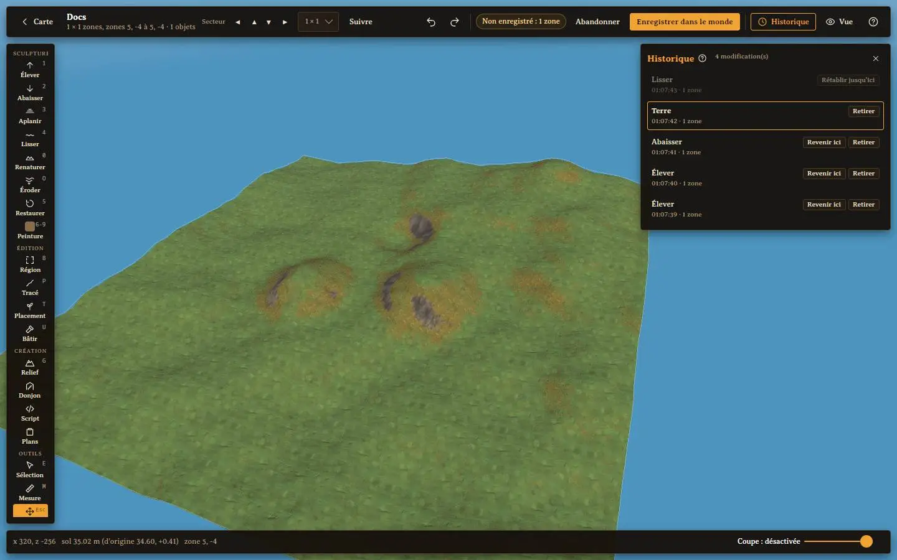

<!-- source: 752963cc -->
# Enregistrement et historique

Rien de ce que vous faites dans l'éditeur ne touche le monde tant que vous ne le décidez pas. Vos modifications
attendent comme modifications **en attente**, puis vont dans les fichiers du monde quand vous faites
**Enregistrer dans le monde**, ou dans le jeu en cours quand vous faites **Appliquer en direct**. L'**Historique**
garde chaque étape, même après la fermeture de l'éditeur, pour que vous puissiez revenir sur une modification plus
tard.

```text
  votre modification ──► en attente ──► Enregistrer dans le monde ──► nouvelle sauvegarde dans le dossier du monde   (hors ligne)
                             │
                             └────────► Appliquer en direct ────────► le jeu en cours, qui la sauvegarde             (en direct)
```

## Modifications en attente

Chaque coup de pinceau, clic, collage ou exécution de script est une **étape**, et elle reste en attente jusqu'à ce
qu'elle soit enregistrée ou appliquée. La barre du haut compte ce qui est en attente, en ambre (« Non enregistré :
3 zones, 1 supprimé(s), 12 ajouté(s), 1 réinitialisée(s) », ou « Non appliqué : … » en direct), et indique « Tout est
enregistré » ou « Tout est appliqué » en gris quand rien n'attend :

| Compte | Ce que c'est |
|---|---|
| **zones** | Les zones dont le sol (hauteur ou peinture) diffère vraiment de la sauvegarde. Élever puis redescendre à la même hauteur ne compte rien. |
| **supprimé(s)** | Les objets du monde qui seront retirés. |
| **ajouté(s)** | Les nouveaux objets : placés, collés, copiés ou créés par un outil. |
| **réinitialisée(s)** | Les zones marquées pour être refaites par le jeu (voir [Réinitialiser des zones](areas-and-zones.md#réinitialiser-des-zones)). |

Une fois que vous avez enregistré, les comptes sont ce qui diffère de cet enregistrement, donc annuler une étape
enregistrée la remet en attente. Dans la vue 3D, chaque nouvel objet pas encore enregistré porte un point vert
(**Vue → Marques non enregistrées** les masque).

**Les modifications en attente appartiennent au monde.** Elles restent quand vous déplacez le secteur, revenez à la
carte ou ouvrez un autre endroit, et sont toutes enregistrées ensemble (voir [Le secteur](areas-and-zones.md#le-secteur)).
Elles ne sont perdues que si vous quittez sans enregistrer (l'éditeur demande d'abord), si vous les jetez, ou si vous
faites **Recharger** sur un monde en direct (il demande d'abord aussi).

**Abandonner** jette ce qui n'est pas enregistré ou appliqué : il annule les étapes non enregistrées à la fin de
l'historique, de la plus récente à la plus ancienne, rétablit les étapes enregistrées ou appliquées que vous avez
annulées depuis, et vide le reste de la liste à rétablir. Les étapes enregistrées et appliquées restent.

Certaines modifications en attente n'ont aucune étape dans l'historique du secteur ouvert (faites dans un autre
secteur, ou avant que le monde soit relu). Elles ne peuvent partir qu'en relisant tout le monde depuis ses fichiers ou
depuis le jeu, ce qui abandonne toutes les modifications en attente, donc Abandonner demande une seconde fois avant de
le faire.

Une fois relu, l'historique reste tel que le monde l'a : depuis les fichiers, l'historique conservé au dernier
enregistrement ; en direct (**Abandonner** ou **Recharger**), chaque étape que le jeu a, appliquée et toujours
annulable, tandis que les étapes non appliquées partent avec leurs modifications.

## Enregistrer un monde

Le jeu garde un monde sous forme de dossier de **sauvegardes numérotées** : chaque sauvegarde est un ensemble de
fichiers (`_main.<n>.chunks`, `.db2`, `.fwl2`, et un petit marqueur `.ok`) plus des fichiers de morceaux qui
contiennent les objets et le sol. **Enregistrer dans le monde** fonctionne comme le jeu, donc un monde qu'il a
enregistré s'ouvre dans le jeu comme n'importe quel autre :

1. **Il écrit une nouvelle sauvegarde** avec le numéro suivant. Seuls les fichiers de morceaux qui ont changé sont
   réécrits ; les objets non touchés sont copiés octet par octet. Le marqueur `.ok` vient en dernier, parce que le jeu
   ne fait confiance qu'à une sauvegarde qui l'a, donc une sauvegarde interrompue n'est jamais prise pour une bonne.
   Chaque fichier garde le format de sauvegarde dans lequel il a été lu, donc les mondes de Valheim 1.0.20 et après
   comme ceux des versions plus anciennes s'enregistrent, et s'ouvrent dans le jeu qui les a créés.
2. **Il relit la nouvelle sauvegarde** et la compare à ce qu'il voulait écrire : le sol des zones modifiées, le sol de
   toutes les autres zones, le nombre d'objets, les zones réinitialisées. Si quoi que ce soit diffère ou échoue, les
   nouveaux fichiers sont retirés et le message se termine par « Rien n'a changé ». L'ancienne sauvegarde n'a pas été
   touchée à ce moment-là.
3. **Il fait le ménage.** La sauvegarde depuis laquelle vous avez ouvert le monde est gardée tant que le monde est
   ouvert, parce que chaque enregistrement est fait à partir d'elle. Une sauvegarde que vous avez faite plus tôt dans
   la même session est retirée quand vous enregistrez à nouveau. Quand vous quittez le monde, seule la sauvegarde la
   plus récente reste.
4. **Il écrit l'historique** avec le monde (voir [Historique](#historique)).

**Fermez d'abord le jeu.** Un jeu ou un serveur en cours garde le monde en mémoire et écrit par-dessus votre
enregistrement la prochaine fois qu'il sauvegarde. Pour modifier un monde pendant qu'il tourne, utilisez le
[mode direct](live-editing.md).

**Ce qui ne peut pas être enregistré** est listé avec la raison : les modifications dans une zone près de laquelle
aucun joueur n'est passé (le monde n'y a pas encore de données : voir [Zones](areas-and-zones.md#zones)), et un nouveau
sol dans un monde où personne n'a jamais creusé ni aplani en jeu (l'éditeur fait les modifications de sol en copiant
celle que le jeu a faite, donc creusez d'abord une fois n'importe où en jeu).

### Le jeu a sauvegardé depuis que vous l'avez ouvert

Si le jeu a sauvegardé le monde après que l'éditeur l'a lu (vous avez joué entre deux enregistrements), enregistrer
jetterait ce qui s'est passé en jeu, donc l'éditeur n'enregistre rien. Il propose à la place de
**Reporter mes modifications** sur la sauvegarde du jeu : il refait chacune de vos modifications en attente sur cette
sauvegarde, en retrouvant les objets par leur type et leur position, puisque leurs identifiants changent à chaque
sauvegarde (voir [Ce qu'est un objet](objects.md#ce-quest-un-objet)).

Là où le jeu a changé la même chose, il demande une fois par type, **Garder la mienne** ou **Garder celle du jeu** :

| Ce qui entre en conflit | Garder la mienne |
|---|---|
| Les zones dont vous avez tous deux modifié le sol | Vos points et votre peinture modifiés passent par-dessus ceux du jeu ; le sol du jeu reste partout ailleurs dans ces zones. |
| Les objets que le jeu a changés (un coffre utilisé, un panneau, une plante qui pousse) que vous avez supprimés, déplacés ou modifiés | Ils sont supprimés, déplacés ou modifiés comme vous l'avez fait. |
| Les objets que le jeu a retirés (pris, détruits, ou une créature ou un bateau qui s'est éloigné) que vous avez déplacés ou modifiés | Ils reviennent là où vous les avez mis. Un objet qui s'était seulement déplacé est alors là en double. |

Rien n'est encore écrit : le monde est maintenant la sauvegarde du jeu avec vos modifications en attente dessus.
Vérifiez-les, puis enregistrez. Les étapes de l'Historique qui touchaient quelque chose que vous avez laissé à la
version du jeu ne peuvent plus être annulées, pas plus que les étapes d'avant ; le message dit combien ont été
supprimées.

## Appliquer en direct

En [mode direct](live-editing.md), le même bouton est **Appliquer en direct**. Il envoie le sol, les objets et les
réinitialisations de zones en attente au jeu en cours, qui les partage avec chaque joueur présent et les sauvegarde
lui-même, comme tout ce que construisent les joueurs. Les étapes envoyées sont marquées **appliquée** dans
l'Historique ; avec **Auto** activé, chaque étape est appliquée dès que vous la terminez.

Les étapes appliquées peuvent encore être annulées : annulez (ou **Retirer** dans l'Historique), puis appliquez à
nouveau.

- Un objet **supprimé** revient sous forme de copie de ce qu'il était quand le monde a été lu, avec ses données (un
  coffre avec son contenu tel qu'il était). Pour le jeu, c'est un nouvel objet.
- Un objet **placé** est de nouveau retiré, même quand un autre mod l'a recréé sous un nouvel identifiant entre-temps :
  le plugin le retrouve par son type et sa position.
- Un objet **déplacé** revient à sa place.
- Une **réinitialisation de zone** ne peut pas être annulée une fois appliquée.

## Historique

**Historique** (`L`) liste chaque étape, de la plus récente à la plus ancienne : son nom (« Élever », « Coller ×3 »,
« Retiré : Placement »), son heure et ce qu'elle a touché. Des étiquettes indiquent qu'une étape est **appliquée**
(enregistrée ou envoyée au jeu), faite par **Claude**, ou d'une **session précédente**. Il garde chaque étape par
défaut, tant qu'elles occupent moins de 2 Go de mémoire (au-delà, les plus anciennes partent en premier) ;
**Paramètres → Historique → Étapes conservées** n'en garde que ce nombre à la place.


*La dernière étape a été annulée avec **Revenir ici** : elle est grisée et propose **Rétablir jusqu'ici**.*

Il y a deux façons de revenir en arrière :

| | Ce qu'elle fait | Exemple |
|---|---|---|
| **Revenir ici** | Annule chaque étape après celle-ci, comme `Ctrl+Z` plusieurs fois. Les étapes suivantes restent grisées, à rétablir. Une nouvelle modification les supprime. | Vous avez essayé trois choses et voulez le monde tel qu'il était avant. |
| **Retirer** | Retire seulement cette étape et garde tout ce qui a été fait après : son changement de hauteur quitte les points qu'elle a touchés, sa peinture part là où rien n'a été repeint depuis, ses objets partent et ceux qu'elle a supprimés reviennent, ses réinitialisations sont annulées. Le retrait est une nouvelle étape, donc `Ctrl+Z` la ramène. | Retirer une rangée d'arbres plantée il y a une heure sans perdre le travail du sol fait depuis. |

**Annuler les modifications de Claude** fait un **Retirer** pour chaque étape que Claude a faite dans l'historique du
secteur ouvert, et garde les vôtres. Les étapes de Claude faites dans d'autres secteurs sont mises de côté (voir plus
bas) : ouvrez ces secteurs pour les annuler aussi.

### L'historique appartient au monde

L'historique suit quand vous déplacez ou redimensionnez le secteur, quand Suivre l'agrandit, et en passant par la
carte. Une étape faite entièrement dans un autre secteur est mise de côté tant que celui-ci est ouvert (« N étape(s)
faites dans d'autres secteurs sont conservées ») ; elle revient, prête à être annulée, quand vous ouvrez un secteur qui
la contient. Une étape seulement en partie dans le secteur ouvert ne peut pas être annulée d'ici, pas plus que les
étapes d'avant. Enregistrer ou appliquer depuis n'importe quel secteur marque les étapes de tous les secteurs comme
enregistrées.

### Conservé après la fermeture de l'éditeur

Après chaque **Enregistrer dans le monde** ou **Appliquer en direct**, l'historique est écrit dans le dossier de
données de l'éditeur (`history/`, un fichier par dossier de monde ; en direct, un par connexion et par monde). Rouvrez
le monde, même des jours plus tard, et les étapes sont de retour, marquées **session précédente**. Annuler remet le
sol, un objet supprimé avec son contenu, et retire un objet placé. Les modifications que vous n'avez ni enregistrées ni
appliquées ne sont pas conservées.

Le monde a pu changer depuis (des joueurs ont construit et creusé, ou le jeu l'a sauvegardé à nouveau), donc l'éditeur
demande une fois avant que la première étape d'une session précédente soit annulée ou rétablie : le faire remet les
choses telles qu'elles étaient, par-dessus ce qui a changé depuis. Pour un monde que seul l'éditeur a enregistré depuis,
il ne demande rien.

### Ce qu'une étape ne peut pas reprendre

L'historique est conservé à travers chaque enregistrement et chaque application, réinitialisations de zones et sol
[Sans limite](ground-limits.md#sans-limite) transformé en disques de sol compris. Quelques choses sont hors de sa portée :

- **Une réinitialisation de zone, une fois enregistrée ou appliquée.** Le jeu refait la zone : ce que les étapes y ont
  fait en est retiré (une étape qui y était entièrement disparaît), de même que l'étape qui a marqué la
  réinitialisation. Les étapes ailleurs restent.
- **Les arbres et rochers retirés sous un sol Sans limite**, une fois appliqués en direct ou une fois le monde rouvert :
  une annulation ne les ramène pas. Utilisez [Faire repousser la nature](../area.md#faire-repousser-la-nature).
- **Le sol que des joueurs ont modifié depuis.** À la réouverture, le sol Sans limite d'une zone enregistré en disques
  de sol revient avec l'historique, donc une annulation remet tout le sol qu'elle a modifié, autour des disques aussi.
  Là où des joueurs ont creusé dans cette zone depuis, la zone garde ce que le jeu a : une annulation ne remet que le
  propre sol de l'étape.

## Sauvegardes

L'éditeur ne fait aucun dossier de sauvegarde à lui : il ne touche jamais l'ancienne sauvegarde tant que la nouvelle
n'a pas été relue correctement, et la sauvegarde depuis laquelle vous avez ouvert le monde reste jusqu'à ce que vous
quittiez le monde. Cela vous protège d'un enregistrement qui tourne mal, pas d'une modification que vous regrettez
après être parti. Pour cela, gardez votre propre copie de tout monde auquel vous tenez (voir
[Sauvegarder un monde avant de le modifier](../guides/back-up-a-world.md)).

Le jeu garde ses propres sauvegardes à côté du dossier du monde (`<World>_backup_auto-<date>`), et les versions
précédentes de l'éditeur gardaient les leurs sous le nom `<World>_backup_terraineditor-<date>`.
**Revenir à une sauvegarde** de l'outil Région remet une sélection telle qu'elle était dans une telle copie, sans
ramener en arrière tout le monde (voir [Restaurer un secteur depuis une sauvegarde](../guides/restore-from-backup.md)).
Il fait correspondre les objets ainsi :

- Un objet présent maintenant dans la sélection et dans la sauvegarde, du même type, à la même position (à 1 cm près)
  et orienté de la même façon, est laissé tel quel.
- Tout autre objet des types choisis présent maintenant dans la sélection est retiré, même quand son type est masqué
  dans Vue.
- Tout objet de la sauvegarde sans correspondance revient, avec toutes ses données : un coffre avec son contenu, un
  panneau avec son texte.
- Les pierres runiques ne sont jamais touchées.

Le sol revient exactement comme dans la sauvegarde, sol Sans limite compris. Une copie d'un autre monde (une autre
graine) est refusée.
