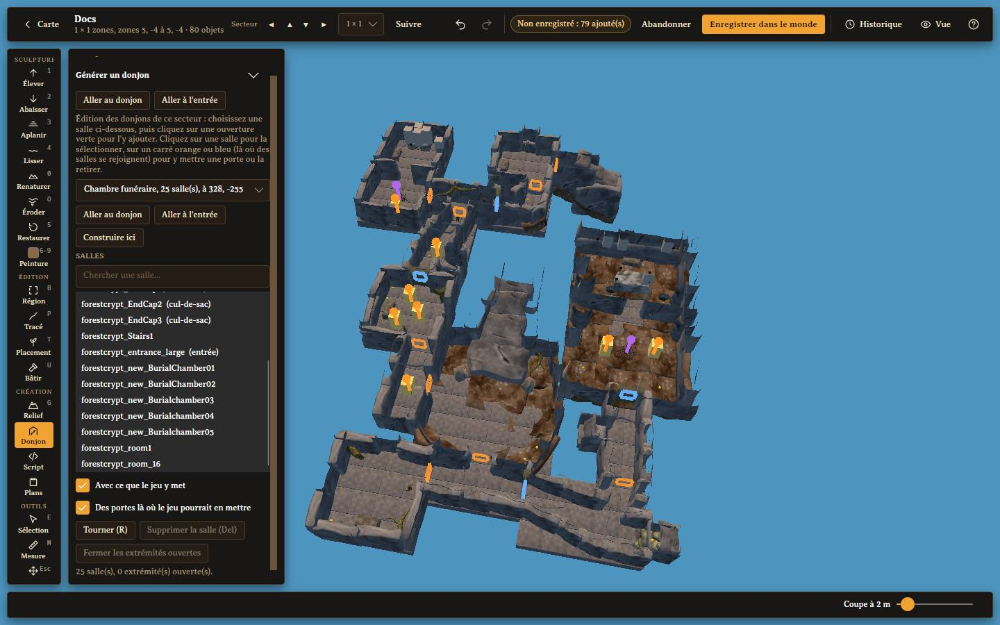
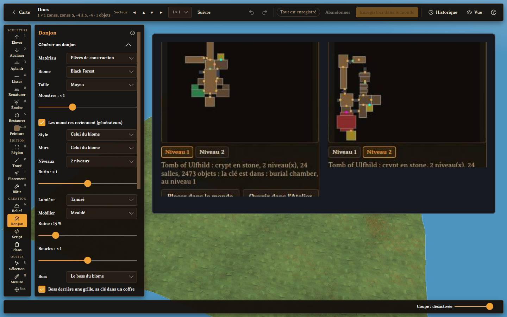
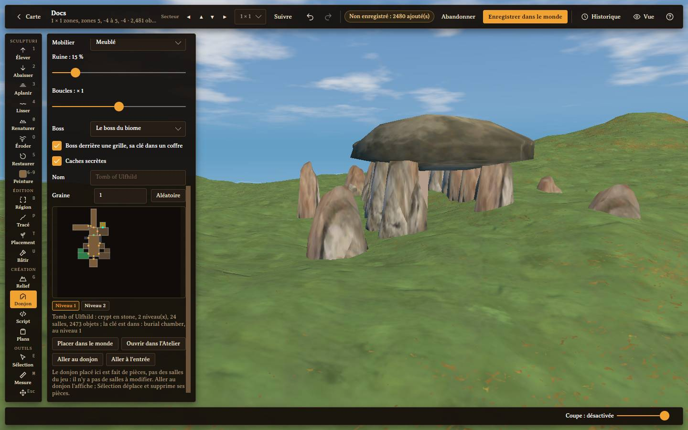
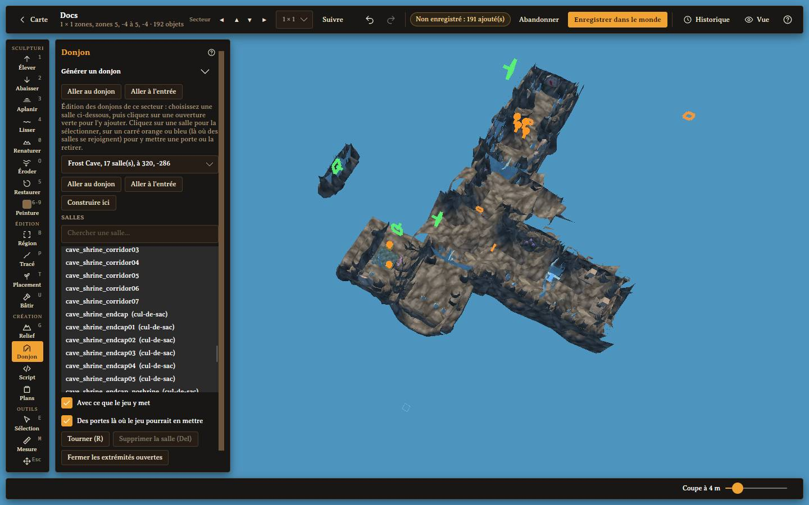
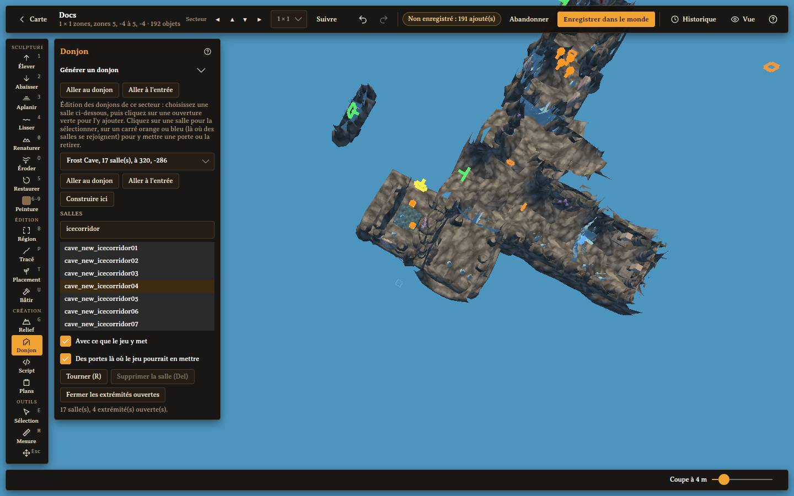
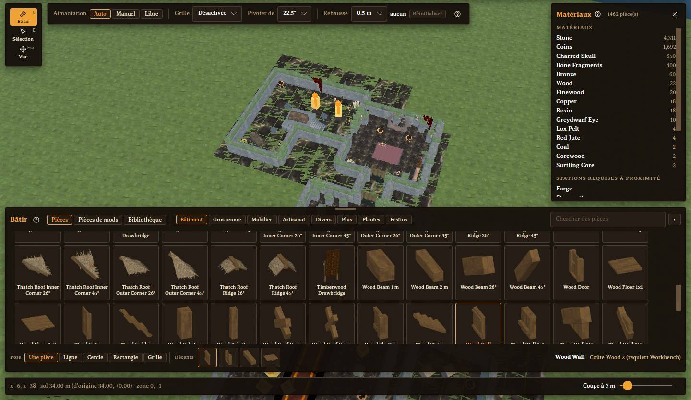

<!-- source: 16125394 -->
# Donjon

Générez des donjons entiers et placez-les dans votre monde derrière une entrée, modifiez salle par salle les donjons
du jeu, et construisez à l'intérieur.

**Où :** barre d'outils, section **CRÉATION** · **Touche :** aucune · **Fonctionne dans :** mondes enregistrés, en
direct ; le générateur aussi dans l'Atelier (**Bibliothèque** → **Générer un donjon…**)

*Un donjon fait des salles du jeu (Chambre funéraire, 25 salles), à 5 000 m d'altitude et coupé 2 m au-dessus du
plancher. Des carrés orange et bleus marquent les jonctions entre salles. **Supprimer la salle (Del)** reste grisé
tant qu'aucune salle n'est sélectionnée.*

Un donjon de Valheim est un lieu au sol (un tumulus, l'entrée d'une grotte) dont la porte mène à des salles gardées
5 000 m au-dessus. Voir [Comment le jeu garde les donjons](concepts/dungeons.md#comment-le-jeu-conserve-les-donjons).

## L'utiliser

Pour générer un donjon et le placer dans le monde :

1. Ouvrez un secteur d'un monde, puis cliquez sur **Donjon** dans la barre d'outils.
2. Sous **Générer un donjon**, choisissez le **Biome**, la **Taille** et les **Niveaux**. Le plan est redessiné un
   instant après chaque changement.
3. Facultatif : cliquez sur **Aléatoire** jusqu'à ce que le plan vous plaise ; vérifiez chaque niveau avec les boutons
   **Niveau 1**, **Niveau 2**... en dessous.
4. Tournez la vue face à l'endroit où l'entrée doit aller, centrée dessus.
5. Cliquez sur **Placer dans le monde**.
6. Cliquez sur **Aller au donjon** pour regarder à l'intérieur ; **Aller à l'entrée** ramène la vue en bas.
7. Cliquez sur **Enregistrer dans le monde** (ou **Appliquer en direct**).

Tout le placement est une seule étape d'annulation : `Ctrl+Z` le retire en entier. Les mêmes choix et la même graine
font toujours le même donjon de pièces de construction ; un donjon fait des [salles du jeu](#fait-des-salles-du-jeu)
dépend aussi de l'endroit où se trouve son entrée et de son orientation. Pour le pas-à-pas complet, voir
[Générer un donjon et le placer dans le monde](guides/make-a-dungeon.md).

***Générer un donjon** pour un donjon de la Forêt noire, Moyen, 2 niveaux, boss derrière une grille. À côté du
panneau, son plan dessiné en plus grand, un niveau chacun : la salle de la clé en vert au niveau 1, l'arène rouge avec
son point magenta de grille et la salle du trésor dorée au niveau 2, et le résumé en dessous.*

## Réglages

### Générer un donjon

**Générer un donjon** est en haut du panneau Donjon : ouvert quand le secteur n'a pas de donjon, replié quand il en a
un.

| Réglage | Ce qu'il fait |
|---|---|
| **Matériau** | **Pièces de construction** : des salles bâties comme un joueur les bâtirait, meublées selon ce qu'elles sont. **Les salles du jeu** : les salles de donjon du biome reliées comme le jeu les relie (voir [Fait des salles du jeu](#fait-des-salles-du-jeu)). Non affiché dans l'Atelier, qui ne prend que des pièces de construction. |
| **Biome** | **Meadows**, **Black Forest** (par défaut), **Swamp**, **Mountain**, **Plains**, **Mistlands**, **Ashlands**, **Deep North** (la liste les nomme en anglais). Règle les monstres, le butin, les lumières, l'entrée au sol, ainsi que le style et les murs sauf si vous les choisissez. |
| **Taille** | **Petit**, **Moyen** (par défaut), **Grand**, **Immense** : environ 5, 8, 12 ou 17 salles par niveau. |
| **Monstres : × 1** | **aucun** à 3 fois la normale, par pas de 0,25. |
| **Les monstres reviennent (générateurs)** | Activé : les générateurs du jeu, dont les monstres reviennent un moment après avoir été tués. Désactivé : les monstres eux-mêmes, placés une fois. Le boss est toujours placé une fois. |
| **Style** | **Celui du biome**, ou **Crypt**, **Catacombs**, **Temple**, **Fortress**, **Prison**, **Dvergr hold**, **Goblin warren**, **Ruins** : quelles salles il a et comment elles sont agencées. |
| **Murs** | **Celui du biome**, ou **Stone**, **Marble**, **Wood**, **Stave**, **Grausten**, **Dvergr**, **Goblin**. |
| **Niveaux** | **1 niveau** à **16 niveaux** (2 par défaut), reliés par des escaliers. Le boss attend au dernier. |
| **Butin : × 1** | Coffres et trésors : **aucun** à deux fois la normale. Les niveaux plus profonds en contiennent plus. Avec les salles du jeu, il garde ou double les coffres des salles. |
| **Lumière** | **Sombre**, **Tamisé** (par défaut) ou **Lumineux** : combien de torches et de braseros. |
| **Mobilier** | **Nu**, **Meublé** (par défaut) ou **Riche**. |
| **Ruine : 15 %** | À quel point il est en ruine, de 0 à 100 % par pas de 5 : gravats, piliers tombés, torches éteintes. Choisir un style règle sa propre valeur, de même que choisir un biome quand **Style** est sur **Celui du biome**. |
| **Boucles : × 1** | À quelle fréquence des salles éloignées le long du chemin sont reliées, pour qu'il y ait plus d'un chemin : **aucune (un arbre)** à deux fois la normale. |
| **Boss** | **Le boss du biome**, **Pas de boss**, ou le boss ou l'élite de n'importe quel biome par son nom (`Troll`, `Draugr_Elite`, `StoneGolem`...). |
| **Boss derrière une grille, sa clé dans un coffre** | La grille de l'arène s'ouvre avec la clé de crypte, dans un coffre loin de là (les joueurs qui ont la clé de l'Ancien l'ouvrent aussi). Désactivé : de grandes portes doubles, ouvertes à tous. |
| **Caches secrètes** | De petites salles au trésor derrière un mur fissuré à briser ou une tapisserie. |
| **Nom** | Écrit sur un panneau dans le hall d'entrée. Vide : un nom tiré de la graine, affiché en grisé (`Barrow of Sigrun`). |
| **Graine** et **Aléatoire** | Le nombre propre du donjon ; n'importe quel nombre entier fait un autre donjon avec les mêmes choix. |

Changer **Lumière** ou **Ruine** ne change rien d'autre au donjon. Avec **Les salles du jeu**, seuls **Biome**,
**Taille**, **Monstres**, **Butin** et la graine sont utilisés ; les autres lignes, et le plan, sont masqués. Ce que le
générateur met où se trouve dans
[Comment le générateur agence un donjon](concepts/dungeons.md#comment-le-générateur-dispose-un-donjon) et
[Ameublement, lumière et gardes](concepts/dungeons.md#ameublement-lumière-et-gardes).

Ce qu'apporte chaque biome quand rien d'autre n'est choisi :

| Biome | Style | Murs | Boss | Entrée au sol |
|---|---|---|---|---|
| Prairies | Crypt | Stone | `Skeleton_Hildir` | Le tumulus d'une chambre funéraire |
| Forêt noire | Crypt | Stone | `Troll` | Le tumulus d'une chambre funéraire |
| Marécages | Crypt | Stone | `Draugr_Elite` | La porte d'une crypte engloutie |
| Montagnes | Fortress | Stone | `StoneGolem` | L'entrée d'une Frost Cave |
| Plaines | Goblin warren | Goblin | `GoblinBrute` | Aucune en propre : une paire de portails liés |
| Terres brumeuses | Dvergr hold | Dvergr | `SeekerBrute` | L'entrée d'une mine infestée |
| Terres cendrées | Fortress | Grausten | `Charred_Melee_Dyrnwyn` | Un Morgen hole |
| Grand Nord | Temple | Stave | `JotunWarrior` | L'entrée d'une Frost Cave |

**Le plan** dessine le niveau affiché vu d'en haut : les salles sur le chemin principal en brun clair, les salles
annexes en brun plus foncé, les couloirs en gris foncé ; l'arène du boss en rouge, la salle du trésor et les caches
secrètes en doré, la salle de la clé en vert. Les passages sont des points : la grille verrouillée en magenta, les
passages cachés en cyan, les arches ouvertes en vert, les portes et les grilles en orange. Pointez une salle pour voir
son nom. Le résumé en dessous dit ce qui a été fait (`Barrow of Sigrun: crypt of stone, 2 level(s), 15 rooms, 2140 objects; the key is in the ossuary on level 2`)
et ce qui n'a pas pu l'être (`no room for stairs down from level 3; the levels below are left out`).

| Bouton | Ce qu'il fait |
|---|---|
| **Placer dans le monde** | Place l'entrée au sol au milieu de la vue, sa porte face à vous, et le donjon 5 000 m au-dessus. |
| **Ouvrir dans l'Atelier** | Écrit le donjon (pièces de construction) comme plan et l'ouvre dans l'[Atelier](workshop.md) pour le modifier : voir [L'ouvrir dans l'Atelier](#louvrir-dans-latelier). Non affiché avec **Les salles du jeu**. |
| **Aller au donjon** / **Aller à l'entrée** | Affichés une fois le donjon placé (et jusqu'à ce que `Ctrl+Z` le retire) : emmènent la vue en haut dans le premier niveau avec les toits coupés, et la ramènent en bas. |

*Le tumulus d'une chambre funéraire placé par **Placer dans le monde**, sa porte face à la caméra. Sous le résumé,
**Aller au donjon** et **Aller à l'entrée** sont maintenant affichés.*

### Salles d'un donjon

Sous le générateur, quand le secteur contient un donjon, le panneau liste ses donjons et modifie leurs salles.

| Réglage | Ce qu'il fait |
|---|---|
| Liste des donjons | Les donjons du secteur, chacun avec son type, ses salles et sa position (`Frost Cave, 34 room(s), at 1520, -2240`). Les villages fuling et les fermes des Prairies, agencés de la même façon au sol, y figurent aussi. |
| **Aller au donjon** | Emmène la vue en haut au milieu des salles du donjon et coupe leurs toits (à 4 m au-dessus du plancher quand la coupe était désactivée). |
| **Aller à l'entrée** | Ramène la vue en bas à l'entrée au sol, sans rien couper. |
| **Construire ici** | Active [Bâtir](build.md) au-dessus du donjon, avec son panneau en bas : voir [Construire dans un donjon](#construire-dans-un-donjon). |
| **SALLES** + **Chercher une salle…** | Les salles que ce type de donjon peut prendre ; tapez pour les filtrer par nom. Les culs-de-sac et les salles d'entrée sont marqués `(end cap)` et `(entrance)`. |
| **Avec ce que le jeu y met** | Activé (par défaut) : une salle ajoutée vient avec ce que le jeu y aurait créé à cet endroit (coffres, générateurs, torches, décorations). Désactivé : des salles nues. |
| **Des portes là où le jeu pourrait en mettre** | Activé (par défaut) : une salle ajoutée reçoit une porte là où elle se raccorde, selon la propre probabilité du jeu. |
| **Tourner (R)** | Raccorde la salle affichée par sa prochaine ouverture du même type. |
| **Supprimer la salle (Del)** | Retire la salle sélectionnée. |
| **Fermer les extrémités ouvertes** | Met le cul-de-sac du jeu sur chaque extrémité ouverte, pour que rien ne mène dehors. Le message dit combien d'extrémités ouvertes n'ont pas de cul-de-sac de leur type. |

Les toits sont coupés avec le curseur **Coupe** de la barre d'état, le même que dans un monde et dans l'Atelier. Tant
que l'outil Donjon (ou **Construire ici**) est utilisé avec un donjon ouvert, ses mètres se comptent depuis environ le
plancher de l'entrée du donjon, de 0 à 29 m : l'extrémité gauche coupe au plancher, l'extrémité droite
(**Coupe : désactivée**) montre les toits. Quitter l'outil ramène la coupe propre du monde, et celle du donjon est
gardée pour quand vous revenez. Voir [Coupe](editor-basics.md#coupe).

La ligne du bas compte les salles, les extrémités ouvertes et les paires qui se chevauchent (`24 room(s), 3 open end(s). 1 overlapping pair(s).`).

## Ouvrir un donjon

1. Ouvrez le secteur au-dessus de l'entrée d'un donjon (les marqueurs de lieux de la carte montrent les entrées).
2. Cliquez sur **Donjon** dans la barre d'outils : la liste montre les donjons du secteur.
3. Cliquez sur **Aller au donjon** sous la liste.
4. Facultatif : déplacez le curseur **Coupe** de la barre d'état pour voir plus ou moins des murs.

Là-haut, la caméra ne suit plus le sol : tournez, déplacez et volez autour des salles comme d'habitude.
**Salles de donjon** dans le [panneau Vue](editor-basics.md) les affiche ou les masque.

Un donjon dont personne ne s'est approché n'a pas encore de salles : le panneau indique *Le jeu n'a pas encore agencé
ce donjon (personne ne s'en est approché).* Visitez-le en jeu, puis rouvrez le secteur.

*Une Frost Cave après **Aller au donjon**, ses toits coupés 4 m au-dessus du plancher : le panneau la liste
(`Frost Cave, 17 room(s), at -640, -350`). Des cadres verts marquent les extrémités ouvertes (une salle a été
supprimée), des carrés orange les jonctions de salles sans porte.*

## Ajouter des salles

Chaque salle a des **ouvertures**, les passages où elle rejoint la salle suivante. Le jeu ne relie que des ouvertures
du même type.

1. Trouvez un cadre vert : il marque une **extrémité ouverte**, une ouverture qu'aucune salle ne rejoint encore.
2. Choisissez une salle dans la liste sous **SALLES**.
3. Pointez une extrémité ouverte (à moins de 1,5 m) : la salle s'y affiche, en transparence, raccordée comme le jeu
   raccorde les salles.
4. Facultatif : appuyez sur `R` (**Tourner (R)**) pour la raccorder par une autre de ses ouvertures.
5. Cliquez pour l'ajouter. Elle reste sélectionnée, donc `Del` la retire à nouveau.

Une salle qui en chevaucherait une autre, ou dépasserait l'espace du donjon (64 × 64 m autour du milieu de sa zone
pour la plupart des types), devient rouge et la ligne avertit. Le jeu construit la liste quand même : ce n'est qu'un
avertissement.

*`cave_new_icecorridor01` choisi sous **SALLES** (filtré avec « icecorridor ») et pointé sur une extrémité ouverte :
il s'y affiche en transparence, raccordé à la façon du jeu. La ligne du bas indique `17 room(s), 4 open end(s).`*

## Portes

Un carré marque chaque endroit où deux salles se rejoignent et où une porte peut se dresser : **bleu** avec une porte,
**orange** sans. Cliquez dessus pour y mettre la porte du donjon ou l'enlever. Chaque clic est une étape d'annulation.

## Supprimer une salle

Cliquez sur une salle pour la sélectionner (sa boîte s'affiche), puis cliquez sur **Supprimer la salle (Del)**. Ce qui
se trouve dans la salle (coffres, générateurs...) part avec elle, de même que les portes là où elle rejoignait
d'autres salles. Les salles voisines ont de nouveau des extrémités ouvertes : **Fermer les extrémités ouvertes** les
bouche.

## Construire dans un donjon

**Construire ici** active [Bâtir](build.md) au-dessus du donjon, avec son [panneau](workshop.md#le-panneau-bâtir) et la
barre de construction : seulement les onglets **Pièces** et **Pièces de mods** (les plans de la **Bibliothèque** vont
sur la parcelle de l'Atelier), une pièce à la fois (les lignes de **Pose** sont tracées au sol, loin en bas) : choisissez
une pièce, puis cliquez sur le plancher ou le mur d'une salle, ou sur une pièce déjà là. Les pièces s'aimantent comme
avec le marteau, et le curseur traverse ce que la coupe masque. Choisissez un autre outil pour arrêter de construire.

Les planchers et les murs d'une salle comptent comme du sol en jeu, donc les pièces qui reposent dessus tiennent. Les
pièces suspendues dans le vide, loin des salles, se brisent dès qu'un joueur s'approche.

## Fait des salles du jeu

Avec **Matériau** réglé sur **Les salles du jeu**, l'éditeur relie les salles de donjon du biome à la façon du jeu :
une chambre funéraire dans les Prairies et la Forêt noire, une crypte engloutie dans les Marécages, une Frost Cave dans
les Montagnes et le Grand Nord, une mine infestée dans les Terres brumeuses, et celles propres aux Terres cendrées et
aux Plaines. Il ajoute des salles jusqu'à environ 8, 14, 20 ou 26 (selon **Taille**), sans chevauchement, ferme chaque
extrémité ouverte, remplit chaque salle de ce que le jeu y mettrait, et met des portes là où le jeu en mettrait.
**Monstres** copie chaque générateur à peu près autant de fois ; **Butin** garde chaque coffre selon cette probabilité
en dessous de × 1 et en ajoute un second à côté selon la probabilité au-dessus. Un type de donjon sans salles à relier
(un camp, un village) devient une Frost Cave, et le résumé le dit.

Placé dans le monde, c'est un donjon de salles, exactement comme le jeu garde les siens : il apparaît dans la liste des
donjons, pour être modifié salle par salle. Ses salles sont réagencées à partir de l'entrée, comme le jeu agence les
siennes : à partir de l'endroit où l'entrée place le donjon, en restant dans l'espace de cette zone. Donc les salles
placées ne sont pas celles du résumé, et le placer ailleurs dans une zone, ou orienté autrement, donne d'autres salles ;
le même endroit et la même orientation redonnent les mêmes. Avec les fichiers de salles et de donjons d'Expand World
Data activés, le générateur, la liste des salles et les salles dessinées les suivent : voir
[Modifier un monde créé avec Expand World, Riverheim ou Tunnelheim](guides/use-mods-worlds.md).

## L'ouvrir dans l'Atelier

*Un donjon généré (un niveau) ouvert sur la parcelle de l'Atelier et coupé à 3 m, le panneau Bâtir revenu sur son
onglet **Pièces** : en haut, le hall d'entrée avec son portail où arrivent les joueurs ; en dessous, l'arène du boss.*

**Ouvrir dans l'Atelier** écrit le donjon comme plan dans le dossier de Homestead et l'ouvre, pour le modifier :
ouvrez un coffre, déplacez les meubles, ajoutez vos propres touches, puis **Enregistrer le plan**. L'Atelier prend la
place du monde : avec des modifications non enregistrées (ou non appliquées), il demande d'abord. Pour placer ensuite
le donjon dans un monde, rouvrez le monde et collez le plan (voir [Donjons à partir de plans](#donjons-à-partir-de-plans)).
Le plan :

- garde ce que contiennent ses objets (la clé dans son coffre, les panneaux, le boss et ses étoiles) et le fait qu'il
  est une ruine ;
- est étiqueté `dungeon` et `generated`, et sa description donne la graine et le résumé ;
- a un **portail** dans le hall d'entrée où arrivent les joueurs.

Un plan de ce nom déjà présent est gardé ; le nouveau est numéroté. Construit en jeu avec Homestead, ce ne sont que
les pièces : pas de clé dans le coffre, pas de boss.

## Donjons à partir de plans

N'importe quel plan peut être un donjon : activez **Un donjon** quand vous l'enregistrez dans l'Atelier (ou dans les
**Détails** du panneau Plans). Collé dans un monde depuis le panneau Plans, il ne va pas au sol :

- L'entrée du donjon du biome va là où vous cliquez, face à vous, et la construction 5 000 m au-dessus.
- La rotation et le miroir de l'outil de collage s'appliquent (`R`, `X`, `,` `.`) ; sa **Hauteur** et ses **Copies**
  non, même si le panneau les affiche.
- Placez un **portail** (`portal_wood`) dans la construction là où les joueurs doivent arriver, tourné dans la
  direction où ils doivent regarder : la porte de l'entrée s'ouvre là, et ce portail est laissé de côté. Sans portail,
  les joueurs arrivent au milieu de la construction, face au nord.
- Dans les Plaines, une paire de portails liés tient lieu d'entrée.

Les pièces ne tiennent dans le ciel que sur ce dont le jeu ne vérifie jamais la stabilité : faites les planchers en
marbre noir (`blackmarble_floor_large`) et posez tout le reste dessus.

## Raccourcis

| Touche ou souris | Ce qu'elle fait |
|---|---|
| Clic sur un cadre vert | Ajouter la salle qui y est affichée. |
| Clic sur une salle | La sélectionner. |
| Clic sur un carré | Y mettre une porte ou l'enlever. |
| `R` | Raccorder la salle affichée par sa prochaine ouverture. |
| `Del` | Supprimer la salle sélectionnée. |
| `Ctrl+Z` | Annuler la dernière modification (un placement, une salle, une porte). |

Toutes les touches de l'éditeur sont dans [Raccourcis](help/shortcuts.md).

## Astuces et limites

- **Récupérer :** chaque placement, salle ou porte est une étape d'annulation (`Ctrl+Z`). Vous avez perdu un
  agencement qui vous plaisait ? Les mêmes choix et la même graine refont le même donjon de pièces de construction (un
  donjon fait des salles du jeu demande aussi le même endroit et la même orientation). Rien n'est écrit avant
  **Enregistrer dans le monde** ou **Appliquer en direct**.
- **Un donjon par zone** (64 × 64 m) : derrière l'entrée propre du jeu, quand quelque chose est déjà là-haut,
  l'éditeur le dit et ne place rien ; mettez l'entrée dans une autre zone. Dans les Plaines (entrée par portail), il
  monte plus haut à la place, voir plus bas.
- Un donjon de pièces de construction est fait d'objets ordinaires, ce n'est pas un donjon de salles :
  [Sélection](select.md) déplace et supprime ses pièces, et la liste des donjons ne l'affiche pas (le panneau dit
  qu'il est fait de pièces, sans salles à modifier). Utilisez **Aller au donjon**.
- Tout ce que place un donjon généré n'a pas de constructeur, comme ce que place le jeu : les raids l'ignorent, il ne
  sert pas de base pour les feux, et le démonter rend un tiers des matériaux. Voir
  [Pièces bâties par les joueurs](concepts/objects.md#pièces-bâties-par-un-joueur).
- L'entrée est le lieu propre au biome dans le jeu : le jeu crée sa porte et ses pierres à chaque chargement de la
  zone. Le donjon va là où le jeu place celui de cette entrée (celui d'une Frost Cave au-dessus du milieu de la zone),
  tourné pour que les joueurs qui passent la porte arrivent dans le hall d'entrée face à l'intérieur. La vue reste à
  l'entrée.
- Dans les Plaines, un portail au sol (à 3 m du point) mène à l'intérieur et son jumeau dans le hall d'entrée ramène
  dehors, liés sous une étiquette comme `dg123`. Sans entrée pour gêner, le donjon monte plus haut par pas de 50 m
  quand quelque chose est déjà là-haut.
- Une partie de ce que le jeu met dans les salles (stalactites de glace, cristaux, poissons) se pose en jeu sur la
  surface la plus proche, donc peut se trouver un peu ailleurs que là où l'éditeur l'affiche.
- Le jeu affiche les donjons sombres ; l'éditeur les éclaire comme l'extérieur, pour que vous voyiez ce que vous
  modifiez.
- **Claude** peut générer des donjons et modifier des salles : voir [Claude](claude.md).

## Voir aussi

- [Générer un donjon et le placer dans le monde](guides/make-a-dungeon.md)
- [Coller un plan dans un monde](guides/paste-a-blueprint.md)
- [Comment le jeu garde les donjons](concepts/dungeons.md#comment-le-jeu-conserve-les-donjons)
- [Atelier](workshop.md) · [Sélection](select.md)
