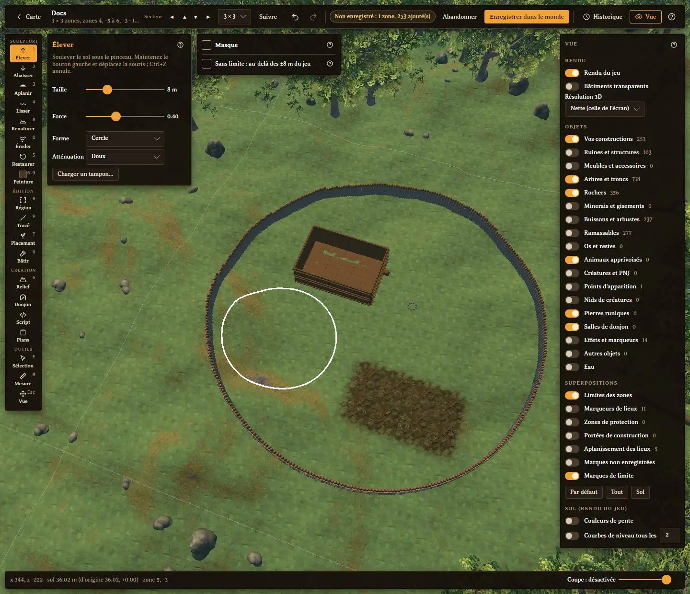
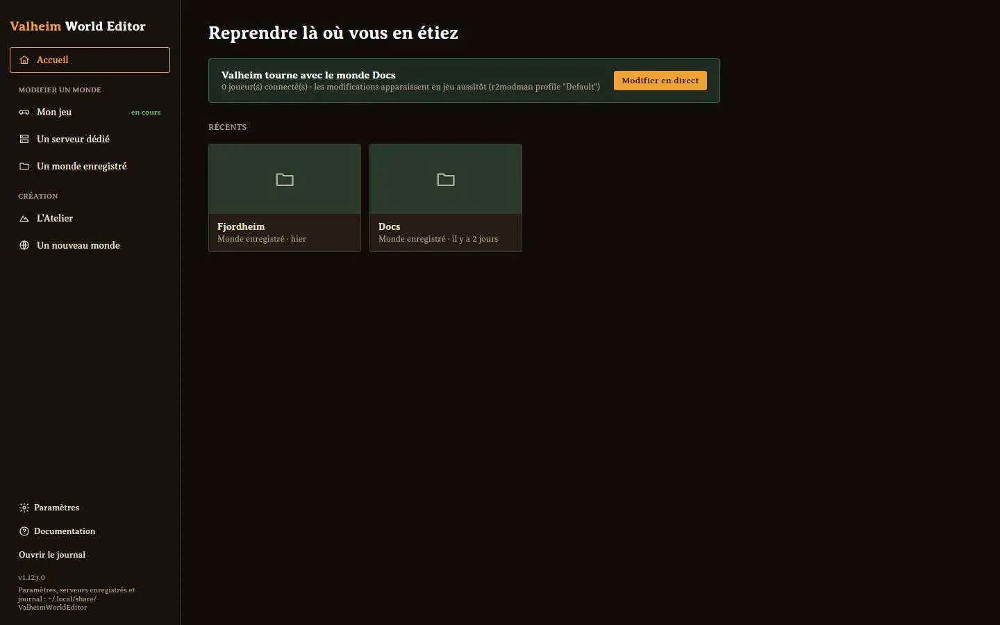
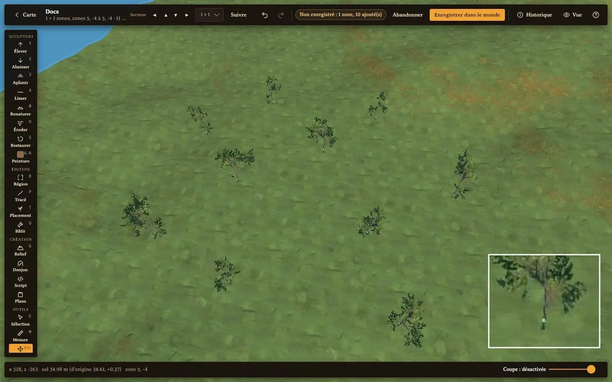
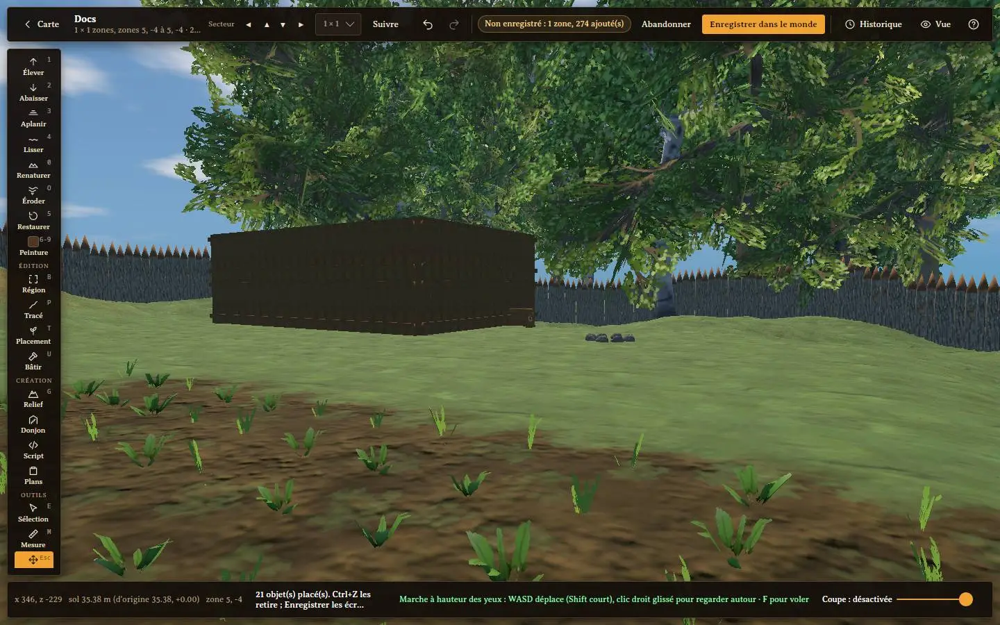
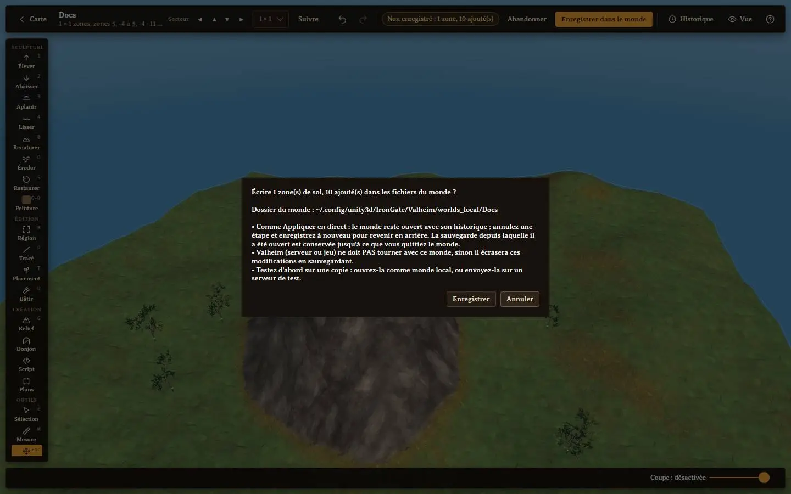
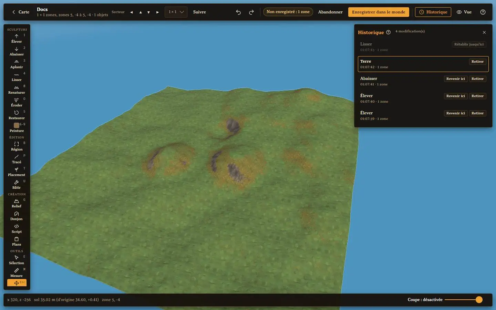
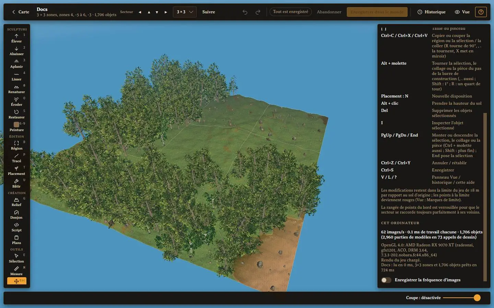
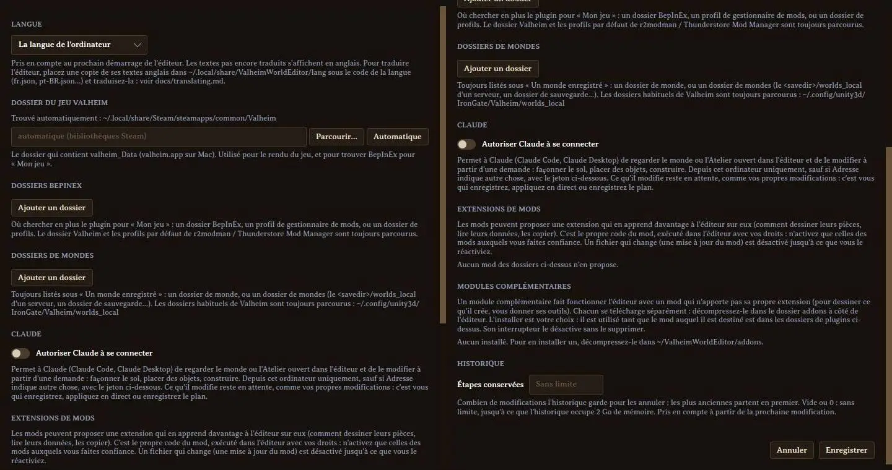

<!-- source: 1d85c1a0 -->
# La fenêtre de l'éditeur

Repérez-vous dans l'éditeur : la page d'accueil, la fenêtre 3D avec sa barre du haut, sa barre d'outils et ses
panneaux, la caméra, l'enregistrement, l'Historique et le panneau Vue.

**Où :** la page d'accueil s'ouvre d'abord ; un monde s'ouvre sur sa [carte](map.md), puis **Modifier en 3D** ·
**Touche :** `?` ou `F3` pour la fiche d'aide, `F1` pour cette aide à l'outil en cours · **Fonctionne dans :** mondes
enregistrés, en direct, l'Atelier

*Une petite base dans un secteur de 3 × 3, le pinceau Élever choisi (son anneau sur l'herbe). À gauche : la barre
d'outils et le panneau de l'outil. En haut : la barre du haut. À droite : le panneau Vue. En bas : la barre d'état, qui
lit le sol sous le pointeur.*

## L'utiliser

1. Sur la page d'accueil, choisissez comment modifier : **Mon jeu**, **Un serveur dédié** ou **Un monde enregistré**
   (ou **L'Atelier** pour bâtir sans monde).
2. Cliquez sur votre monde. Il s'ouvre sur sa [carte](map.md).
3. Sur la carte, cliquez sur l'endroit à modifier, choisissez la taille du secteur, puis **Modifier en 3D**.
4. Choisissez un outil dans la barre d'outils, réglez-le dans son panneau et utilisez-le dans la vue.
5. Vérifiez ce qui attend dans la ligne des modifications en attente de la barre du haut, puis **Enregistrer dans le
   monde** (ou **Appliquer en direct**).
6. Pour revenir sur une modification, appuyez sur `Ctrl+Z` ou ouvrez **Historique** (`L`).

Chaque modification reste [en attente](concepts/saving-and-history.md#modifications-en-attente) jusqu'à ce que vous l'enregistriez
ou l'appliquiez.

## La page d'accueil

*Accueil : la carte du jeu en cours avec **Modifier en direct**, puis les derniers mondes et plans ouverts.*

Le menu latéral contient **Accueil**, puis deux sections, **Modifier un monde** et **Création**. Vous revenez ici depuis
la carte d'un monde (**Mondes**) ou depuis l'Atelier (**Page d'accueil**).

| Entrée | Ce qu'elle affiche |
|---|---|
| **Accueil** | Là où vous vous êtes arrêté. Quand Valheim tourne avec le plugin WorldEditorBridge, une carte indique « Valheim tourne avec le monde … » et combien de joueurs sont connectés, avec **Modifier en direct**. Sous **Récents** : les mondes enregistrés et les plans que vous avez ouverts ou enregistrés en dernier (les plans avec leur image), du plus récent au plus ancien, et les serveurs enregistrés qui se connectent en un clic (mot de passe enregistré, ou fichier de clé). |
| **Mon jeu** | Votre propre jeu, en direct : ce qui manque (BepInEx, le plugin, un premier lancement), ou le monde avec lequel il tourne et **Modifier en direct**. *en cours* s'affiche à côté pendant que le jeu tourne ; l'éditeur vérifie toutes les quelques secondes. Voir [mode direct](live-mode.md). |
| **Un serveur dédié** | Les serveurs enregistrés (**Se connecter**, **modifier**, **oublier**) et le formulaire pour se connecter à un autre. Voir [mode direct](live-mode.md). |
| **Un monde enregistré** | Les mondes de cet ordinateur, à ouvrir avec le jeu fermé. La liste suit toutes les quelques secondes les dossiers de mondes ajoutés ou retirés ; **Actualiser** regarde tout de suite. Survolez un monde pour voir son dossier. **Un autre dossier de mondes** ouvre n'importe quel dossier contenant des fichiers `_main.<n>.chunks`. Voir [Ouvrir un monde qui n'est pas dans la liste](guides/open-a-world.md). |
| **L'Atelier** | **Ouvrir l'Atelier**, si Homestead est installé, et chaque plan, du plus récent au plus ancien : cliquez sur l'un d'eux pour l'ouvrir. Voir [l'Atelier](workshop.md). |
| **Un nouveau monde** | **Créer un nouveau monde** : le monde d'une graine avant qu'il existe, et une recherche d'un monde qui vous convient. Voir [un nouveau monde](new-world.md). |

En bas du menu : **Paramètres** (voir [Paramètres](#paramètres)), **Documentation** (cette aide, dans sa propre fenêtre),
**Ouvrir le journal**, la version, et le dossier qui contient les paramètres et le journal de l'éditeur.

## La fenêtre

La fenêtre 3D a cinq parties :

- **Barre du haut** : le nom du monde et le secteur, les commandes du secteur, annuler et rétablir, ce qui est en
  attente, **Abandonner**, **Enregistrer dans le monde** ou **Appliquer en direct**, puis **Historique**, **Vue** et
  **?**. Voir [La barre du haut](#la-barre-du-haut).
- **Barre d'outils** (bord gauche) : chaque outil, avec sa touche dans le coin. Voir
  [La barre d'outils](#la-barre-doutils).
- **Panneau de l'outil** (à côté de la barre d'outils) : le nom de l'outil choisi, une ligne sur son utilisation, et
  ses réglages. Le [Masque](masks.md) affiche sa propre fiche à côté pour les outils avec lesquels il fonctionne (les
  pinceaux, Tracé, Région, Relief et Placement). La même fiche contient **Sans limite**, l'autre interrupteur partagé
  des outils de sol (voir [Sans limite](terrain.md#sans-limite)).
- **Panneau de droite** : **Vue** (`V`), **Historique** (`L`), la fiche d'aide **Commandes** (`?` ou `F3`) ou
  l'[Inspecteur](select.md) (`I`). Ils partagent la même place, donc un seul s'affiche à la fois ; la même touche ou
  le même bouton le referme.
- **Barre d'état** (en bas) : la position de la souris, le dernier message, la sélection, Marche ou Vol, le curseur
  **Coupe** (voir [Coupe](#coupe)) et, dans une fenêtre d'environ 1 500 px de large ou plus, un rappel de la souris
  (« Clic droit glissé : tourner · Molette : zoom · Clic milieu glissé : déplacer · ? : aide ») ; dans une fenêtre plus
  étroite, sa place revient au message.

La lecture de la souris ressemble à `x 1250, z -380   ground 32.40 m (original 30.10, +2.30)   zone 20, -6` : la
position en mètres, la hauteur actuelle du sol, sa hauteur avant toute modification et la différence, et la zone. À la
limite du jeu, elle ajoute « , à la limite de ±8 m ». La sélection se lit comme « Sélection : 15 objets (Beech ×12,
Rock ×3) », avec les quatre types les plus courants.

Chaque curseur, interrupteur et bouton s'explique quand vous le survolez. L'éditeur retient vos choix d'une session à
l'autre : ce qu'affiche Vue, les options de rendu, la forme et l'atténuation du pinceau, l'action de Région, le type
de Relief, son préréglage de Formule et votre propre formule, les options de Sélection, les catégories ouvertes de
Placement, les réglages de la barre de construction et la taille du panneau Bâtir, le panneau de droite que vous avez
laissé ouvert, **Suivre**, **Auto**, la position de la carte et le presse-papiers. **Sans limite** ne l'est pas : il
est désactivé à chaque démarrage de l'éditeur.

## La barre du haut

| Commande | Ce qu'elle fait |
|---|---|
| **Carte** | Retour à la carte du monde. Ce qui n'est pas enregistré ou appliqué reste en attente. Dans l'Atelier, c'est **Page d'accueil**. |
| Nom et secteur | Le nom du monde ; en dessous, la taille du secteur, sa première et sa dernière zone et le nombre d'objets qu'il contient. |
| **Secteur** ◀ ▲ ▼ ▶, liste des tailles, **Suivre** | Déplacer le secteur, changer sa taille, le laisser s'agrandir quand vous regardez autour. Voir [Le secteur](#le-secteur). |
| Annuler, rétablir (les flèches courbes) | Annuler la dernière modification (`Ctrl+Z`) ; la rétablir (`Ctrl+Y` ou `Ctrl+Shift+Z`). Leur texte de survol nomme l'étape, par exemple « Annuler Élever (Ctrl+Z) ». Une étape d'une session précédente peut demander d'abord. |
| **EN DIRECT** (en direct) | Indique que vous êtes connecté au jeu en cours via le plugin WorldEditorBridge. |
| Liste des joueurs, **Aller** (en direct) | À côté de **EN DIRECT**, quand un joueur est connecté : choisissez un joueur connecté, puis **Aller**. La caméra se tourne vers le joueur quand il est dans le secteur ; sinon le secteur se déplace jusqu'à lui. Les joueurs apparaissent dans la vue comme des poteaux bleus avec leur nom. |
| **Recharger** (en direct) | Recharge le monde depuis le jeu, après avoir demandé quand des modifications ne sont pas encore appliquées (elles sont perdues, avec leurs étapes). Les étapes que le jeu a restent dans l'Historique. Vous restez où vous êtes. |
| **Auto** (en direct) | Applique chaque modification au jeu dès qu'elle est faite : chaque coup de pinceau quand vous relâchez, chaque outil, chaque annulation et rétablissement. L'activer envoie aussitôt ce qui attend. Retenu. |
| Ligne des modifications en attente | « Non enregistré : 3 zones, 1 supprimé(s), 12 ajouté(s), 1 réinitialisée(s) » (hors ligne) ou « Non appliqué : … » (en direct), en ambre ; « Tout est enregistré » ou « Tout est appliqué » en gris quand rien n'attend. Ce qu'elle compte : voir [Modifications en attente](concepts/saving-and-history.md#modifications-en-attente). |
| **Abandonner** | Jette ce qui n'est pas encore enregistré ou appliqué, après avoir demandé. Voir [Abandonner](#abandonner). |
| **Enregistrer dans le monde** (hors ligne) | Écrit les modifications dans les fichiers du monde (`Ctrl+S`). Voir [Enregistrer dans le monde](#enregistrer-dans-le-monde). |
| **Appliquer en direct** (en direct) | Envoie les modifications au jeu en cours (`Ctrl+S`) : tous ceux qui y sont les voient aussitôt. Voir [Appliquer en direct](#appliquer-en-direct). |
| **Historique** | Toutes les modifications de la session (`L`). Voir [Historique](#historique). |
| **Vue** | Ce qui est affiché et comment (`V`). Voir [Panneau Vue](#panneau-vue). |
| **?** | La fiche d'aide **Commandes** (`?` ou `F3`). Voir [La fiche d'aide](#la-fiche-daide). Chaque panneau a son propre petit **?** en haut : la fenêtre d'aide à la page de cet outil (`F1` fait de même pour l'outil en cours). |

Dans une fenêtre étroite, la ligne du nom et du secteur se termine par « … » (survolez-la pour la lire en entier), et
quand même cela ne suffit pas, **Carte**, **Recharger**, **Historique** et **Vue** n'affichent que leur icône.

Dans la vue, chaque nouvel objet pas encore enregistré ou appliqué porte un **point vert**, sauf quand il est
sélectionné (son contour le signale alors). **Vue → Marques non enregistrées** masque les points ; les objets restent.

*De jeunes arbres tout juste plantés : chacun porte un petit point vert au pied jusqu'à ce qu'il soit enregistré (l'un
agrandi dans le coin), et la ligne des modifications en attente les compte : « Non enregistré : 1 zone, 10 ajouté(s) ».*

## La barre d'outils

| Section | Bouton (touche) | Ce qu'il ouvre |
|---|---|---|
| **SCULPTURE** | **Élever** (`1`), **Abaisser** (`2`), **Aplanir** (`3`), **Lisser** (`4`), **Renaturer** (`0`), **Éroder** (`O`), **Restaurer** (`5`), **Peinture** (`6` à `9`) | Les pinceaux de sol. **Peinture** est un seul pinceau pour les quatre peintures, choisies dans son panneau ou avec une touche : Terre (`6`), Cultiver (`7`), Pavé (`8`), Effacer la peinture (`9`). Voir [Sculpter et peindre](terrain.md). |
| **ÉDITION** | **Région** (`B`), **Tracé** (`P`), **Placement** (`T`), **Bâtir** (`U`) | [Région](area.md) (actions en rectangle ou en polygone, copier et coller), [Tracé](path.md) (routes, rampes, rivières), [Placement](place.md) (arbres, rochers, cultures, points d'apparition), [Bâtir](build.md) (les pièces que construisent les joueurs, avec le panneau Bâtir et la barre de construction). |
| **CRÉATION** | **Relief** (`G`), **Donjon**, **Script**, **Plans** | [Relief](landform.md) (tout un relief en un clic : la forme d'une formule, une montagne ou une image), [Donjons](dungeons.md), [Script](scripting.md), et la bibliothèque de plans pour en coller un (voir [l'Atelier](workshop.md)). Seul Relief a une touche. |
| **OUTILS** | **Sélection** (`E`), **Mesure** (`M`), **Vue** (`Esc` ou `H`) | [Sélection](select.md), [Mesure](measure.md), et Vue : regarder autour ; un glissé gauche déplace la vue, un clic choisit un objet, un double-clic sur l'un d'eux passe à Sélection avec cet objet sélectionné. |
| **MODS** | Un bouton par outil qu'apporte l'[extension](modding.md) d'un mod : son nom, son image ou sa première lettre ; le survoler nomme le mod | L'outil du mod : sa fiche de réglages à côté de la barre d'outils, son aide dans l'info-bulle. Ses modifications vont dans l'Historique et sont annulées, rétablies et enregistrées comme celles de l'éditeur. Affiché seulement quand une extension en cours a un outil. |

La barre d'outils défile quand la fenêtre est trop basse pour elle (et s'arrête au-dessus du panneau Bâtir quand il est
ouvert). Dans l'Atelier, elle ne garde que **Bâtir** (`U` ou `T`), **Sélection** et **Vue**.

## Caméra

| Action | Comment |
|---|---|
| Tourner la vue | Clic droit glissé. |
| Zoomer | Molette de la souris, de 3 m à 3 km du point que vous regardez. |
| Déplacer la vue | Clic milieu glissé, `Space` + glissé gauche ou `Shift` + glissé droit (dans n'importe quel outil), ou un glissé gauche avec l'outil **Vue**. |
| Se déplacer | `W` `A` `S` `D` ou les flèches. Plus vous êtes loin, plus c'est rapide. Le point que vous regardez reste sur le sol (ou sur l'eau). |
| Voir comme un joueur | `F` : Marche, puis Vol, puis retour à la vue habituelle. |

### Marche et Vol

*Mode Marche (`F`) : la base telle que la voit un joueur debout près du champ, les yeux à 1,8 m au-dessus du sol.*

`F` passe d'une vue à l'autre parmi trois :

1. **Marche** : vos yeux sont à 1,8 m au-dessus du sol (ou de l'eau là où elle est plus profonde). Vous partez de
   l'endroit que regardait la vue habituelle. `W` `A` `S` `D` avancent là où vous regardez à 6 m/s ; `Shift` court à
   12 m/s. Un clic droit glissé regarde autour. Vous suivez le sol qui monte et descend, sol modifié compris.
2. **Vol** : `F` à nouveau. `Space` monte, `C` descend, à 15 m/s (`Shift` : 45 m/s). `C` vous fait aussi traverser le
   sol, jusque dans ce qu'un mod creuse dessous (les tunnels et les caves de Tunnelheim) ; `Space` vous ramène en haut.
3. **La vue habituelle** : `F` une troisième fois. La vue tourne autour d'un point au sol 20 m devant l'endroit où
   vous étiez.

La barre d'état indique le mode actif et ses touches. En marchant ou en volant, la molette ne zoome pas et les glissés
ne déplacent pas la vue ; chaque outil fonctionne toujours. Dans un donjon (à 5 000 m d'altitude, là où le jeu garde
les salles de donjon), la caméra ne suit pas le sol.

## Le secteur

La fenêtre 3D affiche un **secteur** : un bloc de zones (une zone fait 64 × 64 m) autour de l'endroit que vous avez
ouvert depuis la carte. Sa ligne extérieure de points de sol est verrouillée : pour travailler près d'un bord, déplacez
le secteur ou agrandissez-le. Pourquoi l'éditeur fonctionne ainsi : voir
[Secteurs et zones](concepts/areas-and-zones.md).

| Commande | Ce qu'elle fait |
|---|---|
| **◀ ▲ ▼ ▶** (après « Secteur ») | Déplace le secteur d'une zone (64 m) vers l'ouest, le nord, le sud ou l'est. La caméra reste où elle est dans le monde, et les modifications en attente et l'Historique suivent. |
| Liste des tailles | Rouvre le secteur autour de la même zone centrale en **3 × 3**, **5 × 5**, **7 × 7**, **9 × 9**, **13 × 13** ou **17 × 17** zones. La vue, les modifications et l'Historique restent. Un secteur agrandi par Suivre (comme 4 × 3) affiche sa propre taille. Les grands secteurs (jusqu'à 1 088 m de côté) sont lents à ouvrir et à afficher. |
| **Suivre** | Quand le point que vous regardez arrive à moins de 12 m du bord du secteur, le secteur s'agrandit d'une rangée de zones de ce côté, et garde les zones qu'il a, jusqu'à 17 zones dans chaque sens. Cliquez pour l'activer ou le désactiver ; retenu. Voir [Suivre](concepts/areas-and-zones.md#suivre). |

Les flèches, Suivre et la liste des tailles attendent tant que quelque chose serait perdu, et la barre d'état dit
pourquoi : des objets sont sélectionnés (`Alt+A` dans Sélection les désélectionne), un coup de pinceau est en cours, un
tracé est dessiné (appliquez-le ou effacez-le), ou des modifications sont encore en cours d'envoi au jeu. Ils
n'attendent pas pour un rectangle ou un polygone de Région, une ligne, une grille ou une zone de Placement, ou une
mesure : ceux-ci sont abandonnés quand le secteur se déplace, s'agrandit ou change de taille. Les commandes du secteur
ne sont pas dans l'Atelier.

## Enregistrer, appliquer et abandonner

### Enregistrer dans le monde

**Enregistrer dans le monde** (`Ctrl+S`) demande d'abord, dans **Écrire dans le monde**, en montrant ce qui sera écrit
et le dossier du monde. Fermez Valheim (le jeu ou le serveur) avant d'enregistrer : un jeu en cours écrit par-dessus
vos modifications la prochaine fois qu'il sauvegarde.

*Rien n'est écrit tant que vous ne cliquez pas sur **Enregistrer** : la question compte ce qui entre, nomme le
**Dossier de monde** et vous avertit de fermer Valheim d'abord.*

Le résultat dit ce qui a été enregistré (« 4 zone(s), 2 objet(s) supprimé(s), 12 nouvel(s) objet(s) enregistré(s) dans
la sauvegarde n° 37. ») et liste ce qui n'a pas pu l'être, avec la raison :

- une zone, ou un nouvel objet dans une zone, **not generated yet** (pas encore générée) : aucun joueur n'y est
  allé, donc le monde n'a pas de données à cet endroit. Visitez-la d'abord en jeu.
- un nouveau sol, **no terrain object to copy yet** (le monde n'a encore aucun objet de terrain à copier) : personne
  n'a jamais creusé ni aplani le sol en jeu. Modifiez d'abord le sol une fois n'importe où en jeu.

Après un enregistrement, le secteur et l'Historique restent tels quels. Pour revenir sur une modification enregistrée,
annulez-la (ou retirez-la avec **Retirer** dans l'Historique) et enregistrez à nouveau : l'enregistrement la retire du monde. Quand
il ne reste rien de ce que vous avez enregistré, le message dit que le monde est de nouveau tel que vous l'avez ouvert.
Comment un enregistrement est écrit et vérifié : voir
[Enregistrer un monde](concepts/saving-and-history.md#enregistrer-un-monde).

**Quand le jeu a sauvegardé depuis.** Si le jeu a sauvegardé le monde après que l'éditeur l'a lu, rien n'est
enregistré : enregistrer jetterait ce qui a été fait en jeu. La question **Le jeu a sauvegardé ce monde** propose
**Reporter mes modifications** : l'éditeur lit la sauvegarde du jeu et refait dessus chacune de vos modifications non
enregistrées. Là où le jeu a changé la même zone ou le même objet, il demande une fois par type, **Garder la mienne**
ou **Garder celle du jeu**. Rien n'est écrit tant que vous n'enregistrez pas à nouveau. **Pas maintenant** laisse tout
tel quel. Voir [Enregistrer un monde](concepts/saving-and-history.md#enregistrer-un-monde).

### Appliquer en direct

En mode direct, le même bouton est **Appliquer en direct**. Il envoie le sol, les modifications d'objets et les
réinitialisations de zones au jeu en cours, et les étapes envoyées sont marquées **appliquée** dans l'Historique.
Elles peuvent encore être annulées : l'application suivante envoie l'annulation. Quand des joueurs ont changé le sol
d'une zone que vous avez aussi modifiée, il demande d'abord (**Appliquer** ou **Pas maintenant**). Voir
[Appliquer en direct](concepts/saving-and-history.md#appliquer-en-direct) et [mode direct](live-mode.md).

### Abandonner

**Abandonner** annule tout ce qui n'est pas encore enregistré ou appliqué, après avoir demandé (« Les N dernière(s)
étape(s) de l'Historique sont annulées »). Il annule les étapes non enregistrées à la fin de l'Historique, de la plus
récente à la plus ancienne, rétablit les étapes enregistrées ou appliquées que vous avez annulées depuis, et vide le
reste de la liste à rétablir. Les modifications enregistrées et appliquées restent, de même que le reste de
l'Historique, la caméra et l'outil.

Certaines modifications en attente peuvent n'avoir aucune étape dans l'Historique de ce secteur (faites dans un autre
secteur, ou avant que le monde soit relu). Abandonner demande alors une seconde fois : **Le relire** relit le monde
depuis ses fichiers (ou depuis le jeu, en direct) et abandonne toutes les modifications en attente du monde entier.
L'Historique garde ce que le monde a : l'historique conservé au dernier enregistrement, ou en direct chaque étape que
le jeu a.

### Quitter et fermer

**Carte**, les flèches et la liste des tailles gardent tout ce qui est en attente. Quitter le monde pour la page
d'accueil (**Mondes** sur la carte) et fermer la fenêtre perdent ce qui est en attente, donc les deux demandent
d'abord : **Partir quand même** / **Rester**, et **Quitter quand même** / **Continuer l'édition**.

## Historique

*La dernière modification a été annulée avec **Revenir ici** : elle est grisée et propose **Rétablir jusqu'ici**.*

**Historique** (`L`) liste toutes les modifications de la session, de la plus récente à la plus ancienne. Chaque ligne
affiche le nom de l'étape (l'outil ou l'action, par exemple « Élever », « Coller ×3 », « Retiré : Élever »), l'heure
(avec le jour pour les plus anciennes) et ce qu'elle a touché, par exemple « 3 zones · 12 nouveau(x) · 2 retiré(s) ·
1 réinitialisation(s) de zone ». L'étape actuelle, celle que `Ctrl+Z` annule ensuite, est encadrée. L'en-tête compte
les étapes que vous pouvez annuler. Le panneau affiche les 200 lignes les plus récentes ; **Afficher les plus anciennes
(N)** en bas en ajoute 200 de plus.

| Commande | Ce qu'elle fait |
|---|---|
| **Revenir ici** | Annule toutes les modifications faites après celle-ci. Les modifications suivantes restent dans la liste, grisées. |
| **Rétablir jusqu'ici** | Sur une modification grisée : rétablit toutes les modifications jusqu'à celle-ci incluse. |
| **Retirer** | Retire seulement cette modification et garde tout ce qui a été fait après. Le retrait est une nouvelle étape (« Retiré : … »), donc `Ctrl+Z` ramène la modification. La modification retirée est barrée. |
| **Annuler les modifications de Claude** | Affiché quand Claude a fait des modifications dans l'historique de ce secteur. Retire chacune d'elles, comme le fait **Retirer**, et garde les vôtres, même celles faites après. Les modifications de Claude faites dans d'autres secteurs restent, et la barre d'état dit combien : ouvrez ces secteurs pour les y annuler. |

Étiquettes d'une ligne : **appliquée** (envoyée au jeu, ou enregistrée), **Claude** (faite via la
[connexion à Claude](claude.md)), **session précédente** (conservée d'une session précédente de l'éditeur). Une
nouvelle modification faite après une annulation supprime les étapes grisées. Quand l'Historique est écrit sur le
disque, jusqu'où il remonte, et ce qu'il advient des étapes faites dans d'autres secteurs : voir
[Historique](concepts/saving-and-history.md#historique).

## Panneau Vue

**Vue** (`V`) choisit ce qui est affiché et comment. Chaque interrupteur indique combien il y en a dans le secteur.
Seul ce qui est affiché peut être choisi ou sélectionné, donc masquer un type le protège aussi d'un clic.

| Section | Commande | Ce qu'elle fait |
|---|---|---|
| RENDU | **Rendu du jeu** | Affiche le monde avec les textures, les modèles, l'eau et le ciel du jeu. Désactivé : des couleurs unies et des boîtes, plus rapide. |
| | **Bâtiments transparents** | Affiche les constructions des joueurs à moitié transparentes, pour voir ce qu'il y a dedans ou derrière. Les arbres et les rochers restent pleins. |
| | **Résolution 3D** | **Nette (celle de l'écran)**, **Équilibrée** (un pixel par point d'écran : moins sur un écran haute résolution mis à l'échelle) ou **Rapide** (encore moins). Moins de pixels donnent plus d'images par seconde sur un ordinateur lent ; la barre d'état indique la taille. |
| OBJETS | **Vos constructions**, **Ruines et structures**, **Meubles et accessoires**, **Arbres et troncs**, **Rochers**, **Minerais et gisements**, **Buissons et arbustes**, **Ramassables**, **Os et restes**, **Animaux apprivoisés**, **Créatures et PNJ**, **Points d'apparition**, **Nids de créatures**, **Pierres runiques**, **Salles de donjon**, **Effets et marqueurs**, **Autres objets** | Afficher ou masquer chaque type. Seuls **Vos constructions**, **Arbres et troncs**, **Rochers**, **Animaux apprivoisés**, **Pierres runiques** et **Salles de donjon** sont activés au départ, pour que l'éditeur ne gâche pas ce qui reste à découvrir. |
| | **Eau** | La surface de la mer et des lacs. |
| SUPERPOSITIONS | **Limites des zones** | Les lignes des zones de 64 m (activées au départ). |
| | **Marqueurs de lieux** | Un poteau sur chaque lieu (villages, le marchand, entrées de donjons…). |
| | **Zones de protection** | Des anneaux là où chaque protection protège (32 m). |
| | **Portées de construction** | Des anneaux là où chaque établi, forge ou autre station d'artisanat permet de construire (10 à 40 m, selon le type). |
| | **Aplanissement des lieux** | Là où les lieux aplanissent le sol : un anneau pour la partie plane, un plus pâle là où elle se fond dans le reste. |
| | **Marques non enregistrées** | Le point vert au-dessus de chaque nouvel objet pas encore enregistré ou appliqué. |
| | **Marques de limite** | Du rouge sur le sol qui a atteint la limite de ±8 m du jeu (en Rendu du jeu). Voir [Marques de limite](concepts/ground-limits.md#marques-de-limite). |
| | **Par défaut** / **Tout** / **Sol** | Les interrupteurs habituels / tout activé / seulement le sol. Ils règlent les objets, l'eau et les superpositions, pas le rendu. |
| SOL (rendu du jeu) | **Couleurs de pente**, **Courbes de niveau tous les** 1 / 2 / 5 / 10 **m** | Superpositions du sol, voir [Mesure](measure.md). |

Deux choses de la vue ne sont pas dans ce panneau, parce qu'il en faut là où le panneau n'est pas : le curseur
**Coupe** est dans la barre d'état (voir [Coupe](#coupe)), et aller jusqu'à un joueur connecté se fait dans la barre du
haut, à côté de **EN DIRECT**.

Ce que contiennent les types :

- **Ruines et structures** affiche aussi les parties des lieux du jeu qui ne sont pas des objets de la sauvegarde (les
  rochers de l'entrée d'une crypte, le camp du marchand, l'autel d'un boss). Le jeu les refait à chaque chargement de la
  zone, donc ils ne peuvent être ni choisis ni modifiés.
- Une ruine sur laquelle vous avez construit compte comme votre construction : ses pièces qui touchent les vôtres, et
  celles qui touchent celles-ci, sont sous **Vos constructions**.
- Les **Animaux apprivoisés** sont les créatures que les joueurs ont apprivoisées ; les sauvages sont sous
  **Créatures et PNJ**.
- Les **Points d'apparition** sont les points d'apparition invisibles du jeu, affichés avec un marqueur et le nom de
  la créature. Les **Nids de créatures** sont les nids de Greydwarfs, les tas d'os et autres.
- Les **Salles de donjon** sont très au-dessus de leur entrée (à 5 000 m d'altitude). Modifiez-les avec l'outil
  [Donjon](dungeons.md).
- Ce que portent les présentoirs et les supports d'armure est affiché avec le support, en Rendu du jeu, et affiché ou
  masqué avec son type. Les boucliers et les capes s'affichent dans leur premier style, un support d'armure dans sa
  posture de repos. Les objets ne peuvent pas être choisis : choisissez le support.
- Placer ou coller un type désactivé l'active, pour que ce que vous avez placé reste visible (le message le dit).

**Construit par**, le joueur écrit comme constructeur des pièces que vous bâtissez, collez ou remplacez, est dans
[la barre de construction](build.md#la-barre-de-construction), avec Bâtir, Sélection et Coller.

Quand un secteur contient des lieux (ou en a à moins de 40 m), une note en bas de la vue, à côté du panneau de l'outil,
dit combien, et que le sol inclut déjà l'aplanissement que le jeu fait autour. Fermez-la avec son ×. Voir
[Les lieux aplanissent le sol](concepts/ground-limits.md#les-lieux-aplanissent-le-sol).

## Coupe

Le curseur **Coupe** de la barre d'état masque tout ce qui est au-dessus d'une hauteur, et le curseur de la souris
traverse ce qui est masqué : regardez dans un bâtiment par le haut, sélectionnez ce qu'il contient, ou construisez-y.
C'est une seule commande pour chaque vue 3D ; seul change le point d'où se comptent ses mètres.

| Où | Les mètres se comptent depuis | Plage |
|---|---|---|
| Un monde | Le sol (ou la mer) au milieu de la vue ; en marchant ou en volant, le sol sous la caméra. La coupe suit la vue quand elle bouge. | 0 à 39 m |
| L'[Atelier](workshop.md#coupe) | La parcelle. | 0 à 39 m |
| Un donjon, avec l'outil [Donjon](dungeons.md) ou **Construire ici** | Environ le plancher de l'entrée du donjon. | 0 à 29 m |

Le curseur avance de 1 m par cran. Son extrémité gauche coupe au sol, à la parcelle ou au plancher ; son extrémité
droite la désactive. À côté, la barre affiche « Coupe à N m » ou « Coupe : désactivée ». Elle est désactivée à chaque
démarrage de l'éditeur.

- **Les objets seulement.** La coupe masque ce qui se dresse au-dessus de la hauteur (bâtiments, arbres, rochers,
  salles de donjon). Le sol et l'eau sont affichés en entier.
- **Dans un monde, la coupe suit la vue.** Sur une pente, tournez la vue autour d'un bâtiment plutôt que de la
  déplacer : la hauteur se compte depuis le sol au milieu de la vue.
- **Un monde et un donjon gardent chacun leur propre coupe.** Choisir l'outil Donjon prend la coupe du donjon
  (désactivée au départ ; **Aller au donjon** coupe à 4 m), et le quitter ramène celle du monde. L'Atelier commence sans
  coupe.
- **Autres façons de voir à l'intérieur** : **Vue → Bâtiments transparents**, et **Masquer** et
  **Sélectionner à travers** de l'outil [Sélection](select.md).

## La fiche d'aide

*La fiche **Commandes** (`F3`), défilée jusqu'à la fin : les dernières touches, puis **Cet ordinateur** avec la
fréquence d'images, la carte graphique et **Enregistrer la fréquence d'images**.*

**?**, `?` ou `F3` ouvre la fiche **Commandes** : les principales actions de la souris et touches, avec un rappel de la
limite de ±8 m et du bord verrouillé. Toutes les touches sont dans [Raccourcis](help/shortcuts.md).

En dessous, **Cet ordinateur** indique ce qui affiche la vue 3D (la carte graphique et sa version d'OpenGL) et comment
le secteur s'est chargé et, quand la vue bouge, la fréquence d'images avec le travail propre de l'éditeur par image et
le nombre d'objets, de parties de modèles et d'appels de dessin. La vue n'est affichée à pleine vitesse que lorsque
quelque chose se passe, sinon quelques fois par seconde.

**Enregistrer la fréquence d'images** (désactivé à chaque ouverture de l'éditeur) écrit la fréquence d'images dans
`perf-native.log` dans le dossier de données de l'éditeur, une ligne toutes les 0,2 s pendant que la vue est utilisée :
si la caméra était **moving** (en mouvement) ou **still** (immobile) pendant que quelque chose d'autre se passait, les
images par seconde, le travail de l'éditeur par image et le plus long écart entre deux images. Une ligne d'en-tête
(`#`) donne la date, la version, la taille de la vue, la carte graphique et ce qui est chargé. Les moments d'inactivité
ne sont pas écrits.

## La barre du haut de l'Atelier

Dans l'[Atelier](workshop.md), la fenêtre affiche une parcelle vierge au lieu d'un monde, et la barre du haut change :

| Commande | Ce qu'elle fait |
|---|---|
| **Page d'accueil** | Retour à la page d'accueil, après avoir demandé quand la construction n'est pas enregistrée comme plan. |
| Nom et coût | Le nom de la construction, et en dessous « Coût : … » (survolez-le pour chaque matériau et les stations d'artisanat nécessaires), ou « Une parcelle vierge : seule la construction est gardée dans le plan ». |
| **Contrôle de stabilité** | Activé au départ : chaque pièce de construction est teintée de la couleur que le jeu donne à sa stabilité en mode construction, et les pièces qui tomberaient en jeu sont rouges. Désactivé : construisez librement. Voir [Le contrôle de stabilité](concepts/objects.md#le-contrôle-de-stabilité). |
| En attente | « N pièce(s) », combien tomberaient, et « non enregistrée comme plan » ou « enregistrée » ; « Aucune pièce pour l'instant » sur une parcelle vide. |
| **Enregistrer le plan** | Enregistre les pièces de construction de la parcelle comme plan Homestead (`Ctrl+S`). Rien d'autre n'est gardé. |
| **Matériaux** | Ouvre ou ferme le panneau Matériaux à droite : ce que la construction coûte en jeu. Voir [Matériaux](workshop.md#matériaux). |
| **Historique**, **?** | Comme dans un monde. |

Le curseur **Coupe** est dans la barre d'état, comme dans un monde : dans l'Atelier, ses mètres se comptent depuis la
parcelle (voir [Coupe](#coupe)).

L'Atelier n'a ni commandes du secteur, ni **Abandonner**, ni panneau **Vue** : les constructions sont affichées pleines,
et les limites des zones et les points verts sont désactivés.

## Paramètres

**Paramètres**, en bas du menu de la page d'accueil, règle où l'éditeur cherche les choses sur cet ordinateur.
L'éditeur trouve seul les emplacements habituels : Valheim dans chaque bibliothèque Steam (Steam Flatpak et
bibliothèques supplémentaires compris), BepInEx dans le dossier de Valheim et dans les profils par défaut de r2modman
et de Thunderstore Mod Manager, et les mondes dans les dossiers de mondes de Valheim (ceux de Proton aussi).

*Les Paramètres défilent : leur haut à gauche, leur fin à droite, jusqu'à **Historique** et **Enregistrer**.
**Affichage** n'apparaît que sous Windows.*

| Réglage | Ce qu'il fait |
|---|---|
| **Langue** | La langue de l'éditeur ; au départ celle de l'ordinateur quand l'éditeur l'a, sinon l'anglais. Prise en compte au prochain démarrage de l'éditeur. Voir [Traduire](translating.md). |
| **Dossier du jeu Valheim** | Le dossier contenant `valheim_Data` (`valheim.app` sur Mac), pour une copie hors de Steam ou une seconde installation. **Automatique** revient à la recherche dans les bibliothèques Steam. |
| **Dossiers BepInEx** | D'autres endroits où chercher le plugin pour **Mon jeu** : un dossier `BepInEx`, un profil de gestionnaire de mods, ou un dossier de profils. |
| **Dossiers de mondes** | Un monde, ou un dossier de mondes (la copie `<savedir>/worlds_local` d'un serveur, un dossier de sauvegarde…), toujours listé sous **Un monde enregistré**. |
| **Claude** | **Autoriser Claude à se connecter**, son port et son jeton, **Claude peut exécuter des scripts**, et les lignes à donner à Claude Code ou Claude Desktop. Voir [Claude](claude.md). |
| **Extensions de mods** | Un interrupteur par extension qu'offre un mod des dossiers ci-dessus. N'activez que celles des mods auxquels vous faites confiance. Voir [Pour les auteurs de mods](modding.md). |
| **Modules complémentaires** | Les modules complémentaires décompressés dans le dossier `addons` à côté de l'éditeur, si chacun est utilisé, et un interrupteur pour en désactiver un sans le retirer. Un module complémentaire est utilisé tant que son mod est dans les dossiers de plugins ci-dessus. |
| **Historique** | **Étapes conservées** : combien de modifications l'Historique garde pour les annuler. Vide ou 0 : aucune limite, jusqu'à ce que l'Historique occupe 2 Go de mémoire ; les plus anciennes partent en premier. |
| **Affichage** (Windows) | **Dessiner avec l'OpenGL du pilote graphique**. Désactivé par défaut : l'éditeur dessine via Direct3D, comme les jeux. Pris en compte au prochain démarrage de l'éditeur. |

## Raccourcis

| Touche | Action |
|---|---|
| `Ctrl+Z` / `Ctrl+Y` ou `Ctrl+Shift+Z` | Annuler / rétablir |
| `Ctrl+S` | Enregistrer dans le monde, Appliquer en direct, ou Enregistrer le plan |
| `V` / `L` / `?` ou `F3` | Panneau Vue / Historique / fiche d'aide |
| `F1` | La fenêtre d'aide à l'outil en cours |
| `F` | Marche, Vol, retour à la vue habituelle |
| `W` `A` `S` `D` | Se déplacer |
| `Esc` | Annuler ce que fait l'outil, sinon l'outil Vue |

Toutes les touches et actions de la souris, outil par outil : [Raccourcis](help/shortcuts.md). Sur Mac, `Cmd`
fonctionne partout où il est écrit `Ctrl`.

## Astuces et limites

- Le sol se déplace d'au plus 8 m vers le haut ou le bas depuis sa hauteur d'origine, la limite propre du jeu ; les
  points qui l'atteignent deviennent rouges. Voir [La limite de 8 m du jeu](concepts/ground-limits.md#la-limite-de-8-m-du-jeu).
- La ligne extérieure de points du secteur est verrouillée, pour que le secteur se raccorde toujours à ses voisins.
  Pour modifier à cet endroit, déplacez le secteur ou agrandissez-le. Voir
  [Le bord verrouillé](concepts/areas-and-zones.md#le-bord-verrouillé).
- Les zones qu'aucun joueur n'a visitées n'ont pas de données dans les fichiers du monde : les modifications à ces
  endroits ne peuvent pas être enregistrées. Visitez-les d'abord en jeu.
- Déposer un fichier `.blueprint` ou `.vbuild` sur la vue 3D l'ajoute à votre bibliothèque de plans ; dans l'Atelier,
  il est aussi ajouté à la parcelle là où vous le déposez.
- Quelque chose s'est mal passé ? `Ctrl+Z` annule, **Historique** retire une seule modification, **Abandonner** jette
  tout ce qui n'est pas enregistré. Voir
  [Annuler une étape, retirer une modification ou tout abandonner](guides/undo-changes.md).
- Pour signaler un problème, joignez le journal : **Ouvrir le journal** en bas du menu de la page d'accueil. Il
  recommence à chaque lancement, donc joignez-le avant de redémarrer l'éditeur.

## Voir aussi

- [Votre première modification](start/first-edit.md)
- [Annuler une étape, retirer une modification ou tout abandonner](guides/undo-changes.md)
- [Enregistrement et historique](concepts/saving-and-history.md)
- [Secteurs et zones](concepts/areas-and-zones.md)
- [Raccourcis](help/shortcuts.md)
