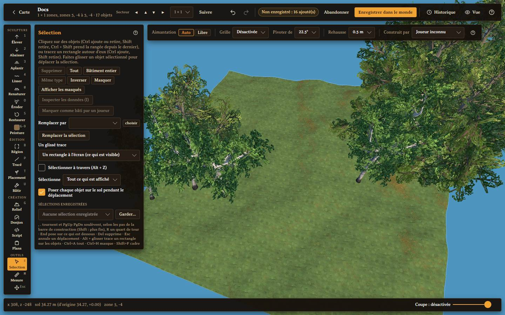

<!-- source: 133e1e92 -->
# Dégager arbres et rochers, aplanir un terrain à bâtir

Retirez les arbres, rochers et buissons d'un endroit et aplanissez-le en un terrain plat pour y construire.

**Il vous faut :** un monde ouvert en 3D, avec le jeu fermé ou en [mode direct](edit-your-game-live.md).

1. Appuyez sur `B` ([Région](../area.md)). En haut de son panneau, choisissez **Polygone**.
2. Cliquez des coins autour du terrain, quelques mètres plus large que la construction, et double-cliquez pour le fermer.
3. Choisissez **Objets**.
4. Vérifiez les pastilles de type : **Arbres et troncs**, **Rochers**, **Buissons et arbustes** et **Ramassables** sont
   activées au départ. Laissez **Vos constructions** désactivée.
5. Appuyez sur **Sélectionner les objets (Enter)**. L'outil Sélection s'ouvre avec ces objets sélectionnés.
6. Appuyez sur `Del`. Ils ont disparu.
7. Appuyez sur `B` pour revenir à l'outil Région : le polygone est toujours là. Choisissez **Sol**, puis **Aplanir**
   dans **Action**.
8. Appuyez sur **moy.** pour la hauteur moyenne à l'intérieur, ou tapez une **Hauteur**. Pour l'aligner sur une porte
   déjà construite, pointez le sol au niveau de son seuil et lisez la hauteur dans la barre d'état.
9. Réglez **Bord adouci** (3 m au départ) pour que le terrain se fonde dans la pente. La ligne sous les réglages indique
   combien de sol sera creusé et remblayé, et ce qui dépasse la portée de 8 m du jeu.
10. Appuyez sur **Aplanir (Enter)**.
11. Facultatif : dans **Action**, choisissez **Peinture**, puis **Terre** ou **Pavé**, et appuyez sur **Peindre (Enter)**.
12. Cliquez sur **Enregistrer dans le monde** (ou **Appliquer en direct**).

*Après **Sélectionner les objets (Enter)** et `Del` : les arbres à l'intérieur du polygone ont disparu, ceux de l'extérieur sont toujours debout.*

## Vérifier le résultat

- Appuyez sur `M` ([Mesure](../measure.md)) et mesurez à travers le terrain : **Plus bas / plus haut** doivent
  correspondre.
- Ou activez **Couleurs de pente** dans le panneau Vue : le terrain apparaît en vert.

## Annuler

- Chaque action est une étape : `Ctrl+Z` annule la dernière. Après l'enregistrement, annulez-la et enregistrez de
  nouveau (voir [Annuler une étape, retirer une modification ou tout abandonner](undo-changes.md)).
- Pour faire repousser les arbres plus tard, sélectionnez l'endroit, choisissez **Récupérer** et utilisez **Faire
  repousser la nature** (voir [Région](../area.md#faire-repousser-la-nature)).

## Voir aussi

- [Région, copier et coller](../area.md)
- [Masque](../masks.md) : n'aplanir que le bas d'une pente
- [Faire une route ou une rampe qui monte une colline](make-a-road.md)
