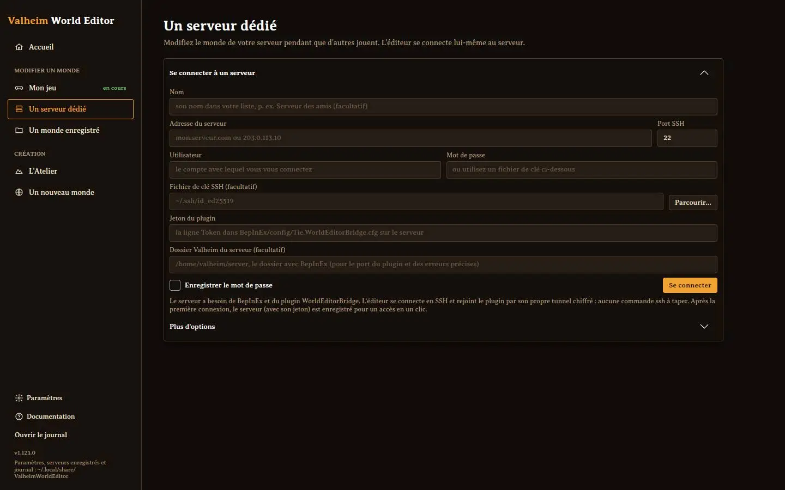

<!-- source: 52199907 -->
# Modifier un serveur dédié pendant que d'autres jouent

Connectez l'éditeur à votre serveur dédié et changez son monde pendant que les joueurs restent en ligne.

**Il vous faut :** un accès SSH à la machine qui fait tourner le serveur (une connexion au shell, avec un mot de passe
ou un fichier de clé : SFTP ou le gestionnaire de fichiers d'un panneau web ne suffisent pas), le droit d'y installer
BepInEx et le plugin WorldEditorBridge et de redémarrer le serveur. Pour un serveur de jeu loué chez un hébergeur (un
panneau web et du FTP, pas de SSH), ou un serveur qu'un panneau de jeu comme Pterodactyl fait tourner dans un
conteneur : voir [Modifier un serveur loué ou hébergé par un panneau](edit-a-rented-server.md).

*Le formulaire sous **Un serveur dédié**. Après la première connexion, le serveur est enregistré au-dessus, pour un
accès en un clic.*

1. Sur le serveur, installez BepInEx ([BepInExPack for Valheim](https://thunderstore.io/c/valheim/p/denikson/BepInExPack_Valheim/),
   en suivant ses instructions pour serveur dédié).
2. Copiez `WorldEditorBridge.dll` (depuis `WorldEditorBridge-<version>.zip` sur la
   [page des versions](https://github.com/Shuiei/valheim-world-editor/releases/latest)) dans `BepInEx/plugins` du
   serveur, ou installez WorldEditorBridge dans le profil serveur d'un gestionnaire de mods.
3. Redémarrez le serveur avec BepInEx. Son `BepInEx/LogOutput.log` indique maintenant `WorldEditorBridge <version>
   listening on http://127.0.0.1:5182/`.
4. Sur le serveur, ouvrez `BepInEx/config/Tie.WorldEditorBridge.cfg` et copiez la valeur de sa ligne `Token`. Le
   fichier n'existe qu'une fois que le serveur a démarré avec le plugin.
5. Sur la page d'accueil de l'éditeur, choisissez **Un serveur dédié**, puis **Se connecter à un serveur**.
6. Remplissez **Adresse du serveur**, **Utilisateur**, et **Mot de passe** ou **Fichier de clé SSH (facultatif)**.
   Collez le jeton dans **Jeton du plugin**.
7. Facultatif : remplissez **Dossier Valheim du serveur (facultatif)** (le dossier qui contient `BepInEx`), pour que
   l'éditeur puisse dire exactement ce qui ne va pas si le plugin ne répond pas. Cochez **Enregistrer le mot de passe**
   pour ne pas avoir à le retaper.
8. Appuyez sur **Se connecter**. L'éditeur se connecte en SSH, ouvre son propre tunnel chiffré vers le plugin et
   charge le monde.
9. Sur la carte, choisissez un endroit, **Modifier en 3D**, faites une modification et appuyez sur **Appliquer en
   direct**.

## Vérifier le résultat

- La barre du haut affiche **EN DIRECT** ; après l'application, « Tout est appliqué » et « Appliqué au jeu en
  cours : … » dans la barre d'état.
- Les joueurs proches de la modification la voient aussitôt.
- Le serveur apparaît maintenant au-dessus du formulaire, et dans **Accueil**, pour un accès en un clic la prochaine
  fois.

Si un message apparaît plutôt sous le formulaire, voir
[Un serveur refuse de se connecter](../help/troubleshooting.md#un-serveur-refuse-de-se-connecter).

## Annuler

Appuyez sur `Ctrl+Z` (ou **Retirer** l'étape dans l'Historique), puis à nouveau sur **Appliquer en direct**. Les
réinitialisations de zones ne peuvent pas être annulées une fois appliquées.

## Les autres champs du formulaire

| Champ | Ce que c'est |
|---|---|
| **Nom** | Le nom du serveur dans votre liste (facultatif ; l'adresse sinon). |
| **Adresse du serveur** | Le nom ou l'adresse IP du serveur. Vous pouvez aussi taper `user@address` ici. |
| **Port SSH** | 22, sauf si le SSH du serveur a été modifié. |
| **Fichier de clé SSH (facultatif)** | Votre clé privée (**Parcourir…** pour la choisir). Vide : les clés habituelles de `~/.ssh` (`id_ed25519`, `id_ecdsa`, `id_rsa`) sont essayées ; une clé que l'éditeur ne peut pas utiliser est ignorée, et les autres ainsi que le mot de passe sont quand même essayés. |
| **Jeton du plugin** | Toujours tapé par vous : l'éditeur ne le lit jamais sur le serveur, si bien qu'une connexion SSH seule ne peut pas modifier le monde. |
| **Plus d'options** → **Phrase secrète de la clé** | La phrase secrète de la clé, si elle en a une. Jamais enregistrée. |
| **Plus d'options** → **Port du plugin** | Le port du plugin sur le serveur, quand ce n'est pas 5182 et qu'aucun dossier n'est indiqué. |
| **Plus d'options** → **J'ai créé mon propre tunnel** | **Adresse de la passerelle** et **Jeton**, puis **Se connecter** : pour un tunnel que vous avez créé avec `ssh -L` ou PuTTY. |

## Serveurs enregistrés

Après la première connexion, le serveur est listé au-dessus du formulaire, du plus récent au plus ancien, avec **Se
connecter**, **modifier** et **oublier** ; le formulaire se replie sous **Se connecter à un autre serveur**. Chaque
ligne affiche `user@address`, s'il utilise un fichier de clé, un mot de passe enregistré ou s'il en demande un, et des
cases pour ce qui n'est pas enregistré.

- **modifier** remplit le formulaire avec le serveur ; changez ce dont vous avez besoin, puis **Se connecter** le met
  à jour.
- **oublier** le retire, avec son mot de passe et son jeton.

Les serveurs sont conservés dans `servers.cfg` dans le dossier de données de l'éditeur (le menu latéral de la page
d'accueil l'affiche), une section par serveur (`Host`, `SshPort`, `User`, `Password`, `KeyFile`, `Token`,
`BridgePort`, `GameFolder`, `HostKey`) : vous pouvez donc aussi le modifier à la main. Un serveur, c'est un compte sur
une adresse et un port : se reconnecter avec les mêmes met à jour sa section.

`Password` n'est rempli que si **Enregistrer le mot de passe** a été coché, en texte clair (sous Linux, vous seul
pouvez lire le fichier) : préférez une clé SSH.

`HostKey` est l'identité du serveur, retenue à la première connexion. Si elle change un jour, l'éditeur refuse de se
connecter, car quelqu'un pourrait se faire passer pour votre serveur. Si vous avez réinstallé le serveur, videz la
ligne `HostKey` de chaque serveur enregistré avec cette adresse pour accepter la nouvelle identité.

## Voir aussi

- [Mode direct](../live-mode.md) : Appliquer en direct, Auto, suivre le jeu, les joueurs
- [Modifier un serveur loué ou hébergé par un panneau](edit-a-rented-server.md) : le serveur de jeu d'un hébergeur,
  Pterodactyl, Docker
- [Modification en direct](../concepts/live-editing.md#comment-il-se-connecte) : le tunnel SSH et le jeton
- [Modifier le monde dans lequel vous jouez](edit-your-game-live.md)
- [Sauvegarder un monde avant de le modifier](back-up-a-world.md)
