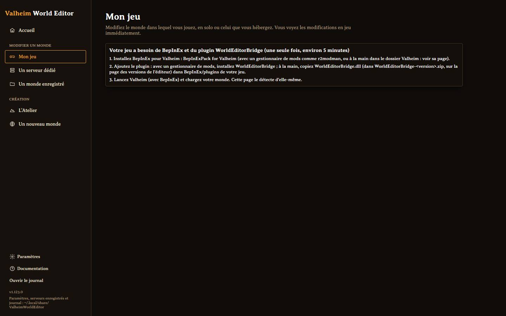
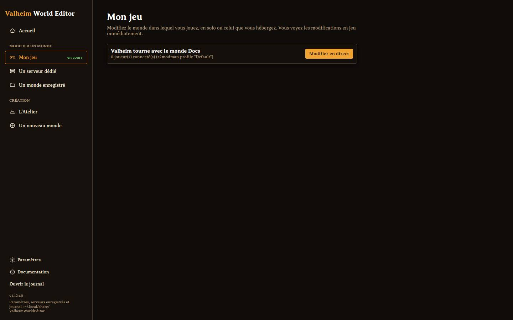

<!-- source: 0fe62110 -->
# Modifier le monde dans lequel vous jouez

Modifiez le monde de votre propre partie en cours (en solo, ou le monde que vous hébergez) et voyez chaque modification en jeu aussitôt.

**Il vous faut :** Valheim sur cet ordinateur, l'éditeur, et environ 5 minutes pour installer une fois BepInEx et le
plugin WorldEditorBridge.

*Ce qu'affiche **Mon jeu** avant l'installation de BepInEx et du plugin : les étapes ci-dessous, en bref.*

1. Installez **BepInEx** dans votre Valheim, une seule fois : [BepInExPack for Valheim](https://thunderstore.io/c/valheim/p/denikson/BepInExPack_Valheim/),
   avec un gestionnaire de mods (r2modman, Thunderstore Mod Manager) ou à la main dans le dossier Valheim, comme sa page
   l'explique. Sous Linux avec le jeu natif, BepInEx démarre par le script de lancement du pack (sa page indique l'option
   de lancement Steam) ; un gestionnaire de mods s'en charge pour vous.
2. Ajoutez le plugin. Avec un gestionnaire de mods, installez **WorldEditorBridge** depuis
   [Thunderstore](https://thunderstore.io/c/valheim/p/Tie/WorldEditorBridge/) ou
   [Hexium](https://valheim.hexium.gg/mods/Tie/WorldEditorBridge). À la main, copiez `WorldEditorBridge.dll` depuis
   `WorldEditorBridge-<version>.zip` (sur la [page des versions](https://github.com/Shuiei/valheim-world-editor/releases/latest) de l'éditeur)
   dans `BepInEx/plugins` de votre Valheim ou de votre profil de gestionnaire de mods. Utilisez le plugin de la même
   version que votre éditeur.
3. Lancez Valheim avec BepInEx et chargez votre monde (en solo, ou lancez un serveur depuis le jeu pour l'héberger). À
   ce premier lancement, le plugin écrit ses réglages et son jeton secret, que l'éditeur lit de lui-même.
4. Dans l'éditeur, ouvrez la page d'accueil. **Accueil** affiche « Valheim tourne avec le monde … » et le nombre de
   joueurs connectés ; **Mon jeu** dans le menu latéral indique *en cours*.
5. Cliquez sur **Modifier en direct**. Le monde s'ouvre sur sa carte.
6. Cliquez sur un endroit près de vous et choisissez **Modifier en 3D**.
7. Faites une modification, par exemple élevez une petite colline avec le pinceau **Élever**.
8. Appuyez sur **Appliquer en direct** (ou `Ctrl+S`).

*La page d'accueil a détecté d'elle-même la partie en cours : **Modifier en direct** ouvre son monde.*

## Vérifier le résultat

- La barre du haut affiche **EN DIRECT**, puis « Tout est appliqué » après l'application.
- La barre d'état indique « Appliqué au jeu en cours : … ».
- En jeu, la colline est là aussitôt. Le jeu l'enregistre comme n'importe quelle autre modification.

Tant que le jeu n'est pas prêt, **Mon jeu** indique ce qui manque : les trois étapes, « BepInEx est installé : il ne
reste que les étapes 2 et 3 », « Lancez Valheim une fois avec BepInEx » (le plugin n'a jamais tourné) ou « Lancez
Valheim et chargez votre monde ». Si cela ne change pas, voir [Mon jeu affiche des étapes à faire](../help/troubleshooting.md#mon-jeu-affiche-des-étapes-à-faire).

## Annuler

Appuyez sur `Ctrl+Z` (ou **Retirer** l'étape dans l'Historique), puis de nouveau sur **Appliquer en direct** : le jeu
revient sur la modification. Les réinitialisations de zones ne peuvent pas être annulées une fois appliquées. Pour que
chaque modification soit appliquée dès que vous la faites, activez **Auto**.

## Voir aussi

- [Mode direct](../live-mode.md) : Appliquer en direct, Auto, suivre le jeu, les joueurs
- [Modifier un serveur dédié pendant que d'autres jouent](edit-a-server-live.md)
- [Modification en direct](../concepts/live-editing.md#comment-il-se-connecte) : comment l'éditeur rejoint le jeu
- [Annuler une étape, retirer une modification ou tout abandonner](undo-changes.md)
