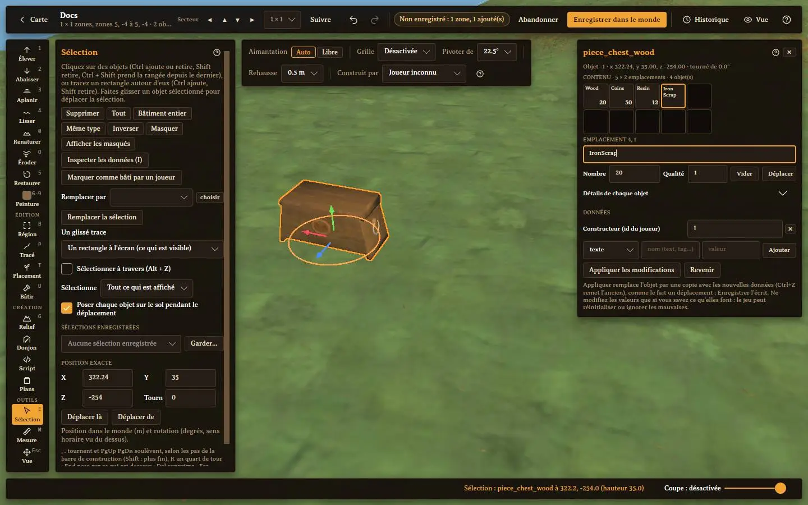

<!-- source: 0fb1e9cf -->
# Changer le contenu d'un coffre ou le texte d'un panneau

Mettez des objets dans un coffre, retirez-en, ou écrivez un nouveau texte sur un panneau, avec l'Inspecteur.

**Il vous faut :** un monde ouvert dans l'éditeur, avec le secteur autour du coffre ou du panneau ouvert. Pour le
trouver d'abord, voir [Trouver un objet, un objet dans un coffre ou un panneau](find-things.md).

## Un coffre

1. Appuyez sur `E` pour ouvrir [Sélection](../select.md).
2. Double-cliquez sur le coffre : il est sélectionné seul et s'ouvre dans l'Inspecteur, ses emplacements affichés comme
   en jeu.
3. Cliquez sur un emplacement vide.
4. Dans **Chercher un objet…**, tapez quelques lettres de l'objet (`iron`, `mead`) et choisissez-le dans la liste.
5. Réglez **Nombre** et, pour les outils et les armures, **Qualité**.
6. Recommencez pour les autres emplacements. Pour retirer un objet, cliquez sur son emplacement, puis sur **Vider** ;
   pour le déplacer, **Déplacer**, puis un autre emplacement.
7. Cliquez sur **Appliquer les modifications**.
8. Cliquez sur **Enregistrer dans le monde** (ou **Appliquer en direct**).

Le nombre est ramené à la plus grande pile que le jeu permet pour cet objet. Le contenu modifié reste celui du
coffre : un coffre que personne n'a ouvert ne se remplit pas par-dessus avec le butin du jeu.

*Emplacement 4 cliqué, IronScrap choisi dans **Chercher un objet…** et **Nombre** réglé sur 20 ; Wood, Coins et Resin
remplissent les trois premiers emplacements. **Appliquer les modifications** les met dans le coffre.*

## Un panneau

1. Appuyez sur `E`, puis cliquez sur le panneau.
2. Appuyez sur `I` (**Inspecter les données (I)**) : un double-clic sur un panneau sélectionnerait tout le bâtiment.
3. Sous **DONNÉES**, trouvez **Texte (panneau)** et tapez le nouveau texte.
4. Cliquez sur **Appliquer les modifications**, puis sur **Enregistrer dans le monde** (ou **Appliquer en direct**).

Pour un panneau qui n'a pas encore de texte, utilisez **Ajouter** : choisissez **texte**, tapez `text` comme nom,
puis les mots.

## Vérifier le résultat

Sélectionnez de nouveau le coffre ou le panneau et appuyez sur `I` : l'Inspecteur affiche le nouveau contenu ou le
nouveau texte. Après l'enregistrement, ouvrez le coffre ou lisez le panneau en jeu.

## Annuler

- Avant d'appliquer : **Revenir** oublie les modifications de la carte.
- Après avoir appliqué : `Ctrl+Z` remet l'ancien coffre ou l'ancien panneau.
- Après l'enregistrement : voir [Annuler une étape, retirer une modification ou tout abandonner](undo-changes.md).

## Voir aussi

- [Inspecteur](../select.md#inspecteur) (sur la page Sélection)
- [Ce qu'est un objet](../concepts/objects.md#ce-quest-un-objet)
- [Trouver un objet, un objet dans un coffre ou un panneau](find-things.md)
