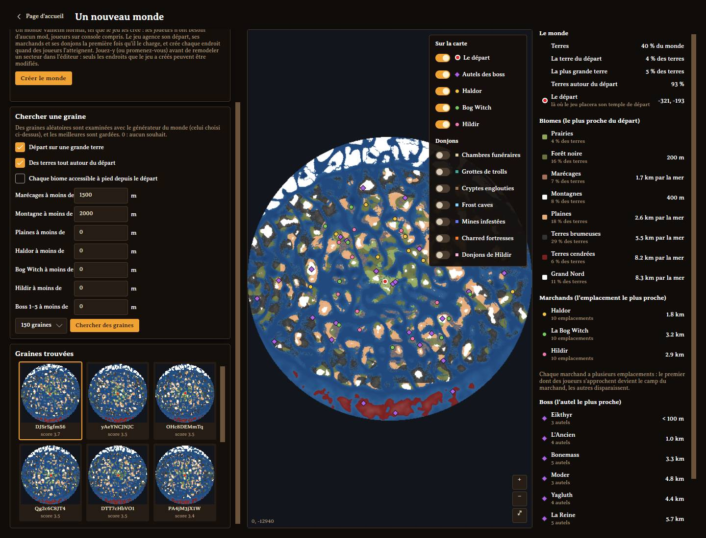

<!-- source: cccbe33c -->
# Trouver une graine avec ce que vous voulez près du départ

Laissez l'éditeur parcourir de nombreuses graines et en choisir une dont le départ a, à proximité, les biomes, les
marchands ou les boss que vous voulez, puis créez le monde.

**Il vous faut :** l'éditeur et Valheim sur cet ordinateur. Aucun monde n'a besoin d'être ouvert.

1. Sur la page d'accueil, choisissez **Un nouveau monde** sous **Création**, puis **Créer un nouveau monde**.
2. Sous **Chercher une graine**, laissez **Départ sur une grande terre** et **Des terres tout autour du départ**
   activés, ou désactivez-les si vous aimez les îles.
3. Facultatif : activez **Chaque biome accessible à pied depuis le départ** pour ne pas avoir besoin d'un bateau trop
   tôt.
4. Réglez les distances voulues, en mètres : **Marécages à moins de**, **Montagne à moins de**, **Plaines à moins
   de**, un marchand (**Haldor à moins de**, **Bog Witch à moins de**, **Hildir à moins de**) ou **Boss 1–5 à moins
   de**. Laissez une case à 0 pour aucun souhait. Les souhaits de marchands et de boss rendent la recherche plusieurs
   fois plus lente.
5. Choisissez combien de graines examiner : **60 graines**, **150 graines** ou **400 graines**.
6. Appuyez sur **Chercher des graines**. La barre montre l'avancement ; **Arrêter** garde les meilleures trouvées
   jusque-là.
7. Sous **Graines trouvées**, survolez une graine pour voir ses caractéristiques, puis cliquez dessus pour la voir sur
   la grande carte.
8. Vérifiez-la sur la grande carte : la recherche examine chaque graine de façon grossière et peut manquer de petites
   îles ou des détroits étroits. Facultatif : activez les types de **Donjons** qui vous intéressent.
9. Tapez le **Nom** du monde, choisissez **Enregistré dans**, et appuyez sur **Créer le monde**.
10. Lancez Valheim et chargez le monde une fois avant de le modifier dans l'éditeur : le jeu crée chaque endroit quand
    des joueurs s'en approchent.

*Les souhaits à gauche ; les meilleures graines sous **Graines trouvées**, la meilleure d'abord, chacune avec son
score.*

## Vérifier le résultat

- L'éditeur ouvre la carte du nouveau monde avec le message « … créé (graine …) ».
- Dans Valheim, le monde figure dans la liste du dossier choisi ; un nouveau personnage arrive à l'emplacement du
  point rouge.
- Les emplacements des marchands et des boss sont là où la page les montrait.

## Annuler

Rien n'est créé avant **Créer le monde**. Pour vous débarrasser d'un monde que vous avez créé, supprimez son dossier
du dossier de mondes dans lequel il a été enregistré (le choix **Enregistré dans**). Une graine qui vous plaît peut
toujours être retapée : la même graine crée le même monde.

## Voir aussi

- [Un nouveau monde](../new-world.md) : chaque commande, la carte, les caractéristiques et le calcul du score des
  graines
- [Ouvrir un monde qui n'est pas dans la liste](open-a-world.md)
- [Modifier un monde créé avec Expand World, Riverheim ou Tunnelheim](use-mods-worlds.md)
