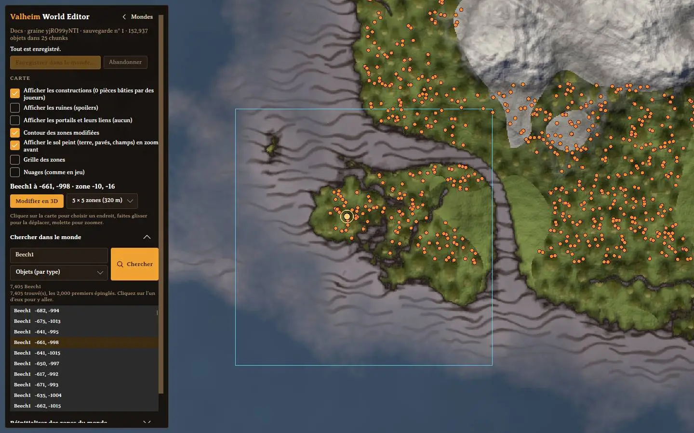

<!-- source: 1ca7ded6 -->
# Trouver un objet, un objet dans un coffre ou un panneau

Cherchez dans tout le monde un objet, un objet dans n'importe quel coffre, ou un texte sur un panneau ou un portail, et
ouvrez-le en 3D.

**Il vous faut :** un monde ouvert sur sa [carte](../map.md).

1. Dans le panneau latéral de la carte, ouvrez **Chercher dans le monde**.
2. Tapez une partie de ce que vous cherchez : un type (`portal`, `chest`, `Beech`), un objet (`Silver`, `Wood`) ou des
   mots d'un panneau. La casse ne compte pas.
3. Choisissez ce qu'il faut chercher : **Objets (par type)**, **Objets dans les conteneurs** ou **Textes (panneaux,
   portails, protections…)**.
4. Appuyez sur **Chercher** (ou `Enter`). Chaque résultat est épinglé en orange sur la carte, et listé avec un compte
   par type.
5. Cliquez sur un résultat dans la liste. La carte se centre dessus et choisit sa zone.
6. Appuyez sur **Modifier en 3D**. L'éditeur s'ouvre avec cet objet sélectionné. Pour un objet de coffre ou un texte,
   ses données s'ouvrent aussi.
7. Facultatif : modifiez le contenu du coffre ou le texte du panneau (voir
   [Changer le contenu d'un coffre ou le texte d'un panneau](fill-a-chest.md)), puis **Enregistrer dans le monde** (ou
   **Appliquer en direct**).

*Chaque épingle est un objet trouvé ; celui choisi dans la liste est plus grand, avec un anneau doré.*

## Vérifier le résultat

- La ligne au-dessus des résultats indique combien ont été trouvés. La liste affiche les 300 premiers ; jusqu'à
  2 000 sont épinglés.
- **Rien trouvé ?** Vérifiez l'orthographe et ce que vous avez choisi de chercher. La recherche voit le monde tel
  qu'il est dans l'éditeur : les objets que vous avez supprimés sans enregistrer ne sont pas trouvés. Les objets de
  gestion internes du jeu (`_ZoneCtrl`…) ne sont trouvés que si votre texte commence par `_`.

## Annuler

La recherche ne modifie rien. Une modification que vous faites à l'objet est une étape : `Ctrl+Z` la reprend.

## Voir aussi

- [Carte du monde](../map.md#chercher-dans-le-monde)
- [Changer le contenu d'un coffre ou le texte d'un panneau](fill-a-chest.md)
- [Sélection](../select.md)
