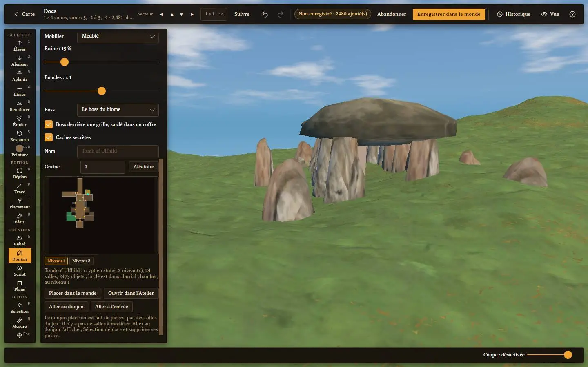

<!-- source: 89221403 -->
# Générer un donjon et le placer dans le monde

Créez un donjon entier à partir de quelques choix et placez-le derrière une entrée, comme le jeu le fait avec les
siens.

**Il vous faut :** un monde ouvert dans l'éditeur, avec le secteur où va l'entrée ouvert, dans une zone qui n'a pas
encore d'entrée de donjon (une sauvegarde d'abord : voir [Sauvegarder un monde](back-up-a-world.md)).

## Étapes

1. Cliquez sur **Donjon** dans la barre d'outils (section CRÉATION).
2. Sous **Générer un donjon**, choisissez le **Biome** : il détermine les monstres, le butin et l'entrée au sol.
3. Choisissez la **Taille** et les **Niveaux**, et le boss sous **Boss**.
4. Regardez le plan ; cliquez sur **Niveau 1**, **Niveau 2**... en dessous pour voir chaque niveau.
5. Facultatif : cliquez sur **Aléatoire** jusqu'à ce que le plan vous plaise, ou tapez un **Nom** pour le panneau de
   la salle d'entrée.
6. Tournez la vue face à l'endroit où l'entrée doit aller, avec cet endroit au milieu de la vue.
7. Cliquez sur **Placer dans le monde**. L'entrée apparaît sur le sol, sa porte tournée vers vous.
8. Cliquez sur **Aller au donjon** pour regarder à l'intérieur depuis le dessus, les toits retirés.
9. Cliquez sur **Aller à l'entrée** pour redescendre.
10. Cliquez sur **Enregistrer dans le monde** (ou **Appliquer en direct**).

*L'entrée après **Placer dans le monde** : le tertre d'une chambre funéraire, sa porte tournée vers la caméra.*

Pour modifier le donjon à la main avant de le placer (déplacer des meubles, remplir des coffres), enregistrez (ou
appliquez) vos modifications, puis cliquez sur **Ouvrir dans l'Atelier** au lieu de l'étape 7 : l'Atelier prend la
place du monde. Modifiez le donjon, cliquez sur **Enregistrer le plan**, rouvrez le monde et collez-le : voir
[Coller un plan dans un monde](paste-a-blueprint.md).

## Vérifier le résultat

La barre d'état indique *… généré : … objets, 5000 m au-dessus d'ici.* **Aller au donjon** montre ses salles. Après
l'enregistrement, ouvrez le monde en jeu, marchez jusqu'à l'entrée et passez la porte : vous arrivez dans la salle
d'entrée.

## Annuler

- Avant l'enregistrement : `Ctrl+Z` reprend tout le placement en une étape.
- Après l'enregistrement : voir [Annuler une étape, retirer une modification ou tout abandonner](undo-changes.md), ou
  [Restaurer un secteur depuis une sauvegarde](restore-from-backup.md).

## Astuces

- *Quelque chose occupe déjà l'espace là-haut* : chaque zone (64 × 64 m) contient un seul donjon. Placez l'entrée dans
  une autre zone.
- Les mêmes choix et la même graine créent toujours le même donjon en pièces de construction : notez la **Graine**
  pour le recréer. Un donjon fait des salles du jeu est réagencé à partir de son entrée quand il est placé : il lui
  faut donc aussi le même endroit et la même orientation.
- **Matériau : Les salles du jeu** le construit plutôt à partir des salles du jeu, pour le modifier salle par salle.

## Voir aussi

- [Donjon](../dungeons.md)
- [Comment le jeu garde les donjons](../concepts/dungeons.md#comment-le-jeu-conserve-les-donjons)
- [Atelier](../workshop.md)
