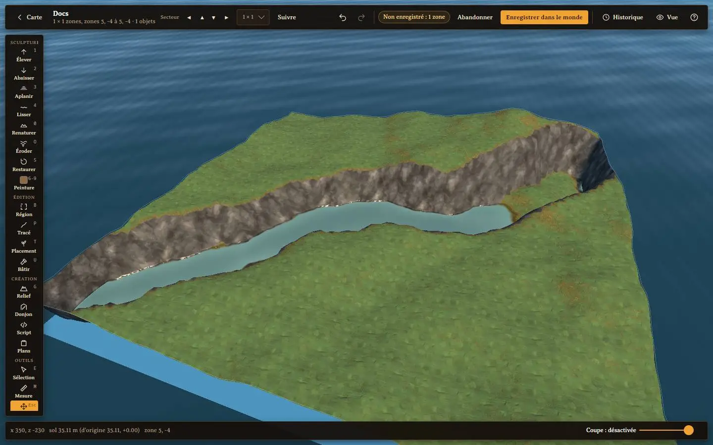

<!-- source: d55dc125 -->
# Creuser une rivière ou un étang

Creusez une rivière, un canal ou un étang qui se remplit d'eau.

**Il vous faut :** un monde ouvert en 3D, avec le jeu fermé ou en [mode direct](edit-your-game-live.md). Les terres
basses près de la mer sont les plus faciles.

Valheim n'a pas d'eau qui coule : l'eau des rivières est la mer, à 30 m partout. Une rivière ou un étang n'a de l'eau
que là où son lit est sous 30 m.

1. Passez le curseur sur le parcours et lisez la hauteur du sol dans la barre d'état. Tant que Sans limite est désactivé, vous
   ne pouvez creuser que 8 m vers le bas : un sol au-dessus d'environ 36 m ne retiendra donc pas l'eau.
2. Appuyez sur `P` ([Tracé](../path.md)) et cliquez des points le long de la rivière, depuis la mer ou un lac vers
   l'intérieur des terres.
3. Dans le panneau, choisissez **Rivière / canal (eau)**.
4. Réglez **Largeur** (la largeur de l'eau), **Bord adouci** (les berges) et **Profondeur** (de combien le lit est sous
   le niveau de la mer en son milieu, 2 m au départ).
5. Appuyez sur **Appliquer (Enter)**. Le lit se remplit d'eau.
6. Pour un étang, appuyez sur `B` ([Région](../area.md)), choisissez **Polygone**, cliquez autour de l'étang et
   double-cliquez sur le dernier coin pour fermer la forme.
7. Dans le groupe **Sol**, choisissez **Aplanir** dans **Action**, tapez une **Hauteur** sous 30 m (28 m donne une eau
   de 2 m de profondeur), réglez **Bord adouci** sur environ 5 m pour des berges douces, et appuyez sur
   **Aplanir (Enter)**.
8. Cliquez sur **Enregistrer dans le monde** (ou **Appliquer en direct**).

*Une rivière creusée avec Rivière / canal (eau) : la mer la remplit.*

## Vérifier le résultat

- L'eau apparaît dans la vue 3D dès que le lit est sous 30 m.
- Si la barre d'état indique qu'une partie a atteint la limite du jeu, le sol est trop haut à cet endroit : abaissez-le
  d'abord près de la mer, suivez des terres plus basses, ou activez **Sans limite** (voir [Élever ou creuser au-delà
  de la limite de 8 m du jeu](raise-past-the-limit.md)).

## Annuler

`Ctrl+Z` reprend le dernier **Appliquer** ou **Aplanir**. Après l'enregistrement, annulez et enregistrez à nouveau
(voir [Annuler une étape, retirer une modification ou tout abandonner](undo-changes.md)).

Pour combler une rivière plus tard, quand les étapes d'annulation ne sont plus là, tracez à nouveau la ligne (ou
gardez-la) et appliquez **Restaurer** de l'outil Tracé : le sol le long de la ligne revient à l'état où le monde l'a
généré. Le pinceau **Restaurer** (`5`) fait de même à un endroit.

## Voir aussi

- [Tracé](../path.md#rivière-ou-canal)
- [Mesure et superpositions](../measure.md) : profondeur de l'eau
- [Limites du sol](../concepts/ground-limits.md)
