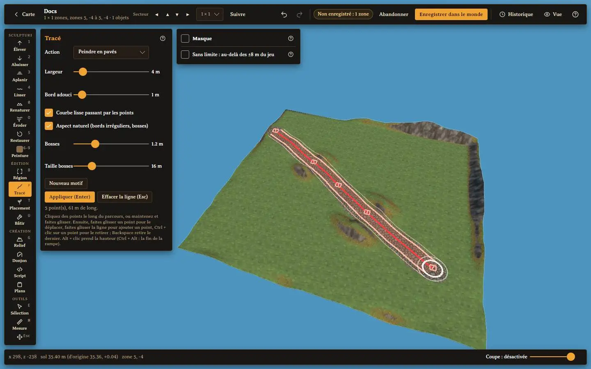

<!-- source: 20a95afa -->
# Faire une route ou une rampe qui monte une colline

Tracez une route plane avec une rampe régulière qui monte la colline, pavée en son milieu.

**Il vous faut :** un monde ouvert en 3D, avec le jeu fermé ou en [mode direct](edit-your-game-live.md).

1. Facultatif : vérifiez d'abord la pente. Appuyez sur `M` ([Mesure](../measure.md)), cliquez sur le pied de la
   colline, puis sur son sommet : **Pente** est ce que donnera une rampe entre les deux.
2. Appuyez sur `P` ([Tracé](../path.md)) et cliquez des points le long de la partie plane de la route.
3. Dans le panneau, choisissez **Aplanir**. `Alt`+clic sur le sol pour prendre sa hauteur, ou tapez-la dans
   **Hauteur**.
4. Réglez **Largeur** (8 m font une bonne route) et **Bord adouci** (4 m la fondent dans la pente).
5. Facultatif : cochez **Aspect naturel (bords irréguliers, bosses)** pour un chemin usé.
6. Appuyez sur **Appliquer (Enter)**, puis sur **Effacer la ligne (Esc)**.
7. Pour la colline, cliquez un point à son pied et un à son sommet, et choisissez **Rampe (début → fin)**. **Début** et
   **Fin** suivent le sol sous les deux extrémités ; tapez une hauteur pour en changer une.
8. Appuyez sur **Appliquer (Enter)**. La ligne reste.
9. Pour la paver, choisissez **Peindre en pavés**, réduisez **Largeur** et **Bord adouci** (4 m et 1 m), et appuyez à
   nouveau sur **Appliquer (Enter)** sur la même ligne.
10. Cliquez sur **Enregistrer dans le monde** (ou **Appliquer en direct**).

*Une route faite avec Aplanir à travers deux monticules, puis Peindre en pavés (Largeur 4 m, Bord adouci 1 m) sur la
même ligne.*

## Vérifier le résultat

- Mesurez le long de la route : **Pente** reste la même tout le long d'une rampe.
- Si des points sont devenus rouges, une partie de la route a atteint la limite de 8 m du jeu : voir
  [Élever ou creuser au-delà de la limite de 8 m du jeu](raise-past-the-limit.md).

## Annuler

Chaque **Appliquer** est une étape d'annulation : `Ctrl+Z` annule la dernière. **Effacer la ligne (Esc)** retire
seulement la ligne, pas ce que vous avez appliqué. Après l'enregistrement, annulez et enregistrez à nouveau (voir
[Annuler une étape, retirer une modification ou tout abandonner](undo-changes.md)).

Pour retirer une route plus tard, quand les étapes d'annulation n'existent plus, tracez une ligne le long de la route et
appliquez **Restaurer** avec une **Largeur** qui la couvre : le sol revient tel que le monde l'a généré, peinture
retirée.

## Voir aussi

- [Tracé](../path.md)
- [Mesure et superpositions](../measure.md)
- [Dégager arbres et rochers, aplanir un terrain à bâtir](clear-an-area.md)
